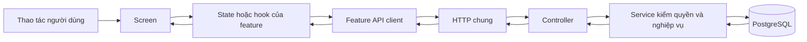

# Quy trình thực hiện và cấu trúc code

DOC-084 · v1.0 · 01/10/2026 · DELIVERY-01. [Mục lục](README.md).

## Điều học từ các dự án lớn

Nguồn được đọc ngày 01/10/2026; đây là những nguyên tắc áp dụng cho dự án này, không phải sao chép toàn bộ kiến trúc của họ.

| Nguồn trực tiếp | Điều quan sát được | Áp dụng |
|---|---|---|
| [Expensify — contribution](https://github.com/Expensify/App/blob/eae59e1d2a1d8175fc93cd9c8497bb78067e28f9/contributingGuides/CONTRIBUTING.md) | Có quy trình đề xuất, review và yêu cầu test/lint trước merge | Mỗi lát có scope, bằng chứng và báo cáo để review |
| [Expensify — từ điển](https://github.com/Expensify/App/blob/eae59e1d2a1d8175fc93cd9c8497bb78067e28f9/src/languages/en.ts) | Từ điển riêng; nhóm khóa, tham số và dạng số nhiều | Tách bản dịch khỏi state/service; không ghép câu trong logic |
| [Mattermost Mobile — app](https://github.com/mattermost/mattermost-mobile/tree/9183991a0ef3690424be57215de9d16b9b771121/app) | Có components, screens, client, routes, i18n, database, actions | Trách nhiệm UI, điều hướng, giao tiếp, ngôn ngữ tách rõ; dự án này nhóm nghiệp vụ vào feature |
| [GitLab — contributing](https://docs.gitlab.com/development/contributing/) | Yêu cầu mô tả thay đổi có bước tái hiện và kiểm thử tự động | Báo cáo phải nói cách kiểm, không chỉ ảnh màn hình |

Giữ Expo/NestJS/PostgreSQL và npm workspace hiện hành. Chưa chuyển microservice, thêm state framework hoặc dựng package dùng chung chỉ để giống một repo lớn.

## Bản đồ code và chiều phụ thuộc

```text
apps/mobile/src/
  app/                 Nối navigation, providers và feature
  components/ui/       Button, Card, Input, Feedback: không gọi API nghiệp vụ
  theme/               Màu, chữ, khoảng cách
  lib/http/            HTTP, timeout/cancel, lỗi có mã, correlation
  lib/logging/         Nhật ký đã lọc dữ liệu nhạy cảm
  lib/i18n/            Message keys, locale local, từ điển VI/EN/JA, formatter
  features/<mien>/
    screens/           Hiển thị; nhận thao tác; điều hướng
    state/             Phiên/trạng thái/quy tắc phía client khi cần
    api/               DTO → request → kiểm response
    models/            Kiểu dữ liệu riêng của miền
    components/        DỰ KIẾN: UI riêng khi feature cần
services/api/src/
  main.ts, bootstrap.ts, app.module.ts  Khởi động và nối module
  common/, config/, database/, logging/ Hạ tầng dùng chung
  modules/<mien>/
    *.controller.ts    HTTP, đọc input/auth context, gọi service
    *.input.ts         Kiểm dữ liệu đầu vào
    *.service.ts       Nghiệp vụ, quyền, transaction và trạng thái
    *.module.ts        Đăng ký dependency
    *.repository.ts    CHỈ THÊM khi truy vấn đủ phức tạp/có nhu cầu tái dùng
  integrations/        DỰ KIẾN: adapter OTP, push, map, storage, call
services/api/migrations/  SQL có phiên bản; không sửa migration đã chạy
services/api/test/        Unit + integration DB thật
apps/mobile/src/**/      Test hành vi đặt cạnh source dưới tên *.test.ts(x)
tests/e2e/{web,native}/   Hành trình xuyên app/API/DB
```



Với catalog đơn giản, state nằm ngay trong screen; không buộc tạo lớp state rỗng. `auth-session.ts` cần lớp riêng vì nhiều màn và vòng đời app dùng chung phiên. Chiều phụ thuộc dữ liệu là qua API, không import source backend vào app.

Quy tắc:

1. `app` nối feature. `components/ui`, `theme`, `lib` không import ngược feature; feature không gọi thẳng controller/backend.
2. Feature khác gọi API/module export có chủ đích; không đọc bảng hoặc state nội bộ của nhau tùy tiện. Service phía server quyết định quyền; ẩn nút phía app không thay quyền.
3. Tiền, trạng thái công việc và idempotency nằm phía server; client chỉ trình bày và gửi ý định.
4. Chỉ tạo `packages/contracts`, `api-client`, `domain`, `design-tokens` thành workspace chạy thật khi có consumer thực sự. Hiện chúng là giữ chỗ.
5. Expo CNG: sửa `app.json`/config plugin, không sửa generated `ios/` và `android/` như nguồn chính.
6. Khi làm feature mới, bỏ `.gitkeep` ở folder đã có code. Không tạo file lớn gom nhiều miền hoặc thư mục `utils` chứa nghiệp vụ không rõ chủ.
7. UI dùng message key; state giữ mã lỗi và tham số, không giữ câu đã dịch. Log dùng mã sự kiện ổn định, không dịch theo UI và không ghi password/token/PII.
8. Ghi rõ file “đã có” và “dự kiến” trong mỗi báo cáo. Không coi một folder hoặc prototype là chức năng hoàn thành.

## Chu trình cho từng lát công việc

| Bước | Kết quả phải có trước khi đi tiếp |
|---|---|
| 1. Chọn lát | Một mã checklist; liệt kê thao tác người dùng và phần không thuộc lát |
| 2. Đọc nguồn | FR/QA hoặc operationId, spec màn/luồng, quyền, trạng thái; quyết định nào pending phải được ghi rõ |
| 3. Đối chiếu hiện trạng | Git diff, file đang có, tests, DB/migration; không dùng thống kê cũ như kết quả mới |
| 4. Khóa interface | Input/output, mã lỗi, quyền, hành vi retry; chỉ hỏi phần thay đổi spec/chưa chốt |
| 5. Viết test có giá trị | Hành vi quan trọng, quyền, cạnh tranh, lỗi/recovery; dùng test hồi quy trước sửa bug |
| 6. Làm xuyên các lớp | Migration → service/controller → feature API/state → UI/i18n; lát phải chạy được |
| 7. Kiểm chứng | Unit, DB integration/contract, native Android/iOS và kiểm UI liên quan; build/typecheck/lint |
| 8. Review lần cuối | Theo luồng gọi thật; rà secret/log, state race, quyền, chữ dài, dữ liệu sau retry |
| 9. Báo cáo | File theo mẫu, sơ đồ, thứ tự đọc code, bằng chứng, giới hạn, câu hỏi học code |
| 10. Cập nhật và bàn giao | Tick đúng phần đạt; phân biệt local/CI/UAT; thêm báo cáo vào mục lục; chuyển lát sau khi đạt gate kỹ thuật |

Chủ dự án đã giao triển khai thì không hỏi lại từng bước kỹ thuật. Nếu cần quyết định provider/chi phí/spec, hoàn tất phần độc lập rồi hỏi gộp phần còn thiếu. Không tự vượt giới hạn production/tiền thật. Tạo plan không tự cấp quyền triển khai toàn bộ backlog.

## Điều kiện ghi hoàn thành

- Có đường chạy thực từ UI qua API/DB nếu chức năng cần backend; mock chỉ dùng để kiểm lớp riêng.
- Các tiêu chí của lát và kiểm thử quan trọng đạt; phần bị chặn không đổi thành “không áp dụng” để lấy trạng thái xanh.
- Báo cáo có commit hoặc ghi rõ working tree chưa commit, ngày chạy, môi trường, lệnh, kết quả và chỗ lưu artifact.
- Các màn mới có i18n, loading/rỗng/lỗi/offline/không quyền phù hợp, accessibility và không làm mất form khi chuyển ngôn ngữ.
- Toàn Bxx chỉ đóng khi mọi lát bắt buộc của Bxx đạt; UAT được chủ dự án nghiệm thu riêng. Không lấy số lượng test hoặc tỷ lệ coverage làm phần trăm app đã xong.

## Lệnh kiểm chứng hiện có

```sh
npm run lint
npm run typecheck
npm run test:tooling
npm run test:coverage -w apps/mobile
docker compose -f infra/compose.yaml --profile test up -d --wait db-test
npm run test:coverage -w services/api
npm run test:e2e
npm run build
DEVICE_ID=emulator-5554 npm run test:native -- android auth
DEVICE_ID=<UUID-simulator-dang-boot> npm run test:native -- ios auth
# Thay auth bằng catalog, i18n hoặc i18n-layout.
# i18n-layout tăng cỡ chữ trong lượt test và khôi phục khi kết thúc.
```

Chạy tập kiểm phù hợp thay đổi; không chạy lại toàn bộ khi không có thay đổi/failure mới. Không dùng Mobile MCP điều khiển Android cùng lúc Maestro đang dùng UiAutomation. Artifact local ở `test-results/`, `coverage/` không track Git; báo cáo lưu đường dẫn, thời điểm và kết quả, CI có link artifact theo retention hiện hành.
