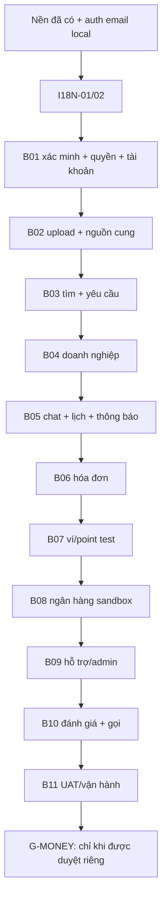

# Thứ tự triển khai từng chức năng

DOC-085 · v1.0 · 01/10/2026 · DELIVERY-01. [Checklist](01-checklist.md) · [Quy trình](02-quy-trinh-va-cau-truc.md).

Các đường dẫn ghi “dự kiến” chưa có code. Dùng spec/API/QA liên kết trong checklist cho từng nhóm; không dựng lại thiết kế từ đầu hoặc chuyển toàn bộ prototype sang app trong một lần. Mỗi lát có luồng chạy thật và báo cáo riêng trước khi chuyển lát tiếp theo.

## Điều chỉnh cách giao đợt — 06/10/2026

Chủ dự án yêu cầu gom chức năng thay vì bàn giao từng thao tác nhỏ. Đợt vừa push: **B01-04 phiên đăng nhập + sổ địa chỉ**, commit `4a98dc0`, CI đạt. Đợt bổ sung: **thu hồi các phiên khác + trở lại màn tài khoản sau login**, theo [báo cáo](bao-cao/B01-07-tiep-tuc-tai-khoan-va-thu-hoi-phien.md). Gói trước nối DB/API/app, VI/EN/JA và kiểm thử chung. Đã duyệt bổ sung thời gian/phiên hiện tại, thu hồi cả lần đăng nhập, địa chỉ mặc định và version. Nhập tọa độ thủ công; chưa tích hợp bản đồ/GPS trả phí.

Các đợt sau gom theo kết quả sử dụng: B02 hồ sơ + kỹ năng + vùng + trạng thái nhận việc (upload/xác minh chỉ khi đủ quyết định); B03 tìm/lọc + yêu cầu + xử lý yêu cầu (cần nguồn cung và xác minh); B05 hội thoại + lịch sử + đọc/nhận tin. Các phần phụ thuộc OTP/provider vẫn Pending, không giả quyền để đi nhanh. Mỗi đợt có báo cáo chung và checklist từng chức năng, không cần hỏi duyệt lại từng file hoặc từng nút.

## Thứ tự và các phụ thuộc cần tránh hiểu nhầm

Đây là thứ tự làm việc mặc định, tuần tự để dễ review, không phải mọi nhóm đều độc lập hoặc xong là đóng vĩnh viễn:

- B01 có thể bàn giao quyền/xác minh đủ cho B02, nhưng khôi phục/xóa thủ công cần admin và kiểm nghĩa vụ các miền về sau. Giữ B01-06 chưa xong đến khi nối đầy đủ.
- B02 cần màn admin tối thiểu để xét xác minh/CRUD danh mục; tạo phần admin này cùng B02, không chờ B11 mới có quyền thật. B11 hoàn thiện vận hành toàn hệ thống.
- B03 cần chat trước thuê theo spec; phần tìm/yêu cầu chạy được trước, nhưng B03-04 chỉ đóng sau tích hợp B05. Không thêm nút chat giả để đánh dấu xong.
- B06 có thể lưu/gửi/xác nhận hóa đơn trước; hoàn tất thanh toán cần B07. B10 đánh giá cần đủ hai dấu thanh toán, không chỉ hóa đơn được duyệt.
- I18N-03/04 theo sát phần nền UI nhưng cần chốt thay đổi contract/nguồn bản dịch. Chưa được ghi app “đa ngôn ngữ đầy đủ” khi mới dịch nhãn.

## 1. I18N-01 và I18N-02 — làm trước màn mới

**Đầu vào:** UX VI/EN/JA, design system, code auth/catalog hiện hành; chưa chọn thư viện mới trong kế hoạch này.

1. Lập danh sách chuỗi UI hiện có trong screens, components và state; tách dữ liệu danh mục từ DB, log kỹ thuật, tên thương hiệu khỏi nhãn UI. Chốt khóa theo nhóm `common`, `auth`, `catalog`, `errors`.
2. Chọn giải pháp phù hợp phiên bản Expo đang khóa; xác định typed keys, biến số/số nhiều, fallback VI và formatter. Không đưa bản dịch trực tiếp vào controller/state.
3. Tạo dự kiến `apps/mobile/src/lib/i18n/{index,locale-storage,formatters}.ts`, `messages/{vi,en,ja}.ts`, `app/providers/LocaleProvider.tsx`. Phần cài đặt thuộc `features/accounts` khi có consumer thật. Không đưa locale UI mới vào `Me` trước khi contract thay đổi được chốt.
4. `AuthSession` chuyển `error: string` đã dịch thành mã lỗi/params; AccountScreen dịch khi render. Catalog route giữ ID; tiêu đề được tính theo locale hiện tại, không giữ cố định `name_vi` trong route rồi đổi tiếng không cập nhật.
5. Dịch các màn và accessibility labels đã có; lưu locale local. Giữ VND và múi giờ nghiệp vụ Việt Nam, không tự dịch chat/tên/nội dung người dùng.
6. Test: thiếu khóa fallback; sai params bị phát hiện; đổi VI→JA→EN giữ form/session/route; lỗi đang hiển thị đổi tiếng ngay; cold start giữ locale; native chữ dài và cỡ chữ lớn. Test selector ưu tiên testID ổn định; vẫn có assertions riêng về bản dịch thực tế.

**Đạt:** các màn đã triển khai dùng message keys và lựa chọn locale hoạt động; nguồn dữ liệu chưa dịch được ghi rõ. Báo cáo `I18N-01-nen-da-ngon-ngu.md` giải thích state → key → dictionary → UI và lưu locale.

**I18N-04** được chủ dự án duyệt 05/10/2026, gồm mở rộng dữ liệu thật; xem [báo cáo](bao-cao/I18N-04-danh-muc-da-ngon-ngu.md). API đọc danh mục đã có locale/name/name_locale và DB có bản dịch cả categories/skills. Tìm kiếm đa ngôn ngữ còn ở B03.

**I18N-03:** trước code, chốt ưu tiên locale thiết bị/lựa chọn local/tài khoản. Đối chiếu `Me`/`ProfileEdit` enum đang chỉ `vi`. Phần này tác động spec/API/data nên đồng bộ đúng phạm vi sau quyết định; không tự nới enum rồi coi backend hoàn tất.

## 2. B01 — hoàn thiện tài khoản theo các lát

**Đầu vào:** lát B01-01 đã đạt; `account-batch.md`, quyền/trạng thái, API nhóm Tài khoản. Provider OTP/email và cấu hình xác minh chưa chọn.

**Trạng thái ngày 01/10/2026:** chủ dự án yêu cầu để B01-02 **Pending** vì cần cân nhắc chi phí, gồm cả triển khai local. Các bước dưới đây giữ làm kế hoạch khi mở lại, không phải lệnh bắt đầu. Chỉ mở lại OTP khi chủ dự án yêu cầu; không bỏ qua xác minh hoặc giả lập verified cho các lát phụ thuộc.

1. B01-02: xác định chính sách OTP/challenge, kênh gửi, expiry/resend/rate-limit, giới hạn chi phí; implement server challenge + adapter + màn verify. Kiểm replay, sai/hết hạn, cạnh tranh và audit không lộ mã. Dùng fake adapter trong unit test được, nhưng gửi thật chưa kiểm thì ghi rõ.
2. B01-03/04: làm reset/change password → thay/liên kết định danh → hồ sơ/phiên → địa chỉ. Theo operationId `resetPassword`, `changeIdentity`, `confirmIdentityChange`, `editMe`, `listSessions`, `revokeSession`, các thao tác addresses. Không phát minh endpoint nếu contract chưa đủ.
3. B01-05: guard dùng xác thực server, quyền/resource ownership, fresh auth/MFA theo phương thức được chọn; thêm permission matrix test nhiều tài khoản. Không coi `partner_ids: []`/`admin_permissions: []` trong lát local là hệ thống phân quyền hoàn chỉnh.
4. B01-07: giữ hành động đang chờ khi vào login; recheck quyền/đối tượng khi quay lại. Không tự gửi lại yêu cầu thuê/tiền chỉ vì login thành công.
5. B01-06: tạo yêu cầu khôi phục/xóa và kiểm nghĩa vụ theo spec; hoàn thiện quyết định admin ở B09/B11, test lại khi có jobs/ledger.

**Vị trí:** `features/auth`, `features/accounts` (dự kiến), `modules/auth`, `modules/accounts`, `common/guards`, `integrations` và migration mới. **Đạt để đi B02:** đường xác minh cần thiết + quyền/ownership được kiểm; phần khôi phục/xóa toàn hệ thống vẫn mở nếu chưa đủ. Mỗi lát có báo cáo riêng, không cộng toàn B01 thành “xong”.

## 3. B02 — upload, hồ sơ và quản trị nguồn cung

1. B02-02 làm `createUpload` → upload bytes → `completeUpload` → `getAsset`; kiểm quyền, loại/dung lượng file, ready và public/private. Provider storage cần chọn trước tích hợp; không dùng tên file giả như upload thành công.
2. B02-03 dựng hồ sơ thợ/cửa hàng/doanh nghiệp theo form đã thiết kế; nối kỹ năng đa ngành bằng ID, vùng/địa chỉ, ảnh, nháp/công bố. Truy vấn public không trả giấy tờ hoặc dữ liệu ví.
3. B02-04 bật/tắt nhận việc và đình chỉ; kiểm service tại thời điểm mutation, không chỉ disable UI.
4. B02-05 thêm admin tối thiểu cho xét xác minh và taxonomy CRUD, audit và kiểm quyền. Việc khởi tạo `apps/admin` phải có workspace/build/test thật; là phần phụ thuộc của chức năng nguồn cung.

**Vị trí dự kiến:** mobile `features/partners`, API `modules/partners`, hạ tầng asset có module riêng khi triển khai, `integrations` storage; admin feature tương ứng. **API:** `createPartner`, `getPartner`, `editPartner`, `setSkills`, `setAreas`, `setLocations`, `setAvailability`, `submitVerification` và admin taxonomy/verification.

**Đạt:** hồ sơ mới lưu DB và xuất hiện trong truy vấn đúng điều kiện; file và thao tác admin có quyền; sửa/tắt/đình chỉ từ tab cũ được recheck. Báo cáo phải có luồng file riêng và luồng publish profile.

## 4. B03 — tìm và yêu cầu dịch vụ

1. `features/search` / `modules/search`: truy vấn địa lý DB, vị trí tay/GPS, danh sách trước rồi map adapter; thử từ chối quyền GPS, vùng trống, thay bộ lọc và request trả về sai thứ tự.
2. `features/jobs` / `modules/jobs`: tạo/list/detail yêu cầu làm ngay/hẹn trước; kiểm xác minh điện thoại, self-hire, membership, partner active, kỹ năng và vùng hiện hành.
3. Nhận/từ chối/rút/đổi lịch/dừng: transaction, version/idempotency, hai tài khoản cùng thao tác; làm ngay cần ETA và không thêm bước bắt đầu.
4. Nối chat trước thuê khi B05-01 có thật; cho phép giai đoạn tìm/yêu cầu được review riêng, giữ tiêu chí liên hệ còn mở.

**API:** `searchPartners`, `createJob`, `listJobs`, `getJob`, `acceptJob`, `declineJob`, `withdrawJob`, `rescheduleJob`, `stopJob`. **Đạt:** retry không tạo việc trùng, lọc trước xếp hạng, không tự hết hạn/đóng việc theo thời gian. Báo cáo theo requestId từ bấm “Gửi” tới transaction.

## 5. B04 — doanh nghiệp

1. Membership, lời mời 7 ngày, nhận/gửi lại/rời/cấp quyền; lấy account scope từ phiên server.
2. Phân công/đổi người/đầu mối gọi; transaction bảo đảm một assignment hiệu lực và giữ lịch sử.
3. Test quản lý kiêm nhiều quyền; tài khoản doanh nghiệp khác không truy cập; người cũ mất quyền việc nhưng vẫn giữ phòng chat riêng.

**Vị trí dự kiến:** `features/organizations`, `modules/organizations`, jobs và guard qua interface rõ ràng. **API:** nhóm Doanh nghiệp, `assignJob`, `leavePartner`. **Đạt:** quyền theo năng lực thao tác, không theo nút đổi vai. Chuyển chủ/đóng DN vẫn pending.

## 6. B05 — chat, lịch và thông báo

1. Làm chat theo cặp tài khoản, lịch sử có cursor, gửi/đọc, client operation ID, ACK sau DB commit và reconnect. Xem `realtime.json`; không invent event khác rồi bỏ contract.
2. Outbox → worker khi có nhu cầu thực → inbox/push; device registration, settings, mở đúng phòng/việc và kiểm quyền khi bấm thông báo.
3. Lịch và nhắc 24h/1h; thay lịch vô hiệu nhắc cũ; test race, app nền, network loss và nhiều thiết bị.
4. Quay lại đóng tiêu chí chat của B03/B04; kiểm thông báo tới nhân viên đang phụ trách, không chỉ quản lý.

**Vị trí dự kiến:** `features/chat`, `notifications`, API các module tương ứng và integrations push/realtime. **API:** `openConversation`, `listConversations`, `listMessages`, `sendMessage`, `readConversation`, `registerDevice`, `listNotifications`, `readNotification`, `getSettings`, `setSettings`.

**Đạt:** reconnect không mất/nhân đôi tin, không rò phòng riêng; tắt push không xóa inbox. Báo cáo cần sơ đồ event/ACK/outbox, không chỉ HTTP.

## 7. B06 — hóa đơn

1. Nối ảnh kết quả đã ready, draft công/vật tư, tính preview theo công thức chuẩn; người thực hiện gửi trực tiếp.
2. `saveInvoiceDraft`/`sendInvoice`/`requestInvoiceRevision`/`confirmInvoice`: version, immutable revision và kiểm cạnh tranh sửa/xác nhận.
3. Kiểm hóa đơn 0, dừng việc, khóa tiền; phần thanh toán và hai dấu hoàn tất nối ở B07.

**Vị trí dự kiến:** `features/invoices`, `modules/invoices`, interface jobs/assets. **Đạt:** xác nhận hóa đơn không tự hoàn tất việc; phiên bản khóa không đổi số tiền. Báo cáo giải thích transaction, version và đường lỗi conflict.

## 8. B07 — ví/point chỉ chạy test

1. Implement ledger/holds/projection/formula version từ data/API hiện hành; dùng bộ mẫu tài chính chuẩn, không suy tỷ lệ từ prototype.
2. Nối `reportPayment`/`settleInvoice`, giữ phí/point, thợ nhận tiền và khách báo đã trả; bảo đảm một settlement và bút toán cân bằng.
3. Màn ví/point/ledger; test nhiều việc đồng thời, retry, crash giữa các bước và rebuild projection; kiểm quyền từng tài khoản/partner.

**Vị trí dự kiến:** `modules/wallet`, `points`, `invoices`; chỉ tách pure domain code khi thực sự được tái dùng. **Đạt:** số nguyên và invariant ledger đúng, thưởng chờ chưa tiêu, âm ví không dùng rút, cash trực tiếp không thành tiền platform. Báo cáo phải lần theo một ví dụ số và transaction thực.

## 9. B08 — ngân hàng và sandbox

1. Bank verified và topup/payout request; admin duyệt thủ công và audit theo quyền.
2. Idempotency, đối soát reference, trạng thái unknown và giữ tiền; adapter sandbox được chọn rõ.
3. Test duplicate callback, timeout sau provider commit, retry và rút credit bị chặn.

**API:** `getBank`, `setBank`, `createTopup`, `createPayout`, `getPayout`, nhóm admin topup/payout/bank, `getOperation` khi áp dụng. **Đạt:** không gửi lại mù/ghi có hai lần; chỉ sandbox, chưa tiền thật. Báo cáo phân biệt sandbox thật với adapter giả lập.

## 10. B09 — hỗ trợ và admin

1. Report/evidence/update/queue, URL có quyền và lịch sử xử lý; không phát sinh tiền khi đóng báo cáo.
2. Preview completion → fresh auth → lý do → recheck → settlement service chung. Không giả dấu thợ nhận tiền, không tự mở đánh giá.
3. Hoàn thiện user/partner/recovery/deletion/admin grants và tích hợp phần còn thiếu của B01/B02. Ngoại lệ khoản giữ treo Q02 chỉ triển khai sau quyết định cụ thể, không tự diễn giải.

**Vị trí dự kiến:** `features/support`, `modules/support`, `moderation`, `apps/admin` các miền; không gom tất cả admin vào một service khổng lồ. **Đạt:** permission matrix và audit đầy đủ cho thao tác nhạy cảm, nguồn chứng cứ không rò. Báo cáo có cả nhánh bị từ chối quyền.

## 11. B10 — đánh giá và cuộc gọi

1. Đánh giá hai chiều, điều kiện hai dấu Q01, mỗi chiều một bản, sửa/ẩn/phản hồi và sao trung bình đúng với kiểm duyệt.
2. Chọn call provider/chi phí, implement adapter và quyền người nhận hiện hành; gọi trước/sau hoàn tất theo spec. Không biến việc mở dialer thành bằng chứng cuộc gọi trong app.
3. E2E cả hai tài khoản, đổi nhân viên, trạng thái review ẩn/gỡ và cuộc gọi thất bại.

**Vị trí dự kiến:** tạo `reviews`/`calls` feature/module khi triển khai; không cần tạo folder trống trong đợt kế hoạch. **API:** nhóm Đánh giá, `startCall`, `actOnCall`. **Đạt:** admin hoàn tất thay không tự mở review; provider thật chỉ được báo đạt khi đã kiểm.

## 12. B11 và G-MONEY — nghiệm thu, vận hành, cổng riêng

1. Đối chiếu toàn bộ FR → operationId/event → QA → code/test; hoàn thiện admin invoices/audit/metrics và chức năng chưa có trong RTM. Không dùng số endpoint làm tỷ lệ hoàn thành sản phẩm.
2. Chạy UAT khách/partner/DN/admin, locale VI/EN/JA, accessibility, offline, cỡ chữ, deep link, push, thiết bị mục tiêu; ghi rõ simulator/thiết bị thật. Chủ dự án nghiệm thu bằng hành trình và giải thích code.
3. Runbook local/test/staging/production, secrets, migrations, backup/restore/rollback/monitoring; diễn tập ở môi trường được cho phép, không tự deploy từ kế hoạch.
4. G-MONEY chỉ mở khi Q02/PLAN-005, provider/ngân sách/PLAN-007 và kiểm ngoại lệ được chốt, có phê duyệt tiền thật riêng.

**Đạt:** mỗi yêu cầu bắt buộc có bằng chứng hoặc quyết định ngoài phạm vi rõ ràng, UAT có người duyệt; production chưa được phép vẫn ghi chưa được phép.
