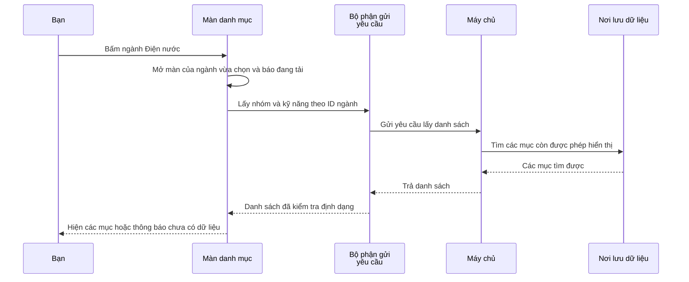

# B00-01 — Khi bạn bấm một ngành, app lấy danh sách ở đâu?

DOC-087 · 01/10/2026 · Báo cáo phần nền tảng đã làm ở phiên bản `41579b5`, kiểm lại cùng phần đăng nhập ở `50d184a`. [Checklist](../01-checklist.md).

Bản này được viết lại để người mới có thể lần theo code. Các kết quả kiểm thử cuối bài giữ nguyên ngày và phiên bản đã kiểm, không phải kết quả chạy mới.

## Bạn đã dùng được những gì?

Bạn có thể mở danh sách ngành, bấm vào một ngành để xem nhóm và kỹ năng bên trong. Danh sách được lấy từ nơi lưu dữ liệu của dự án, không phải những dòng chữ viết sẵn trên màn hình. Khi đang chờ, app hiện thông báo tải. Nếu chưa có dữ liệu, app báo danh sách trống. Nếu tải lỗi, bạn có thể bấm Thử lại.

Đây vẫn là giao diện nền tảng để kiểm tra chức năng. Khung giao diện chính thức theo thiết kế, hồ sơ người cung cấp dịch vụ và việc thuê dịch vụ chưa hoàn thành.

## Ba khái niệm cần biết trước khi đọc

| Từ trong code | Hiểu trong tình huống này |
|---|---|
| App hoặc UI | Phần bạn nhìn và bấm trên điện thoại |
| API | Cách app gửi yêu cầu tới chương trình xử lý phía máy chủ, ví dụ “cho tôi các nhóm của ngành này”. Khi thử trên máy bạn, máy chủ này cũng chạy trên máy bạn |
| Database, viết tắt DB | Nơi lưu danh mục lâu dài. Dự án dùng PostgreSQL để quản lý dữ liệu đó |

Mỗi ngành có một **ID**, tức mã nhận diện riêng. App gửi ID để tìm đúng ngành, vì tên ngành có thể đổi hoặc được dịch sang ngôn ngữ khác.

## Một lần bấm diễn ra như thế nào?

Ví dụ bạn bấm ngành **Điện nước**. App mở màn xem ngành đó, gửi ID lên máy chủ, nhận các nhóm/kỹ năng rồi vẽ chúng lên màn hình.

Nếu bước gửi hoặc nhận thất bại, màn hình hiện lỗi và nút Thử lại. Sơ đồ trên mô tả trường hợp lấy dữ liệu thành công.

## Mở code theo thứ tự này

Không cần đọc hết dự án. Bắt đầu từ nơi nhận thao tác bấm, rồi đi theo lời gọi sang file tiếp theo. **Hàm** là một đoạn code có tên để thực hiện một việc, chẳng hạn `requestJson` gửi yêu cầu và nhận kết quả.

| Bước | Mở file, tìm đoạn nào? | Đoạn đó nhận gì, làm gì và chuyển tiếp gì? |
|---|---|---|
| 1 | [CatalogScreen.tsx](../../../apps/mobile/src/features/catalog/screens/CatalogScreen.tsx), tìm `onPress` và `navigation.navigate` | Nhận thao tác bấm thẻ ngành. Mở màn mới và mang theo ID cùng tên ngành |
| 2 | Cùng file, tìm `selectedId` và `useFocusEffect` | Lấy ID của màn đang xem. Khi màn được mở hoặc quay lại, chuyển sang trạng thái đang tải rồi gọi lấy danh mục và kỹ năng. Màn đầu tiên chưa chọn ngành chỉ lấy danh mục |
| 3 | [catalog-api.ts](../../../apps/mobile/src/features/catalog/api/catalog-api.ts), tìm `categories`, `skills`, `all` | Chuẩn bị yêu cầu đúng cho danh mục hoặc kỹ năng. Nếu máy chủ chia danh sách thành nhiều trang, lấy tiếp cho đủ |
| 4 | [request.ts](../../../apps/mobile/src/lib/http/request.ts), tìm `requestJson` | Gửi yêu cầu qua mạng, chờ câu trả lời và báo lỗi nếu chờ quá lâu. File này dùng chung cho nhiều chức năng |
| 5 | [catalog.controller.ts](../../../services/api/src/modules/catalog/catalog.controller.ts) và [catalog.query.ts](../../../services/api/src/modules/catalog/catalog.query.ts) | Phía máy chủ tiếp nhận yêu cầu, kiểm tra ID và thông tin lấy trang trước khi chuyển sang phần tìm dữ liệu |
| 6 | [catalog.service.ts](../../../services/api/src/modules/catalog/catalog.service.ts), tìm `list` | Đọc nơi lưu dữ liệu. Chỉ trả các mục đang được phép hiển thị, kể cả kiểm tra ngành/nhóm cha của chúng |
| 7 | Quay về [CatalogScreen.tsx](../../../apps/mobile/src/features/catalog/screens/CatalogScreen.tsx), tìm `setState` và `state.kind` | Nhận kết quả, ghi lại trạng thái hiện tại rồi chọn hiển thị danh sách, danh sách trống hoặc lỗi |

`state` nghĩa là **thông tin màn hình đang ghi nhớ**. Ở đây `loading` là đang tải, `ready` là đã có kết quả, `error` là tải thất bại. Khi `setState` thay đổi thông tin đó, React cập nhật phần giao diện tương ứng.

## Các file đang mở trong IDE của bạn có vai trò gì?

[App.tsx](../../../apps/mobile/src/app/App.tsx) là nơi lắp các phần chính của app. Nó tạo bộ phận gọi API, bộ phận quản lý đăng nhập, rồi nối chúng với các màn hình. Nó không tự tìm danh mục trong DB.

[AppProviders.tsx](../../../apps/mobile/src/app/providers/AppProviders.tsx) giúp các màn hình bên trong dùng chung bộ phận gọi danh mục và lựa chọn ngôn ngữ. **Provider** có thể hiểu là nơi cung cấp thứ dùng chung: màn danh mục gọi `useCatalogApi()` để lấy bộ phận đã chuẩn bị, thay vì tự tạo lại. File này còn giúp bố cục tránh vùng camera/thanh hệ thống trên điện thoại.

[AppNavigator.tsx](../../../apps/mobile/src/app/navigation/AppNavigator.tsx) quản lý việc mở màn nào và quay lại màn trước. [Card.tsx](../../../apps/mobile/src/components/ui/Card.tsx) vẽ thẻ để bấm. Thẻ chỉ báo “đã bấm”; màn danh mục quyết định bấm đó sẽ mở ngành nào. Vì vậy cùng một kiểu thẻ có thể dùng ở nhiều nơi.

[001_catalog.sql](../../../services/api/migrations/001_catalog.sql) mô tả cách tạo các bảng lưu ngành/nhóm, kỹ năng và mối liên hệ giữa chúng. Một **bảng dữ liệu** gần giống bảng tính có hàng và cột, nhưng có thêm quy tắc kiểm tra dữ liệu.

## Khi có lỗi hoặc bạn bấm nhanh thì sao?

Bấm **Thử lại** làm màn hình tải lại yêu cầu. Nếu bạn rời màn khi đang tải, app hủy việc chờ và bỏ qua kết quả cũ. Nếu không làm vậy, câu trả lời của màn đã rời có thể cập nhật sai thời điểm. Trong code, tìm `AbortController` để xem cách hủy này.

Tên ngành hiện vẫn lấy từ `name_vi`, nghĩa là tên tiếng Việt trong dữ liệu. Phần đổi ngôn ngữ đã dịch nút và thông báo, nhưng chưa dịch tên ngành/kỹ năng. Code hiện tại mang tên ngành qua màn bằng `nameVi`; phiên bản trước dùng tên biến `title`.

## Bạn có thể tự thử và tự kiểm hiểu

Mở app theo [hướng dẫn chạy](../../huong-dan-mobile/04-chay-app.md), bấm một ngành rồi quay lại. Đối chiếu thao tác đó với `onPress` và `navigation.navigate`. Sau đó tìm ba nhánh `state.kind` để hiểu vì sao cùng một màn có lúc hiện chữ “đang tải”, có lúc hiện danh sách.

- Muốn đổi hình thức của thẻ, nên bắt đầu ở đâu? **Card.tsx**.
- Muốn biết bấm thẻ sẽ mở màn nào, xem ở đâu? **CatalogScreen.tsx**.
- Muốn hiểu vì sao một ngành bị ẩn, xem ở đâu? **catalog.service.ts**, vì máy chủ quyết định danh mục nào được trả về.

## Kết quả kiểm tra và phần tra cứu kỹ thuật

Các lượt kiểm được ghi nhận bên dưới đã thử việc lấy dữ liệu, quay lại màn, lỗi/thử lại và danh sách trống. Android/iOS được kiểm trên máy ảo, chưa thay cho thử trên điện thoại thật hay việc bạn nghiệm thu toàn app.

**Cách đọc:** `PASS` là đạt bài kiểm tra; `CI` là hệ thống tự chạy kiểm tra trên GitHub; `log` là nhật ký hoạt động; `requestId` là mã giúp tìm các dòng nhật ký của cùng một yêu cầu. Các tên file/lệnh còn lại dành cho lúc cần kiểm chứng sâu hơn.

Mở thông tin kỹ thuật và bằng chứng đã ghi nhận

`categories` là cây dùng ID, `skills` nối nhiều category qua bảng liên kết. `translations` của category hiện để mở rộng; tại mốc báo cáo UI/API dùng `name_vi` và chưa có nền i18n. Bản mới đã dịch nhãn UI theo báo cáo I18N; bản dịch dữ liệu vẫn chưa có. Không dùng tên dịch làm khóa dữ liệu. Hiện SQL ở service vì phạm vi còn nhỏ; chưa cần repository wrapper rỗng.

Source thay đổi chính ở theme, components/ui, navigation/providers, catalog và test runner. Native CNG sinh binary từ cấu hình; native generated không phải code cần review trong Git. Log phương án A đã có sanitizer và requestId; xem [runbook](../../implementation/logging-testing.md) để vận hành, không dùng trạng thái native cũ trong runbook làm tiến độ hiện hành.

## Bằng chứng và cách thử

- [CI 41579b5](https://github.com/anhthaingd/dich-vu-quanh-ban/actions/runs/36729018889): 3 jobs đạt. [CI 50d184a](https://github.com/anhthaingd/dich-vu-quanh-ban/actions/runs/36810424485): 3 jobs đạt sau thêm auth.
- Kiểm hồi quy local native: Android `2026-09-30T15:08:01.800Z`, iOS `2026-09-30T15:13:22.612Z`; đều PASS trong `test-results/native/{android,ios}/result.json`. Môi trường DVQB_API_36 và iPhone 18 Pro/iOS 27; không là test thiết bị thật.
- Flow [catalog.yaml](../../../tests/e2e/native/catalog.yaml): back/resume, lỗi→retry, rỗng→khôi phục; API và schema PostgreSQL test riêng, đã dọn schema.
- [catalog.test.ts](../../../services/api/test/integration/catalog.test.ts) kiểm HTTP/DB; [CatalogScreen.test.tsx](../../../apps/mobile/src/features/catalog/screens/CatalogScreen.test.tsx) kiểm hành vi screen; [catalog.spec.mjs](../../../tests/e2e/web/catalog.spec.mjs) kiểm web với API/DB thật.
- Tái hiện: chạy API/Metro theo [hướng dẫn](../../huong-dan-mobile/04-chay-app.md), bấm một ngành rồi Back; test tự động dùng `DEVICE_ID=... npm run test:native -- android catalog` hoặc `ios catalog`. Flow lỗi/rỗng chỉ điều khiển schema test, không sửa DB làm việc.

Bản báo cáo này đọc lại code và artifact đã có ngày 01/10, không tuyên bố đã chạy lại bộ test trong đợt viết tài liệu.

Tiến độ tiếp theo xem [checklist](../01-checklist.md). B00-05 — khung giao diện chính thức — chưa hoàn thành.
