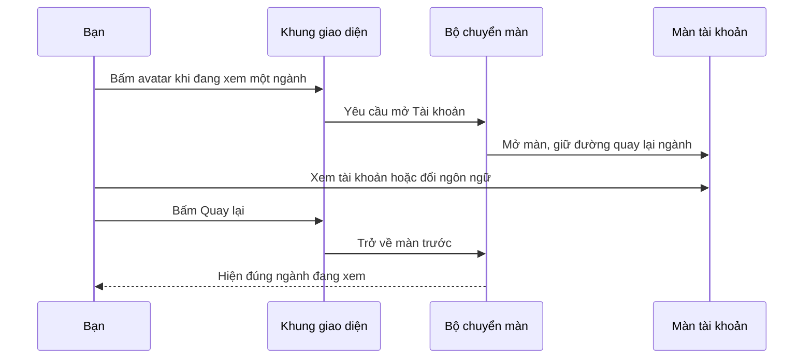

# B00-05 — Khung giao diện: avatar, danh mục và màn tài khoản

04/10/2026 · Codex · Thay đổi tiếp sau phiên bản `844e1d2`. [Checklist](../01-checklist.md) · [Báo cáo nền danh mục](B00-01-nen-tang-danh-muc.md).

**Đã bàn giao kỹ thuật local cho khung khách của các chức năng hiện có; chủ dự án xác nhận bản hiện tại và yêu cầu push ngày 05/10/2026.** Xác nhận này chỉ áp dụng phần đang có; chưa nghiệm thu toàn app. Mốc push/CI mới xem checklist. B00-05 vẫn một phần vì khung các vai trò và điểm vào nghiệp vụ khác sẽ nối khi có chức năng thật.

## Bạn sẽ thấy gì khác?

Đầu màn danh mục có tên ứng dụng và avatar tròn. Khi chưa đăng nhập, avatar hiện dấu hỏi. Khi đã đăng nhập, nó hiện chữ đầu tên người đang dùng. Bấm avatar mở Tài khoản; đăng xuất rồi quay lại thì avatar trở về dấu hỏi.

Danh mục được xếp thành hai cột trên màn đủ rộng. Khi màn hẹp hoặc bạn tăng cỡ chữ trên điện thoại, thẻ chuyển về một cột để chữ dễ đọc. Danh mục vẫn lấy từ dữ liệu thật và vẫn có thông báo đang tải, danh sách trống, lỗi và nút Thử lại.

Màn Tài khoản tách lựa chọn ngôn ngữ và phần đăng nhập thành các khối rõ ràng. Header — vùng đầu màn có nút Quay lại/avatar — nằm ngoài phần cuộn, nên bạn vẫn tìm được đường quay lại khi đã kéo xuống dưới.

Thanh dưới hiện chỉ có **Tìm dịch vụ**, đưa bạn về danh mục đầu tiên. Công việc, Tin nhắn và Thông báo chưa có chức năng thật nên chưa thêm vào thanh này. Tài khoản nằm ở avatar, không trở thành một tab bên dưới. Đây là khung khách cho những chức năng đang có, chưa phải toàn bộ giao diện/nghiệp vụ sản phẩm hay khung partner/doanh nghiệp.

## Một thao tác bạn có thể thử

Từ danh mục đầu tiên, bấm Điện nước → bấm avatar → mở Tài khoản → bấm Quay lại. Bạn trở về đúng ngành Điện nước đang xem. Nếu bấm Tìm dịch vụ ở thanh dưới, bạn quay về danh sách ngành đầu tiên.

Không thêm đường dẫn API mới chỉ để mở màn Tài khoản. API là nơi app gửi yêu cầu tới máy chủ. Các yêu cầu lấy danh mục, kiểm phiên, đăng nhập và đăng xuất vẫn do phần chức năng tương ứng thực hiện như trước.

## Mở code theo thứ tự nào?

| Bước | File và đoạn cần tìm | Nhận gì, làm gì, chuyển cho đâu? |
|---|---|---|
| 1 | [CatalogScreen.tsx](../../../apps/mobile/src/features/catalog/screens/CatalogScreen.tsx), `CatalogScreen()` và `ProductShell` | Màn danh mục đưa nội dung của mình vào khung chung, kèm cách mở Tài khoản và quay về danh mục đầu |
| 2 | [ProductShell.tsx](../../../apps/mobile/src/app/layout/ProductShell.tsx), `ProductShell()` và `onAccount` | Vẽ avatar; khi bạn bấm, gọi hành động do màn danh mục đưa vào |
| 3 | [AppNavigator.tsx](../../../apps/mobile/src/app/navigation/AppNavigator.tsx), `AppNavigator()` | Quản lý các màn và đường quay lại. Điểm vào Tài khoản sử dụng màn thật đã có |
| 4 | [AccountScreen.tsx](../../../apps/mobile/src/features/auth/screens/AccountScreen.tsx), `AccountScreen()` | Nhận thao tác đăng nhập/đăng xuất hoặc đổi ngôn ngữ. Màn này cũng dùng khung chung, với nút Quay lại |
| 5 | [Screen.tsx](../../../apps/mobile/src/components/ui/Screen.tsx), `Screen()` | Chia vùng đầu màn, phần nội dung cuộn và thanh dưới; chừa vùng an toàn để tránh camera/thanh hệ thống |

**Khung chung** trong code tên là `ProductShell`. Nó không tự đăng nhập hoặc tìm danh mục. Nó nhận các hành động như `onAccount` và `onBack` từ màn đang sử dụng nó. Cách này giúp nhiều màn có cùng hình thức mà mỗi màn vẫn quyết định đúng việc cần làm.

`useAuth()` trong khung đọc thông tin đăng nhập đang có để lấy chữ đầu tên. Nó không đọc token để vẽ lên màn hình. `useLocale()` lấy câu chữ đúng ngôn ngữ cho nhãn nút và lời hướng dẫn khi dùng trình đọc màn hình.

## Vì sao không đặt mọi thứ trong CatalogScreen?

Nếu mỗi màn tự vẽ header và xử lý khoảng chừa cho điện thoại, sửa một nút Quay lại có thể phải sửa ở nhiều nơi. Đưa bố cục chung vào `ProductShell` và `Screen` giúp sửa một lần, còn cách lấy dữ liệu vẫn ở `CatalogScreen`.

[Card.tsx](../../../apps/mobile/src/components/ui/Card.tsx) chịu trách nhiệm vẽ thẻ. Danh mục quyết định chia cột; thẻ không biết ngành nào được mở. [tokens.ts](../../../apps/mobile/src/theme/tokens.ts) giữ màu, cỡ chữ và khoảng cách dùng chung theo thiết kế.

## Dữ liệu, quyền và khi gặp lỗi

Dữ liệu danh mục vẫn do `useCatalogApi()` tải từ máy chủ: đầu vào là ID ngành đang mở; đầu ra là danh sách ngành/nhóm và kỹ năng. Khung chỉ sắp xếp cách hiển thị. Khi chuyển màn, yêu cầu đang chạy được hủy; khi quay lại, danh mục tải lại để tránh giữ dữ liệu đã bị ngừng hoạt động. Mất mạng hoặc máy chủ lỗi vẫn hiện Thử lại; danh sách không có mục thì hiện thông báo trống.

Thông tin tên và trạng thái đăng nhập đến từ `AuthProvider`, nơi cung cấp phiên dùng chung cho các màn. Avatar chỉ đọc tên để hiển thị, không cấp quyền. Máy chủ vẫn quyết định đăng nhập hợp lệ và trạng thái email đã xác minh. Đổi ngôn ngữ không biến email chưa xác minh thành đã xác minh, cũng không dịch dữ liệu danh mục trong DB.

## Những gì chưa thay đổi hoặc chưa làm

- Tên ngành/nhóm/kỹ năng vẫn tiếng Việt; phần dịch dữ liệu còn ở I18N-04. Các nhãn giao diện mới có Việt/Anh/Nhật.
- OTP/xác minh vẫn Pending. Không bỏ điều kiện xác minh của các thao tác cần nó.
- Chưa có dữ liệu thật cho Công việc, Tin nhắn, Thông báo, point hay hồ sơ partner trong phần này.
- Chưa thêm font Be Vietnam Pro vào bản cài; app tiếp tục dùng font hệ thống theo nền tảng như khung trước. Không gọi dịch vụ tải font khi mở app.
- Không đổi API, bảng dữ liệu hoặc quy tắc tài khoản. Không triển khai production hay kết nối tiền thật.

## Bài thử để hiểu code

1. Bấm avatar ở màn ngành, rồi Quay lại. Tìm `navigation.navigate('Account')` và `navigation.goBack()` để thấy hai chiều chuyển màn.
2. Đăng nhập bằng tài khoản thử rồi về danh mục: avatar đổi theo tên. Đọc `displayName` và `initial` trong `ProductShell` để xem chữ đó được tính thế nào.
3. Tăng cỡ chữ thiết bị, mở danh mục. Đọc `twoColumns` trong `CatalogScreen` để hiểu vì sao bố cục đổi thành một cột.

## Kiểm thử và bằng chứng

Đã kiểm danh mục, mở/quay lại Tài khoản, đăng nhập và bố cục cỡ chữ lớn trên cả Android lẫn iOS. Bộ kiểm code mobile có 83 bài đạt; 5 hành trình web đạt với API/DB thật. Đây là tổng bộ kiểm, không phải 83 chức năng mới. Kiểm tự động không thay việc bạn nghiệm thu giao diện; máy ảo không thay kiểm trên điện thoại thật. Mức code được chạy qua trong test cao cũng không bảo đảm hết lỗi.

Nguồn thiết kế, thay đổi kỹ thuật và kết quả kiểm tra

Nguồn: [UI-16](../../../ui-ux/specs/design-system.md), [phạm vi UX](../../../ui-ux/specs/ux-scope-current.md), [prototype](../../../ui-ux/prototype/src/App.jsx). Giữ cobalt #2457D6, nội dung #16233B, nền #F4F7FC, vùng bấm tối thiểu 44–48px. Chỉ nối chức năng có thật theo tiêu chí B00-05.

Thêm `app/layout/ProductShell.tsx` và bài kiểm hành vi. Sửa Screen, Card, CatalogScreen, AccountScreen, từ điển VI/EN/JA; thêm bài web/native cho khung. Không thêm dependency hoặc native module.

Kiểm ngày 04/10/2026 JST (artifact dùng thời gian UTC, có thể hiện 03/10):

| Kiểm tra | Kết quả hiện có |
|---|---|
| `npm run typecheck`, `npm run lint`, `npm run build` | Đạt |
| `npm run test:coverage -w apps/mobile` | 83 test / 15 bộ đạt; core: lines 100%, branches 94%; app: lines 99,12%, branches 90,94% |
| `npm run test:tooling` | 3 test đạt |
| `npm run test:e2e` / Playwright cùng cấu hình | 5 hành trình đạt với API/DB test thật; bài shell kiểm bổ sung cuộn đến danh mục cuối cũng đạt |
| Native Android — `shell`, `auth`, `i18n-layout` | Đạt trên `emulator-5554`, DVQB_API_36; chữ 150% |
| Native iOS — `shell`, `auth`, `i18n-layout` | Đạt trên iPhone 18 Pro, iOS 27; kiểm chữ extra-extra-extra-large |
| Sơ đồ trong báo cáo | Mermaid đã render và xem; ảnh kiểm nằm ngoài repo |

Lệnh native: `DEVICE_ID=<thiết bị> node scripts/test/native.mjs <android hoặc ios> <shell hoặc auth hoặc i18n-layout>`, sau khi build API và bật DB test. `shell` gồm đi ngành → nhóm → kỹ năng, Quay lại, mở lại app, lỗi/Thử lại, trống/phục hồi, avatar → Tài khoản → đúng ngành trước và đổi VI/EN/JA. `auth` kiểm đăng ký, khôi phục phiên sau tắt/mở app, sai mật khẩu/thử lại và đăng xuất. `i18n-layout` kiểm biểu mẫu Anh/Nhật khi tăng cỡ chữ; cỡ chữ được khôi phục sau test.

Bằng chứng local: `test-results/native/{android,ios}/{shell,auth,i18n-layout}/result.json`, ảnh và `junit.xml` trong cùng thư mục; web ở `test-results/web/`, coverage ở `coverage/mobile/`. Artifact không commit; dùng lệnh để tạo lại. Đã đọc lại 6 kết quả native PASS và xem ảnh bố cục. Cuối lượt không còn schema `web_*`/`native_*` trong DB test; font Android về 1.0, iOS về large như ban đầu.

Các vấn đề tìm thấy trong lúc kiểm:

- Nút **Tools button** nổi của Expo che avatar. Đã tắt nút nổi trên hai bản development đang cài; đây là tùy chọn công cụ trên máy ảo, không phải quyền hoặc tính năng sản phẩm. Nếu cài lại development build và thấy bánh răng che avatar, mở menu Expo và tắt Tools button trước khi chạy các bài này.
- Biểu mẫu dài hơn: bài native cần cuộn tới ô nhập và đóng bàn phím trước khi chuyển ô. Bài kiểm dùng Return trên iOS, Hide keyboard trên Android.
- Bước cũ đóng hộp lưu mật khẩu có cú bấm theo tọa độ khi thấy “0%”. Nhãn này cũng xuất hiện ở pin iOS, dẫn tới bấm nhầm Đăng xuất sau khi hộp đã đóng. Đã bỏ cú bấm tọa độ, chỉ tìm nút **Not Now**.
- Một lượt web đã đạt các thao tác nhưng timeout khi dọn môi trường. Đã thêm tên từng bước đóng API/web/DB vào trace; lượt i18n riêng và lượt đủ 5 bài sau đó đều đạt. Chưa xác định chắc nguyên nhân timeout ban đầu; không coi việc chạy lại đạt là đã sửa nguyên nhân.

CI [37132800077](https://github.com/anhthaingd/dich-vu-quanh-ban/actions/runs/37132800077) đã đạt cho commit i18n `844e1d2`; không dùng kết quả đó làm bằng chứng cho code B00-05 mới.

## Bổ sung ngày 05/10/2026

Đã bổ sung hướng dẫn chạy đồng thời Android 8081 và iOS 8082 ở README. Khi chạy lại iOS, Metro chỉ nghe `::1` nhưng URL Expo đưa cho app là `127.0.0.1`: hai địa chỉ kết nối không khớp. Sửa các script `start` dùng `node --dns-result-order=ipv4first` để Metro localhost nghe IPv4; không đổi API/DB hay cần build lại native. Đã kiểm trực tiếp iOS đi Điện nước → Dịch vụ điện nước → Sửa điện dân dụng và quay về danh mục. Lượt này không thay ngày/bằng chứng sáu bài native 04/10 ở trên.

Trước commit ngày 05/10 đã chạy lại typecheck, lint, 83 test mobile có coverage và 3 test tooling, đều đạt.

## Bước sau

Khung này tiếp tục dùng khi mở rộng các chức năng thật. Phần dịch tên ngành/nhóm/kỹ năng ở I18N-04 cần chốt nguồn bản dịch và cách API trả theo ngôn ngữ trước khi làm; báo cáo này chưa thay quyết định đó. OTP vẫn Pending, còn Công việc/Tin nhắn/Thông báo và khung partner/doanh nghiệp giữ ở các lát tương ứng trong checklist.
