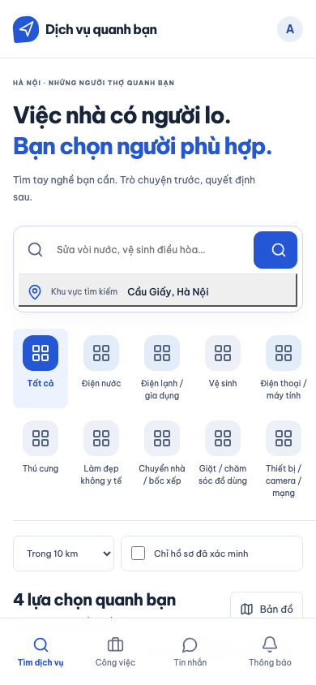
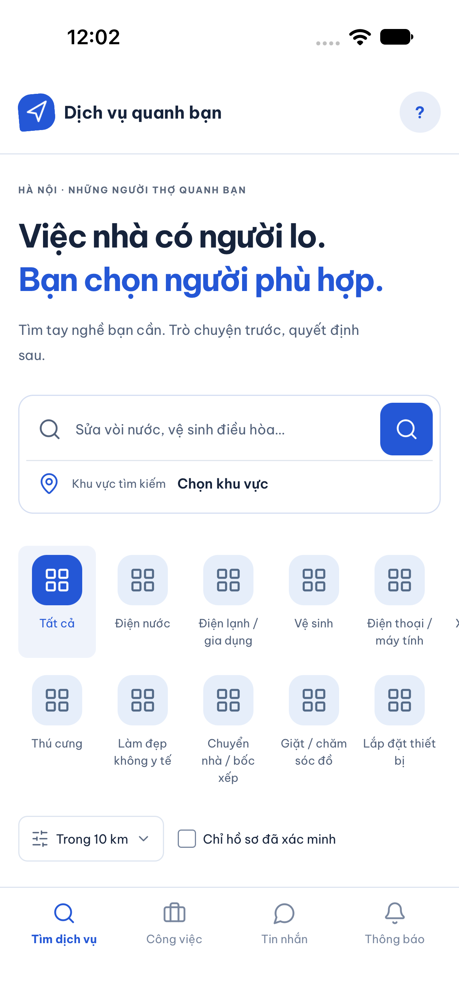
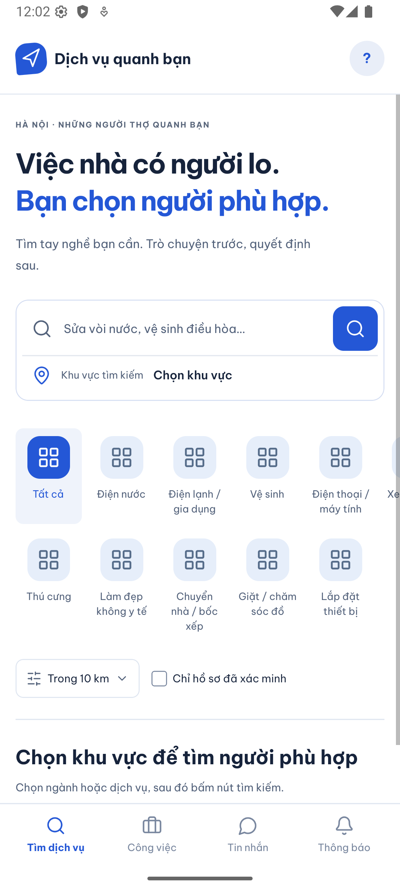
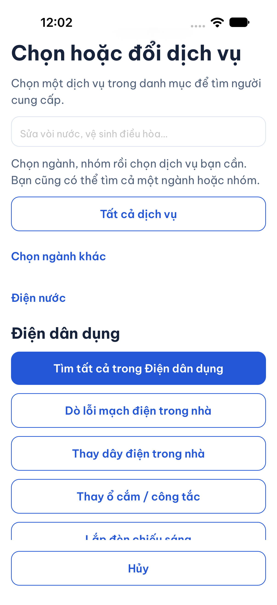
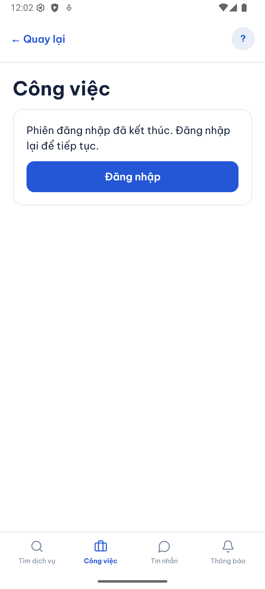
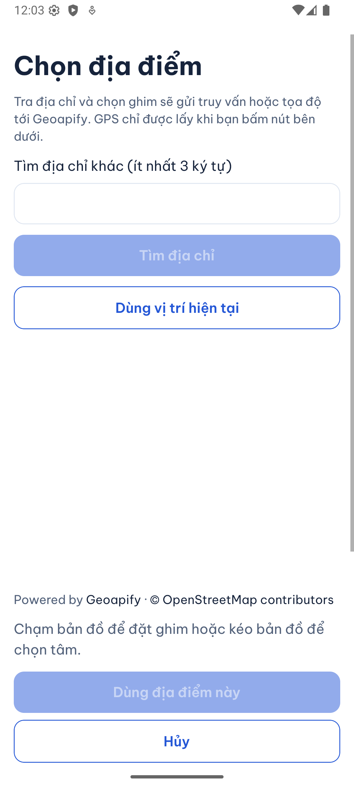
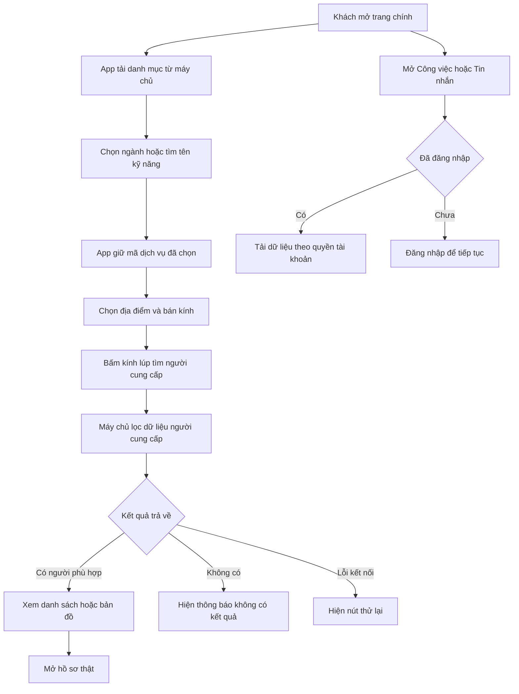
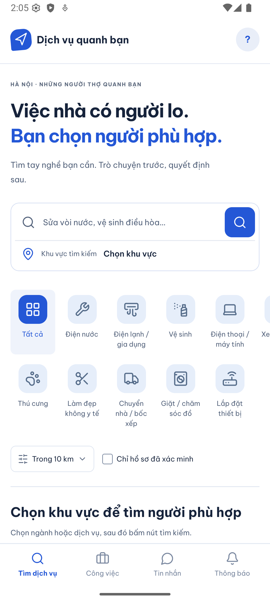
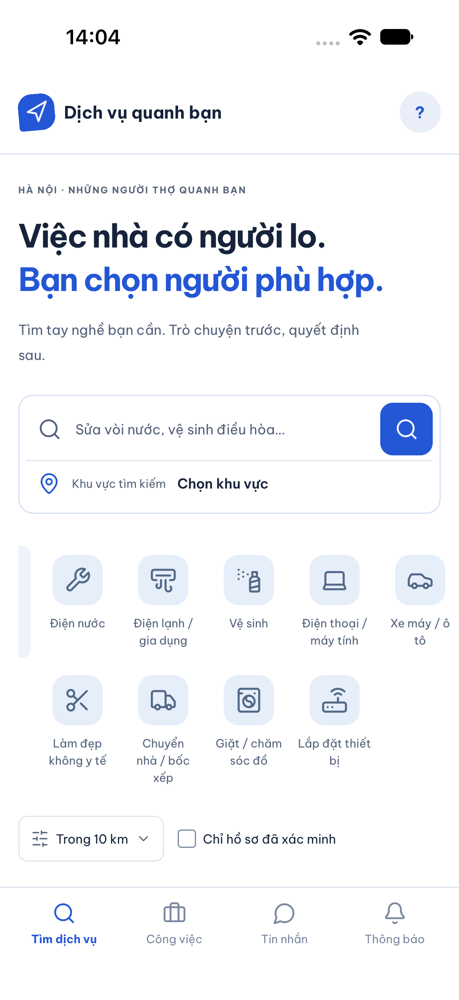
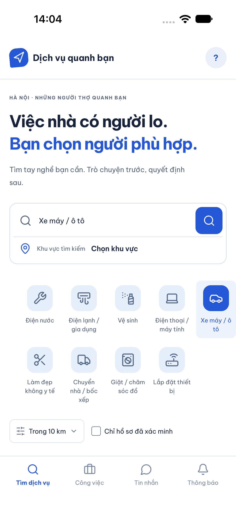

# B00-06 — Sửa trang chính theo Storybook

Ngày kiểm: **08/10/2026**. Bản sửa local trên nền commit `0bc5164`. Đây là sửa cách triển khai theo thiết kế đã có, không đổi API, dữ liệu hoặc nghiệp vụ. Chưa commit/push, chưa có CI cho bản sửa này và chưa UAT của chủ dự án.

## 1. Người dùng thấy gì khác?

Mở app sẽ thấy ngay trang tìm dịch vụ: nền trắng, thương hiệu, tiêu đề hai dòng, vùng tìm dịch vụ/chọn khu vực, hai hàng ngành có biểu tượng cuộn ngang và thanh điều hướng dưới. Không còn trang danh mục dạng thẻ chữ với nút “Tìm người cung cấp” riêng. Ngôn ngữ nằm trong Tài khoản, mở bằng avatar ở góc phải.

Đã đối chiếu trực tiếp story **Mobile** trong [App.stories.jsx](../../../ui-ux/prototype/src/App.stories.jsx), [App.jsx](../../../ui-ux/prototype/src/App.jsx), [neighborhood.css](../../../ui-ux/prototype/src/neighborhood.css) và [UI-16](../../../ui-ux/specs/design-system.md). Dùng font Be Vietnam Pro và cùng hình biểu tượng Lucide; font và ảnh biểu tượng đóng gói trong app, không tải từ mạng lúc mở.

Bấm Công việc hoặc Tin nhắn sẽ đến màn chức năng thật; khách chưa đăng nhập thấy nút đăng nhập để tiếp tục. Tab hiện tại đổi màu. Thông báo giữ trạng thái vô hiệu hóa, không có số chưa đọc giả vì chức năng chưa được triển khai.

## 2. Ảnh đối chiếu

Ảnh app chạy thật bằng mã nguồn local với API/DB test riêng, **không phải điện thoại thật**. Không có mật khẩu/token hoặc dữ liệu cá nhân. Storybook dùng dữ liệu minh họa, còn trang app ban đầu yêu cầu người dùng chọn khu vực trước khi tìm.

| Nguồn, ngày 08/10/2026 | Ảnh |
|---|---|
| Storybook Mobile, viewport 390 × 844; ẩn thanh công cụ thử vai trò/phiên bản để đối chiếu phần sản phẩm |  |
| iPhone 18 Pro simulator, iOS 27 — trang chính |  |
| Android emulator API 36 — trang chính |  |

Ảnh các điểm vào đã kiểm

## 3. Đi từ thao tác tới kết quả

Ví dụ muốn thay ổ cắm: chạm ô dịch vụ, nhập “o cam” hoặc mở Điện nước → Điện dân dụng → Thay ổ cắm / công tắc. App lấy danh mục từ máy chủ và giữ **mã dịch vụ** đã chọn. Tiếp theo chọn khu vực bằng bộ chọn địa điểm sẵn có, rồi bấm nút kính lúp. App gửi mã dịch vụ, tọa độ và bán kính tới API tìm người cung cấp. API là điểm nhận yêu cầu và trả dữ liệu từ chương trình máy chủ.

Máy chủ lọc người cung cấp theo điều kiện đã có. App hiển thị kết quả thật, hoặc trạng thái không có kết quả/lỗi để thử lại. Đổi dịch vụ hoặc bộ lọc sẽ xóa kết quả của lần tìm cũ, tránh nhìn thấy người của ngành trước.

## 4. Đọc code theo thứ tự

| File và hàm | Nhận gì → xử lý gì → kết quả |
|---|---|
| [App.tsx](../../../apps/mobile/src/app/App.tsx), `App` | Nạp font local rồi khởi tạo app; không phải một yêu cầu tới máy chủ font. |
| [AppNavigator.tsx](../../../apps/mobile/src/app/navigation/AppNavigator.tsx), `AppNavigator` | Route `CatalogHome` mở `SearchScreen`. Route tìm riêng vẫn dùng cùng màn và nhận mã dịch vụ ban đầu. |
| [ProductShell.tsx](../../../apps/mobile/src/app/layout/ProductShell.tsx), `ProductShell` | Nhận các hàm mở màn và tab hiện tại → vẽ header/avatar/footer → gọi đúng điều hướng khi bấm. |
| [SearchScreen.tsx](../../../apps/mobile/src/features/search/screens/SearchScreen.tsx), `SearchScreen`, `submit` | Giữ mã ngành/kỹ năng, vị trí, bán kính → kiểm dữ liệu bắt buộc → gọi bộ quản lý tìm kiếm. Bộ lọc chi tiết mở trong bảng riêng. |
| [ServiceFilter.tsx](../../../apps/mobile/src/features/search/components/ServiceFilter.tsx), `ServiceFilter`, `choose` | Tải tên danh mục theo ngôn ngữ. Tìm không dấu trong tên kỹ năng đã tải, rồi trả mã ngành/kỹ năng. Bấm Tất cả xóa cả hai mã. Hủy bảng chọn giữ lựa chọn trước đó. |
| [LocationField.tsx](../../../apps/mobile/src/features/location/components/LocationField.tsx), `LocationField` | `renderTrigger` chỉ thay hình thức nút mở; dùng lại bộ chọn địa điểm, không tạo logic tọa độ mới. |
| [partner-search.ts](../../../apps/mobile/src/features/search/state/partner-search.ts), `PartnerSearch.search`, `reset`, `more` | Nhận điều kiện → gọi API, quản lý hủy/thử lại/phân trang. `reset` loại kết quả cũ khi điều kiện đổi. |
| [partners-api.ts](../../../apps/mobile/src/features/partners/api/partners-api.ts), `createPartnersApi` | Chuyển điều kiện thành yêu cầu HTTP theo contract hiện hành. UI không truy cập DB. |
| [AccountPage.tsx](../../../apps/mobile/src/features/accounts/components/AccountPage.tsx), `AccountPage` | Giữ cổng đăng nhập cho Công việc/Tin nhắn, nhận cấu hình thanh điều hướng từ hai màn. Quyền dữ liệu vẫn do backend quyết định. |

## 5. Dữ liệu, lỗi và giới hạn

- Lựa chọn tìm kiếm và từ khóa trong bảng chọn là dữ liệu tạm trên màn; không lưu vào hồ sơ tài khoản. Tên đã dịch không được lưu làm điều kiện tìm kiếm: API nhận ID. Đổi ngôn ngữ sẽ tải tên tương ứng và giữ ID.
- Từ khóa được chuẩn hóa chữ thường, dấu tiếng Việt và `đ` để khớp tên kỹ năng trong danh mục. **Chưa phải tìm tự do trong tên/bài giới thiệu người cung cấp**. Tìm người vẫn gọi API bằng ID kỹ năng/ngành, không đổi contract.
- Bản app không tự đặt người dùng tại Cầu Giấy như dữ liệu mẫu Storybook. Chưa chọn địa điểm thì không gọi tìm kiếm. Bộ chọn địa điểm cũ vẫn hỗ trợ địa chỉ/gợi ý, bản đồ, GPS và địa chỉ lưu.
- Khi tải danh mục/kỹ năng lỗi có nút thử lại; không thay bằng dữ liệu mẫu. Yêu cầu cũ bị hủy và không ghi đè phản hồi mới khi đổi ngôn ngữ/rời bảng chọn.
- Kết quả chỉ dùng tên, loại, xác minh, đánh giá, khoảng cách và giá API thực sự trả. Không chép ảnh nghề, kinh nghiệm hoặc mô tả mẫu Storybook vào hồ sơ thật. Vì vậy **chưa tuyên bố toàn bộ thẻ kết quả hoặc toàn app giống từng pixel**. Nút mở hồ sơ tiếp tục dẫn tới luồng liên hệ đã có.
- Chưa triển khai trung tâm Thông báo. Các màn chi tiết Công việc/Tin nhắn, khung partner/doanh nghiệp và ví không thuộc đợt sửa trang chính này.

## 6. Tự thử và tự kiểm hiểu

1. Mở app → kiểm font, tiêu đề, ô tìm kiếm, hai hàng ngành; kéo ngang để thấy ngành ngoài mép màn.
2. Chạm ô dịch vụ → nhập `o cam` → chọn kỹ năng. Mở lại rồi Hủy: tên kỹ năng vẫn còn. Chọn Tất cả: bỏ lọc ngành và kỹ năng.
3. Chọn địa điểm → bấm kính lúp → xem danh sách/bản đồ. Đổi ngành: kết quả cũ biến mất cho tới lần tìm mới.
4. Mở Tài khoản → đổi English/日本語 → quay lại. Chọn dịch vụ giữ nguyên mã; tên hiển thị đổi theo bản dịch.
5. Khi chưa đăng nhập, mở Công việc/Tin nhắn: app yêu cầu đăng nhập, không hiện dữ liệu người khác. Tab Thông báo chưa bấm được.

Vì sao nhập `o cam` không trực tiếp gửi chuỗi đó tới API người cung cấp? Vì `ServiceFilter.choose` trả mã kỹ năng có thật. Vì sao không hiện bốn thợ như Storybook ngay khi mở? Vì app phải có khu vực do người dùng chọn và kết quả thật từ API. Vì sao một danh mục đổi tên theo ngôn ngữ vẫn tìm cùng dịch vụ? Vì điều kiện dùng ID, không dùng câu đã dịch.

## 7. Kiểm thử và bằng chứng

| Phạm vi | Kết quả local ngày 08/10/2026 | Bằng chứng |
|---|---|---|
| Mobile unit/component | **196/196 đạt**, 40 suite; app 86,91% dòng / 81,07% nhánh; core 100% dòng / 94,35% nhánh. Sau chỉnh accessibility, ghép style vùng cuộn và giữ tên địa chỉ đã chọn, chạy lại 14 test liên quan: đạt. | `.local/home-coverage2.log`, `.local/home-unit-final.log` |
| Web dùng API/DB test | **14 bài khác nhau đã đạt**: lượt đầu 10/14, sửa 4 lỗi kiểm thử và chạy lại 5/5 (gồm 1 bài đã đạt). Kiểm 390px VI, 320px JA, 768px EN không tràn ngang. | `.local/home-web.log`, `.local/home-web-recheck.log`, `test-results/web/` |
| Android emulator API 36 | **Đạt** trang chính, tab khách, chọn/hủy/xóa kỹ năng, bộ lọc và mở bộ chọn vị trí. | `test-results/native/android/search-service/result.json`, ảnh ở trên |
| iPhone 18 Pro simulator, iOS 27 | **Đạt** cùng luồng; kiểm lại sau sửa lưới ngành và thao tác cuộn. | `test-results/native/ios/search-service/result.json`, ảnh ở trên |
| Static/build | Lint, typecheck cả hai workspace, Expo export Android/iOS/web đạt. | `.local/home-lint-final.log`, `.local/home-typecheck-final.log`, `.local/home-build.log` |
| Báo cáo | Mermaid render đạt: 16 nút, kích thước 926 × 1090; link nội bộ và `git diff --check` đạt. | Sơ đồ trực tiếp trong file này |

Lỗi kiểm thử đã xử lý: truy vấn trùng phần UI phía sau modal/route cũ; thiếu `aria-selected` tường minh trên web; hai bài thao tác liên tiếp trước khi API lưu xong. Không bỏ kiểm tra dữ liệu hoặc quyền để làm test xanh.

Bằng chứng web dùng bản export và API có cấu hình origin riêng của bộ E2E; không dùng Metro Android 8081 làm bản xem trước web (Metro này gọi `10.0.2.2`).

Các flow native cũ được cập nhật điểm vào mới trong đợt này; chỉ flow nào có kết quả ghi ở bảng mới được tính đã chạy lại. Không dùng kết quả native lịch sử của B00-05/P0-3 làm bằng chứng cho giao diện mới. Không chạy lại backend coverage vì không thay code API/DB; web E2E vẫn dùng API và DB test riêng.

Thông tin tra cứu

- Đợt sửa bắt đầu từ phản hồi ảnh trang danh mục cũ và yêu cầu “sửa đi”. Thay trạng thái khung khách trước đây ở B00-05, giữ nguyên báo cáo lịch sử.
- Thêm dependency trực tiếp `expo-font@57.0.4` (đã có trong cây phụ thuộc/native build), ba file font có giấy phép OFL; biểu tượng raster từ Lucide có giấy phép ISC. [Script tạo biểu tượng](../../../scripts/ui/export-native-icons.mjs).
- Kiểm thử liên quan: [ServiceFilter](../../../apps/mobile/src/features/search/components/ServiceFilter.test.tsx), [ProductShell](../../../apps/mobile/src/app/layout/ProductShell.test.tsx), [web shell](../../../tests/e2e/web/shell.spec.mjs), [web chọn dịch vụ](../../../tests/e2e/web/search-service.spec.mjs), [native](../../../tests/e2e/native/search-service.yaml).
- Hai bài web cũ được sửa điều kiện chờ: đợi địa chỉ mặc định thực sự đổi trong DB, đợi công tắc nhận việc lưu xong rồi khách tìm lại. Không chỉ đợi một huy hiệu vốn đã có hoặc bấm gửi khi thao tác trước còn đang lưu.
- Không đồng bộ Excel/Drive/ZIP vì đây là sửa code theo thiết kế hiện hành. Không đưa `.idea/` vào phạm vi sửa.

## 8. Bổ sung icon theo ngành — 08/10/2026

Theo phản hồi của chủ dự án, đã thay ô lưới lặp lại ở cả 10 ngành bằng biểu tượng riêng. Khi mở trang chính, người dùng có thể nhận ra ngành qua hình và nhãn; khi chọn ngành, hình giữ nguyên và chuyển trắng trên nền xanh. Mục **Tất cả** vẫn dùng ô lưới.

| Ngành | Biểu tượng Lucide |
|---|---|
| Điện nước | Cờ lê — `Wrench` |
| Điện lạnh / gia dụng | Điều hòa — `AirVent` |
| Vệ sinh | Bình xịt vệ sinh — `SprayCan` |
| Điện thoại / máy tính | Máy tính xách tay — `Laptop` |
| Xe máy / ô tô | Ô tô — `Car` |
| Thú cưng | Dấu chân thú — `PawPrint` |
| Làm đẹp không y tế | Kéo — `Scissors` |
| Chuyển nhà / bốc xếp | Xe tải — `Truck` |
| Giặt / chăm sóc đồ | Máy giặt — `WashingMachine` |
| Lắp đặt thiết bị | Bộ phát mạng — `Router` |

Nguồn hình: [Lucide](https://lucide.dev/icons/), dùng phiên bản đã có trong prototype. Mười ảnh PNG được đóng gói local, giữ giấy phép tại `apps/mobile/assets/icons/LICENSE`, không tải icon từ dịch vụ ngoài khi mở app.

**Cách đọc code:** trong [ServiceFilter.tsx](../../../apps/mobile/src/features/search/components/ServiceFilter.tsx), `industryIcons` là bảng tra từ mã ngành (`code`) sang tên icon. `ServiceFilter` nhận danh mục từ API → tra mã ngành → đưa tên icon cho [Icon.tsx](../../../apps/mobile/src/components/ui/Icon.tsx), hàm `Icon` hiển thị ảnh tương ứng. Đây là bước vẽ biểu tượng trong luồng chọn ngành ở sơ đồ mục 3. Tên dịch VI/EN/JA không tham gia chọn icon. Mã ngành mới chưa được khai báo dùng ô lưới dự phòng. `choose` vẫn trả ID ngành/kỹ năng như trước; không đổi quyền, dữ liệu, trạng thái nghiệp vụ hoặc cơ chế lỗi/thử lại API.

Có thể tái tạo ảnh bằng [export-native-icons.mjs](../../../scripts/ui/export-native-icons.mjs): `node scripts/ui/export-native-icons.mjs`. Script lấy hình vector Lucide và xuất PNG nền trong suốt 72 × 72; app hiển thị 24 × 24.

### Ảnh bổ sung

Ảnh app chạy bằng code local ngày **08/10/2026**, danh mục phát triển/test, khách chưa đăng nhập; đây là emulator/simulator, không phải điện thoại thật. Ảnh ở mục 2 giữ nguyên làm bằng chứng trước khi sửa icon.

| Màn đã kiểm | Ảnh |
|---|---|
| Android emulator API 36 — trang chính với icon riêng |  |
| iPhone 18 Pro simulator, iOS 27 — trang chính |  |
| iOS — kéo ngang để thấy ngành xe ở cuối hàng |  |
| iOS — chọn Xe máy / ô tô, icon trắng trên nền xanh |  |

### Kiểm chứng bổ sung

- Typecheck mobile, ESLint cho ba file code/script thay đổi và `git diff --check`: đạt.
- Chạy lại `ServiceFilter.test.tsx` và `ProductShell.test.tsx`: **8/8 đạt**. Có cảnh báo React `act(...)` trong test bất đồng bộ; không có test thất bại. Không chạy lại toàn bộ 196 test hoặc web E2E cho thay đổi icon này.
- Kiểm trực quan ảnh native của bản sửa; iOS đã kéo ngang xem đủ 10 icon và bấm chọn Xe máy / ô tô. Không dùng kết quả này thay cho UAT hoặc kiểm trên điện thoại thật.
- Sơ đồ Mermaid hiện có được render lại bằng Chromium: đạt, 16 nút. Chưa commit/push, chưa CI cho bổ sung này.

**Tự thử:** kéo ngang hàng ngành, chọn ngành xe rồi chọn Tất cả. Vì sao tên ngành đổi ngôn ngữ vẫn giữ hình? Vì bảng tra dùng mã ổn định thay vì nhãn đã dịch. Khi thêm ngành mới cần bổ sung ở đâu? Thêm ảnh trong `Icon.tsx`, tên nguồn trong script xuất ảnh và cặp mã/icon trong `industryIcons`.

## 9. Kiểm trước push — 09/10/2026

Chủ dự án yêu cầu push toàn bộ phần trang chính và icon ngành đang bàn giao. Đã chạy lại lint, typecheck cả hai workspace, **196/196 mobile test (40 suite)**, test tooling và Expo export **Android/iOS/web**: đạt. Log local: `.local/push-home-lint.log`, `.local/push-home-typecheck.log`, `.local/push-home-tests.log`, `.local/push-home-tooling.log`, `.local/push-home-build.log`. Có cảnh báo React `act(...)` trong test; không có bài thất bại.

Ảnh và kiểm native ngày 08/10 ở trên giữ nguyên phạm vi; không tuyên bố chạy lại native hoặc web E2E trong lượt kiểm trước push này. Thư mục `.idea/` là cấu hình IDE local, không đưa vào commit. Kết quả CI sẽ ghi riêng sau khi push và kiểm trên GitHub.
