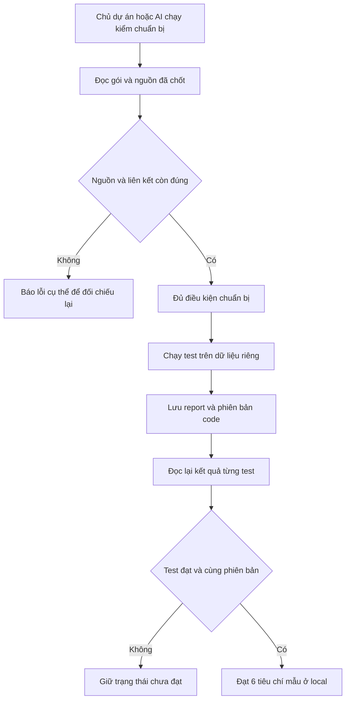

# B00-07 Bộ kiểm SDD local

> Mốc local ban đầu. Phạm vi hiện hành đã mở rộng ở [B00-08](B00-08-sdd-toan-du-an.md); giữ số liệu dưới đây theo lượt kiểm ban đầu.

13/10/2026 · SDD-01, phạm vi mẫu MAP-02 · Working tree trên commit `8c25c32`, chưa commit/push. [Mục lục](../README.md) · [Cách dùng](../sdd/README.md) · [Thiết kế đã duyệt](../de-xuat/SDD-01-quy-trinh-ai-bam-spec.md).

## 1. Bạn đã dùng được gì

Trước đây mỗi phiên AI phải tự giải thích mình dựa vào spec nào. Bây giờ bạn có thể chạy một lệnh để kiểm gói giao việc MAP-02: nguồn còn đúng phiên bản không, yêu cầu có nối đến code/test không, và bài test cần thiết đã thực sự chạy trên bản code đang xem chưa.

Có hai kết quả khác nhau: **chuẩn bị đạt** nghĩa là nguồn và liên kết hợp lệ; **bàn giao đạt** nghĩa là các test bắt buộc của 6 tiêu chí mẫu có kết quả đạt và khớp phiên bản. Không đồng nghĩa toàn app, toàn MAP-02 hoặc UAT đã hoàn tất.

Đây là công cụ dòng lệnh trên máy phát triển. Không thêm/sửa màn app trong đợt này nên không có ảnh UI/native mới. CI, bảo vệ nhánh và các miền jobs/chat/invoice chưa được mở rộng.

## 2. Các từ cần hiểu

- **Gói giao việc:** file nhỏ ghi nguồn cần đọc, phạm vi sửa, tiêu chí kiểm và việc ngoài phạm vi.
- **Truy vết:** đi từ một tiêu chí tới spec gốc, đoạn code và bài test chứng minh tiêu chí đó.
- **Dấu băm:** một chuỗi nhận diện nội dung. File đổi thì chuỗi đổi, giúp phát hiện bằng chứng cũ. Chuỗi này không chứng minh quyết định đã được chủ dự án duyệt.
- **Artifact:** file kết quả do lượt kiểm tạo ra, gồm report và log. Các file này lưu local, không đưa vào Git.

## 3. Theo một lần kiểm từ đầu đến cuối

Bạn chạy `prepare` cho `SDD-01-MAP-02`. Chương trình mở gói, tra nguồn và kiểm từng liên kết. Ví dụ QA-080 phải trỏ đúng mục QA-080 có operation `searchPartners`; nếu ai chèn dòng trước đó làm địa chỉ JSON trỏ sang yêu cầu khác, bộ kiểm báo sai.

Tiếp theo, `sdd:run` chạy test mobile, API/PostGIS và web đã được liệt kê sẵn trong code. Nó không thực thi chuỗi lệnh do JSON đưa vào. Sau mỗi suite, chương trình giữ report gốc. Nếu bài test thất bại hoặc code đổi trong lúc đang chạy, không công nhận bằng chứng bàn giao.

Cuối cùng, `verify` đọc lại report, tìm đúng tên test trong đúng file và so phiên bản hiện tại với phiên bản lúc chạy. Một file mới trong thư mục đã băm cũng làm bằng chứng cũ hết hiệu lực.

## 4. Mở code theo thứ tự

| File và hàm | Nhận gì, làm gì, chuyển gì |
|---|---|
| [Gói MAP-02](../sdd/changes/SDD-01-MAP-02.json) | Đầu vào gồm mã nguồn, tiêu chí, phạm vi và giới hạn. Không chứa lệnh shell để chương trình tự chạy. |
| [Nguồn](../sdd/source-map.json) và [truy vết](../sdd/traceability.json) | Cho biết từng tiêu chí phải tra tài liệu và bài test nào; không tạo bản sao spec. |
| [check.mjs](../../../scripts/sdd/check.mjs), `argumentsFor`, `printResult` | Đọc mã gói/mức kiểm từ Terminal, từ chối tham số sai, in lỗi hoặc kết quả rõ ràng. |
| [core.mjs](../../../scripts/sdd/core.mjs), `checkChange` | Kiểm cấu trúc, file, heading/JSON Pointer, giá trị ID/operation và test đang bật; sau đó mới xét bằng chứng nếu đang verify. |
| `scopeDiagnostics` trong core | So danh sách file đã đổi với miền quản lý và scope. File ngoài miền mẫu được nêu là chưa chứng nhận; nguồn spec đổi trong gói implementation bị báo phân loại sai. |
| `snapshot` trong core | Băm nguồn/code/test/config và giữ Git HEAD; phát hiện cả sửa chưa commit, thêm và xóa file. |
| [run.mjs](../../../scripts/sdd/run.mjs), `recipesFor`, `runChange`, `recordEvidence` | Chọn lệnh cố định, khóa tránh hai lượt chạy trộn report, xóa evidence cũ, chạy và lưu bằng chứng khi phiên bản không đổi. |
| [node-reporter.mjs](../../../scripts/sdd/node-reporter.mjs), `nodeReporter`; `parseReport` trong core | Reporter giữ sự kiện pass/fail/skip thật từ Node; parser đọc Node/Jest/Playwright theo từng định dạng và đối chiếu tên file/test. |

## 5. Dữ liệu và cách xử lý lỗi

Nguồn spec/QA/OpenAPI giữ nguyên. Gói SDD và truy vết ở `docs/ke-hoach-trien-khai/sdd/`; kết quả ở `test-results/sdd/SDD-01-MAP-02/`. Bộ kiểm không ghi DB sản phẩm; các test dùng `dvqb_test` với schema riêng và dọn khi xong.

Nếu nguồn đổi, chương trình không tự cập nhật dấu băm. AI phải đọc thay đổi và xác định quyết định hiện hành. Nếu test chưa chạy, verify báo thiếu evidence. Nếu report ghi skip hoặc tên bài test không còn khớp, tổng số test đạt không che được phần thiếu đó.

Trong lượt kiểm này, Chromium bị sandbox macOS chặn khởi động; lần chạy đó không được coi đạt. Sau khi cho phép khởi động trình duyệt, test web chạy được. Tiện ích Console Ninja còn chèn thông báo vào stdout; đã chuyển report Playwright sang file JSON riêng, thêm ca hồi quy và giữ log console riêng để tránh trộn kết quả.

`run.lock` ngăn hai tiến trình cùng gói ghi đè bằng chứng. Dừng cưỡng bức có thể để lại lock; kiểm không còn lượt chạy rồi mới xóa đúng lock. Không có cơ chế tự retry vô hạn hoặc tự xóa khóa của tiến trình khác.

## 6. Tự thử và tự kiểm hiểu

Chạy theo thứ tự trong [hướng dẫn](../sdd/README.md). Khi cần xem một lỗi, đọc mã trong ngoặc vuông và đường dẫn kèm theo; xử lý nguyên nhân rồi chạy lại. Không cần cố ý sửa spec thật để thử lỗi: các test bộ kiểm tạo dữ liệu tạm riêng.

1. Vì sao `prepare` đạt mà `verify` có thể chưa đạt? Vì chuẩn bị chỉ kiểm nguồn/liên kết, chưa chứng minh bài test đã chạy.
2. Vì sao cùng commit vẫn bị báo bằng chứng cũ? Vì source chưa commit hoặc config/seed/test có thể đã đổi; xem `snapshot`.
3. Bỏ một tiêu chí để hết lỗi có phải sửa đúng không? Không. Phạm vi phải được đối chiếu quyết định đã chốt và review thay đổi trước khi thu hẹp.

## 7. Kiểm thử và bằng chứng

Đã kiểm bộ kiểm với 28 ca riêng; tổng bộ tooling hiện có 31 ca đạt. Các ca gồm dữ liệu hợp lệ, JSON sai, nguồn/mã sai, test bị đổi tên, fail/skip, report bị sửa, code cũ, thay đổi trong lúc chạy, scope và đường dẫn ra ngoài repo. Lint đạt.

Đã chạy mẫu với 7 bài mobile trong Jest, 2 bài API trên PostGIS, build API và 1 bài Playwright trên web. Đây là 10 bài hành vi, không phải 10 tiêu chí: chúng được nối tới 6 tiêu chí mẫu. Jest không phải bằng chứng app chạy trên Android/iOS.

Đã tạo bản sao API trong thư mục tạm, bỏ `AND l.public` chỉ ở truy vấn lấy ghim và chạy bài kiểm quyền riêng tư. Test thất bại với địa chỉ `PRIVATE_MAP_CANARY` xuất hiện thay địa chỉ public; đây là lỗi assertion đúng mục tiêu, không phải lỗi setup. Bản sao được dọn, source sản phẩm không thay đổi. Các lượt chuẩn bị bản sao từng thiếu config/dependency/seed đã được sửa trước khi lấy bằng chứng này.

Lệnh, vị trí và giới hạn bằng chứng

| Phần | Lệnh/vị trí | Kết quả |
|---|---|---|
| Bộ kiểm | `node --test scripts/test/sdd-check.test.mjs` | 28 đạt |
| Tooling chung | `npm run test:tooling`, `test-results/sdd/tooling.log` | 31 đạt |
| Lint | `npm run lint`, `test-results/sdd/lint.log` | Đạt |
| Gói mẫu | `npm run sdd:run -- --change SDD-01-MAP-02` | Tạo report mobile/API/web và kiểm verify; phiên bản chính xác xem evidence |
| Bằng chứng | `test-results/sdd/SDD-01-MAP-02/evidence.json` | HEAD, dấu băm, Node/nền tảng, thời gian, lệnh, exit code, report/hash |
| Thử lỗi riêng tư | `test-results/sdd/privacy-mutation.log` | Bản sao sai bị test bắt; exit 1 đúng mong đợi |
| Mermaid | Sơ đồ nằm ngay trong file này | Kiểm parse/render bằng Mermaid trong Chromium trước bàn giao |

Các artifact local không track Git và có thể được thay ở lần chạy sau. Chạy lại `sdd:run` để tạo bằng chứng mới; không chép trạng thái cũ vào report. Trong lượt này không chạy lại toàn bộ test/app build/native vì code sản phẩm không đổi; API build là điều kiện của bài web.

## 8. Giới hạn và bước sau

Chưa chứng nhận trọn QA-080/081: chưa kiểm riêng tie-break `created_at/id`, chưa nối nhiều trang qua UI thật trong gói này; đã kiểm logic phân trang và cảnh báo còn trang ở các test lớp riêng. Chưa kiểm màu sắc, native, thiết bị thật, live provider hoặc UAT.

Chưa nối CI/required checks; không tuyên bố mọi thay đổi của repo tự bị chặn. Bộ kiểm chỉ kiểm gói được gọi và miền đã đăng ký. Tên test được kiểm qua cú pháp, nhưng ý nghĩa assertion và độ đầy đủ nguồn vẫn cần người review. Evidence không có chữ ký chống giả; người có quyền sửa cả bộ kiểm, manifest và report vẫn cần cơ chế review bên ngoài.

Bước kế tiếp là đánh giá cảnh báo ngoài phạm vi và tích hợp gói local này vào CI với bằng chứng do CI tự chạy, rồi mới mở jobs/chat và invoice theo thiết kế SDD-01. Không thay quyết định Pending, spec nghiệp vụ, sổ Excel, ZIP hoặc Drive trong đợt này.
