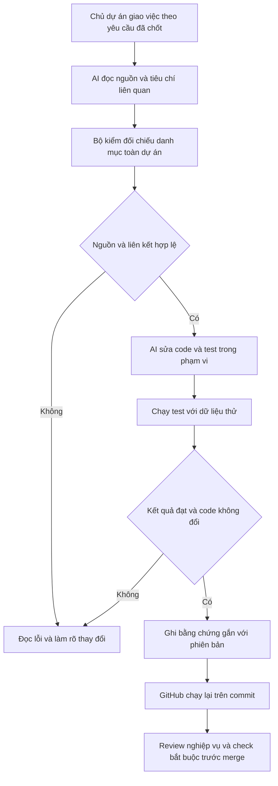

# B00-08 — AI thay code được kiểm theo spec như thế nào?

DOC-086 · SDD-01 mở rộng · 13/10/2026. Thay đổi công cụ/test/CI, không thay nghiệp vụ. [Mục lục](../README.md) · [Hướng dẫn dùng](../sdd/README.md).

## 1. Bạn dùng được gì?

Khi giao AI sửa một chức năng, bạn có thể yêu cầu ghi mã tiêu chí và chạy gói `SDD-PROJECT`. Bộ kiểm báo nguồn nào đã thay đổi, file mới nào chưa được đăng ký hoặc test nào chưa có bằng chứng. GitHub chạy lại bộ kiểm trên phiên bản code được đẩy lên; kết quả local không được dùng thay cho lần chạy đó.

Phạm vi đã đăng ký gồm toàn repository, 88 ca QA, 123 operation API và 71 tiêu chí có test cụ thể. 58 operation có controller hiện hành; 65 operation chưa có controller. **Đây là danh mục quản lý, không phải tuyên bố 123 operation hay 88 QA đã hoàn tất.** Mỗi QA hiện có nhãn một phần hoặc chưa ánh xạ.

Đợt này còn thử quy trình trên MAP-02: bổ sung test thứ tự khi khoảng cách bằng nhau, rồi dùng giao diện web tải ba trang kết quả từ API/DB thật. App không đổi giao diện nên không có bộ ảnh màn mới.

## 2. Theo một lần giao việc

“Tiêu chí” là một điều cụ thể cần giữ, ví dụ địa điểm riêng không xuất hiện thành ghim công khai. “Evidence” là kết quả test kèm phiên bản code đã chạy. “Dấu băm” giúp phát hiện nội dung đã đổi sau khi kiểm.

Ví dụ `MAP-02-AC-07` nhận dữ liệu ba đối tác cùng khoảng cách. Test cố ý đặt thời gian tạo bằng nhau ở hai đối tác rồi lần lượt lấy từng trang. Máy chủ phải trả đúng thứ tự thời gian và ID, không lặp hoặc mất đối tác. Cùng bài kiểm còn đặt ba địa điểm công khai trùng tọa độ để kiểm thứ tự chọn ghim. Đây là dữ liệu thử trong schema riêng, không sửa dữ liệu sử dụng thật.

## 3. Mở code theo thứ tự

| Bước | File và hàm | Nhận gì, làm gì, trả gì? |
|---|---|---|
| 1 | [Gói toàn dự án](../sdd/changes/SDD-PROJECT.json) | Ghi căn cứ, baseline và những tiêu chí phải kiểm |
| 2 | [project.mjs](../../../scripts/sdd/project.mjs), `checkProject`, `inventoryDiagnostics` | Đọc file Git, QA/API và route controller; so với danh mục để bắt phần mới/bị bỏ sót |
| 3 | [core.mjs](../../../scripts/sdd/core.mjs), `checkChange` | Kiểm nguồn/hash, mã yêu cầu, code và đúng tên test; trả lỗi cụ thể hoặc cho phép chạy |
| 4 | [run.mjs](../../../scripts/sdd/run.mjs), `projectRecipes`, `runChange` | Chạy các lệnh cố định với DB test; lưu report/log, dừng ở bước thất bại |
| 5 | [core.mjs](../../../scripts/sdd/core.mjs), `snapshot`, `parseReport` | So phiên bản trước/sau, kiểm kết quả và mọi file test đã chạy; không tin chữ pass trong console |
| 6 | [quality.yml](../../../.github/workflows/quality.yml) | Checkout đầy đủ Git, cài dependencies, chạy cùng gói và upload bằng chứng |
| 7 | [Test MAP-02](../../../services/api/test/integration/partners.test.ts), `equal-distance...` và [web](../../../tests/e2e/web/search-map.spec.mjs) | Ví dụ áp dụng SDD lên nhánh thực tế còn thiếu kiểm thử |

## 4. Dữ liệu và lỗi

Nguồn và mapping lưu trong Git; report local ở `test-results/sdd/SDD-PROJECT/`, không commit. CI lưu artifact 7 ngày. Chạy lại bằng lệnh trong hướng dẫn khi artifact hết hạn.

Nếu test fail, lượt chạy không giữ chứng nhận cũ. Nếu code/config/spec/HEAD đổi, evidence cũ bị coi là hết hiệu lực. Report ghi root máy tạo để tải về máy khác vẫn đối chiếu đúng file; không ghép theo mỗi tên file vì có thể trùng.

Nếu có route hoặc file mới, kiểm tra dừng để AI phân loại và review tác động. Nếu nguồn spec đổi, không tự cập nhật hash để vượt kiểm: xác định quyết định mới và áp dụng quy trình đồng bộ khi spec thay đổi. Quyền nghiệp vụ vẫn do backend quyết định; bộ SDD không thay quyền của người dùng app.

## 5. Tự thử và tự kiểm hiểu

1. Chạy `prepare`: đạt nghĩa là đủ nguồn/liên kết, chưa có nghĩa test đã chạy.
2. Mở `project-inventory.json`, tìm QA-001: phần OTP chưa có tiêu chí không được biến thành đạt vì các test đăng nhập mật khẩu đã xanh.
3. Sau `sdd:run`, sửa một file code rồi chạy `verify`: phải báo bằng chứng cũ. Khôi phục đúng thay đổi thử hoặc chạy lại trước bàn giao.

Vì sao API có controller vẫn chưa gọi là phủ contract? Vì một endpoint có nhiều quyền, lỗi, trạng thái và tình huống cạnh tranh. Criterion chỉ chứng minh assertions thực tế đã review. Vì sao build Storybook đạt chưa đủ để nghiệm thu UI? Vì build chỉ chứng minh có thể dựng tài liệu/giao diện mẫu, không so hình app với mẫu.

## 6. Kiểm thử và giới hạn

Local ngày 13/10/2026 đã chạy đạt trọn gói và `verify`: **50 tooling (47 bài SDD), 196 mobile, 83 API, 14 web**; không fail/skip. Lint, typecheck, hai coverage gate, build app/API, kiểm tải, prototype và Storybook đạt. Hai sơ đồ B00-07/08 đã parse và render bằng Chromium, mỗi sơ đồ có 11 nút; liên kết tài liệu đã kiểm.

Lượt local trên working tree từ `8c25c32`, kết thúc 09:58 UTC, fingerprint `d70d360e5cc91f6257e6295708c4804312bcbf836d0cbfde0f8f373dd6def65e`. Việc bổ sung kết quả vào tài liệu và tạo commit sau đó làm fingerprint/HEAD đổi; CI phải tự chạy lại trên commit đã push. Không dùng report local cũ chứng nhận commit mới. Trạng thái remote CI và bảo vệ nhánh kiểm riêng trước bàn giao.

Các bài đối chứng đã chạy bắt được file/API/QA chưa đăng ký, criterion bị bỏ, nguồn đổi, report thiếu/sửa/fail/skip và code đổi khi đang test. Lượt web đầu có một assertion mới sai vì tìm thẻ danh sách trong chế độ bản đồ; đã sửa kiểm đúng ghim, chạy lại riêng đạt rồi chạy đủ 14 bài đạt. Hai test jobs/invoice nay lưu ảnh trong `test-results/web/report-screenshots/`, không tự ghi đè ảnh báo cáo lịch sử trong Git.

Thông tin kỹ thuật và bằng chứng

| Nhóm | Cách kiểm và nơi lưu |
|---|---|
| Chất lượng code | lint, typecheck, toàn bộ tooling |
| Mobile/API | Mobile app: 86.92% lines / 81.11% branches; API app: 92.74% / 85.84%; nhóm core đạt ngưỡng 90% / 85%. PostGIS schema thử riêng |
| Hành trình web | Toàn bộ Playwright E2E, report/screenshot/trace khi lỗi |
| Build/hạ tầng | Expo export, API, Vite prototype, Storybook đạt. Tải local 200 request, concurrency 20, 0 lỗi, p95 32.71ms; không phải SLA production |
| SDD | `prepare` và `verify`, 71 criterion bắt buộc, mọi file test phải có kết quả |
| Native/UAT | Không chạy trong đợt này; không dùng Expo export thay chứng minh native |

Workflow gộp các kiểm tra cũ vào một job `SDD project` để mỗi bộ test chạy một lần và evidence có cùng checkout. Đánh đổi: ít song song hơn; timeout 30 phút. Giữ nguyên coverage gate và kiểm tải, thêm build prototype/Storybook. Không thêm dependency sản phẩm.

Phần chưa chứng minh: OTP, lời mời/đội ngũ đầy đủ, gọi, notifications, ngân hàng, reviews, support/admin; branch dữ liệu ảnh khác PNG, reminder, WebSocket và UAT. Hai route adapter ảnh local chưa có operation OpenAPI được ghi gap. QA-068 có số lượng seed lịch sử khác code, không tự sửa nguồn. Code hiện chuyển công việc sang completed khi settlement; review_eligible chờ cả hai dấu thanh toán, không diễn giải hai trạng thái này thành một.

Chưa trích đầy đủ mọi requirement ngoài QA/API từ DOCX/Excel. Checker không chứng minh phê duyệt nghiệp vụ và không chống người sửa cả test/checker để làm giả; review của con người vẫn bắt buộc về quy trình.

## 7. Tiếp tục sử dụng

Mỗi chức năng mới cần thêm criterion có test đúng hành vi, cập nhật inventory và ghi rõ phần chưa chứng minh. Không có yêu cầu triển khai phần Pending chỉ vì đã đưa nó vào danh mục. Nghiệm thu thiết bị thật, provider, UAT và phát hành là các mức riêng.
