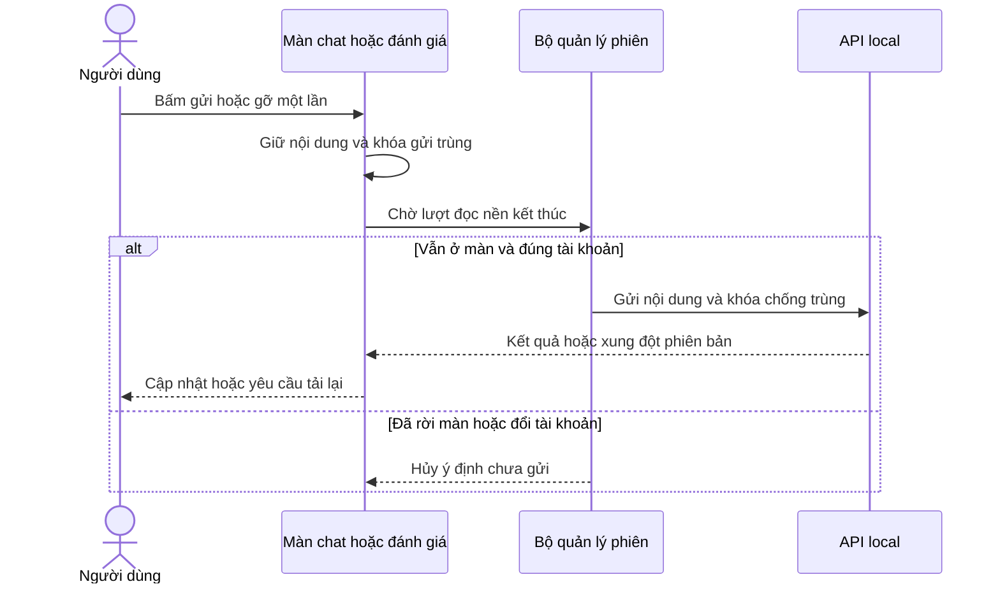
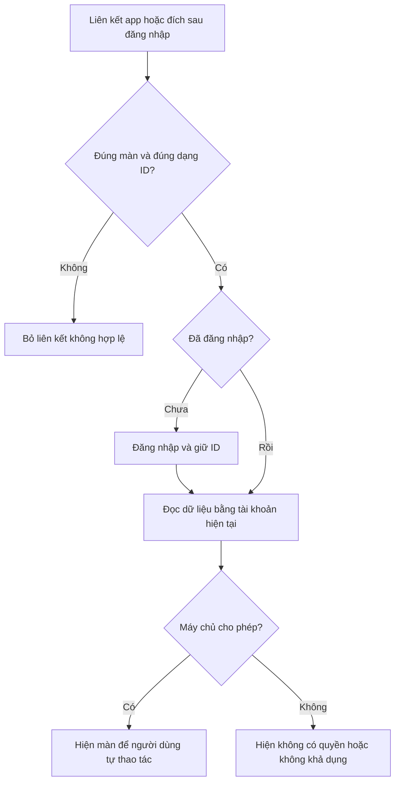
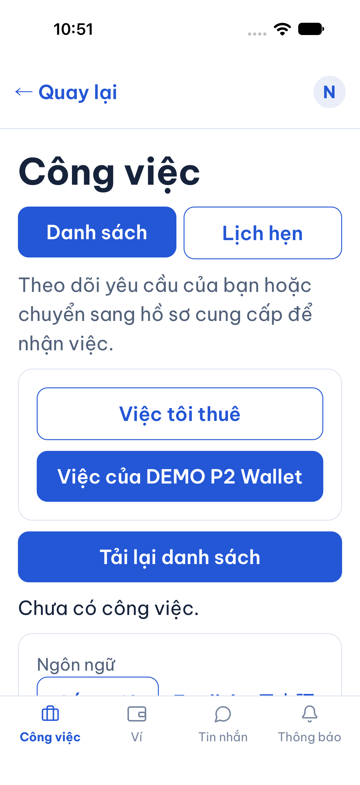
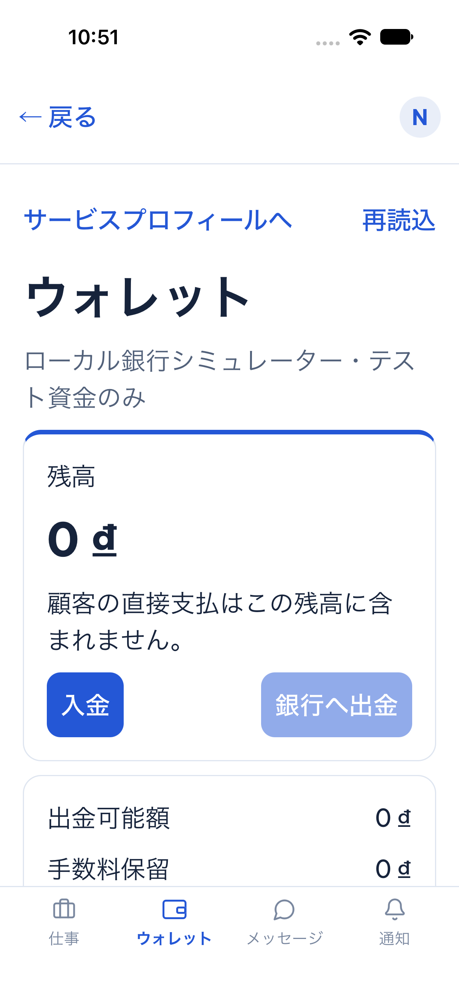
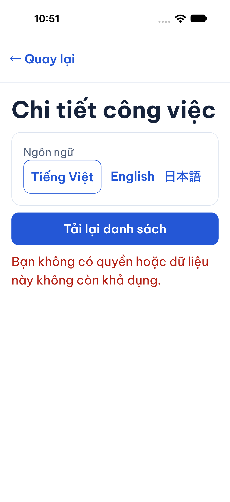
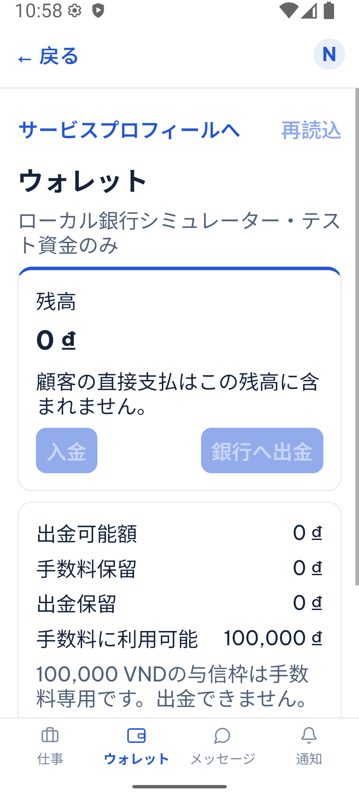
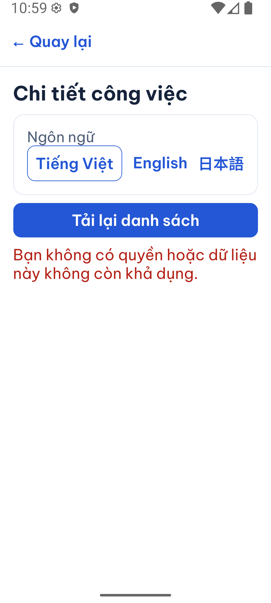
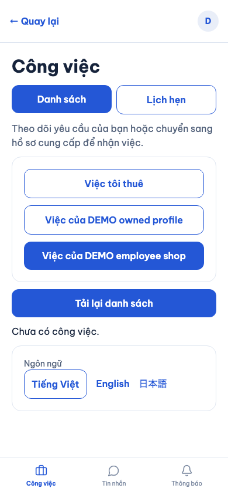

# B00-09 — Thao tác ổn định, đúng màn và đúng hồ sơ

23/10/2026 · Đợt [LOCAL-01](../de-xuat/LOCAL-01-hoan-thien-luong-local.md), trên nền `cd719cb`. Phạm vi code/local; không phát hành, không dùng điện thoại hoặc dịch vụ thật. [Mục lục](../README.md).

## Bạn đã dùng được gì?

- Trong chat và đánh giá, một lần bấm được tiếp nhận ngay cả khi màn đang đọc lại dữ liệu nền. Màn ghi nhớ nội dung và phiên bản lúc bấm, chờ lượt đọc kết thúc rồi gửi một lần.
- Mở liên kết thuê dịch vụ khi chưa đăng nhập: app yêu cầu đăng nhập rồi mở lại đúng hồ sơ cần thuê. Người dùng vẫn phải xem và bấm gửi; app không tự tạo yêu cầu.
- Tài khoản → Chọn vai trò / hồ sơ → Dùng hồ sơ này: chủ hồ sơ có Công việc / Ví / Tin nhắn / Thông báo; nhân viên có Công việc / Tin nhắn / Thông báo. Khách có Tìm dịch vụ / Công việc / Tin nhắn / Thông báo. Có thể đổi hồ sơ ngay trong danh sách công việc.
- Avatar luôn là người đang đăng nhập. Quyền của hồ sơ được đọc từ máy chủ; chọn vai không cấp quyền admin hay quyền ví mới.
- `dvqb://jobs/ID`, `dvqb://jobs/ID/invoice`, `dvqb://jobs/ID/reviews`, `dvqb://partners/ID`, `dvqb://partners/ID/hire`, `dvqb://conversations/ID`, `dvqb://support/ID` mở đúng màn. Đối tượng không còn tồn tại hoặc không có quyền chỉ hiện thông báo lỗi.

Đây là hoàn thiện cách triển khai theo UI-16 và hợp đồng hiện hành, không chốt thêm nghiệp vụ. Chủ dự án sau đó đã duyệt bốn phần gallery, MFA, ngừng nhận việc và restore đầy đủ; xem [B02-05](B02-05-gallery-va-ngung-nhan-viec.md), [B11-05](B11-05-khoi-phuc-mfa.md), [B11-06](B11-06-backup-day-du-demo.md).

## Một lần bấm đi qua đâu?

“Phiên đăng nhập” là thông tin app dùng để chứng minh bạn là ai. Lượt đọc nền đôi khi đang dùng phiên đó để gia hạn hoặc đọc dữ liệu. Trước đây nút bị khóa theo lượt đọc này, nên bấm đúng thời điểm có thể không được nhận.

“Khóa chống trùng” là mã riêng của một lần gửi. Nếu mạng mất sau khi máy chủ đã nhận, nút thử lại dùng cùng mã và cùng nội dung. Chỉ lỗi `BUSY` nội bộ mới tự chờ lại; không tự gửi lại một thao tác mạng có kết quả chưa rõ.

## Đọc code theo thứ tự

| Bước | File và hàm | Nhận gì, làm gì, trả gì? |
|---|---|---|
| 1 | [routes.ts](../../../apps/mobile/src/app/navigation/routes.ts), `accountDestination`, `appLinkState` | Nhận đích/URL không đáng tin; chỉ giữ màn trong danh sách và UUID đúng dạng. Bỏ query, fragment, host khác, đường dẫn hành động hoặc dữ liệu gửi kèm. |
| 2 | [AppNavigator.tsx](../../../apps/mobile/src/app/navigation/AppNavigator.tsx), `Navigator` | React Navigation nhận URL khi khởi động và khi app đang mở; cùng dùng một bộ phân tích. Admin và tài khoản đình chỉ giữ luồng riêng. |
| 3 | [AccountScreen.tsx](../../../apps/mobile/src/features/auth/screens/AccountScreen.tsx) | Đăng nhập thành công, đang đúng màn và phiên rảnh mới chuyển đích. Chỉ truyền ID; không giữ mật khẩu, form thuê hoặc lệnh thanh toán trong route. |
| 4 | [JobCreateScreen.tsx](../../../apps/mobile/src/features/jobs/screens/JobCreateScreen.tsx), `Form` | Đọc lại hồ sơ bằng phiên hiện tại, hiển thị khả năng thuê; người dùng chọn nội dung rồi mới gửi. |
| 5 | [ProductRoleProvider.tsx](../../../apps/mobile/src/app/providers/ProductRoleProvider.tsx), `choose`, `refresh` | Đọc đủ các trang membership để tìm hồ sơ còn hoạt động; gắn lựa chọn với ID tài khoản. Đổi màn/quay lại foreground kiểm lại membership; đăng xuất xóa lựa chọn. |
| 6 | [OrganizationsScreen.tsx](../../../apps/mobile/src/features/organizations/screens/OrganizationsScreen.tsx), `select`; [JobsScreen.tsx](../../../apps/mobile/src/features/jobs/screens/JobsScreen.tsx), `changePartner` | Chọn hồ sơ rồi đọc việc theo `partner_id`. Chuyển về khách bỏ bộ lọc partner. |
| 7 | [ProductShell.tsx](../../../apps/mobile/src/app/layout/ProductShell.tsx); [FinanceScreen.tsx](../../../apps/mobile/src/features/finance/screens/FinanceScreen.tsx) | Vẽ đúng bộ tab và mở ví theo ID hồ sơ. API vẫn quyết định quyền; nhân viên không có tab Ví dù có thể được cấp đường xem ví trong tổ chức. |
| 8 | [session-ready.ts](../../../apps/mobile/src/features/jobs/state/session-ready.ts), `sessionOperation`; [mutation.ts](../../../apps/mobile/src/features/jobs/state/mutation.ts), `Mutation.run` | Chờ lượt đang chạy, kiểm lại tài khoản/màn; hủy không giữ lệnh để gửi lại sau. Lỗi mạng giữ đúng mã và nội dung cho lần thử lại chủ động. |
| 9 | [ConversationScreen.tsx](../../../apps/mobile/src/features/chat/screens/ConversationScreen.tsx), `Room`; [ReviewsScreen.tsx](../../../apps/mobile/src/features/reviews/screens/ReviewsScreen.tsx), `run` | Nhận lần bấm dù đang đọc nền; cập nhật kết quả chỉ khi màn còn hoạt động. Phiên bản đánh giá lúc bấm không tự đổi theo dữ liệu vừa tải. |

## Dữ liệu và lỗi

Lựa chọn vai chỉ ở bộ nhớ của phiên app, không lưu mặc định lâu dài. Sau khởi động lại, vai mặc định là khách; các màn có ID vẫn kiểm quyền bằng máy chủ. Một tài khoản có nhiều hồ sơ không bị tự chuyển sang chủ hồ sơ bất kỳ.

Mất mạng giữ thông tin lỗi và cho tải lại; không báo thành công giả. Nếu dữ liệu đánh giá đã đổi trong khi chờ, server trả xung đột phiên bản để người dùng đọc lại. Rời màn trước khi bắt đầu gửi hủy ý định; yêu cầu đã tới máy chủ không thể được “thu hồi” bằng việc đóng màn, nên chống trùng vẫn do server đảm nhiệm.

## Tự thử và kiểm hiểu

1. Chọn hồ sơ chủ sở hữu, mở Ví; chuyển sang hồ sơ nhân viên và kiểm tab Ví biến mất. Avatar vẫn cùng tên người.
2. Mở liên kết thuê khi chưa đăng nhập; sau đăng nhập kiểm đúng hồ sơ và chưa có yêu cầu nào được tự tạo.
3. Tắt mạng ở danh sách công việc, tải lại, bật mạng rồi tải lại. Không được hiện “đã gửi” từ một lượt đọc.

Vì sao không truyền cả form thuê trong URL? Vì URL chỉ cần xác định màn; quyền và dữ liệu phải được đọc lại. Vì sao giữ phiên bản cũ khi gỡ đánh giá? Vì đó là nội dung người dùng đã xem và đồng ý tác động; bản mới cần họ kiểm lại.

## Kiểm chứng và giới hạn

Kiểm native phát hiện khoảng trắng JSX trực tiếp trong thẻ tổ chức gây lỗi `Text strings must be rendered within a Text component`. Đã thêm test cấu trúc View tái hiện hai khoảng trắng, sửa và kiểm lại. Membership đọc nền dùng đường đọc thụ động hiện hành để không chiếm khóa form; kết quả trả muộn sau logout bị từ chối. Ảnh web còn phát hiện hồ sơ nhân viên hiện ID rút gọn khi không có quyền sửa hồ sơ; bài kiểm đã tái hiện rồi xác nhận dùng đúng tên từ membership được xác thực.

Android còn tái hiện lỗi lượt đọc đầu của liên kết tranh khóa với thao tác foreground: màn đúng nhưng hiện lỗi tải chung trước khi gọi API. Test warm link bổ sung lỗi `BUSY` một lần và bắt buộc thông báo từ chối đúng quyền; trước sửa thất bại, sau sửa đạt. Màn chi tiết việc, snapshot hóa đơn và danh sách hội thoại dùng `sessionOperation` để chờ lại lỗi khóa nội bộ. Không thử lại mù các mutation mạng.

Hồi quy web toàn bộ còn bắt được ô mã lời mời ở màn Đội ngũ mở nhập trước khi effect tải lần đầu khóa form. Trace ghi rõ ô nhập từ editable chuyển readonly ngay trong `fill`, giá trị trở về rỗng và nút nhận lời mời không bật. Đã khởi tạo form ở trạng thái đang tải, thêm assertion giữ đúng mã sau nhập; không tăng timeout hay bỏ hành trình hai tài khoản.

Cùng lượt hồi quy, luồng hỗ trợ qua toàn bộ assertions nhưng timeout ở `Close test API`; trace cho thấy bước đóng hoàn tất sau khi browser đóng. Fixture nay chặn request/polling và kết nối WebSocket mới trước khi đóng socket/API, giữ trang cho ảnh lỗi và trace. Đây là sửa dọn môi trường test, không thay timeout hay điều kiện thành công nghiệp vụ.

Các bài kiểm tập trung tái hiện được lỗi nút chat/đánh giá trước khi sửa; kiểm hủy khi đổi tài khoản/rời màn, giữ ID sau đăng nhập, liên kết cold/warm và tài nguyên bị từ chối. Hành trình web `local-completion.spec.mjs` đã đạt: chủ/nhân viên, ví, VI/EN/JA, offline và logout. Các test điều hướng cũ chuyển sang chờ app đọc initial URL xong; không bỏ assertion nghiệp vụ.

iOS simulator đã đạt hành trình `local-completion`: chọn vai chủ hồ sơ, mở ví, VI/EN/JA, liên kết mở khi app đang chạy và khi khởi động tới đối tượng không khả dụng. Chữ hệ thống ở `extra-extra-extra-large`; form đăng nhập được thao tác bằng bàn phím native. Kết quả lưu tại `test-results/native/ios/local-completion/result.json` (23/10/2026).

Android emulator API 36 cũng đã đạt cả năm nhóm trên, font scale `1.5`, gồm mở nóng và mở nguội. Kết quả tại `test-results/native/android/local-completion/result.json` (23/10/2026). APK cũ thiếu WebRTC đã được thay bằng development APK hiện có; không bỏ module gọi. Script cuộn theo vùng nhìn thấy ở Android, chờ launcher tải xong và đóng app test trước khi dọn API; font được trả về giá trị ban đầu.

Ở development build Android/iOS, liên kết mở nguội đi qua màn chọn bundle của Expo. Bài kiểm chọn máy chủ local đã mở; Expo chuyển URL đang chờ vào `initialURL`, không gửi lại URL sản phẩm. Đây là bằng chứng mở nguội qua development launcher, chưa chứng nhận bản release có bundle nhúng. Không dùng build hoặc unit test để chứng nhận điện thoại thật, APNs/FCM, Universal Links, UAT hay production.

## Ảnh chạy thực tế

Ngày 23/10/2026, dữ liệu DEMO, API/PostgreSQL local. Ảnh iOS là simulator iPhone 18 Pro/iOS 27; Android là emulator API 36. Không phải điện thoại thật. Vai nhân viên được kiểm thêm trên web với tài khoản có membership giới hạn.

Tra cứu kiểm thử

- [account-return.test.tsx](../../../apps/mobile/src/app/navigation/account-return.test.tsx): whitelist, cold hire sau login, warm link bị từ chối.
- [ProductRole.test.tsx](../../../apps/mobile/src/app/layout/ProductRole.test.tsx): khách/chủ/nhân viên và logout.
- [session-ready.test.ts](../../../apps/mobile/src/features/jobs/state/session-ready.test.ts): hủy ý định chờ và kiểm tài khoản.
- [Work.test.tsx](../../../apps/mobile/src/features/jobs/screens/Work.test.tsx), [Reviews.test.tsx](../../../apps/mobile/src/features/reviews/screens/Reviews.test.tsx): tranh chấp lượt đọc/ghi và phiên bản cố định.
- [Web](../../../tests/e2e/web/local-completion.spec.mjs), [native](../../../tests/e2e/native/local-completion.yaml): chạy DB test riêng, dữ liệu DEMO; font lớn được trả lại sau test.
- Toàn bộ hồi quy: `npm run sdd:run -- --change SDD-PROJECT`, sau đó `npm run sdd:check -- --change SDD-PROJECT --phase verify`. Kết quả máy đọc hiện hành nằm trong `test-results/sdd/SDD-PROJECT/evidence.json`; chỉ có giá trị khi fingerprint khớp bộ file đang xem. Không lấy số của lượt trước thay kết quả này.
- Ba sơ đồ trong B00-09/B11-04 đã parse và render bằng Mermaid local trong Chromium (2 + 1 sơ đồ, không xuất thêm file ảnh sơ đồ).
- Đợt này chưa commit/push và chưa có CI mới. Nền P2 `cd719cb` đã có main CI thành công; bằng chứng nền không chứng nhận các sửa đổi LOCAL-01.

