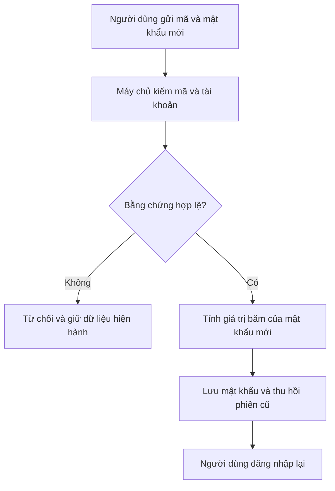
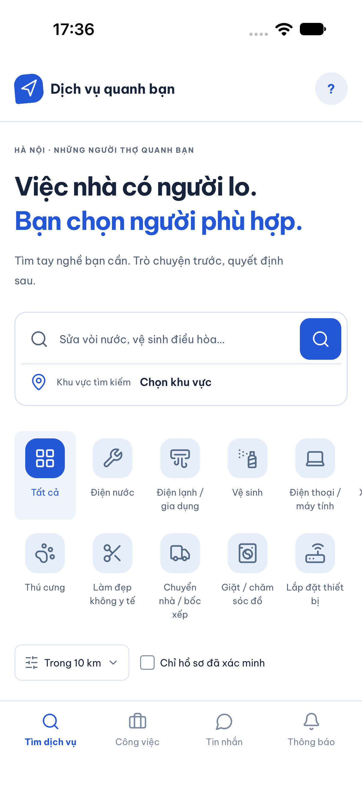
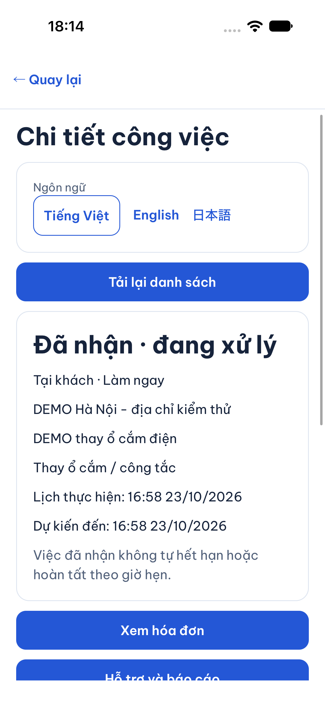
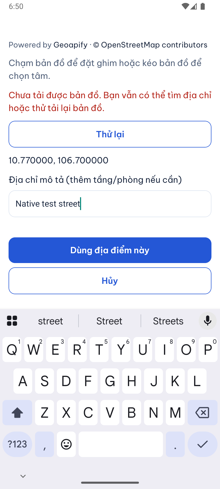
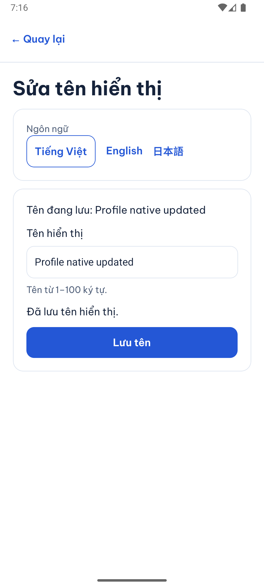
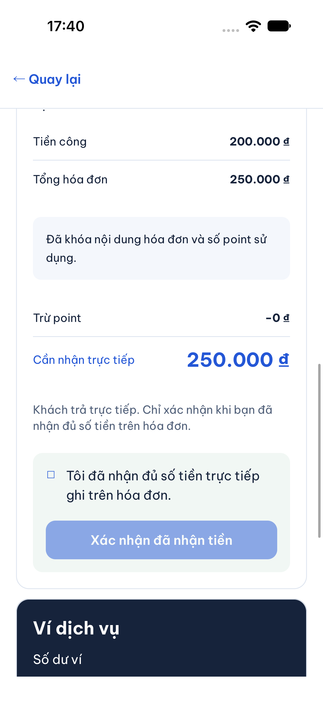
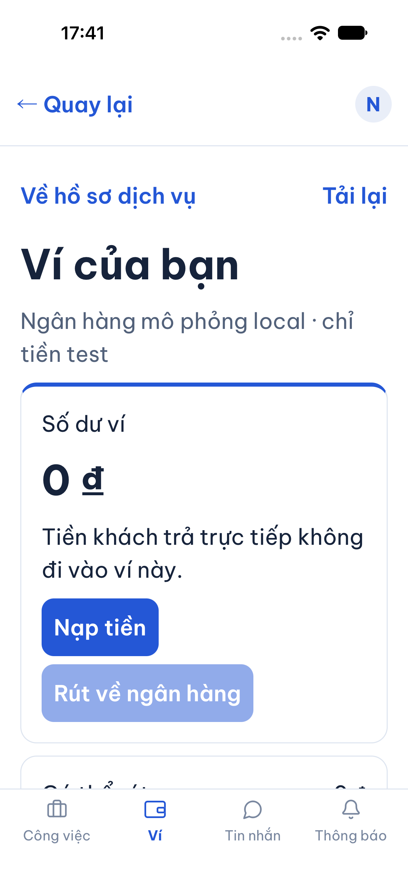
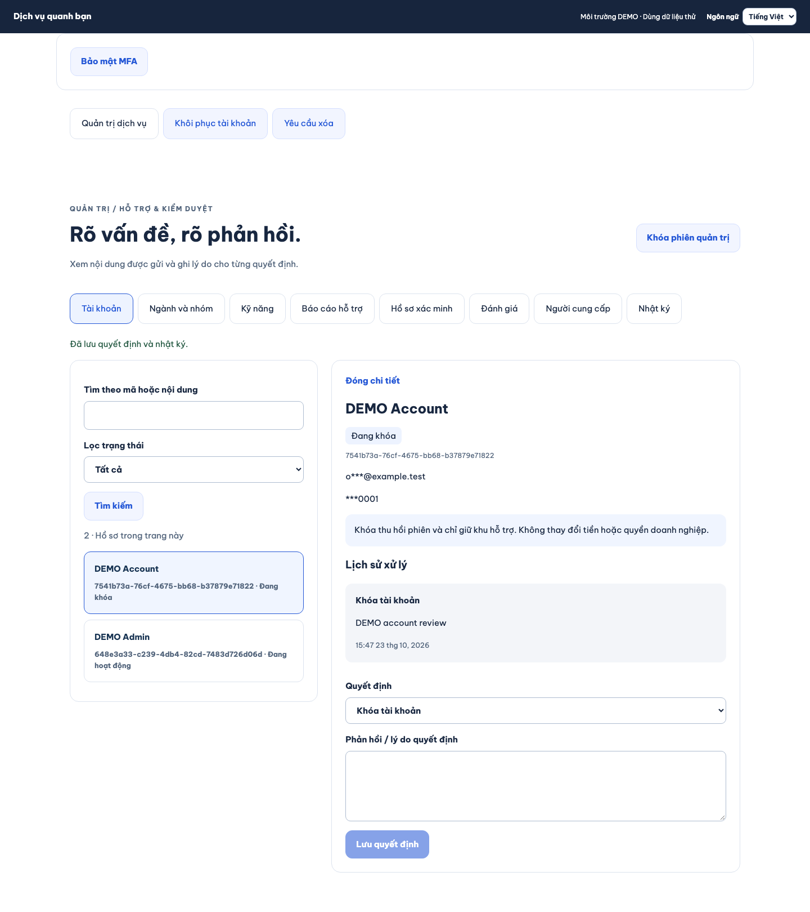
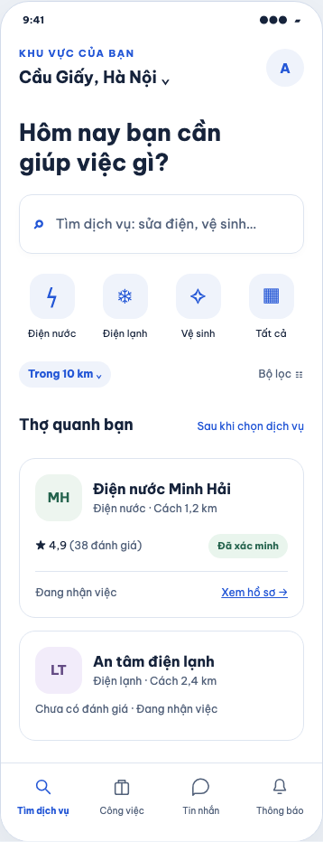
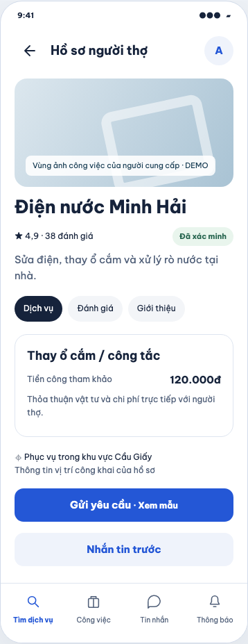

# B00-10 — Rà soát bảo mật, kiểm lại hệ thống và đề xuất giao diện

23/10/2026 · Yêu cầu rà soát của chủ dự án · Nền `feat/local-completion`, commit `1d925ce`; các sửa trong báo cáo là code local chưa commit/push. [Mục lục](../README.md) · [Checklist](../01-checklist.md).

## 1. Kết quả bạn có thể xem

[Bản đề xuất tương tác: 7 màn mobile và khu quản trị desktop](B00-10-de-xuat-giao-dien.html) cho phép chuyển giữa tìm dịch vụ, hồ sơ người cung cấp, công việc, chat, hóa đơn, ví và tài khoản. Đây là bản minh họa bằng dữ liệu DEMO, chưa áp dụng vào app và chưa nối API. Giao diện sản phẩm hiện hành sửa lỗi nút công việc dịch chuyển khi tải nền, cảnh báo xung đột giả từ polling, bổ sung cách đóng bàn phím ETA trên iOS và sửa lưu tên sau khi đổi ngôn ngữ.

Đã sửa thứ tự xử lý bảo mật: yêu cầu đặt/đổi mật khẩu không hợp lệ phải bị từ chối trước khi tính mật khẩu mới bằng thuật toán tốn tài nguyên. Đã nâng các thư viện có bản vá, gồm MapLibre web và Storybook. Các cảnh báo chưa có bản vá được giữ công khai phía dưới.

**CI phải đọc theo đúng phiên bản:** main `cd719cb` có [run 39717884524 xanh](https://github.com/anhthaingd/dich-vu-quanh-ban/actions/runs/39717884524). Nhánh đang kiểm `1d925ce` có [run 39910748394 thất bại](https://github.com/anhthaingd/dich-vu-quanh-ban/actions/runs/39910748394): 30/31 hành trình web đạt, bài công việc/chat không mở được ô lý do rút yêu cầu. Vì vậy không lấy CI main làm bằng chứng rằng nhánh hiện tại đã xanh. Bộ API đầy đủ độc lập đạt 177/177, coverage gate đạt; thời gian bài test khoảng 304 giây khi native đang chạy. Các sửa lần này cần CI mới sau khi được phép push.

### Bổ sung: mũi tên quay lại trong thiết kế, 28/10/2026

Chủ dự án duyệt sửa bản thiết kế trước: bỏ dòng chữ “Quay lại”, chỉ dùng icon mũi tên; không đặt nút ở màn chính. Phạm vi là HTML đề xuất B00-10, chưa duyệt áp dụng toàn bộ thiết kế vào app. Tìm dịch vụ và Ví là hai màn gốc của mẫu nên không có mũi tên. Hồ sơ người thợ, chi tiết công việc, hội thoại, hóa đơn và Tài khoản mở từ avatar có icon cùng hàng tiêu đề. Hai mẫu Công việc/Trò chuyện hiện là màn chi tiết, chưa có mẫu danh sách gốc của hai tab; không suy ra danh sách gốc cũng cần mũi tên.

Icon dùng SVG nét đơn, vùng bấm 44×44; nhãn `aria-label="Quay lại"` chỉ dành cho công cụ đọc màn hình, không hiển thị chữ hoặc tooltip. Bỏ dòng giới thiệu thương hiệu ở đầu màn chi tiết để tiêu đề và mũi tên nằm trên một hàng gọn.

Đích quay lại được lấy từ đường đi thực tế: Hồ sơ → Chat → mũi tên về Hồ sơ; Công việc → Chat → về Công việc; mở Tài khoản từ Ví → về Ví. `openScreen` nhận màn đích, lưu vị trí cuộn và đường đi trong `history.state`; `goBack` dùng lịch sử đó; `restorePreview` khôi phục khi dùng Back/Forward hoặc tải lại. `updatePreview` cập nhật màn, tiêu đề và trạng thái nút. Khi mở thẳng liên kết chưa có lịch sử, nút dùng đích dự phòng bên trong mẫu (hóa đơn → công việc → trang đầu), không đẩy người xem ra trang ngoài. Khi JavaScript tắt, liên kết chuyển màn vẫn dùng CSS và mũi tên trở về trang đầu; không mô phỏng lịch sử đầy đủ trong chế độ này.

Đã kiểm bằng Chromium trên file trực tiếp và Live Server 5501, chiều rộng 1400/390: icon không có chữ hiển thị, canh giữa với tiêu đề, vùng bấm, ẩn tại màn gốc, hai nguồn mở chat, nguồn mở tài khoản, Back/Forward, tải lại, liên kết trực tiếp, giữ vị trí cuộn, phím Enter, đóng lời giải thích Thông báo và bảy màn không tràn ngang/lỗi JavaScript. Đã kiểm đường dự phòng khi tắt JavaScript. Ảnh HTML ngày 28/10 nằm ở mục 6; đây không phải ảnh app native. Báo cáo native/API ngày 23/10 bên dưới là bằng chứng lịch sử; toàn SDD được chạy lại sau khi chốt bộ file, kết quả hiện hành đọc theo fingerprint ở mục 7.

### Bổ sung: sửa chuyển màn trong bản đề xuất, 23/10/2026

Bản đầu chỉ nối bảy nút ở cột chọn màn; tab Công việc và chữ Xem hồ sơ bên trong điện thoại là phần tử tĩnh. Đã tái hiện bằng Chromium: hai thao tác trong điện thoại không mở màn tương ứng, nhưng nút chọn màn bên trái mở được. Đây là thiếu sót của bản xem trước, không phải lỗi API hoặc lỗi app native.

Kiểm thêm đúng Live Server cổng 5501 phát hiện lỗi thứ hai: file thiếu cặp thẻ `head`/`body` tường minh, extension tìm điểm chèn ở `</svg>` và chèn mã tải lại vào nhiều icon, trong khi độ dài HTTP chỉ cộng một lần. Phản hồi bị cắt trước script chuyển màn (`typeof updatePreview` là `undefined`). Đã bổ sung cấu trúc HTML đầy đủ để Live Server chèn một lần trước `</body>`; không thay cấu hình extension. Đây là nguyên nhân menu chọn màn cũng có thể không hoạt động khi mở bằng Live Server.

Đã đổi lựa chọn màn thành liên kết `#home`, `#profile`, `#job`, `#chat`, `#invoice`, `#wallet`, `#account`. CSS `:target` chọn màn nên vẫn chuyển được khi trình xem tắt JavaScript; hàm `updatePreview` chỉ cập nhật tiêu đề, ghi chú và tab đang chọn khi JavaScript hoạt động. Có thể dùng nút Back/Forward của trình duyệt, mở liên kết một màn rồi tải lại. Trong điện thoại, bấm Xem hồ sơ → Gửi yêu cầu (xem mẫu) → Công việc → Trò chuyện hoặc Hóa đơn; avatar mở Tài khoản và liên kết xem mẫu Ví đối tác. Các thao tác xác nhận/tiền và mục tài khoản chưa mô phỏng sẽ mở lời giải thích, không gửi dữ liệu. Thông báo chưa có màn chi tiết; khu quản trị vẫn là bố cục tĩnh và được ghi rõ.

Cách xem: mở HTML bằng trình duyệt hoặc Live Server, tải lại trang đang mở. Chọn một trong bảy màn ở menu hoặc bấm liên kết trong điện thoại. Trên màn hẹp, vuốt ngang danh sách chọn màn để thấy các mục cuối. Đây mới là đề xuất bảy màn chính, chưa phải prototype đầy đủ mọi trang sản phẩm.

Đã kiểm lại bảy màn bằng cả file trực tiếp và Live Server cổng 5501, ở chiều rộng 1400/390 px, bật và tắt JavaScript: liên kết trong điện thoại, Enter bằng bàn phím, lịch sử Back/Forward, mở thẳng/tải lại `#invoice`, đường dẫn không hợp lệ trở về màn đầu, phản hồi các thao tác chưa mô phỏng; không có lỗi JavaScript hoặc tràn ngang. Ảnh HTML mới được xem lại; ảnh native giữ bằng chứng của lượt kiểm trước. Cấu hình Live Server `.vscode/settings.json` có sẵn từ workspace chỉ đặt cổng 5501, được giữ nguyên và đăng ký inventory/fingerprint; không coi là kiểm chứng extension IDE.

Trong lượt SDD sau sửa HTML, API đạt 176/177: bài `two actors reschedule after acquiring their own locks without deadlocking the customer foreign key` nhận 3 giao dịch chờ khóa thay vì 2. Worker thông báo chạy mỗi giây cũng khóa cùng hồ sơ người cung cấp; bộ đếm trước đó tính cả worker vào hai actor HTTP. Lượt tập trung không sửa cũng có thể đạt, nên đây là bài kiểm phụ thuộc thời điểm. Đã dừng và chờ worker hoàn tất trước khi dựng riêng tình huống hai actor trong [jobs-chat.test.ts](../../../services/api/test/integration/jobs-chat.test.ts); giữ tất cả kiểm tra hai response 200/409 và một bản ghi lịch sử, không đổi code xử lý công việc. Lượt tập trung sau sửa đạt; kết quả toàn gói cuối vẫn đọc từ evidence/verify bên dưới. Các bài notification riêng và toàn API tiếp tục kiểm worker thực.

## 2. Phát hiện và cách xử lý

Mức độ trong bảng là đánh giá tác động của đợt review, không phải chứng nhận pentest hoặc điểm CVSS tự tính. “Lỗ hổng thư viện” là cảnh báo của tác giả/GitHub; “tái hiện” là bài thử local trên ứng dụng này.

| Phát hiện | Bằng chứng và tác động | Xử lý local |
|---|---|---|
| Cao — tính mật khẩu mới trước khi kiểm chứng yêu cầu | `confirm` gọi scrypt trước kiểm challenge; `changePassword` gọi trước xác thực phiên/current password. Yêu cầu không hợp lệ vẫn chiếm một trong hai vị trí tính scrypt, có thể làm chậm đăng nhập. Chưa đo năng lực tấn công production. | Chuyển hash sau kiểm challenge, người dùng, mục đích, receipt hoặc chứng minh mật khẩu hiện tại. Bài test mới thất bại trước sửa (500 thay vì 400), đạt sau sửa; xác nhận không gọi scrypt khi challenge không tồn tại, mã sai, mã hết hạn hoặc đổi mật khẩu thiếu phiên. |
| Critical theo advisory — MapLibre web lọc HTML attribution không đủ | [GHSA-jrc7-96c5-q579](https://github.com/advisories/GHSA-jrc7-96c5-q579), bản lỗi đến 6.4.0. App đọc style/attribution bên ngoài; tồn tại đường hiển thị liên quan. | `maplibre-gl` 5.22.0 → 6.4.1. Thử style DEMO có hai thuộc tính `on*` liền nhau: không còn thuộc tính xử lý sự kiện và không chạy mã chèn. Bản đồ thật render đạt. |
| Critical theo advisory — Storybook development | [GHSA-f2ph-cmg5-wxc8](https://github.com/advisories/GHSA-f2ph-cmg5-wxc8). Phạm vi máy phát triển; không đồng nghĩa API production bị khai thác. | Storybook và hai package đi kèm lên 10.6.3. Chỉ sửa dependency/lock của prototype, không sửa thiết kế hoặc spec. |
| Cao theo advisory — Node CI cũ | `.nvmrc` và engines ghim 24.7.0; máy đang test thực tế là 24.22.1. [Node security release 21/10](https://nodejs.org/en/blog/release/v24.22.1) vá TLS/DNS/Brotli và các thành phần runtime. | Đồng bộ `.nvmrc`, engines và lock metadata sang 24.22.1. Workflow hiện hành đọc `.nvmrc`, giữ cùng nhánh Node 24. Không tuyên bố đã nâng máy production hoặc chứng minh khả năng khai thác app. |
| Các dependency có bản vá | Vite dev server, shell-quote, MCP SDK, source-map-js, ip-address. | Vite 7.3.7, shell-quote 1.12.0, SDK 1.32.1, source-map-js 1.2.2, ip-address 10.7.4; giữ phiên bản tương thích ngoài MapLibre major cần cho vá. |
| Lỗi tương tác công việc khi tải nền | Trace CI: dòng “Đang tải…” được chèn phía trên nội dung trong lúc bấm, đẩy nút khỏi vị trí chạm; ô lý do không mở. | Chỉ hiện dòng tải khi chưa có công việc. Giữ bản nháp và chờ snapshot mới trước xác nhận. Thêm assertion vào bài test tải nền hiện có; không tăng retry/timeout. |
| Cảnh báo xung đột giả khi đang nhập công việc | Polling dự phòng sau 15 giây báo “Dữ liệu đã đổi” dù chưa đọc được thay đổi; có thể chèn thông báo đẩy nút. Tái hiện bằng timer trong Work.test. | Hoãn đọc nền trong lúc đang soạn thao tác; khi gửi vẫn dùng expected_version và kiểm quyền server. Tín hiệu thu hồi quyền vẫn xóa nội dung ngay. |
| Đổi ngôn ngữ làm lưu tên bị xung đột | Native iOS nhập tên, đổi VI/EN/JA rồi lưu: server tăng phiên bản tài khoản khi lưu ngôn ngữ nhưng bản nháp tên vẫn giữ phiên bản cũ. | ProfileEditor dùng phiên bản snapshot mới khi tên server vẫn bằng tên ban đầu. Nếu tên đã đổi, giữ kiểm xung đột; retry chưa rõ kết quả giữ nguyên payload/key. Hai bài unit kiểm cả nhánh an toàn và không ghi đè người khác. |
| Bài native xóa địa chỉ từ giữa chuỗi | Tap giữa ô đặt con trỏ trước ký tự cuối của địa chỉ gợi ý; backspace để lại “s”, nên kết quả thành “Native test streets”. Tắt autoCorrect không giải quyết được và đã bỏ thay đổi thử này. | Tap gần cuối chính ô nhập trước xóa, xác nhận ảnh ô rỗng và giữ assertion nguyên văn “Native test street”. Không nới expectation. |
| Bàn phím Android che ô mô tả địa điểm | Ảnh khi đang nhập cho thấy ô nằm dưới bàn phím; Modal chỉ cấu hình KeyboardAvoidingView trên iOS. | Thêm behavior height cho Android để phần cuộn và nút xác nhận nằm trên bàn phím. Native kiểm và chụp ô có chữ đang nhập khi bàn phím còn mở; iOS giữ padding và chạy lại luồng địa chỉ. |
| Bài native không khớp trạng thái/nhãn hiện hành | Sau nhận việc, trạng thái ở ngoài khung nhìn. Tên người cung cấp trên iOS có nhãn trợ năng “Xem hồ sơ · …”. Nút đổi ngôn ngữ có thể chỉ hiện một phần. | Chờ nút đăng xuất enabled và cuộn đầy đủ trước thao tác; cuộn đến trạng thái trước assert; dùng đúng nhãn trợ năng; cuộn nút ngôn ngữ vào giữa và hiện đủ trước chạm. Khi đổi tiếng Anh ở công việc, chờ nhãn trạng thái dịch xong thay vì cuộn qua đích đang đổi. Màn bảo mật phải có trường mật khẩu hiện tại mới được tính đã mở; chữ tiêu đề trùng nhãn nút ở màn tài khoản không đủ làm bằng chứng. Không xóa kiểm tra nghiệp vụ. Ảnh native còn chỉ ra bàn phím number-pad iOS không có phím hoàn tất, che nút xác nhận và các cử chỉ Maestro không đóng được. Ô ETA trên iOS chuyển sang bàn phím số/ký hiệu có phím Done, gọi Keyboard.dismiss khi hoàn tất; vẫn kiểm chỉ nhận số phút nguyên dương. Android giữ number-pad. |

**Cảnh báo còn mở:** audit root giảm từ 106 mục (32 critical) xuống 52 mục (0 critical, 49 high, 3 moderate). Đây là số package bị ảnh hưởng kể cả phụ thuộc bắc cầu, không phải 52 lỗ hổng độc lập trong API. Các gốc còn lại là `braces 3.0.3` qua micromatch, `node-forge 1.4.0` qua Expo CLI/code-signing-certificates và `uuid 7.0.3` qua xcode (đối chiếu bằng npm explain). Tại ngày kiểm, [braces](https://github.com/advisories/GHSA-vfj7-8cjw-p6xm) và [node-forge](https://github.com/advisories/GHSA-86w9-cpqp-85rv) chưa có bản vá được công bố. Nhánh uuid cũ đi qua công cụ xcode, chỗ gọi hiện hành dùng v4; [advisory UUID](https://github.com/advisories/GHSA-w5hq-g745-h8pq) nhắm các hàm tạo UUID dùng bộ đệm, chưa chứng minh đường khai thác chạy trong sản phẩm. Không ép override major để lấy audit xanh. Audit dependency production riêng API: 0 cảnh báo; prototype sau nâng: 0. Các số này chỉ là snapshot registry ngày kiểm, không chứng minh không còn lỗ hổng.

MapLibre 6 yêu cầu WebGL2/ES2022 và có thay đổi API so với 5. Đã đối chiếu các chỗ gọi hiện hành, typecheck và Chromium render; SDK bản đồ native không đổi. WebView/trình duyệt cũ và GPU thiết bị vật lý chưa được kiểm ở đợt này.

## 3. Theo một yêu cầu đặt lại mật khẩu

Người dùng gửi mã xác minh cùng mật khẩu mới. API là chương trình phía máy chủ nhận yêu cầu đó. Máy chủ phải kiểm mã còn hạn, đúng mục đích và đúng tài khoản trước khi làm phép tính mật khẩu tốn tài nguyên. Scrypt tạo giá trị băm để lưu, không lưu mật khẩu người dùng nhập.

Với đổi mật khẩu trong tài khoản, bằng chứng là phiên đang hoạt động và mật khẩu hiện tại. Nếu sai, trả lỗi trước tính mật khẩu mới. Nếu ghi dữ liệu thất bại, giao dịch cơ sở dữ liệu được hoàn tác; không báo thành công giả. Những giới hạn thử mã, thời hạn và kiểm quyền hiện hành được giữ.

| Thứ tự đọc | File và hàm thật | Nhận gì → xử lý gì → trả gì |
|---|---|---|
| 1 | [security.service.ts](../../../services/api/src/modules/account-security/security.service.ts), `confirm`, `consume` | Nhận challenge/mã/mật khẩu; kiểm mục đích, người dùng và chứng cứ khôi phục trước hash. |
| 2 | Cùng file, `changePassword`, `actor`, `proof` | Nhận phiên/mật khẩu hiện tại; xác thực lại dưới khóa tài khoản, chỉ tính hash mới khi proof đạt. |
| 3 | [password.ts](../../../services/api/src/modules/auth/password.ts), `hashPassword` | Tính scrypt có giới hạn đồng thời; đầu ra là chuỗi băm có salt, không phải mật khẩu rõ. |
| 4 | `revoke` trong service | Thu hồi phiên của tài khoản sau thay đổi; caller phải đăng nhập lại theo kết quả. |
| 5 | [account-security.test.ts](../../../services/api/test/integration/account-security.test.ts) | Thay hàm scrypt bằng hàm báo lỗi trong test; yêu cầu thiếu chứng cứ vẫn phải trả 400/401 và số lần gọi bằng 0. |
| 6 | [profile-editor.ts](../../../apps/mobile/src/features/accounts/state/profile-editor.ts), `save` | Nhận tên bản nháp, so sánh tên hiện hành với tên lúc bắt đầu. Chỉ lấy phiên bản mới nếu tên chưa đổi; giữ kiểm xung đột và khóa retry. |
| 7 | [JobDetailScreen.tsx](../../../apps/mobile/src/features/jobs/screens/JobDetailScreen.tsx), `JobDetailScreen` và [Work.test.tsx](../../../apps/mobile/src/features/jobs/screens/Work.test.tsx) | Giữ nội dung cũ trong lúc đọc nền, không chèn thêm dòng đẩy nút. Nội dung người dùng nhập vẫn ở state (bộ nhớ tạm của màn); máy chủ quyết định quyền và trạng thái sau cùng. |

## 4. Rà soát các bề mặt bảo mật

Đã đọc và nối các luồng xác thực/refresh/revoke, khôi phục/xóa tài khoản, MFA admin và mã dự phòng, quyền công việc/chat/realtime/cuộc gọi, upload/đọc tài liệu, giao dịch ví và idempotency (gửi lại cùng thao tác không tạo hai giao dịch), proxy bản đồ, log lỗi và workflow CI. Bộ kiểm dùng DB riêng, người dùng DEMO, ngân hàng mô phỏng.

Các kiểm soát hiện có được đối chiếu trong code: API kiểm quyền tài nguyên phía server; refresh token bị thu hồi theo family; quyền tài liệu được đọc lại trước phát nội dung; ảnh được giới hạn dung lượng/pixel và mã hóa lại; MFA có hạn/replay protection; tiền dùng transaction và phiên bản; logger lọc dữ liệu nhạy cảm. Đây là phạm vi review, không phải tuyên bố đã thử mọi biến thể khai thác. Quét mẫu private key và token AWS/GitHub/OpenAI/Slack trên 839 file văn bản Git quản lý không có kết quả khớp; không quét lịch sử Git, file nhị phân/lớn hoặc thư mục local bị ignore, nên không gọi đây là chứng nhận không có secret. Kiểm API/web cung cấp bằng chứng cho các tình huống được viết thành test; không thay pentest triển khai thật.

## 5. Vì sao giao diện còn sơ sài và hướng đề xuất

Đã đối chiếu design system/prototype hiện hành, điều hướng UI-16 và ảnh app chạy thật. Vấn đề chính là phân cấp thông tin: tiêu đề/khối mô tả chiếm nhiều chiều cao, nhiều hành động cùng dạng nút xanh lớn, thẻ gần như chỉ có chữ, các nhóm quản lý dài. Các màn nghiệp vụ dùng được nhưng chưa giúp người dùng nhận ra việc quan trọng nhất ngay khi mở.

| Nhóm màn | Quan sát và hướng sửa thiết kế đề xuất |
|---|---|
| Tìm dịch vụ, bộ lọc, bản đồ | Đưa vị trí và ô tìm kiếm lên đầu; giới hạn nhóm danh mục ban đầu, dành chỗ cho kết quả; thẻ có ảnh/nhận diện, đánh giá và giá tham khảo. Không tự bật GPS hay thêm xếp hạng ngoài contract. |
| Hồ sơ công khai, gallery, quản lý partner/đội ngũ | Hồ sơ có phần giới thiệu ngắn, gallery nhất quán, dịch vụ và vùng phục vụ rõ; khu chỉnh sửa chia nhóm nhỏ. Chỉ hiển thị “đã xác minh” khi dữ liệu thật có trạng thái đó. |
| Công việc, lịch, yêu cầu/nhận việc | Một tóm tắt trạng thái và bước tiếp theo; hành động chính nổi bật, lịch sử/tác vụ ít dùng xuống phần phụ. Giữ các điều kiện nhận/hủy/đổi lịch. |
| Chat, cuộc gọi, thông báo | Header gắn người và công việc, bong bóng tin nhắn rõ, ô soạn cố định; đánh dấu chưa đọc và trạng thái gửi/lỗi có chữ. Không công bố đã kiểm âm thanh/push provider thật từ ảnh. |
| Hóa đơn, point, ví/ngân hàng | Trình bày tiền theo dòng rõ ràng; phân biệt tiền khách trả trực tiếp với số dư ví dịch vụ; hai dấu đã trả/đã nhận vẫn độc lập. Không thêm thanh toán thẻ/tiền thật. |
| Tài khoản, địa chỉ, phiên, bảo mật/khôi phục | Dùng hàng cài đặt có nhãn phụ, ngôn ngữ trong khu cài đặt; hành động nguy hiểm tách riêng; xác nhận và lỗi đặt gần trường liên quan. |
| Hỗ trợ, xác minh, đánh giá | Biểu mẫu theo bước ngắn, trạng thái xử lý rõ; tệp riêng và lý do bắt buộc vẫn theo quyền hiện hành. |
| Admin desktop/mobile | Sidebar desktop, danh sách–chi tiết rõ; mobile xếp tuần tự; bộ lọc cố định, hành động có hậu quả và lý do, không lẫn tab khách. |

Ba hướng đã cân nhắc: (A) chỉ chỉnh khoảng cách/màu — ít thay đổi nhưng vẫn còn màn dài; (B) thiết kế lại phân cấp theo nhiệm vụ, giữ nhận diện xanh và điều hướng — **khuyến nghị**, minh họa trong HTML; (C) đổi thương hiệu và điều hướng toàn bộ — phạm vi lớn, chưa có cơ sở cần làm lúc này.

Nguồn tham khảo chính thức: [Airbnb 2025 Services](https://news.airbnb.com/product-releases/airbnb-2025-summer-release) cho hình ảnh/hồ sơ và khám phá; [Taskrabbit](https://www.taskrabbit.com/how-it-works) cho tìm dịch vụ → so sánh người làm → trao đổi; [Grab Design](https://www.grab.com/inside-grab/stories/grab-a-seat-episode-3-podcast-design-head-patrick-jean/) cho tính nhất quán giữa nhiều dịch vụ. Đây là tổng hợp đề xuất cho app này, không sao chép nghiệp vụ thanh toán hoặc quảng cáo của app tham khảo.

Bản B chọn nền sáng, xanh chủ đạo, nhịp khoảng cách 8/16/24, chữ nội dung dễ đọc, nút chạm tối thiểu 44, một hành động chính theo trạng thái. Khi triển khai cần kiểm contrast, screen reader, bàn phím, VI/EN/JA, font lớn, safe area, offline/loading/error/empty. HTML chỉ minh họa vài trạng thái, không có đủ tất cả trạng thái sản phẩm. Không mở PROMO-02/banner/voucher.

## 6. Ảnh thực tế và bản đề xuất

Các ảnh dưới dùng DEMO/test, chụp ngày 23/10/2026. iOS là simulator, Android là emulator; không phải thiết bị vật lý. Ảnh ví thuộc bài font lớn; ảnh không thay bằng chứng thao tác. Admin là Chromium desktop local.

Ảnh bản HTML trên Chromium, viewport 390 px, ngày 28/10/2026; dữ liệu DEMO, chưa áp dụng vào app:

## 7. Kiểm thử và giới hạn

Kết quả tập trung: account-security 10/10, Work 21/21, typecheck ba workspace và build API đạt ở lượt kiểm tập trung; SDD cuối chạy lại trên bộ file bàn giao. Có RED trước sửa và GREEN sau sửa cho lỗi hash, tải nền và polling. Bốn bộ profile/editor/account/location tập trung đạt 17/17 sau bản vá phiên bản, có RED/GREEN cho tình huống đổi locale rồi lưu tên. MapLibre được thử qua bản đồ render thật với attribution độc hại mô phỏng; vị trí dữ liệu vẫn là DEMO.

**Native: 14/14 flow iOS simulator và 14/14 flow Android emulator đạt trong đợt này.** Đây là các hành trình đã đăng ký, không phải kiểm hết mọi trạng thái của mọi màn hoặc thiết bị vật lý. Bảng dưới giữ từng flow để kiểm lại đúng phạm vi:

| Flow | iOS | Android |
|---|---|---|
| catalog | PASS | PASS |
| auth | PASS | PASS |
| i18n | PASS | PASS |
| i18n-layout | PASS | PASS |
| shell | PASS | PASS |
| profile | PASS | PASS |
| accounts | PASS | PASS |
| partners | PASS | PASS |
| jobs | PASS | PASS |
| invoices | PASS | PASS |
| search-service | PASS | PASS |
| local-completion | PASS | PASS |
| local-approved | PASS | PASS |
| p2-screens | PASS | PASS |

Web độc lập đạt 31/31 trong khoảng 9,5 phút; API độc lập đạt 177/177 và coverage gate. Các lượt này diễn ra trước một số sửa bổ sung phát hiện từ native, nên không dùng thay cho lượt SDD cuối. Bộ mobile đầy đủ ở lượt SDD đầu đạt 73 suite/344 test trước khi thêm hồi quy polling và locale; API của lượt SDD đầu hết ngân sách tổng, lượt đó không đạt toàn gói.

**Kiểm bộ file bàn giao:** sau khi lưu báo cáo, chạy lại đủ 12 bước của `sdd:run`, rồi `sdd:check --phase verify`. Kết quả có hiệu lực là `test-results/sdd/SDD-PROJECT/result.json` và `evidence.json` khớp fingerprint của code, config, báo cáo và HEAD. Các số của lượt tập trung ở trên không thay cho kết quả này. Không chỉnh file nguồn/báo cáo sau khi chạy để giữ bằng chứng hợp lệ.

Bản đề xuất HTML: lượt đầu chỉ kiểm bảy nút chọn màn, chưa kiểm các nút bên trong điện thoại. Lượt bổ sung ở mục 1 đã kiểm trực tiếp các đường chuyển màn và trường hợp tắt JavaScript trên Chromium ở chiều rộng 1400/390; không có pageerror/tràn ngang. Các ảnh app và sơ đồ Mermaid đã được xem/render, liên kết file trong báo cáo đã kiểm.

SDD giữ 151 tiêu chí, QA 96 partial/12 unmapped; không thay hash nguồn spec, không giảm tiêu chí để đạt. Bổ sung đường test vào tiêu chí liên quan và đăng ký các artifact báo cáo mới trong inventory. Inventory toàn repo không đồng nghĩa toàn bộ nghiệp vụ đã nghiệm thu.

Bằng chứng máy nằm trong `test-results/sdd/SDD-PROJECT`, `test-results/web`, `test-results/native`; không commit artifact chứa session/test runtime. Các log chẩn đoán ở `/private/tmp/dvqb-*` có thể mất sau dọn máy. CI artifact gốc được đọc để truy nguyên lỗi click; không dùng kết quả CI cũ làm kiểm chứng cho code mới.

Lệnh chạy lại và giới hạn bằng chứng

| Mục | Lệnh/nguồn |
|---|---|
| Chuẩn bị | `npm run sdd:check -- --change SDD-PROJECT --phase prepare` |
| Toàn bộ code/tooling/web/build/load | `caffeinate -i npm exec --yes --package=npm@11.5.1 -- npm run sdd:run -- --change SDD-PROJECT` |
| Kiểm khớp bằng chứng | `npm run sdd:check -- --change SDD-PROJECT --phase verify` |
| Web độc lập | `npm exec -- playwright test --config tests/e2e/web/playwright.config.mjs` |
| Native | `DEVICE_ID=<thiết bị giả lập> node scripts/test/native.mjs <ios/android> <flow>` |
| Dependency | `npm audit --json`; `npm audit --workspace services/api --omit=dev --json`; `npm audit --prefix ui-ux/prototype --json` |

Máy kiểm dùng Node 24.22.1; npm mặc định máy là 11.19.1, lượt SDD cuối gọi npm 11.5.1 qua `npm exec --package=npm@11.5.1` để khớp bản CI. Không thay npm toàn máy. `npm ci --dry-run --ignore-scripts` bằng npm 11.5.1 đạt cho cả root và `ui-ux/prototype`, xác nhận manifest/lock đồng bộ.

Native dùng development build đã cài và Metro chạy source hiện hành. Lookup địa chỉ dùng fixture; bản đồ nền native có thể báo chưa tải do chưa cấu hình provider trong runner. Không lấy hành trình địa chỉ này làm bằng chứng tiles/GPS/provider thật đã đạt. Đợt này không build lại binary phát hành, không thử store submission. Một lượt SDD đầu bị giới hạn tổng API 300 giây trong lúc nhiều bộ native/web cùng chạy; không được tính là PASS. Bộ API độc lập sau đó đạt 177/177 trong 303,9 giây, coverage gate đạt. Vì thời gian tích lũy của toàn bộ test đã vượt ngân sách cũ, recipe API được cấp 600 giây; không sửa assertion, retries, coverage hay giới hạn từng bài. Các lượt chạy lại và kết quả cuối được ghi rõ phía trên. Android AVD 2 GB có ANR cả system và app; stack mới nhất ở Expo DevMenu ShakeDetector/SystemSensorManager, CPU 95%, memory pressure some avg10 54%. Khởi động lại cùng AVD bằng tham số RAM 4 GB tạm thời, không đổi config và không xóa dữ liệu; các flow tiếp tục chạy được. Chưa kiểm release build trên thiết bị RAM thấp, nên không coi đây là đã chứng nhận hết ANR trên sản phẩm phát hành.

## 8. Bạn có thể tự thử và bước tiếp theo

1. Mở bản HTML và chuyển bảy tab màn để xem đề xuất B. So sánh cách đặt tìm kiếm, trạng thái công việc và số tiền với ảnh hiện hành.
2. Trên môi trường DEMO, mở công việc rồi thao tác khi đang tải nền: nội dung cũ không bị đẩy xuống; xác nhận vẫn chờ dữ liệu hợp lệ.
3. Với tài khoản thử, gửi mã khôi phục sai: ứng dụng báo lỗi, không đổi mật khẩu. Không thử tải lớn lên dịch vụ thật.

Tự kiểm hiểu: vì sao kiểm mã trước tính scrypt? Vì yêu cầu thiếu quyền không được chiếm tài nguyên tính mật khẩu mới. Vì sao 0 critical chưa đồng nghĩa an toàn? Vì audit chỉ biết cảnh báo dependency, còn lỗi logic và bề mặt triển khai cần kiểm riêng. Vì sao ảnh ví không phải tiền khách trả? Hai dòng tiền có ý nghĩa khác nhau, xem nhãn và contract hóa đơn.

Cần chốt hướng B trước khi áp dụng thiết kế mới đồng loạt. Nếu được duyệt, triển khai theo cùng hệ component và các luồng hoàn chỉnh: tìm–hồ sơ–yêu cầu; công việc–chat–hóa đơn; tài khoản/partner; admin. Không coi đề xuất này là yêu cầu cập nhật Drive/ui-ux/spec. Phần bảo mật/test đã sửa thuộc phạm vi được giao; commit/push, CI mới, thiết bị vật lý, APNs/provider, UAT và production vẫn tách riêng.
