# B00-11 — Áp dụng thiết kế vào app

28/10/2026 · Chủ dự án yêu cầu triển khai từ bản [B00-10](B00-10-de-xuat-giao-dien.html). Đây là thay đổi giao diện trên code local, chưa commit/push, chưa CI mới hoặc UAT. [Checklist](../01-checklist.md).

## 1. Bạn đã dùng được những gì?

Mở app: trang tìm dịch vụ gọn hơn, các ngành nằm trên một hàng có thể vuốt. Chọn khu vực rồi tìm sẽ thấy thẻ người cung cấp có chữ viết tắt, khoảng cách, đánh giá và xác minh từ dữ liệu thực tế. Avatar vẫn mở Tài khoản; các tab chính giữ đúng vai trò khách, chủ hồ sơ và nhân viên.

Mở một màn chi tiết: mũi tên 44 × 44 nằm cạnh tiêu đề, không có chữ “Quay lại”. Người dùng trình đọc màn hình vẫn nghe được tên thao tác. Trang gốc của Tìm dịch vụ, Công việc, Tin nhắn, Thông báo và tổng quan Ví không có mũi tên. Danh sách trò chuyện được mở riêng từ một công việc vẫn có mũi tên vì còn ngữ cảnh để trở về.

| Màn | Thay đổi người dùng nhìn thấy |
|---|---|
| Tìm dịch vụ | Giới thiệu ngắn, thanh tìm và chọn khu vực lên cao, hàng ngành có thể vuốt, thẻ kết quả có khoảng cách rõ |
| Hồ sơ người cung cấp | Ảnh thật được ưu tiên nếu có; không chừa ô ảnh rỗng. Tên, xác minh và liên hệ/yêu cầu đặt trước nội dung dài |
| Chi tiết công việc | Nhãn trạng thái, kỹ năng và tên người cung cấp rõ hơn; nút tải lại là thao tác phụ ở cuối |
| Trò chuyện | Tin của mình bên phải, của người khác bên trái; có liên kết công việc khi mở từ công việc; ô soạn cố định dưới hội thoại |
| Hóa đơn | Tiền trả trực tiếp nằm trong khối nền đậm, thao tác xác nhận rõ; tiến trình chuyển xuống dưới phần hóa đơn |
| Ví | Số có thể rút nổi bật; phí đang giữ và tiền chờ rút riêng biệt; tên hồ sơ lấy từ quyền thành viên thực tế |
| Tài khoản | Point khả dụng ngay dưới tên, các mục tài khoản thành hàng thay cho nhiều nút xanh; ngôn ngữ tập trung ở Tài khoản cho các màn thao tác |
| Quản trị web | Menu nghiệp vụ bên trái trên desktop; danh sách và chi tiết có vùng riêng, bố cục nhỏ tự về một cột |

Bản HTML dùng số tiền, ảnh và tên minh họa. App chỉ hiện dữ liệu API đang có: không tạo đánh giá, ảnh, mốc lịch sử hoặc giá tham khảo giả để giống bản mẫu. Hồ sơ hiện chưa có trường giá theo kỹ năng trong API public nên không bổ sung giá giả. Chat chưa có thông tin “đang trực tuyến/đã xem” thì không hiển thị. Màn admin mobile tiếp tục console riêng, được hưởng kiểu chữ/nút chung, không biến thành desktop thu nhỏ.

## 2. Theo một thao tác từ đầu đến cuối

Ví dụ mở Tài khoản rồi xem Point: `AccountScreen` nhận phiên người dùng, `AccountPoints` đọc số dư từ API `/me/points`. “Khả dụng” là phần còn có thể dùng, khác tổng số đã gồm khoản đang giữ. Không nhận được dữ liệu thì hiện lỗi và nút thử lại, không tự cho số dư bằng 0. Đăng xuất gỡ khối Point của người cũ.

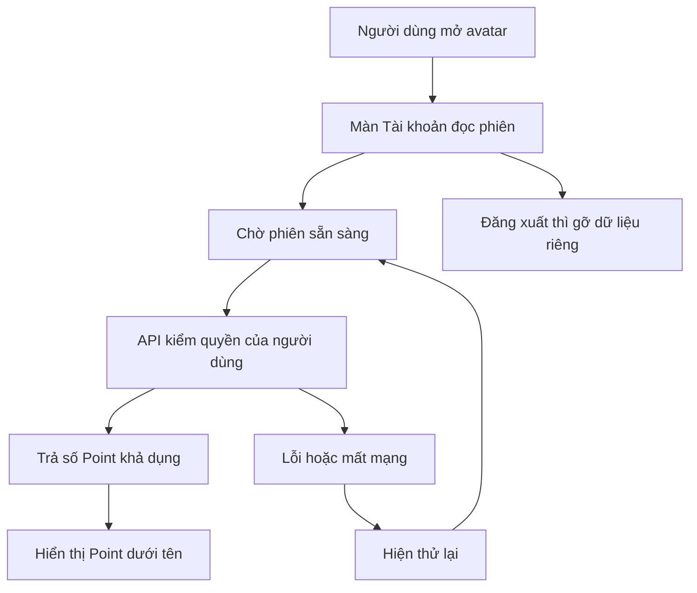

`ProductShell` là phần đầu trang và thanh tab dùng chung. Nó nhận tiêu đề, cờ `root` xác định màn gốc và hàm xử lý quay lại. Nó chỉ vẽ mũi tên khi có nơi quay lại và màn không phải gốc; React Navigation vẫn quản lý màn trước đó. Ví có các trang con trong cùng một màn nên mũi tên của trang ngân hàng/nạp/rút trở về tổng quan Ví.

Trong chat, `Screen` có chế độ không tự cuộn; `Room` quản lý vùng cuộn hội thoại, còn ô soạn ở dưới. `useAccountRefreshControl` chuyển bộ kéo làm mới đến đúng vùng cuộn đó. Vì vậy người dùng vẫn kéo tải lại, thử lại khi mất mạng và giữ bản nháp, không tạo hai vùng cuộn lồng nhau.

## 3. Mở code theo thứ tự nào?

| File và hàm | Nhận gì, làm gì, trả gì? |
|---|---|
| [ProductShell](../../../apps/mobile/src/app/layout/ProductShell.tsx), `ProductShell` | Nhận tiêu đề, màn gốc, các callback; dựng header/mũi tên/avatar/tab theo vai trò |
| [Screen](../../../apps/mobile/src/components/ui/Screen.tsx), `Screen` | Nhận nội dung; chọn vùng cuộn thông thường hoặc vùng flex cho chat |
| [AccountPage](../../../apps/mobile/src/features/accounts/components/AccountPage.tsx), `AccountPage`, `useAccountRefreshControl` | Kiểm phiên trước nội dung riêng, dùng tiêu đề trong header, chuyển kéo làm mới cho chat |
| [Tìm dịch vụ](../../../apps/mobile/src/features/search/screens/SearchScreen.tsx), `SearchScreen` | Giữ bộ lọc/toạ độ và API tìm kiếm, trình bày các kết quả thành thẻ |
| [Hồ sơ](../../../apps/mobile/src/features/partners/screens/PartnerProfileScreen.tsx), `Profile` | Đọc hồ sơ public, chỉ hiện các nút thuê/nhắn mà máy chủ cho phép |
| [Công việc](../../../apps/mobile/src/features/jobs/screens/JobDetailScreen.tsx), `Detail` | Đọc việc và tên hồ sơ, dùng `allowed_actions` cho thao tác hợp lệ |
| [Chat](../../../apps/mobile/src/features/chat/screens/ConversationScreen.tsx), `Room` | Giữ thứ tự tin, ô soạn, retry cùng mã; phân biệt vị trí bong bóng bằng người gửi |
| [Hóa đơn](../../../apps/mobile/src/features/invoices/screens/InvoiceScreen.tsx), `row` | Phân cấp tiền công/vật tư/Point/tiền trực tiếp; giữ phép tính và xác nhận hiện hành |
| [Ví](../../../apps/mobile/src/features/finance/screens/FinanceScreen.tsx), `FinanceContent` | Dùng `withdrawable` cho số có thể rút, giữ kiểm quyền/ngân hàng/xác thực lại |
| [Tài khoản](../../../apps/mobile/src/features/auth/screens/AccountScreen.tsx), `AccountPoints`, `AccountLink` | Đọc Point có rào phiên và vòng đời; dựng danh sách điều hướng dễ quét |
| [Quản trị](../../../apps/admin/src/App.tsx), `Desk`; [CSS](../../../apps/admin/src/style.css) | Giữ danh sách/bộ lọc/quyết định/MFA, bố trí menu bên cạnh nội dung |

## 4. Dữ liệu, quyền và lỗi

Không đổi schema DB, contract API, cách tính tiền hoặc quyền backend. Các thao tác tạo/gửi/chỉnh hóa đơn, báo trả tiền, nhận tiền, rút tiền và gửi chat vẫn dùng logic hiện hành. Nút phụ màu nhạt không đồng nghĩa được phép thao tác: trạng thái disabled, khóa khi đang gửi và retry cùng mã vẫn giữ.

Ngôn ngữ không còn chen vào các màn `AccountPage`. Các bài kiểm giữ bản nháp đã chuyển sang đổi ngôn ngữ qua Tài khoản; unit test kích hoạt thay đổi locale qua provider để kiểm cùng trạng thái mà không phụ thuộc vị trí nút. Màn sửa thông tin cá nhân, chọn danh mục cũ và khu admin/hỗ trợ hạn chế vẫn có bộ chọn ngôn ngữ riêng hiện hành, nằm ngoài 7 màn thiết kế.

Rà soát luồng đổi ngôn ngữ qua avatar đã tái hiện một lỗi: thao tác lưu locale đến đúng lúc phiên đang kiểm tra, trả BUSY và giữ tiếng Việt. `AuthProvider` nay đợi phiên sẵn sàng trước khi lấy phiên bản hồ sơ và gửi cùng mã thao tác, vẫn kiểm đúng chủ tài khoản. Bài kiểm giữ một phản hồi xác thực rồi đổi ngôn ngữ chứng minh yêu cầu lưu đợi đúng phiên bản mới.

Point mới có bài kiểm lấy `available` thay vì `balance`, retry khi lỗi và xóa nội dung sau đăng xuất. Khung chat giữ bài kiểm phân trang, watermark đọc, mất phản hồi khi gửi, thu hồi quyền và kéo làm mới. Không đổi tiêu chí để lấy kết quả xanh.

## 5. Ảnh app chạy thật

Ảnh ngày 28/10/2026, dữ liệu DEMO/test. Ảnh trình duyệt là Expo web của sản phẩm, không phải bản HTML mẫu. Ảnh native ghi rõ simulator/emulator, không phải thiết bị vật lý.

| Tìm dịch vụ · Expo web 390 px | Hồ sơ · Expo web 390 px |
|---|---|
| 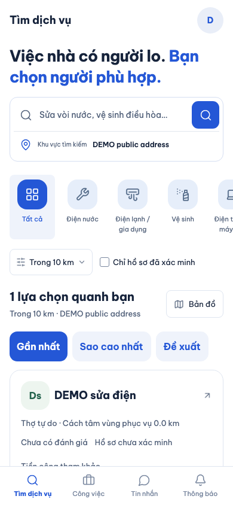 | 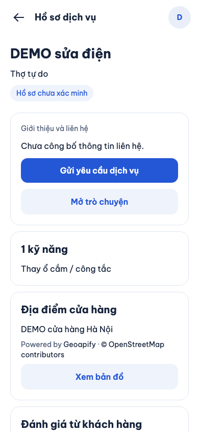 |

| Công việc · Expo web | Chat · Expo web |
|---|---|
| 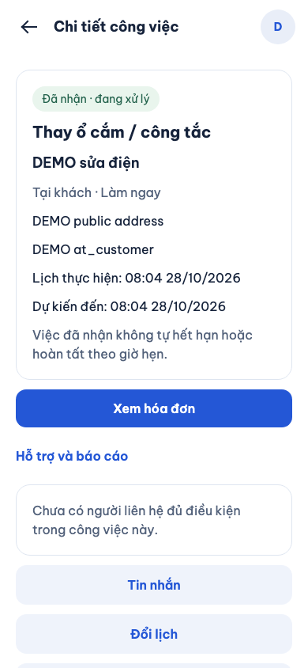 | 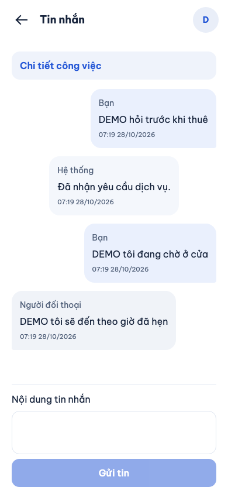 |

| Hóa đơn · ảnh vùng kiểm hóa đơn | Ví · Expo web |
|---|---|
| 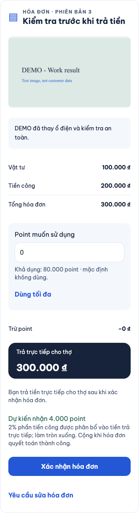 | 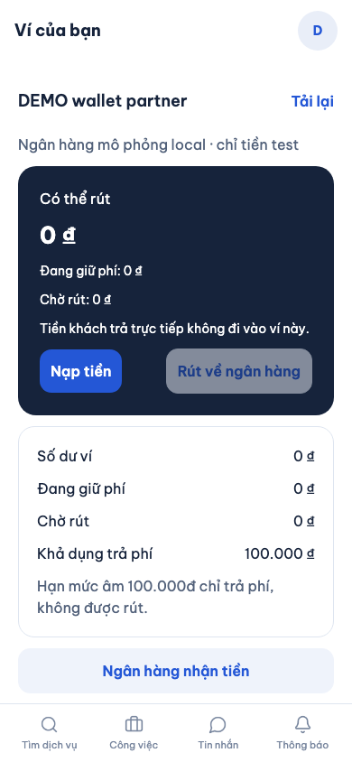 |

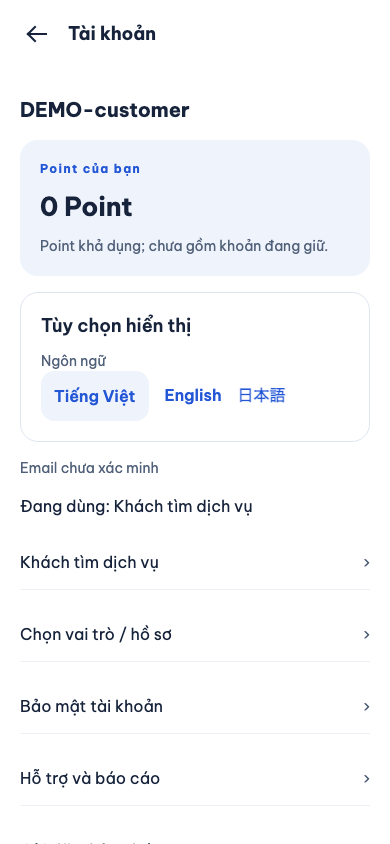

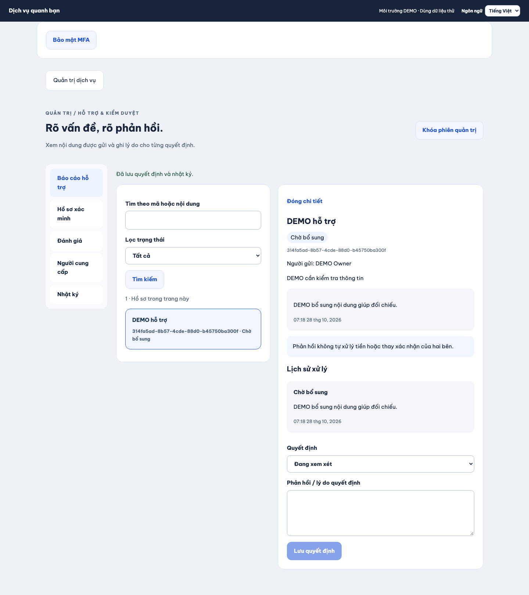

| Tìm dịch vụ · iPhone 18 Pro Simulator | Chat · iPhone 18 Pro Simulator |
|---|---|
| 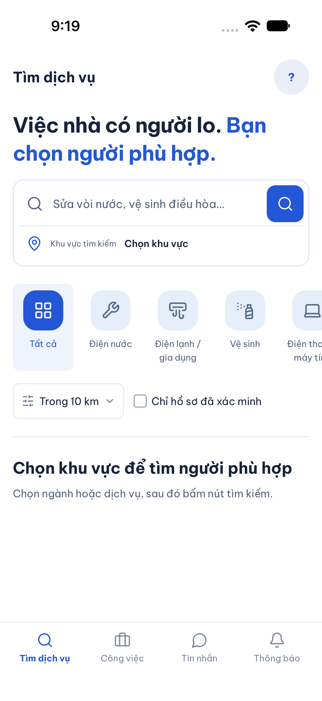 | 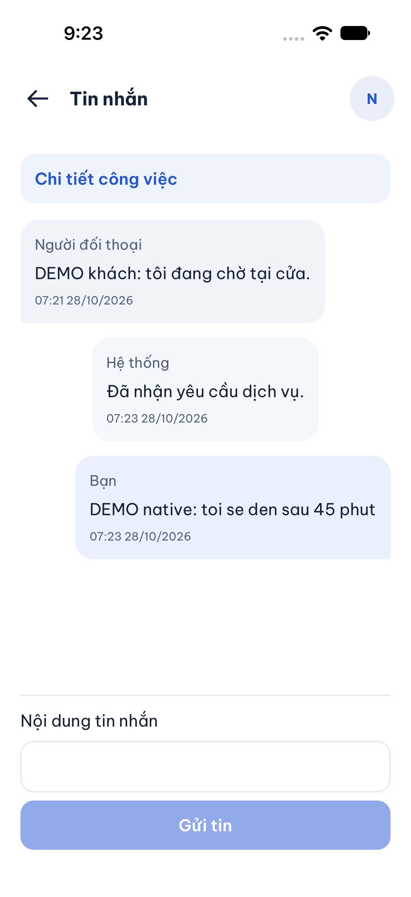 |

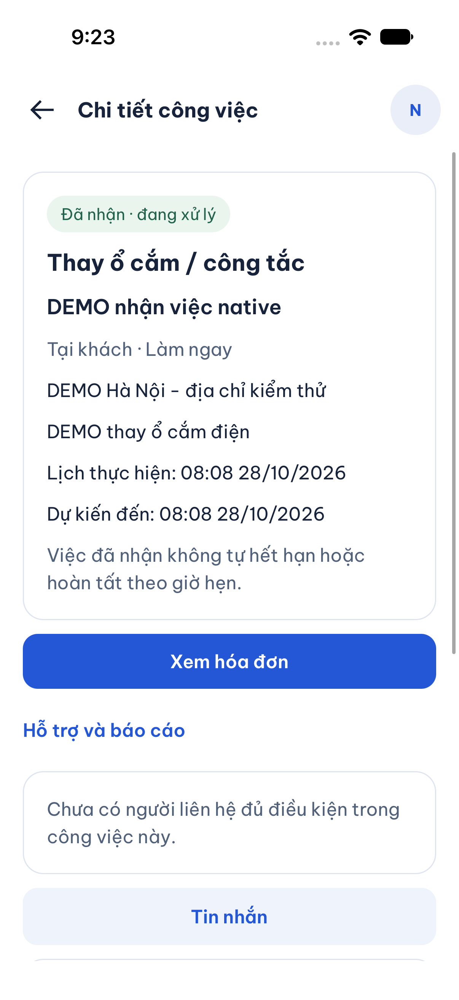

| Công việc · Android API 36 Emulator | Chat · Android API 36 Emulator |
|---|---|
| 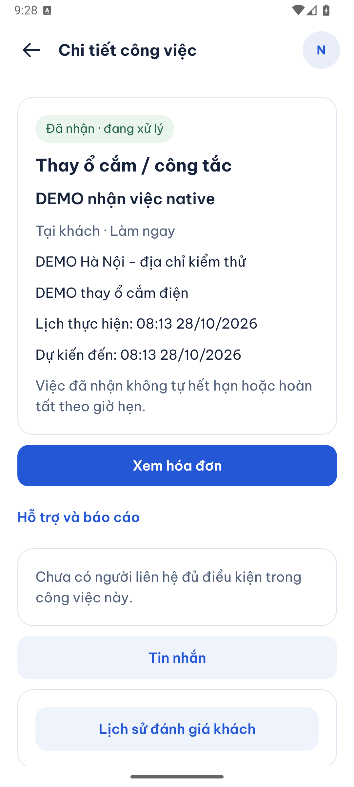 | 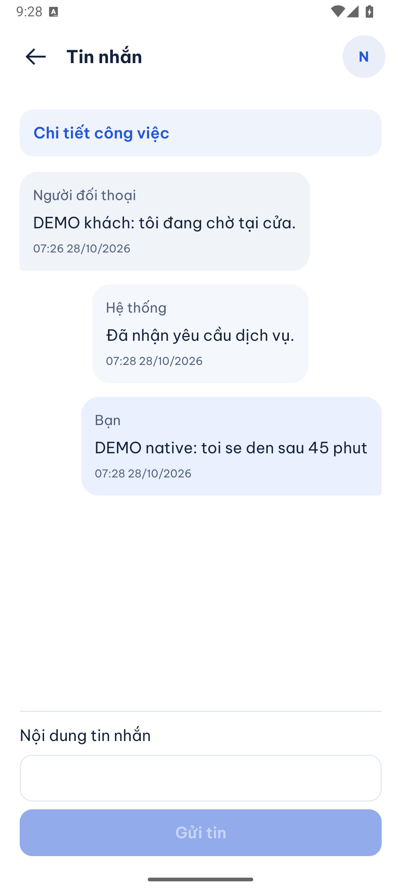 |

## 6. Tự thử và tự kiểm hiểu

1. Mở Tìm dịch vụ, chọn ngành và khu vực, tìm rồi mở một hồ sơ. Mũi tên chỉ xuất hiện khi đã đi vào màn con.
2. Mở avatar, xem Point, đổi ngôn ngữ rồi quay về. Mở Công việc/Tin nhắn/Thông báo từ tab để kiểm không có mũi tên trên màn gốc.
3. Mở chat từ công việc, nhập tin nhiều dòng và bật bàn phím. Ô soạn còn thao tác được; tin đã gửi xuất hiện đúng phía.
4. Trong DEMO, kiểm tiền công/vật tư/Point trên hóa đơn; xác nhận hóa đơn và báo thanh toán vẫn là hai bước khác nhau.

- Vì sao số Point có thể dùng không luôn bằng tổng số? Xem `PointWallet.available` và khoản `held`.
- Vì sao Ví không dùng `balance` làm số có thể rút? Xem `Wallet.withdrawable` và các khoản giữ.
- Vì sao mũi tên mất ở Tin nhắn nhưng có khi mở danh sách chat từ công việc? Xem `ConversationsScreen` và `root: !route.params?.jobId`.

## 7. Kiểm thử và giới hạn

Các kiểm trực tiếp ngày 28/10: lint và typecheck đạt; 349 bài Jest trong 73 suite đạt. Mười hành trình web liên quan đã đạt qua các lượt kiểm có chủ đích: shell/3 ngôn ngữ, hồ sơ người cung cấp, địa chỉ/phiên, thông báo, công việc/chat hai tài khoản, hóa đơn, Ví và ba luồng admin web/mobile (kiểm duyệt hai giao diện, hoàn tất thay thợ). Các ca mất phản hồi vẫn kiểm cùng mã thao tác và không ghi tiền hai lần.

iPhone 18 Pro Simulator iOS 27 đã đạt luồng `shell` (VI/EN/JA, chọn ngành/khu vực, tab) và `jobs` (nhận việc, ETA, đọc/gửi chat); bản cuối của luồng việc chạy lại sau chỉnh bố cục. Ảnh chỉ chứng minh các màn và trạng thái được chụp. Không suy ra tất cả màn native, mọi kích thước chữ hoặc mọi thiết bị đều đã kiểm.

Android API 36 Emulator đã đạt `jobs`: danh sách việc người cung cấp, nhận việc với ETA, đổi ngôn ngữ và đọc/gửi chat. Lần mở máy ảo đầu lỗi ColorBuffer từ snapshot, sau đó gặp hộp thoại System UI không phản hồi khi khởi động lạnh. Đã khởi động bằng đồ họa phần mềm, xử lý hộp thoại và kiểm lại đạt 1/1 flow; giữ log lỗi đầu, không coi đó là lượt app đạt. Không reset/xóa dữ liệu AVD.

SDD-PROJECT là bộ kiểm bàn giao toàn repo, chạy **sau khi chốt code, báo cáo, ảnh và inventory**. Bằng chứng máy đọc của lần chạy cuối nằm trong `test-results/sdd/SDD-PROJECT/evidence.json`; từng bước có log và report tương ứng. Dùng `npm run sdd:check -- --change SDD-PROJECT --phase verify` để xác nhận evidence khớp đúng code đang mở. Đây là dữ liệu sinh local, không lưu Git; không dùng evidence B00-10 trước khi đổi giao diện. Phạm vi giữ 151 criterion, QA 96 partial/12 unmapped; không tự tăng mức chứng nhận nghiệp vụ.

Lệnh, bằng chứng và các lỗi đã xử lý trong lượt kiểm

- `npm run lint`, `npm run typecheck`, `npm test -w apps/mobile`: đạt. Thêm 2 test cho Point và lưu locale trùng lúc xác thực; giữ mọi test cũ.
- Playwright chạy tuần tự bằng `tests/e2e/web/playwright.config.mjs`; các file thay đổi gồm `shell`, `jobs-chat`, `finance`, `partners`, `account-management`, `notifications`, `admin-completion`. Tên test và các kiểm quyền/tiền/retry gốc giữ nguyên.
- Luồng admin hoàn tất thay thợ đi từ chi tiết việc về trang Công việc gốc rồi mở Tài khoản qua avatar. Kịch bản cũ bấm quay lại lần nữa đã không còn đúng thiết kế; nay kiểm rõ màn gốc không có mũi tên, giữ các kiểm thanh toán/quyền và trạng thái báo cáo. Lượt web đầy đủ đầu đạt 30/31; ca này chạy lại riêng đạt 1/1 sau sửa, rồi chạy SDD đầy đủ lại trên bản cuối.
- Test Ví chuyển selector `finance-home` sang mũi tên `nav-back` của màn đang hiển thị. Không chọn nút trong các màn stack bị ẩn.
- Một lượt unit địa chỉ vượt 5 giây khi nhiều bộ kiểm/giả lập cùng khởi động; chạy riêng đạt và sau đó toàn 349 test đạt, không tăng timeout.
- Một lượt shell bị lỗi đóng trace vì hai tiến trình Playwright cùng thư mục output; đã chạy lại tuần tự cùng partner, cả hai đạt. Không coi lỗi artifact là lỗi sản phẩm.
- Lỗi đổi locale khi phiên đang BUSY được tái hiện trên web và sửa tại `AuthProvider`; regression test giữ phản hồi xác thực chậm, kiểm đúng phiên bản và ngôn ngữ sau lưu.
- Mermaid đã parse và render 9 node; kiểm liên kết nội bộ và `git diff --check`.
- Bộ SDD đầy đủ: `caffeinate -i npm exec --yes --package=npm@11.5.1 -- npm run sdd:run -- --change SDD-PROJECT`, dùng Node 24.22.1. Evidence và verify cuối mới là căn cứ cho toàn bộ 12 bước; kết quả kiểm từng màn ở trên không thay bộ đầy đủ.

Chưa commit/push, chưa có CI mới trên thay đổi này, chưa UAT hoặc kiểm thiết bị vật lý. Không đồng bộ Drive hoặc `ui-ux`. Bản thiết kế đã được duyệt triển khai qua yêu cầu ngày 28/10; các tài liệu nghiệp vụ cũ chưa được đồng bộ trong đợt này. PROMO-02 và các giới hạn provider/production giữ nguyên.

## 8. Đóng gói Git theo yêu cầu ngày 28/10/2026

Sau lượt kiểm local ở trên, chủ dự án yêu cầu commit/push. Gói gồm B00-10/B00-11 và các bản sửa bảo mật/test đã review. Cấu hình Live Server `.vscode/settings.json` chỉ đặt cổng trên máy cá nhân: giữ file local, thêm `.vscode/` vào ignore và bỏ mục đăng ký tạm khỏi inventory/scope SDD. Không bỏ code, test, criterion, required step hoặc sửa hash nguồn spec. Ghi chú đăng ký cấu hình này ở B00-10 là lịch sử của lượt kiểm thiết kế.

Trước đóng gói, toàn bộ 12 bước SDD local đạt: 349 mobile, 177 API, 55 tooling, 31 web; không có web bị bỏ qua hoặc flaky. Sau thay đổi đóng gói, kiểm lại prepare và bộ tooling; CI phải chạy mới trên commit được push. Kết quả local trước commit không thay bằng chứng CI của commit mới. Các dòng chưa commit/push phía trên ghi trạng thái tại thời điểm hoàn tất triển khai.
