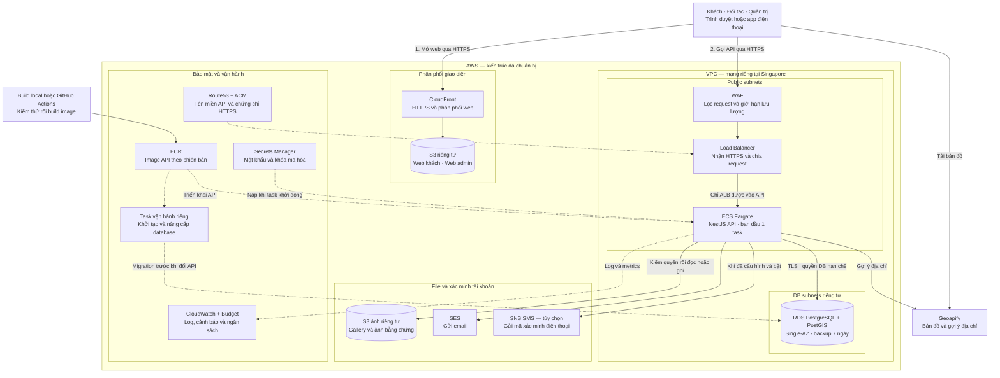
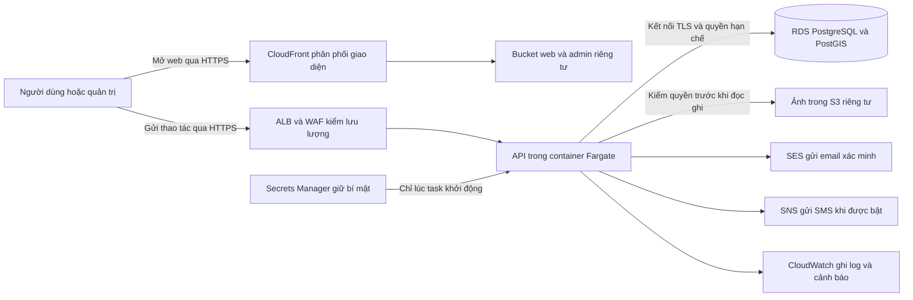
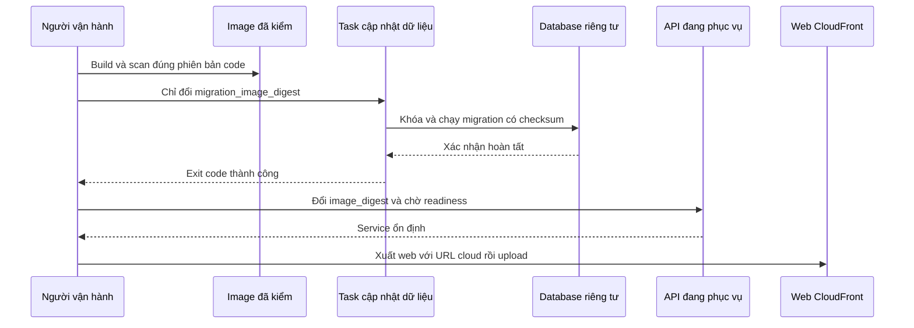

# B00-12 — Đưa Dịch vụ quanh bạn lên AWS

AWS-01 · 28/10/2026 · Code đang sửa trong repo, chưa commit/push đợt này. [Mục lục](../README.md) · [Thiết kế đã chọn theo ủy quyền](../de-xuat/AWS-01-ha-tang-pilot.md) · [Hướng dẫn từng lệnh](../../../infra/aws/README.md).

> **Cập nhật mục tiêu ngày 29/10/2026:** kế hoạch triển khai tiếp theo là [AWS-02 — deploy để học và dọn hết tài nguyên có phí](../de-xuat/AWS-02-lab-khong-phi-khi-tat.md). Báo cáo này giữ kết quả code/kiểm pilot đã làm; sơ đồ và dự toán 80–95 USD/tháng bên dưới mô tả bộ pilot hiện có, không phải lab đã triển khai. Không có thay đổi Terraform/API hoặc thao tác AWS thật trong đợt sửa plan. Hướng dẫn pilot đã gắn thông báo chưa tiếp tục apply theo mục tiêu mới.

SDD của đợt sửa plan: đã đối chiếu nguồn AWS-01, chỉ thêm thông báo chuyển sang AWS-02; bỏ đúng thông báo đó tái tạo chính xác SHA-256 đã đăng ký trước sửa. Chỉ hash `aws01` được cập nhật sau review này, giữ heading/tiêu chí bàn giao cũ, mọi source hash khác, baseline, criterion và QA gap. Đăng ký file AWS-02 trong inventory, kiểm link và render sơ đồ kế hoạch riêng; bằng chứng pilot trước đây không chứng nhận quy trình lab hoặc phí AWS khi nghỉ.

## 1. Kết quả bạn nhận được

Đã chuẩn bị bộ hạ tầng để chạy app ngoài máy cá nhân: người được mời mở một đường dẫn HTTPS trên trình duyệt, dùng chung API và dữ liệu đặt trên AWS. Máy của bạn không cần mở Expo/Metro để web hoạt động. App native có cấu hình build nội bộ riêng; cần tài khoản phát hành và kiểm thiết bị thật trước khi gửi APK/IPA.

**Hiện chưa có website/API AWS đang chạy.** Phần đã làm là Terraform, container API, tích hợp lưu ảnh/gửi mã xác minh cloud, công cụ khởi tạo/nâng cấp và các kiểm thử local. Theo yêu cầu của bạn, tài khoản AWS, domain, cấu hình provider và thao tác tạo tài nguyên thật được để thành hướng dẫn để bạn thực hiện sau. Không phát sinh tài nguyên hoặc phí AWS trong đợt này.

Cấu hình khởi đầu dành cho khoảng 10 người được mời, dự trù **80–95 USD/tháng**, chưa gồm thuế, domain và SMS. Chọn dịch vụ quản lý sẵn để giảm công việc vá máy chủ/backup, chấp nhận phí nền của ALB và database. Một máy EC2 tự quản có thể rẻ hơn, nhưng bạn phải quản hệ điều hành, DB, bản sao và phục hồi nhiều hơn.

## 2. Một người dùng đi qua hạ tầng như thế nào?

### Sơ đồ tổng thể hệ thống

Sơ đồ dưới đây nhóm các thành phần theo chức năng để bạn thấy cả đường người dùng truy cập lẫn cách vận hành hệ thống. Đây là **kiến trúc AWS tương ứng với code đã chuẩn bị**; hiện app vẫn chạy local, các tài nguyên AWS chưa được tạo thật.



Đọc theo ba luồng:

- **Mở web:** người dùng → CloudFront → lấy giao diện từ S3.
- **Sử dụng chức năng:** người dùng → WAF → Load Balancer → API → database, ảnh hoặc dịch vụ gửi mã.
- **Cập nhật hệ thống:** build image → ECR → chạy nâng cấp database → triển khai API mới. *Image* là gói chứa chương trình API và môi trường chạy; *migration* là bước cập nhật cấu trúc/dữ liệu database có kiểm soát.

Khối **NestJS API** chứa các chức năng đăng nhập, hồ sơ, tìm dịch vụ, công việc, chat, hóa đơn và quản trị. *Task* là một bản API đang chạy trên Fargate. Khi cần mở rộng, có thể tăng số API task phía sau Load Balancer và nâng cấu hình database theo mục 5. Realtime nhiều máy cần thêm cơ chế phân phối sự kiện chung trước khi bật.

WAF được vẽ trước Load Balancer theo thứ tự kiểm request; thực tế WAF là bộ quy tắc gắn với Load Balancer. Secrets được ECS nạp lúc khởi động task, không phải API đọc lại liên tục. Nhóm CloudWatch/Budget gom phần giám sát và chi phí cho dễ đọc, không phải một dịch vụ duy nhất.

### Luồng tìm dịch vụ của người dùng

Ví dụ khách mở app và tìm dịch vụ. **CloudFront** là lớp phân phối các file giao diện; **API** là chương trình xử lý yêu cầu; **RDS** là nơi AWS quản lý database; **S3** là kho file ảnh. Các tên này chỉ từng công việc khác nhau, không phải bốn app độc lập phải viết lại.



1. Trình duyệt tải giao diện từ CloudFront. Bucket không mở public; chỉ CloudFront có quyền đọc file giao diện.
2. Khi tìm dịch vụ hoặc đăng nhập, app gọi `https://api.<domain>/v1`. ALB nhận HTTPS và chuyển tới API; WAF chặn một số mẫu request xấu và lưu lượng quá cao.
3. API kiểm dữ liệu, phiên và quyền bằng các module hiện có, rồi đọc/ghi RDS. RDS không có địa chỉ truy cập public. Dữ liệu truyền tới DB được mã hóa và kiểm chứng chỉ máy chủ, không dùng `rejectUnauthorized:false`.
4. Ảnh được API kiểm byte/checksum, giải mã ảnh và kiểm quyền; sau đó lưu trong S3. Container bị thay hoặc tăng thêm bản API không làm mất file. Ảnh xác minh giữ thêm lớp mã hóa ứng dụng hiện có.
5. Khi người dùng xin mã xác minh, mã được đưa vào hàng đợi trong DB dưới dạng mã hóa. Worker gửi qua SES hoặc SNS; người nhận phải nằm trong danh sách cho phép. Nhà cung cấp còn phải được cấu hình thật trong tài khoản AWS.

Không thể truy cập API bằng cổng 3100 trên Internet: security group chỉ nhận từ ALB. Task có public IP để gọi ra ngoài, giúp bỏ phí NAT Gateway; database ở subnet riêng không có đường Internet. Đây là lựa chọn giảm chi phí có ranh giới mạng cụ thể, không phải database public.

## 3. Tham khảo app lớn và áp dụng vừa đủ

[Airbnb mô tả trên AWS](https://aws.amazon.com/solutions/case-studies/innovators/airbnb/) dùng IAM theo workload và kiểm soát quyền chặt. Dự án này áp dụng nguyên tắc đó bằng role riêng cho API, vận hành DB và build image. API không được đọc secret master, không được cấp quyền IAM hoặc tạo hạ tầng.

[Trang khách hàng Amazon ECS](https://aws.amazon.com/ecs/customers/) nêu United Airlines sử dụng ECS/Fargate để đưa ứng dụng vào hoạt động và đáp ứng thay đổi nhu cầu. Ở đây API được đóng gói thành image có digest cố định; thay số task/tài nguyên không đổi cách triển khai app. Đây là lựa chọn suy ra từ nguyên tắc chung, không tuyên bố biết toàn bộ thiết kế nội bộ của các công ty đó.

Không tách microservice hoặc triển khai Kubernetes/Redis/NAT nhiều AZ ngay. Các module NestJS hiện tại, PostgreSQL và hợp đồng API được giữ. Phần khác local là adapter cloud, vận hành, secret và mạng; không mở quảng cáo/voucher PROMO-02.

## 4. Chi phí ban đầu và phần có thể tăng

Giả định chạy 730 giờ/tháng tại Singapore, một task 0.25 vCPU/1 GiB, RDS `db.t4g.micro` Single-AZ, 20 GiB gp3, lưu lượng ít. Giá được đối chiếu ngày 28/10/2026, không trừ free tier/credit và không phải cam kết hóa đơn. [Snapshot giá có nguồn](bang-chung/B00-12-aws-gia.json).

| Khoản | Cách tính | USD/tháng ước tính |
|---|---|---:|
| Fargate | `(0.25 × 0.05056 + 1 × 0.00553) × 730` | 13.26 |
| ALB | `0.0252 × 730` | 18.40 |
| RDS PostgreSQL micro | `0.025 × 730` | 18.25 |
| RDS gp3 20 GiB | `20 × 0.138` | 2.76 |
| IPv4 public | 2 IP ALB + 1 task, `3 × 0.005 × 730` | 10.95 |
| WAF | 1 ACL + 3 rule, chưa tính request | 8.00 |
| Secrets Manager | 2 secret, chưa tính API calls | 0.80 |
| ALB LCU, S3/CloudFront, log/alarm, DNS, ECR, email/backup vượt mức | Theo lưu lượng, dữ liệu và số request | Dự phòng khoảng 8–22 |
| **Tổng kế hoạch** | Làm tròn, chưa SMS/domain/thuế | **80–95** |

Nguồn đơn giá compute/DB/ALB: [AWS ECS Singapore price list](https://pricing.us-east-1.amazonaws.com/offers/v1.0/aws/AmazonECS/current/ap-southeast-1/index.json), [AWS RDS Singapore](https://pricing.us-east-1.amazonaws.com/offers/v1.0/aws/AmazonRDS/current/ap-southeast-1/index.json), [AWS ELB Singapore](https://pricing.us-east-1.amazonaws.com/offers/v1.0/aws/AWSELB/current/ap-southeast-1/index.json). Khoản phụ theo [VPC IPv4](https://aws.amazon.com/vpc/pricing/), [WAF](https://aws.amazon.com/waf/pricing/) và [Secrets Manager](https://aws.amazon.com/secrets-manager/pricing/).

Cần tính thêm: SMS theo quốc gia/số đoạn, domain, EAS/Apple nếu dùng, data transfer/cross-AZ, S3 version cũ, RDS burst CPU credits khi chạy nặng kéo dài, dung lượng auto-grow, backup vượt miễn phí, task cũ/mới cùng chạy lúc triển khai. Không mua Reserved/Savings Plans trước khi đo usage ổn định. `service_enabled=false` dừng task nhưng ALB/RDS/WAF vẫn tính phí. Budget 100 USD là cảnh báo toàn tài khoản, không ngăn mọi khoản vượt.

## 5. Tăng từ 10 người lên nhiều hơn

| Khi nào | Thay đổi | Cần kiểm lại |
|---|---|---|
| CPU app cao, DB chưa nghẽn | Tăng `task_cpu` lên 512, memory theo cặp Fargate phù hợp | p95, ảnh/password hashing, CPU và cost |
| Muốn giảm gián đoạn do một task | `min_tasks=2`, `max_tasks=4` | Rollout, tải 10/50 người, ALB health, DB connections |
| DB thiếu memory/CPU hoặc cần tự failover | `db_class=db.t4g.small`, `db_multi_az=true` | Backup, maintenance/reboot, failover và chi phí tăng |
| Tải lớn kéo dài | Tách worker nếu có bằng chứng nghẽn, pool/DB capacity, egress private khi cần | Load nghiệp vụ, outbox lag, retry, retention |
| Cần realtime nhiều máy | Bổ sung cơ chế fan-out chung, ví dụ Redis, rồi mở realtime | Reconnect, revoke, giao sự kiện và load đa replica |

Autoscaling đã có theo CPU 60%, scale-out 60 giây, scale-in 300 giây. Một task vẫn là một điểm gián đoạn; Single-AZ DB chưa có HA. Không hứa “10.000 người chỉ sửa một con số”: giới hạn DB, pool, hàng đợi, provider và băng thông vẫn cần đo. Mỗi API dùng pool tối đa 5 kết nối; phải chừa thêm kết nối cho rolling update và ops.

Realtime hiện tại phát sự kiện trong một tiến trình. Cloud pilot từ chối `REALTIME_ENABLED=1`; app dùng tải dữ liệu HTTP/focus/refresh hiện có. Session, MFA, idempotency và outbox lưu DB, ảnh lưu S3 nên có nền tảng để tăng HTTP replica. Hàng đợi realtime vẫn có thể tăng khi realtime tắt; cần theo dõi dung lượng và chốt retention trước mở rộng dài hạn.

## 6. Những lớp bảo mật đã làm

| Lớp | Bảo vệ đã cấu hình | Giới hạn cần hiểu |
|---|---|---|
| Mạng | HTTPS ALB, WAF, task chỉ nhận ALB, DB riêng, không SSH | Task vẫn có outbound HTTPS ra Internet; chưa có allowlist egress theo domain |
| Database | TLS xác minh CA, storage encrypted, runtime role không DDL, migration role riêng | Ops task có quyền cao, chỉ người vận hành được chạy |
| File ảnh | S3 block public/HTTPS-only/versioning, API ACL/expiry/revocation, kiểm ảnh thật | Ảnh đi qua API nên tiêu tốn CPU/băng thông; chưa phải CDN public |
| Secret | Sinh ngẫu nhiên, tách khóa, ECS inject từ Secrets Manager, không có secret value trong Terraform | ADMIN/MESSAGE key cần bảo toàn để đọc dữ liệu cũ; chưa tự động re-encrypt khi rotate |
| Tài khoản | Invite email trước hash/DB, phone OTP giữ nguyên, admin TOTP và recovery | Cho email vào allowlist không chứng nhận họ đã xác minh phone; phải nhận OTP thật |
| Build | Docker source copy rõ, runtime non-root/read-only, image digest, ECR scan | ECR finding phải được review; scan không tự ngăn triển khai |
| CI | OIDC ngắn hạn, build role chỉ ECR, yêu cầu Quality đúng SHA | Cần cấu hình Environment/branch protection trên GitHub thật |
| Khôi phục | RDS PITR 7 ngày, S3 version cũ 30 ngày, protect destroy, runbook restore | Cùng region/account; restore thực và RTO/RPO chưa được đo |

Trong đợt này đã cập nhật NestJS 12.3.2 và dependency liên quan body-parser/multer/fast-uri/qs theo cảnh báo thực tế để chuẩn bị public API. Lượt `npm audit --workspace services/api --omit=dev` đã trả 0 cảnh báo; đây là dependency audit tại thời điểm kiểm, không phải chứng nhận không còn lỗ hổng toàn app.

## 7. Triển khai phiên bản mới đi theo thứ tự nào?



Bootstrap tạo danh mục chuẩn, không nạp tài khoản/đối tác DEMO. Secret được giữ khi chạy lại; khóa DB tránh hai bootstrap cùng ghi đè mật khẩu. Chủ dự án đăng ký và xác minh email trước, sau đó task `bootstrap-admin` cấp quyền lần đầu và ghi audit. TOTP vẫn phải enroll qua UI.

Nếu migration lỗi, API cũ tiếp tục; không đưa image mới vào service. Nếu API mới không khỏe, circuit breaker có thể quay lại bản thành công trước. Lần đầu chưa có bản thành công thì phải sửa lỗi và deploy lại. Migration tương lai phải tương thích code cũ đang chạy; rollback image không tự rollback dữ liệu. [Runbook mục 8–9](../../../infra/aws/README.md) nêu chi tiết nâng cấp, secret, backup/restore và lỗi.

## 8. Mở code theo thứ tự nào?

Các đường dẫn dưới đây là file thật; tên hàm giúp đi từ cấu hình tới xử lý.

| Bước | File/hàm | Nhận gì → làm gì → đưa cho ai |
|---|---|---|
| 1 | [variables.tf](../../../infra/aws/variables.tf), [pilot.tfvars.example](../../../infra/aws/pilot.tfvars.example) | Domain, region, allowlist, image và kích thước → Terraform dựng cấu hình |
| 2 | [network.tf](../../../infra/aws/network.tf), [edge.tf](../../../infra/aws/edge.tf) | Cấu hình mạng → ranh giới public/API/DB, HTTPS/WAF và DNS |
| 3 | [storage.tf](../../../infra/aws/storage.tf) | Tên môi trường/account → bucket riêng, CloudFront, ECR và vỏ secret |
| 4 | [compute.tf](../../../infra/aws/compute.tf) | Digest, secret ARN và URL → task API/ops, role và autoscaling |
| 5 | [database.mjs](../../../scripts/aws/database.mjs), `runtimeSecrets`, `validateRuntime`, `grantRuntime` | Credential ops → migration/catalog/quyền DB; bí mật chỉ vào Secrets Manager |
| 6 | [environment.ts](../../../services/api/src/config/environment.ts), `config` | Env cloud → kiểm fail-closed, chọn S3/SES/SNS; khóa local adapter không phù hợp |
| 7 | [connection.ts](../../../services/api/src/database/connection.ts), `connectionOptions` | URL DB và CA → kết nối TLS xác minh máy chủ, chặn URL tắt SSL |
| 8 | [cloud.ts](../../../services/api/src/integrations/cloud.ts), `S3Assets`, `sesTransport`, `cloudTransport` | Bytes/email/SMS → AWS SDK dùng task role, timeout/retry rõ |
| 9 | [assets.service.ts](../../../services/api/src/modules/assets/assets.service.ts), `put`, `read`, `content` | Grant và phiên → kiểm quyền hiện hành rồi lấy file, không lộ bucket public |
| 10 | [operate.mjs](../../../scripts/aws/operate.mjs) | Terraform output + SSO → kiểm account, chạy ops/chờ exit, xuất web/smoke |
| 11 | [observability.tf](../../../infra/aws/observability.tf) | Metrics/budget → cảnh báo, cần người nhận xác nhận email SNS |
| 12 | [container-smoke.mjs](../../../scripts/aws/container-smoke.mjs), [pilot.tftest.hcl](../../../infra/aws/tests/pilot.tftest.hcl) | Image/config → kiểm hành vi container thật và hạ tầng mô phỏng |

Tên `LocalMessages`/bảng `local_deliveries` được giữ để tránh đổi schema không cần thiết; cloud inject transport SES/SNS vào hàng đợi đó. Tên lịch sử này không có nghĩa cloud đang gửi qua Mailpit. Cấu hình cloud không chấp nhận bật Mailpit/SMS-file/local asset.

## 9. Đã kiểm và chưa kiểm

| Phạm vi | Bằng chứng đợt này | Không chứng minh |
|---|---|---|
| API unit | 31/31 đạt, gồm config cloud/TLS/S3/SES/SNS/allowlist | SES/SNS/S3 live |
| API tích hợp PostGIS | 153/153 đạt ở lượt infra ban đầu, gồm shared-store ảnh/ACL/revoke và hồi quy cũ; bổ sung kiểm HTTP proxy ở mục hậu kiểm dưới đây | RDS/IAM AWS thật |
| Terraform | Validate main/bootstrap; test bootstrap, scale, image guard và migration staging | Account quota, availability/permission/provider behavior thực |
| Container release Linux amd64 | Build, boot với TLS 1.3, migration/catalog, role DB không DDL/đọc migration, sai CA bị từ chối; auth/CORS; UID 1000/read-only; shutdown 0 | Performance máy Fargate hoặc RDS thật |
| Static | Typecheck toàn workspace, lint, diff check | UAT |
| Dependency API runtime | Audit 0 advisory ở lượt kiểm | Bảo mật ứng dụng tuyệt đối |
| Mermaid | Parse và render ba sơ đồ trong báo cáo, gồm sơ đồ tổng thể hệ thống | App screenshot/native |
| SDD toàn repo | Đọc evidence và chạy verify đúng dấu băm bộ file cuối theo lệnh dưới | Không thay CI mới/native/UAT |

Kết quả SDD cuối nằm trong `test-results/sdd/SDD-PROJECT/`; chỉ coi đạt khi `verify` trả ĐẠT trên working tree hiện tại. Không chép số kiểm riêng API vào kết luận toàn repo. Giữ 151 criterion cũ và thêm 5 criterion cloud. QA-109 được thêm sau khi đối chiếu nguyên vẹn 108 QA trước; chỉ hash file QA được cập nhật theo diff append-only đã review, các hash nguồn khác và baseline giữ nguyên. QA hiện có 97 partial/12 unmapped; criterion cloud chỉ chứng minh phạm vi được mô tả. CI mới có job `AWS infrastructure` bên cạnh `SDD project`; chưa push nên chưa có run remote mới.

### Hậu kiểm: hạn mức tra cứu địa chỉ qua ALB

Trước khi sửa, người dùng đi qua cùng một máy ALB có thể bị tính chung hạn mức 30 lần tra cứu/phút: controller đọc IP của kết nối socket, tức IP ALB, thay vì IP client. Người thứ hai có thể nhận lỗi 429 ngay ở lần tra cứu đầu tiên. Đây là sửa cách triển khai theo hạn mức hiện hành, không thay API, quota hoặc spec nghiệp vụ.

[LocationsController.lookup](../../../services/api/src/modules/locations/locations.controller.ts) nay lấy `req.ip` do Express xác định qua cấu hình `trust proxy` tại [createApp](../../../services/api/src/bootstrap.ts), giữ IP socket làm dự phòng. Khi chạy cloud, chỉ tin một hop ALB đã được security group bảo vệ. Khi local không bật trust proxy, Express dùng IP kết nối thật; controller không tự đọc header client gửi. Tài khoản có bearer hợp lệ vẫn dùng hạn mức theo user như trước.

Kiểm HTTP mới trong [locations.test.ts](../../../services/api/test/integration/locations.test.ts), tên `location HTTP isolates trusted proxy clients and ignores spoofed forwarding when proxy trust is disabled`, đã thất bại trước sửa với `429 !== 200`, rồi đạt sau sửa. Test dùng database riêng và provider giả, cho đồng hồ tiến có kiểm soát để kiểm hạn mức phút mà không chạm hạn mức burst toàn cục. Bảy bài liên quan location cùng đạt, gồm hai trường hợp: client B còn quota sau khi A dùng hết; đổi phần đầu X-Forwarded-For hoặc giả header khi local không giúp vượt quota. Test được nối vào criterion LOCATION-AC-03 hiện có; giữ mọi criterion, inventory file và hash nguồn. Chưa kiểm qua ALB thật hoặc Geoapify live.

<details>
<summary>Lệnh tái kiểm và giới hạn lưu bằng chứng</summary>

```sh
npm run lint
npm run typecheck
npm run test --workspace services/api
npm run test:integration --workspace services/api
npm audit --workspace services/api --omit=dev
terraform -chdir=infra/aws init -backend=false
terraform -chdir=infra/aws validate
terraform -chdir=infra/aws test
terraform -chdir=infra/aws/bootstrap init -backend=false
terraform -chdir=infra/aws/bootstrap validate
docker build --platform linux/amd64 -f infra/aws/Dockerfile -t dvqb-api:check .
node scripts/aws/container-smoke.mjs dvqb-api:check
docker compose -f infra/compose.yaml --profile test up -d --wait db-test
npm run sdd:check -- --change SDD-PROJECT --phase prepare
npm run sdd:run -- --change SDD-PROJECT
npm run sdd:check -- --change SDD-PROJECT --phase verify
```

Container smoke tạo tên DB/network ngẫu nhiên, mật khẩu test ngẫu nhiên và dọn chúng sau kiểm; không đọc AWS credentials. Provider tests dùng client giả, không gửi tin đến người thật. Evidence SDD/log test là artifact local bị Git ignore; chạy lại bằng các lệnh trên nếu đổi file, HEAD hoặc evidence mất. Snapshot giá public được lưu trong repo. Không có screenshot UI mới vì đợt này không sửa giao diện sản phẩm.

</details>

## 10. Việc bạn làm tiếp và điều kiện mời người dùng

**Ưu tiên mới:** hiện chỉ chuẩn bị tài khoản/MFA/SSO/công cụ local theo [AWS-02](../de-xuat/AWS-02-lab-khong-phi-khi-tat.md). Cần triển khai và kiểm quy trình lab tạo/xóa, không mua domain hoặc tạo state bucket để làm theo pilot ở thời điểm này. Các bước mời người dùng dưới đây giữ làm tham khảo cho pilot, không phải công việc hiện hành của môi trường học.

**Bổ sung theo yêu cầu ngày 29/10/2026:** bắt đầu từ chặng 1 của [hướng dẫn từng bước dành cho chủ dự án](../../../infra/aws/HUONG-DAN-TUNG-BUOC.md). Mỗi chặng chỉ rõ trang AWS, giá trị cần điền, lệnh chạy, kết quả cần thấy và điểm phát sinh phí. Có phiếu tiến độ chưa đánh dấu, phân biệt dùng web, APK Android, iOS internal và phần TestFlight chưa chuẩn bị. Nguồn AWS/Expo/Geoapify được đối chiếu khi soạn; chưa thao tác tài khoản thật, chưa commit/push hoặc deploy.

[infra/aws/README.md](../../../infra/aws/README.md) giữ vai trò runbook kỹ thuật cho thứ tự: chuẩn bị AWS/SSO/domain → bootstrap state → Terraform với service tắt → build/push image → ops bootstrap → cấu hình SES/SMS/Geoapify → bật API → publish web → bootstrap admin/MFA → smoke/load/restore/UAT → mới mời người dùng.

| Chức năng | Sau cấu hình cơ bản | Cần thêm |
|---|---|---|
| Mở web, đăng ký email được mời, đăng nhập | Có code và đường triển khai | AWS/domain/HTTPS/DB và kiểm live |
| Xác minh email, recovery/invitation email | SES adapter đã có | Identity/quota/sandbox/live delivery |
| Tạo hồ sơ người cung cấp | Giữ bắt buộc phone_verified | SNS/SMS identity, số được xác minh, allowlist và bật SMS |
| Ảnh/gallery/evidence | S3 adapter giữ quyền hiện có | IAM/bucket live test; khóa admin cho ảnh xác minh |
| Gợi ý địa chỉ | API tích hợp Geoapify hiện hành | Server key và quota phù hợp |
| Admin | Cloud key và bootstrap owner đã có | Verified owner, MFA/recovery codes, kiểm quyền live |
| Chat/công việc/inbox | HTTP hiện hành | Live UAT; không phải websocket tức thì |
| Native | Profile internal đã thêm | EAS/Apple/Android/thiết bị, chưa build/phát hành thật |
| Push, cuộc gọi, ngân hàng thật | Chưa bật trong cloud pilot | Đợt provider riêng; không dùng cấu hình local để lách |

Trước khi mở rộng, bắt buộc kiểm lại restore và thời gian phục hồi. RPO/RTO ước tính chỉ là mục tiêu, chưa phải kết quả đo. Chưa có cross-region DR, tự động dọn dữ liệu nghiệp vụ, re-encryption khóa admin/message hoặc chứng nhận xử lý tiền thật.

Hai câu hỏi để tự kiểm hiểu: **Vì sao thay container không mất ảnh?** Vì ảnh ở S3, không nằm trên ổ đĩa container. **Vì sao hai subnet DB vẫn có thể bị gián đoạn khi AZ lỗi?** Vì cấu hình ban đầu là Single-AZ, muốn failover phải bật Multi-AZ. **Vì sao đổi image chưa đủ để rollback mọi thứ?** Vì database và khóa mã hóa có vòng đời riêng, code cũ phải còn đọc được schema/dữ liệu.

Chưa đồng bộ Excel/Drive/ui-ux; quyết định cloud mới được ghi trong AWS-01/B00-12. Không coi các tài liệu local cũ đã tự chuyển thành đặc tả production. Các phần còn phụ thuộc tài khoản thật được liệt kê để chủ dự án thực hiện, không được báo đã deploy.
