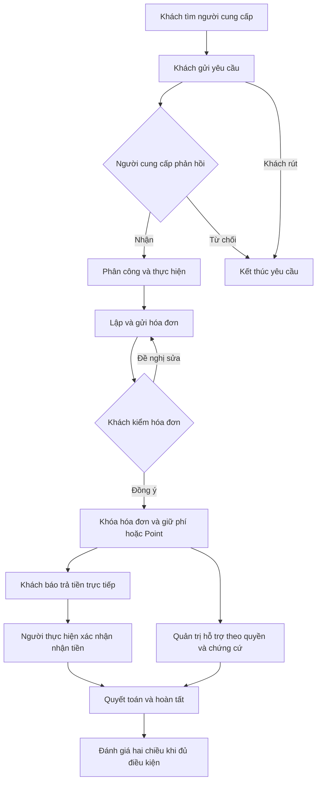

# B00-13 — Dữ liệu vận hành mô phỏng trên database đang dùng

Ngày 30/10/2026 · Theo yêu cầu dùng **`dvqb_local`**, thêm dữ liệu trước khi làm báo cáo Android/iOS. [Mục lục](../README.md) · [Báo cáo màn hình](B00-14-bao-cao-man-hinh.html).

## Bạn đã dùng được gì?

App có thể đăng nhập nhiều người, xem hồ sơ cung cấp, công việc, hóa đơn, tin nhắn, đánh giá, ví và hàng đợi quản trị với dữ liệu có liên hệ với nhau. Dữ liệu được lưu trong database hiện tại, còn nguyên sau khi đóng app hoặc khởi động lại API. Không thay bằng dữ liệu giả trả trực tiếp từ màn hình.

**Dữ liệu mới là mô phỏng**, không phải khách hàng hoặc giao dịch thật. Việc dùng database đang chạy và việc dùng dữ liệu thật của người ngoài là hai khái niệm khác nhau. Bộ này mô phỏng hoạt động trong nhiều tháng, tại Hà Nội, TP Hồ Chí Minh và Đà Nẵng; giữ nguyên 5 tài khoản và 4 hồ sơ có trước.

| Nhóm | Sau seed | Ý nghĩa |
|---|---:|---|
| Tài khoản | 257 | Thêm 252 người với tên/liên hệ mô phỏng |
| Hồ sơ cung cấp | 76 | Thêm 72 hồ sơ cá nhân, cửa hàng, doanh nghiệp |
| Công việc | 1.009 | Nhiều trạng thái, lịch, khách và người thực hiện |
| Hóa đơn | 469 | Nháp, đã gửi, yêu cầu sửa, đã khóa, đã quyết toán |
| Tin nhắn | 5.041 | Hội thoại và lịch sử trao đổi gắn dữ liệu |
| Đánh giá | 180 | Hai chiều, số sao, phản hồi, ảnh, ẩn/gỡ |
| Báo cáo hỗ trợ | 186 | Mở, đang xử lý, bổ sung, giải quyết, đóng |
| Tệp ảnh | 438 | Ảnh minh họa mô phỏng và chứng cứ riêng tư |

Số tổng trên gồm thêm một công việc và hóa đơn được tạo/hoàn tất qua API thật trong B00-14. Phân bố trạng thái bên dưới mô tả bộ seed gốc 1.008 công việc.

Ảnh seed là **thẻ minh họa có nhãn mô phỏng**, không phải ảnh công trình hay giấy tờ nhận dạng thật. Chúng giúp kiểm tải ảnh và quyền riêng tư, chưa chứng minh trải nghiệm với ảnh thực tế đủ mọi định dạng/kích thước.

## Vai trò và các trường hợp đã chuẩn bị

| Tài khoản mẫu | Dùng để xem |
|---|---|
| `vanhanh.000@example.test` | Chủ hồ sơ cá nhân, ví, các trạng thái công việc |
| `vanhanh.001@example.test` | Chủ cơ sở có đội ngũ và người liên hệ |
| `vanhanh.075@example.test` | Thành viên cơ sở 003; quyền tùy tư cách thành viên |
| `vanhanh.180@example.test` | Khách có lịch sử thuê dịch vụ |
| `vanhanh.240@example.test` | Quản trị có đầy đủ nhóm quyền local |
| 241 / 242 / 243 | Hỗ trợ / kiểm duyệt / tài chính |
| 244 / 245 / 246 | Tài khoản / danh mục / nhật ký và số liệu |
| 247 / 248 / 249 / 250 / 251 | Mới / chưa xác minh / bị khóa / yêu cầu xóa / đã ẩn danh |

Các số cuối trong bảng đều dùng cùng dạng email `vanhanh.NNN@example.test`. Nhân viên quản lý không phải vai trò cố định riêng trong DB: đó là nhân viên được cấp các quyền cụ thể trên từng cơ sở. Quyền giao diện không thay kiểm quyền ở máy chủ.

Mật khẩu ngẫu nhiên của **chỉ bộ tài khoản mô phỏng này** và thông tin thiết lập TOTP được lưu riêng tại [credentials.json](../../../.local/seed-operational/credentials.json), quyền file `600`, không đưa vào Git hoặc báo cáo chia sẻ. Không dùng mật khẩu này cho người thật. TOTP là mã thay đổi theo thời gian để xác thực bổ sung khi vào quản trị; không chụp mã/khóa vào ảnh báo cáo.

Các trạng thái đã có dữ liệu:

- Công việc: 120 chờ nhận, 468 đã nhận, 120 chờ quyết toán, 120 hoàn tất, 60 từ chối, 60 khách rút, 60 dừng. Có đặt lịch, đổi lịch, phân công và quản trị hoàn tất thay.
- Hóa đơn: 108 nháp, 60 gửi, 60 yêu cầu sửa, 120 khóa, 120 quyết toán. Có dùng/không dùng Point và dấu khách trả tiền/người thực hiện nhận tiền.
- Xác minh: 72 hồ sơ, chia đều chờ duyệt/được duyệt/từ chối/yêu cầu bổ sung.
- Rút tiền: 16 yêu cầu, hai trường hợp cho mỗi trạng thái pending, approved, transferring, unknown, succeeded, failed, rejected, cancelled. `unknown` nghĩa là chưa biết kết quả chuyển, không được tự coi thất bại rồi chuyển lại.
- Nạp tiền: 287 yêu cầu ở bốn trạng thái. Có ngân hàng được duyệt/chờ/từ chối/hủy, số dư, khoản giữ phí và khoản giữ rút tiền.
- Hỗ trợ: đủ năm trạng thái; có liên kết công việc/hóa đơn, phản hồi, ghi chú và chứng cứ. Có hồ sơ khôi phục/xóa tài khoản để quản trị đọc.

Đây là ma trận tình huống đã chuẩn bị, **không phải khẳng định mọi tổ hợp quyền × trạng thái × thiết bị × lỗi mạng đã được chạy qua**. Kiểm tương tác trực tiếp được ghi riêng trong B00-14.

## Một yêu cầu đi qua hệ thống thế nào?



Seed tạo sẵn dữ liệu tương ứng các điểm trên, **không giả vờ rằng 1.008 công việc đã được bấm tạo trên điện thoại**. App đọc lại dữ liệu qua API thật. Khi người dùng thao tác tiếp, các dịch vụ nghiệp vụ hiện tại vẫn kiểm quyền, phiên bản, trạng thái và tiền.

## Mở code theo thứ tự nào?

| Bước | File / hàm thật | Nhận gì, làm gì, trả gì |
|---|---|---|
| 1 | [operational-model.mjs](../../../scripts/data/operational-model.mjs): `requireOperationalTarget`, `id`, `person`, `accountRole` | Kiểm đúng database local, tạo mã ổn định và mô hình tài khoản |
| 2 | [seed-operational.mjs](../../../scripts/data/seed-operational.mjs): nhánh `--preview` / `--apply`, `insert` | Đếm dữ liệu cũ, sao lưu, thêm các bảng liên quan trong một giao dịch DB |
| 3 | Cùng file: `verify` | Đọc lại DB; đối chiếu sổ tiền, quyền sở hữu ảnh, quan hệ, trạng thái và dữ liệu cũ |
| 4 | [environment.ts](../../../services/api/src/config/environment.ts) | Chỉ cho bật `LOCAL_OPERATIONAL_DATA=1` khi môi trường development, host và database loopback, tên `dvqb_local` |
| 5 | [check-operational-api.mjs](../../../scripts/review/check-operational-api.mjs): `call`, `login` | Đăng nhập tài khoản seed rồi đọc các API thật và kiểm từ chối truy cập không liên quan |
| 6 | [capture-native.mjs](../../../scripts/review/capture-native.mjs) | Điều khiển app đã cài để mở màn và chụp ảnh; không đưa dữ liệu trực tiếp vào component |

Giao dịch DB là nhóm thay đổi được xác nhận cùng nhau: lỗi trước `COMMIT` sẽ hủy các dòng đang thêm. Khóa đợt seed ngăn hai lượt cùng tạo. Mã đánh dấu đợt giúp chạy lại không nhân đôi các dòng đã tạo. Đã chạy lại `--apply`: script xác nhận đợt đã tồn tại, không ghi lại các dòng seed và các tổng số ở đầu báo cáo giữ nguyên; [nhật ký chạy lại](../../../.local/seed-operational/seed-rerun.log). Dữ liệu ảnh và file cấu hình nằm ngoài giao dịch PostgreSQL; nếu máy dừng giữa chừng, cần đọc manifest/log và kiểm lại, không coi DB rollback là tự khôi phục mọi file.

## Dữ liệu, lỗi và cách chạy lại

Backup nằm trong [.local/seed-operational/backups](../../../.local/seed-operational/backups). Đã kiểm đọc được danh mục bản dump bằng `pg_restore --list`; **chưa diễn tập khôi phục toàn bộ**. Không có thao tác reset/drop database trong đợt này.

Point khởi tạo là số dư mô phỏng đầu kỳ để thử các mức dùng Point; không phải Point phát sinh từ giao dịch thật. API sổ cái dùng mã giao dịch làm tham chiếu dự phòng cho dòng đầu kỳ, đúng kiểu UUID của hợp đồng; việc này sửa lỗi màn hóa đơn đọc cả lịch sử Point.

`verify` kiểm cân bằng từng giao dịch theo đơn vị VND/POINT; số dư khớp tổng bút toán; việc hoàn tất có hóa đơn và quyết toán; công thức phí/Point; nhân viên đúng cơ sở; đánh giá đủ hai dấu thanh toán; ảnh thuộc người viết; hình thức công việc được hồ sơ cung cấp hỗ trợ; không âm Point khả dụng; hồ sơ cá nhân chỉ có chủ, không có lời mời nhân viên; điểm đại diện vùng đa giác; lịch đổi khớp thời gian đang áp dụng; thứ tự thời gian; checksum ảnh và giải mã ảnh riêng tư. Nó đối chiếu các dòng người dùng, danh tính, hồ sơ, tư cách thành viên và địa chỉ có trước với bản chụp trước seed.

Trong lần review dữ liệu đầu, đã sửa **chỉ những dòng mới của đợt seed** về điều kiện đánh giá, người sở hữu ảnh, định dạng số tài khoản, đội ngũ đúng loại hồ sơ, tọa độ đại diện vùng phục vụ và lịch hẹn khớp lịch sử đổi lịch. Script chính đã cập nhật để lần tạo mới đi theo quy tắc đúng; lịch sử xử lý đợt hiện tại có marker riêng. Không dùng việc nhiều dòng seed để bỏ qua điều kiện nghiệp vụ.

API local dùng `127.0.0.1:3110`, vì cổng 3100 đang được một dự án khác sử dụng. App đang được chạy với Metro 8085 và API 3110. Lệnh launcher cũ có thể gán cổng 3100; dùng `npm run review:mobile -- ios` hoặc `npm run review:mobile -- android` để đọc đúng cổng API từ cấu hình đợt này. Android Emulator dùng `adb reverse` tới API/Metro trên máy. Tài chính, OTP và quản trị ở chế độ local, không gọi ngân hàng/email/SMS thật.

<details>
<summary>Lệnh và bằng chứng kỹ thuật</summary>

Chạy từ thư mục gốc repository:

```sh
node --import tsx scripts/data/seed-operational.mjs --preview
node --import tsx scripts/data/seed-operational.mjs --apply
node --import tsx scripts/data/seed-operational.mjs --verify
node --import tsx scripts/review/check-operational-api.mjs
node scripts/review/build-report.mjs
```

- [Kết quả kiểm seed](../../../.local/seed-operational/verification.json): PASS; số liệu ở đầu bài lấy từ lần kiểm này.
- [Kết quả đọc API](../../../.local/seed-operational/api-verification.json): đọc trường `results`, từng đường dẫn có status và pass; file được cập nhật khi chạy lại.
- [Manifest riêng trên máy](../../../.local/seed-operational/manifest.json): mã đối tượng, bản chụp dữ liệu cũ, đường dẫn backup/ảnh; không đưa vào gói chia sẻ.
- Bài kiểm mới: [operational-model.test.mjs](../../../scripts/test/operational-model.test.mjs), guard cấu hình trong [catalog-config.test.ts](../../../services/api/test/unit/catalog-config.test.ts).
- Bằng chứng local không phải remote CI, thiết bị vật lý, UAT hoặc production. Bộ hồi quy SDD vẫn dùng database kiểm thử riêng theo quy tắc repository; không trỏ bài test có reset fixture vào `dvqb_local`.

</details>

## Bạn có thể tự kiểm hiểu

1. Mở một công việc chờ quyết toán: vì sao đã khóa hóa đơn vẫn chưa phải đã nhận tiền? Xem hai dấu thanh toán ở phần hóa đơn.
2. Đăng nhập nhân viên và chủ cơ sở: cùng một công việc nhưng nút nào khác? Máy chủ dựa vào tư cách thành viên và quyền, không dựa vào tên tài khoản.
3. Chạy lại `--apply`: số tài khoản/công việc không tăng vì đợt đã được đánh dấu. Nếu muốn một đợt mới hoặc làm sạch dữ liệu mô phỏng, cần thiết kế thao tác riêng; không tự xóa rồi seed lại database đang dùng.
