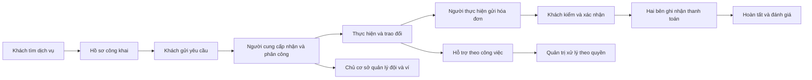

# B00-14 — Báo cáo màn hình Android và iPhone theo vai trò

Cập nhật báo cáo: 02/11/2026 · Ảnh sau sửa: 02/11/2026 · Database: **dvqb_local** · [Mở báo cáo tương tác](B00-14-bao-cao-man-hinh.html) · [Dữ liệu vận hành](B00-13-du-lieu-van-hanh-local.md) · [Mục lục](../README.md).

## Cách xem dễ nhất

Mở file HTML bằng trình duyệt. Chọn **Vai trò → Luồng sử dụng → Theo từng bước**. Mỗi mục cho biết màn dùng để làm gì, đi vào từ đâu, bấm nút nào và chuyển sang đâu. Bấm ảnh để phóng to; có thể xem Android và iPhone cạnh nhau.

- **Tìm kiếm:** nhập tên màn hoặc chức năng, có thể bỏ dấu. Ví dụ `hoa don`, `phan quyen`, `rut`. Ưu tiên mục có tên khớp; tránh trả “hoạt động” khi tìm “hóa đơn”.
- **Luồng chính / nhánh:** tách từ chối, khách rút, dừng, đổi lịch, phân công và quản trị hoàn tất thay. Những nhánh này không phải bước bắt buộc của mọi công việc.
- **Quyền quản trị:** lọc riêng hỗ trợ, kiểm duyệt, tài khoản, danh mục, tài chính và báo cáo. Nhìn thấy màn không tự đồng nghĩa có quyền thực hiện mọi nút.
- **Ảnh đã kiểm:** chọn có ảnh cả hai nền tảng, còn thiếu ảnh, **Ảnh có vấn đề / cần kiểm tiếp** hoặc **Không thể chụp qua luồng hiện tại**. Bộ lọc xét đúng nền tảng đang chọn; mỗi ảnh ghi vai trò, ngày kiểm và vấn đề liên quan.
- **Danh mục:** xem nhanh toàn bộ mục đang khớp, rồi chọn một mục để quay lại hướng dẫn từng bước.
- **Sao chép vị trí:** đường dẫn ghi nhớ bộ lọc và màn đang xem. Khi chuyển sang máy khác, cần gửi kèm file HTML và thư mục `anh/B00-14-UX01`; đường dẫn local không tự trở thành liên kết Internet.

Báo cáo chạy bằng file local, không cần đăng nhập hay gửi thông tin lên dịch vụ khác. Phần dữ liệu mô tả được nhúng trong HTML; ảnh lấy từ thư mục bên cạnh. Không chứa mật khẩu, token hay khóa TOTP.

## Hệ thống có những nhóm màn nào?

Đã đối chiếu **27 route** trong `RootStackParamList`; khu quản trị và khu hỗ trợ tài khoản bị khóa còn được dựng có điều kiện ngoài danh sách route thông thường. Danh mục tương tác có **135 mục**, gồm màn, tab, biểu mẫu và trạng thái của cùng màn. Đây không phải 135 route độc lập.

| Luồng | Những phần được giải thích | Vai trò chính |
|---|---|---|
| 01. Tìm và thuê dịch vụ | Trang chủ, chọn ngành/kỹ năng, địa điểm, bộ lọc, danh sách/bản đồ, hồ sơ công khai, yêu cầu thuê | Khách chưa đăng nhập, khách thuê |
| 02. Tài khoản và bảo mật | Đăng nhập/đăng ký, thông tin, phiên, địa chỉ, xác minh, OTP, mật khẩu, đổi liên hệ, xóa/khôi phục | Người dùng cá nhân |
| 03. Khách theo dõi công việc | Danh sách, lịch, chi tiết theo trạng thái, hóa đơn, trả tiền, đánh giá | Khách thuê |
| 04. Người cung cấp thực hiện việc | Nhận/từ chối, phân công, đổi lịch/dừng, hóa đơn, nhận tiền, hoàn tất, đánh giá | Chủ hồ sơ, nhân viên có quyền |
| 05. Hồ sơ cung cấp và xác minh | Danh sách/tạo hồ sơ, thông tin, kỹ năng, vùng phục vụ, địa điểm, gallery, xác minh riêng tư | Chủ hồ sơ, người được giao quản lý |
| 06. Đội ngũ và phân quyền | Tổ chức, thành viên, lời mời, đã rời, phân quyền, bàn giao, rời đội | Chủ cơ sở, nhân viên, quản lý |
| 07. Ví và giao dịch | Số dư/khoản giữ, nạp/rút, ngân hàng, lịch sử, chi tiết | Người có quyền ví tương ứng |
| 08. Liên lạc | Hội thoại, nội dung chat, cuộc gọi, thông báo, công tắc thông báo | Các bên được phép tham gia |
| 09. Hỗ trợ và quản trị | Báo cáo, phản hồi, hỗ trợ tài khoản bị khóa, MFA, các hàng đợi và màn tra cứu quản trị | Người gửi, quản trị theo quyền |

`CatalogCategory` còn đăng ký trong Navigator nhưng không có điểm vào rõ ràng từ trang chủ hiện dùng `SearchScreen`. Báo cáo giữ mục này và ghi giới hạn, không gọi nó là luồng người dùng đã bấm qua.

## Hiểu vai trò trước khi đọc các nút

| Vai trò | Quyền đến từ đâu? | Điều dễ hiểu nhầm |
|---|---|---|
| Khách chưa đăng nhập | Nội dung công khai | Xem hồ sơ chưa có nghĩa được gửi việc hoặc xem liên hệ riêng |
| Khách thuê | Tài khoản và quan hệ khách của từng công việc | Không xem hóa đơn nháp của người cung cấp |
| Chủ hồ sơ | Tư cách chủ trên một hồ sơ cụ thể | Có thể vừa là khách thuê ở công việc khác |
| Nhân viên | Tư cách thành viên, việc được giao và các quyền cấp thêm | Không tự có quyền quản lý thành viên hoặc rút tiền |
| Nhân viên quản lý | Các quyền như quản lý đội/hồ sơ/việc/ví | Không phải “admin toàn hệ thống”; quyền theo từng cơ sở |
| Quản trị | Tập quyền quản trị độc lập + phiên MFA hợp lệ | Người đọc tài chính không tự được duyệt tiền; đọc hỗ trợ không tự được xử lý |
| Tài khoản bị khóa | Phiên chỉ dành cho hỗ trợ | Đăng nhập khu hỗ trợ không khôi phục quyền thuê/nhận việc |

Ảnh của chủ hồ sơ được ghi rõ là ảnh chủ hồ sơ. Khi lọc nhân viên, bảng giải thích quyền vẫn áp dụng, nhưng ảnh đó không được coi là bằng chứng nhân viên đã thấy tất cả nút của chủ.

## Luồng nên xem theo thứ tự nào?



Điểm bắt đầu phù hợp: chọn **Khách thuê → Tìm và thuê**, sau đó **Khách theo dõi công việc**. Khi đã hiểu phía khách, chuyển sang **Chủ hồ sơ → Người cung cấp thực hiện việc**. Cuối cùng xem đội ngũ/ví và khu quản trị. Nút “Xem màn liên quan” giúp nhảy qua phần giải thích khác mà không phải tự tìm lại.

## Bằng chứng và cách đọc kết quả

Ảnh được chụp từ app đã cài trên **Android Emulator DVQB_API_36 / Android 16** và **iPhone 18 Pro / iOS 27 Simulator**, đọc API thật nối `dvqb_local`. Không phải ảnh thiết kế hoặc trình duyệt giả lập kích thước điện thoại. Ngày chụp 02/11/2026 ghi tại từng khung ảnh; số mục có ảnh hiện trực tiếp ở đầu HTML và bộ lọc.

**Đã hoàn tất đợt chụp lại: 134/135 mục có ảnh mới trên cả hai nền tảng, tổng 268 ảnh chính.** Thêm 2 ảnh lưu lỗi tải xác minh trước khi thử lại. Tất cả 270 vị trí cần kiểm (135 mục × 2 nền tảng) đã có ảnh hoặc lý do không thể chụp; không còn 127 mục chưa được chụp bổ sung như phiên trước.

| Kết quả | Android | iOS |
|---|---:|---:|
| Mục có ảnh mới đã đối chiếu | 134 | 134 |
| Trong đó có ghi nhận vấn đề | 4 | 4 |
| Không có đường vào để chụp | 1 | 1 |

Ảnh có vấn đề vẫn được giữ để thể hiện đúng ứng dụng. **Có ảnh không đồng nghĩa màn không có lỗi hoặc mọi nút đã được thử.** Một số ảnh được cuộn tới nội dung chính, không phải ảnh toàn bộ trang dài. Vai trò chụp ở từng khung không được suy rộng thành bằng chứng cho mọi vai trò được bộ lọc liệt kê.

Danh sách kiểm và dấu băm từng ảnh nằm trong [B00-14-native.json](bang-chung/B00-14-native.json). Dấu băm giúp phát hiện ảnh bị đổi sau khi đối chiếu. B00-15 giữ bằng chứng kiểm thao tác của đợt triển khai trước; bộ ảnh tổng hiện dùng thư mục riêng `anh/B00-14-UX01`.

### Màn nào chưa thể chụp?

| Mục / trạng thái | Nền tảng | Nguyên nhân và kết luận |
|---|---|---|
| **Danh mục theo ngành — CatalogCategory** | Android + iOS | Route còn đăng ký, nhưng trang chủ chạy SearchScreen và mở bộ chọn dịch vụ riêng. Lệnh chuyển vào CatalogCategory chỉ nằm trong CatalogScreen cũ; không có điểm vào từ giao diện đang dùng hoặc deep link được hỗ trợ. Đã kiểm đường Trang chủ → chọn dịch vụ và truy vết điều hướng. Không ép route để tạo ảnh. Đây là **1 mục thiếu ảnh trên hai nền tảng**, không phải app bị treo ở màn đó. |
| **Cuộc gọi đã kết nối / đổ chuông** | Android + iOS | Mục “Gọi trong app” đã có ảnh **hộp thoại lỗi**, nhưng chưa thể chụp trạng thái gọi thành công do API local thiếu cấu hình media. Không tính ảnh lỗi là bằng chứng gọi được hoặc âm thanh hoạt động. |

### Các lỗi và điểm vướng đã thấy

| Mã · ưu tiên đề nghị | Màn / nền tảng | Hiện tượng có bằng chứng | Trạng thái / hướng xử lý |
|---|---|---|---|
| NATIVE-01 · Cao nếu cần dùng gọi | Gọi trong app · cả hai | Hiện “Chưa kết nối được máy chủ cuộc gọi”. [Android](anh/B00-14-UX01/android-call.png) · [iOS](anh/B00-14-UX01/ios-call.png) | Thiếu cấu hình LIVEKIT local; API trả CALLS_UNAVAILABLE khi không có media. Cần môi trường gọi và hai phía tham gia để kiểm thành công; chưa tự bật provider trả phí. |
| NATIVE-02 · Cao | Hộp thoại gọi lỗi · cả hai | Khi thao tác còn chờ, chỉ có **Thử lại**, thiếu **Đóng/Hủy**. iOS phải mở lại app để rời; Android dùng được Back hệ thống. | Lỗi trải nghiệm có đối chiếu CallsProvider: nút đóng bị ẩn khi `pending`. Cần đường thoát rõ khi tạo cuộc gọi thất bại. Chưa sửa trong đợt chụp. |
| NATIVE-03 · Vừa | Xác minh hồ sơ · cả hai | Lần đầu mở báo lỗi cập nhật/kết nối. Bấm **Thử lại / Tải lại kết quả** thì hiện “Đã xác minh”; iOS gặp ở hai lượt mở. [Lỗi Android](anh/B00-14-UX01/android-verification-initial-error.png) · [Lỗi iOS](anh/B00-14-UX01/ios-verification-initial-error.png) | **Đã chụp được sau khi thử lại**, chưa xác định nguyên nhân gốc. Cần ghi request/lifecycle lúc mở màn và kiểm lại đường tải đầu. |
| NATIVE-04 · Vừa | Chi tiết giao dịch ví · cả hai | Bấm giao dịch nhưng chi tiết nằm **sau toàn bộ lịch sử**, không tự cuộn tới; dễ tưởng nút không hoạt động. [Android](anh/B00-14-UX01/android-finance-detail.png) · [iOS](anh/B00-14-UX01/ios-finance-detail.png) | **Đã chụp được bằng cách cuộn xuống**. Nên mở trang/hộp chi tiết riêng hoặc đưa vùng chi tiết vào tầm nhìn. |
| NATIVE-05 · Cao để điều tra | Mở lại ứng dụng · Android | 18:16 ngày 02/11 app thoát; log có SIGSEGV trong `mqt_v_js` / `libreactnative.so`, stack chứa `MountingCoordinator::pullTransaction`. | Một lần quan sát sau thao tác dừng app và mở development-client; **mở lại đã tiếp tục chụp được**. Chưa có nguyên nhân gốc hay bằng chứng lỗi lặp trên bản release. Tóm tắt log trong [ledger](bang-chung/B00-14-native.json), mục `nativeCrash`. |
| NATIVE-06 · Thấp | Kết quả tìm dịch vụ · iOS | Điểm hiện `2.3333333333333335 (3 đánh giá)`. [Ảnh](anh/B00-14-UX01/ios-search-results.png) | SearchScreen đưa giá trị sao trực tiếp vào câu. Cần định dạng/làm tròn thống nhất. Lỗi hiển thị được xác nhận trên iOS, chưa kiểm cùng bản ghi trên Android trong đợt này. |

Sáu ghi nhận trên liên quan **5 mục báo cáo**, tương ứng **8 vị trí nền tảng có ghi chú vấn đề**. NATIVE-01 và NATIVE-02 cùng nằm ở mục cuộc gọi. NATIVE-05 được gắn vào Trang chủ Android để dễ tìm, dù ảnh chính là app đã mở thành công, không phải ảnh thời điểm crash. Mức ưu tiên là đề nghị để chọn đợt sửa, không phải kết luận nguyên nhân gốc hay xác nhận đã sửa.

Các hóa đơn Android từng được chụp khi dữ liệu chưa tải đủ đã được chụp lại: Point và ảnh kết quả đã hiện. Màn khách xem công việc có hóa đơn nháp hiện **“Hóa đơn sẽ xuất hiện ở đây”** là trạng thái chờ đúng quyền. Không gộp các trường hợp này vào danh sách lỗi chưa xử lý.

Theo yêu cầu dọn ảnh cũ ngày 02/11, đã xóa 243 PNG trước sửa trong `anh/B00-14` và 14 PNG của audit trước sửa trong `anh/UX-01`, tổng **257 ảnh / 51.858.413 byte (~51,9 MB)**. Bảng audit cũ giữ nội dung và nhật ký, gỡ liên kết ảnh đã xóa và ghi là lịch sử. Không xóa ảnh của các báo cáo khác, ảnh thiết kế đã duyệt hoặc dữ liệu app/database.

Sau khi kiểm đủ dấu băm của bộ ảnh xuất mới, đã dọn thêm **866 ảnh chụp thử/bản sao/ảnh ghép kiểm tra trong `.local/ux-01-recapture`, giải phóng 178.249.540 byte (~178,2 MB)**. Giữ 270 ảnh cần thiết cạnh báo cáo, metadata kết quả và backup database. Các log debug lớn có thể được nén `.gz`; không xóa bằng chứng lỗi cần tra cứu.

### Lịch sử kiểm trước UX-01 — ngày 30/10/2026

Các kết quả dưới đây là mốc kiểm dữ liệu/API trước đợt sửa giao diện. Số đếm trong JSON có `checkedAt` riêng; không phải số đếm database mới ngày 02/11. Ảnh native mới nằm ở phần trên; kiểm thao tác UX-01 của đợt triển khai nằm ở B00-15.

Các trạng thái seed được mở qua giao diện hoặc deep link được app hỗ trợ. Vì phần lớn công việc có sẵn ở các trạng thái khác nhau, việc chụp ảnh **không chứng minh đã bấm toàn bộ chuỗi chuyển trạng thái cho từng công việc**.

Đã bổ sung một công việc mô phỏng riêng để đi trọn chuỗi qua API thật: tạo → nhận → nháp → gửi → xác nhận với 10.000 Point → khách báo trả → người thực hiện quyết toán. Kết quả cuối: hoàn tất, hóa đơn quyết toán, 240.000 đồng mô phỏng trả trực tiếp, đủ điều kiện đánh giá. Tài khoản không liên quan bị từ chối và khách không xem được hóa đơn nháp. Bài kiểm này không reset hay thay database.

Trong lần chạy đầu, công cụ kiểm kỳ vọng sai mã HTTP của thao tác nhận việc (201 thay vì 200); đã đọc controller, sửa kỳ vọng và tiếp tục đúng công việc đã tạo. Bằng chứng giữ lịch sử lần chạy này; không gọi đó là một lỗi nghiệp vụ của app.

Khi kiểm native phát hiện dòng Point khởi tạo có `reference_id=null`, trái hợp đồng UUID của API, khiến cả màn hóa đơn không tải xong. Đã sửa API dùng mã giao dịch sổ cái làm tham chiếu dự phòng khi không có hóa đơn/nạp/rút liên quan; giữ ưu tiên các mã nghiệp vụ cũ. Kiểm hồi quy trên DB cách ly tái hiện lỗi trước sửa, kiểm lại schema và quyền đọc sau sửa. Không đổi công thức tiền, số dư hay quyền.

Bộ đọc API đạt 93/93 kiểm trong lượt hậu kiểm, gồm các hàng đợi, chi tiết, ví/Point, trạng thái công việc, nhóm quyền quản trị và nội dung PNG xác minh riêng tư. Giới hạn đăng nhập trả 429 được tôn trọng theo `Retry-After`; không tắt hay nới bảo vệ để lấy kết quả xanh.

## Kiểm lần cập nhật báo cáo ngày 02/11

Bộ kiểm báo cáo đối chiếu đủ 270 vị trí, dấu băm ảnh, lý do và bằng chứng cho mục không chụp được; kiểm tìm không dấu, vai/quyền/luồng, không có kết quả, chuyển bước, liên kết, URL, danh mục, lọc lỗi/không thể chụp theo nền tảng và phóng ảnh. Kiểm tải 268 ảnh chính, 2 ảnh lỗi bổ sung, cùng bố cục 1440/768/390/320 px. Kết quả có ngày chạy tại [report-check/result.json](../../../.local/seed-operational/report-check/result.json). Sơ đồ Mermaid giữ 12 nút và được kiểm render.

Đợt này chụp lại app trên `dvqb_local`; không reset database, không duyệt tiền, xóa tài khoản, lưu quyền hay gửi tin nhắn thực. Đăng nhập, đọc hội thoại và thông báo có thể cập nhật phiên/dấu đã đọc, nên không gọi đây là đợt hoàn toàn không ghi DB. Có backup trước chụp tại `.local/ux-01-recapture/before-capture.dump`. Không sửa code sản phẩm trong đợt này; các lỗi ở bảng trên còn mở.

SDD chạy lại theo quy định repo, bằng chứng ở `test-results/sdd/SDD-PROJECT/`; chỉ dùng kết quả `verify` có snapshot khớp bộ file cuối. Hồi quy tự động không thay thế ảnh native, kiểm mọi nút hay UAT.

## Mở code theo thứ tự nào?

| Mục tiêu | File / hàm thật | Đọc để hiểu |
|---|---|---|
| Xem màn nào đã đăng ký | [routes.ts](../../../apps/mobile/src/app/navigation/routes.ts): `RootStackParamList`, `accountDestination`, `appLinkState` | Tên route, dữ liệu điều hướng và các deep link được chấp nhận |
| Xem ai đi vào khu nào | [AppNavigator.tsx](../../../apps/mobile/src/app/navigation/AppNavigator.tsx) | Tài khoản thường, quản trị và tài khoản bị khóa dùng nhánh giao diện nào |
| Đọc lời giải thích từng màn | [screen-catalog.mjs](../../../scripts/review/screen-catalog.mjs): `screens`, `add` | Mục đích, đường vào, vai trò, nút, quyền và link source thật |
| Tạo file báo cáo | [build-report.mjs](../../../scripts/review/build-report.mjs) | Ghép mô tả UX-01, snapshot seed có ngày riêng và ledger ảnh native 270 vị trí vào HTML/JSON |
| Tìm/lọc/đi từng bước | [report-template.html](../../../scripts/review/report-template.html): `render`, `restore`, `imagePanel` | Bộ lọc kết hợp, ưu tiên tìm tên, vị trí trong URL, ảnh và màn liên quan |
| Chụp native | [capture-native.mjs](../../../scripts/review/capture-native.mjs): `login`, `open`, `shot` | Mở app/route thật, đợi màn, chụp và xuất ảnh từ Maestro |
| Kiểm với database hiện tại | [check-operational-api.mjs](../../../scripts/review/check-operational-api.mjs), [verify-operational-flow.mjs](../../../scripts/review/verify-operational-flow.mjs) | Đọc quyền/dữ liệu và chạy một công việc mô phỏng qua API |
| Đọc lịch sử Point | [invoices.service.ts](../../../services/api/src/modules/invoices/invoices.service.ts): `ledger` | Ưu tiên mã hóa đơn/nạp/rút; dòng khởi tạo dùng mã giao dịch, tránh trả UUID rỗng |
| Kiểm báo cáo | [check-report.mjs](../../../scripts/review/check-report.mjs) | Tìm không dấu, kết hợp bộ lọc, không có kết quả, chuyển bước, URL, phóng ảnh, kích thước và liên kết |

Báo cáo chỉ giữ lựa chọn lọc trên URL trình duyệt; thay bộ lọc không sửa dữ liệu ứng dụng. Nút trong bảng là lời giải thích hoặc liên kết đến mục khác của báo cáo, không phải nút gửi lệnh tới API sản phẩm.

## Những thao tác thay đổi sau UX-01

| Nhóm màn | Cách thao tác hiện tại |
|---|---|
| Tìm và lọc | **Tìm dịch vụ quanh đây** gửi truy vấn. Bộ lọc có nháp: **Áp dụng bộ lọc** tìm ngay, **Hủy** giữ điều kiện cũ. Đổi sắp xếp tự tìm lại; đổi khu vực bỏ kết quả khu vực cũ. Bộ chọn dịch vụ chọn xong đóng ngay, không có nút Áp dụng riêng. |
| Công việc / hóa đơn | Hành động chính ở thanh dưới; rút/dừng/từ chối tách riêng. Đọc nội dung và chi phí trước ảnh. Lịch sử giao dịch chỉ tải khi mở; Point lỗi thì chưa xác nhận hóa đơn. |
| Chat | Bấm cả hàng hội thoại để mở. Khi đọc phía trên, tin mới không tự kéo màn; **Có tin mới · xem tin** đưa tới cuối. D02 đọc ngược lịch sử chưa được duyệt. |
| Tài khoản / hồ sơ | Tài khoản chia nhóm. Các tab chỉnh hồ sơ giữ nháp; nút Lưu ghi từng nhóm. Công khai và nhận việc là hai trạng thái khác nhau. |
| Thông báo | Bốn công tắc có nháp trong cùng phiên; quay về rồi mở lại vẫn còn. **Lưu cài đặt** mới ghi máy chủ. |
| Ví / phân quyền / quản trị | Ví giải thích lý do khóa rút, đường bổ sung ngân hàng theo quyền. Quyền hiển thị tên, mô tả, tóm tắt thay đổi; không đổi thì không lưu. Xét duyệt chọn hành động rồi gửi một lần. |
| Đánh giá / phiên | Gỡ đánh giá hoặc thu hồi phiên có bước xác nhận; Hủy giữ nguyên. |

Mỗi mục trong HTML có mô tả nút, đường vào, liên kết sang màn liên quan và ghi chú mới. Bảng nút hóa đơn đã tách theo trạng thái: không liệt kê Lưu nháp trên hóa đơn đã gửi, không liệt kê Xác nhận trên hóa đơn đã quyết toán; Đánh giá nằm ở chi tiết công việc hoàn tất. Mô tả theo code không thay thế kiểm bấm từng nút trên native. Giữ API/quyền hiện hành, D01–D04 chưa mở.

## Giới hạn cần giữ đúng

- Chỉ ảnh có thật được hiển thị. Mục còn thiếu ảnh hoặc chỉ đối chiếu code vẫn nằm trong danh mục; dùng bộ lọc **Còn thiếu ảnh** để xem chính xác. Không suy từ “đã kiểm kê” thành “đã kiểm native mọi trạng thái”.
- Chưa có kiểm trên điện thoại vật lý, UAT của chủ dự án, push APNs/FCM thật, OTP tới SIM/hộp thư thật, ngân hàng thật hoặc production. Ảnh và số tiền đều mô phỏng.
- Màn gọi cần cấu hình media local và hai phía tham gia; lịch sử hoặc mô tả nút không chứng minh chất lượng âm thanh. Bản đồ cũng phụ thuộc quyền định vị/dịch vụ bản đồ, không suy ảnh bản đồ thành kiểm mọi lỗi mạng/định vị.
- Không dùng ảnh đang tải, ảnh bấm nhầm tab hoặc ảnh có lớp thông báo của công cụ phát triển. Một số lượt Maestro thất bại do tab cuộn ngang, vùng bị header che hoặc driver chụp xung đột; đã mở lại/chụp trực tiếp và đối chiếu. Đây là lỗi công cụ thu bằng chứng, tách riêng khỏi crash Android và các vấn đề ứng dụng ở bảng trên.
- Báo cáo tiếng Việt, chụp giao diện tiếng Việt; chưa chứng nhận toàn bộ biến thể Anh/Nhật và mọi cỡ chữ hệ điều hành.
- Không tự sửa nghiệp vụ app chỉ để làm ảnh đẹp. Lỗi seed đã sửa về quan hệ đánh giá/ảnh, thành viên đúng loại hồ sơ và điểm đại diện đa giác; lỗi điều khiển chụp hoặc ảnh đang tải cần chụp lại hoặc loại khỏi bằng chứng.
- Hồi quy SDD dùng `dvqb_test` riêng theo quy tắc repository. Các kiểm app/API và ảnh của báo cáo dùng `dvqb_local`; không dùng fixture reset của SDD trên database này.

<details>
<summary>Bằng chứng kỹ thuật trên máy và cách chạy lại</summary>

- [Kiểm dữ liệu seed](../../../.local/seed-operational/verification.json).
- [Đọc API và kiểm quyền](../../../.local/seed-operational/api-verification.json).
- [Luồng API ghi dữ liệu hiện tại](../../../.local/seed-operational/flow-verification.json).
- [Kiểm báo cáo bằng trình duyệt](../../../.local/seed-operational/report-check/result.json), ảnh bố cục 1440/768/390/320 trong cùng thư mục.
- [Ledger native hiện tại](bang-chung/B00-14-native.json). Nhật ký thô tại `.local/ux-01-recapture/runs/`, không đưa YAML/nhật ký có thông tin đăng nhập vào báo cáo. Ảnh chụp thử trùng/sai được dọn sau khi kiểm bản xuất; chỉ ảnh đã đối chiếu và ảnh lỗi cần giữ nằm cạnh báo cáo.
- [Dữ liệu báo cáo để kiểm kê](B00-14-man-hinh-data.json); không có thông tin đăng nhập.
- SDD: `test-results/sdd/SDD-PROJECT/`; đọc trạng thái và thời điểm bằng chứng thực tế, không dùng kết quả của lượt cũ để chứng nhận phiên bản mới.

```sh
npm run api
npm run review:mobile -- ios
# Hoặc Android sau khi emulator đã khởi động:
npm run review:mobile -- android
npm run review:screens:build
npm run review:screens:check
```

Chạy API ở một terminal, rồi launcher ở terminal khác; bộ giả lập cần có app đã cài. Launcher mở Metro và app theo nền tảng đã chọn. Script chụp tự động đang gắn ID các giả lập của phiên này; khi đổi máy cần đối chiếu lại ID và trạng thái đăng nhập. Chỉ mở một Metro trên 8085; cùng Metro có thể phục vụ cả hai nền tảng. Các phiên chụp đang chạy đã dùng cấu hình này. Khi chạy lại capture, chọn phase phù hợp với trạng thái đăng nhập/màn hiện tại và đọc `result.json` cùng ảnh thực tế; số bước dự kiến không thay thế số ảnh đã kiểm.

</details>

## Bài thử để tự hiểu hệ thống

1. Lọc **Khách thuê**, tìm “hóa đơn”: giải thích vì sao “Xác nhận hóa đơn” khác “Báo đã thanh toán”.
2. Lọc **Quản trị viên → finance.read** rồi đọc nút: vì sao chỉ đọc được hóa đơn chưa đủ quyền xét rút tiền?
3. Chọn **Luồng chính** rồi chuyển sang **Nhánh / trạng thái khác**: công việc từ chối hoặc khách rút có phải đi tiếp tới hóa đơn không? Đối chiếu trạng thái trong mô tả.
