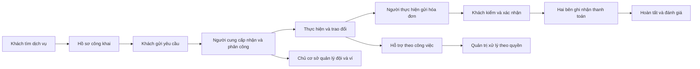

# B00-14 — Báo cáo màn hình Android và iPhone theo vai trò

Cập nhật báo cáo: 05/11/2026 · Ảnh ghi ngày riêng 02/11, 04/11 hoặc 05/11/2026 · Database: **dvqb_local** (native), **dvqb_test/schema riêng** (ảnh web UX-02) · [Mở báo cáo tương tác](B00-14-bao-cao-man-hinh.html) · [Dữ liệu vận hành](B00-13-du-lieu-van-hanh-local.md) · [Mục lục](../README.md).

## Cập nhật quản trị UX-02 ngày 05/11/2026

Đã ghép kết quả triển khai [B00-19](B00-19-trien-khai-quan-tri.md) vào báo cáo tổng, theo yêu cầu chủ dự án. Mở HTML → **Vai trò: Quản trị viên → Luồng: Hỗ trợ và quản trị**. Sau MFA là Tổng quan, hàng đợi/chi tiết/lịch sử hỗ trợ, Nhân sự, thêm tài khoản có sẵn, mời email, xác nhận và danh sách lời mời. Nhận lời mời nằm trong luồng **Tài khoản và bảo mật** của người dùng thường, trước khi có quyền quản trị.

- Tổng quan đếm toàn bộ hồ sơ được tạo trong kỳ 7/30 ngày; bộ lọc ngày, trạng thái và mới/cũ gắn với phân trang.
- Xử lý hỗ trợ tách nội dung/lịch sử, ghi chú riêng và quyết định; có bước kiểm tra trước khi ghi. Chỉ `support.manage` mới xử lý được.
- Nhân sự có hai cách thêm: chọn tài khoản đang có hoặc mời người mới qua email. Lời mời 7 ngày, đúng email đã xác minh, vẫn cần MFA; gửi lại thay mã cũ, có hủy. Chỉ thử thư Mailpit local.
- Mobile dùng Tổng quan / Xử lý / Quyền / Khác. Web dùng menu trái. Những màn quản trị còn lại nằm trong **Khác / Chức năng khác**, theo quyền hiện có.

Báo cáo có **141 mục / 282 vị trí native**, đủ ảnh trên cả Android và iOS. Sau phản hồi của chủ dự án, đã **chụp lại 80 ảnh** ngày 05/11/2026: 37 mục quản trị/nhận lời mời và 3 mục Tài khoản (khách, chủ hồ sơ, nhân viên), mỗi mục trên hai nền tảng. Những mục này dùng ảnh app đang chạy theo UX-02 trong `anh/B00-14-UX02`, không còn dùng ảnh trước thay đổi. Các màn ngoài phạm vi UX-02 giữ ảnh và ngày kiểm riêng 02/11 hoặc 04/11; không gọi toàn bộ 282 ảnh là vừa chụp mới.

Không còn vị trí dùng ảnh lịch sử thay giao diện UX-02 hoặc vị trí thiếu ảnh trong danh mục hiện tại. Trang chủ Android vẫn gắn **NATIVE-05 còn mở**. **5 ảnh web/mobile-web** từ B00-19 được trình bày riêng, không tính thành native.

Ảnh mới dùng `dvqb_local` hiện có. Danh sách lời mời đang rỗng; biểu mẫu mời được điền DEMO và chụp tới bước kiểm tra, **chưa bấm Xác nhận thực hiện**. Tab lịch sử hỗ trợ được chụp ở hồ sơ chưa có quyết định trước đó. Màn nhận lời mời chụp biểu mẫu trước khi nhập mã. Đây là bằng chứng đúng trạng thái giao diện, không chứng nhận đã thực hiện mọi thao tác trong luồng. Không gửi thêm lời mời, đổi quyền, duyệt tiền hay reset dữ liệu để tạo ảnh.

Bằng chứng triển khai trước đợt cập nhật báo cáo: 396 test mobile, 192 test API, 32 hành trình web đạt; SDD verify đạt trên bộ nguồn lúc bàn giao code. Đợt cập nhật báo cáo chạy lại kiểm HTML/ảnh/bộ lọc và SDD theo nguồn cuối; xem [kết quả kiểm báo cáo](../../../.local/seed-operational/report-check/result.json) và `test-results/sdd/SDD-PROJECT/`. Không dùng số lần trước thay bằng chứng mới. Chưa có CI remote/thiết bị vật lý/UAT mới. Ngoài ảnh và báo cáo, đã sửa khóa React bị trùng giữa phần Point và nhận lời mời trên Tài khoản; bài hồi quy tái hiện trước sửa và cả 7 test Tài khoản đạt sau sửa, xem [B00-19](B00-19-trien-khai-quan-tri.md#bổ-sung-khi-chụp-lại-báo-cáo-tổng-05112026). Không đồng bộ Drive/Excel/`ui-ux`.

## Cách xem dễ nhất

Mở file HTML bằng trình duyệt. Chọn **Vai trò → Luồng sử dụng → Theo từng bước**. Mỗi mục cho biết màn dùng để làm gì, đi vào từ đâu, bấm nút nào và chuyển sang đâu. Bấm ảnh để phóng to; có thể xem Android và iPhone cạnh nhau.

- **Tìm kiếm:** nhập tên màn hoặc chức năng, có thể bỏ dấu. Ví dụ `hoa don`, `phan quyen`, `rut`. Ưu tiên mục có tên khớp; tránh trả “hoạt động” khi tìm “hóa đơn”.
- **Luồng chính / nhánh:** tách từ chối, khách rút, dừng, đổi lịch, phân công và quản trị hoàn tất thay. Những nhánh này không phải bước bắt buộc của mọi công việc.
- **Quyền quản trị:** lọc riêng hỗ trợ, kiểm duyệt, tài khoản, danh mục, tài chính và báo cáo. Nhìn thấy màn không tự đồng nghĩa có quyền thực hiện mọi nút.
- **Ảnh đã kiểm:** chọn có ảnh hiện hành cả hai nền tảng, thiếu ảnh hiện hành, ảnh lịch sử trước UX-02, **Ảnh có vấn đề / cần kiểm tiếp** hoặc **Không thể chụp qua luồng hiện tại**. Bộ lọc xét đúng nền tảng đang chọn; mỗi ảnh ghi vai trò, ngày kiểm và vấn đề liên quan.
- **Danh mục:** xem nhanh toàn bộ mục đang khớp, rồi chọn một mục để quay lại hướng dẫn từng bước.
- **Sao chép vị trí:** đường dẫn ghi nhớ bộ lọc và màn đang xem. Khi chuyển sang máy khác, cần gửi kèm file HTML và các thư mục `anh/B00-14-UX01`, `anh/B00-14-UX02`, `anh/B00-19`; đường dẫn local không tự trở thành liên kết Internet.

Báo cáo chạy bằng file local, không cần đăng nhập hay gửi thông tin lên dịch vụ khác. Phần dữ liệu mô tả được nhúng trong HTML; ảnh lấy từ thư mục bên cạnh. Không chứa mật khẩu, token hay khóa TOTP.

## Hệ thống có những nhóm màn nào?

Đã đối chiếu **26 route** trong `RootStackParamList`; khu quản trị và khu hỗ trợ tài khoản bị khóa còn được dựng có điều kiện ngoài danh sách route thông thường. Danh mục tương tác có **141 mục**, gồm màn, tab, biểu mẫu và trạng thái của cùng màn. Đây không phải 141 route độc lập.

| Luồng | Những phần được giải thích | Vai trò chính |
|---|---|---|
| 01. Tìm và thuê dịch vụ | Trang chủ, chọn ngành/kỹ năng, địa điểm, bộ lọc, danh sách/bản đồ, hồ sơ công khai, yêu cầu thuê | Khách chưa đăng nhập, khách thuê |
| 02. Tài khoản và bảo mật | Đăng nhập/đăng ký, thông tin, phiên, địa chỉ, xác minh, OTP, mật khẩu, đổi liên hệ, xóa/khôi phục | Người dùng cá nhân |
| 03. Khách theo dõi công việc | Danh sách, lịch, chi tiết theo trạng thái, hóa đơn, trả tiền, đánh giá | Khách thuê |
| 04. Người cung cấp thực hiện việc | Nhận/từ chối, phân công, đổi lịch/dừng, hóa đơn, nhận tiền, hoàn tất, đánh giá | Chủ hồ sơ, nhân viên có quyền |
| 05. Hồ sơ cung cấp và xác minh | Danh sách/tạo hồ sơ, thông tin, kỹ năng, vùng phục vụ, địa điểm, gallery, xác minh riêng tư | Chủ hồ sơ, người được giao quản lý |
| 06. Đội ngũ và phân quyền | Tổ chức, thành viên, lời mời, đã rời, phân quyền, bàn giao, rời đội | Chủ cơ sở, nhân viên, quản lý |
| 07. Ví và giao dịch | Số dư/khoản giữ, nạp/rút, ngân hàng, lịch sử, chi tiết | Người có quyền ví tương ứng |
| 08. Liên lạc | Hội thoại, nội dung chat, cuộc gọi, thông báo, công tắc thông báo | Các bên được phép tham gia |
| 09. Hỗ trợ và quản trị | Báo cáo, phản hồi, hỗ trợ tài khoản bị khóa, MFA, các hàng đợi và màn tra cứu quản trị | Người gửi, quản trị theo quyền |

Ngày 04/11, chủ dự án chọn bỏ `CatalogCategory` cũ và giữ bộ lọc hiện hành. Đã gỡ route, component và test chỉ dành cho màn cũ; các ca danh mục cần thiết được kiểm trong `ServiceFilter`. Xem [B00-17](B00-17-sua-loi-sau-audit-native.md).

## Hiểu vai trò trước khi đọc các nút

| Vai trò | Quyền đến từ đâu? | Điều dễ hiểu nhầm |
|---|---|---|
| Khách chưa đăng nhập | Nội dung công khai | Xem hồ sơ chưa có nghĩa được gửi việc hoặc xem liên hệ riêng |
| Khách thuê | Tài khoản và quan hệ khách của từng công việc | Không xem hóa đơn nháp của người cung cấp |
| Chủ hồ sơ | Tư cách chủ trên một hồ sơ cụ thể | Có thể vừa là khách thuê ở công việc khác |
| Nhân viên | Tư cách thành viên, việc được giao và các quyền cấp thêm | Không tự có quyền quản lý thành viên hoặc rút tiền |
| Nhân viên quản lý | Các quyền như quản lý đội/hồ sơ/việc/ví | Không phải “admin toàn hệ thống”; quyền theo từng cơ sở |
| Quản trị | Tập quyền quản trị độc lập + phiên MFA hợp lệ | Người đọc tài chính không tự được duyệt tiền; đọc hỗ trợ không tự được xử lý |
| Tài khoản bị khóa | Phiên chỉ dành cho hỗ trợ | Đăng nhập khu hỗ trợ không khôi phục quyền thuê/nhận việc |

Ảnh của chủ hồ sơ được ghi rõ là ảnh chủ hồ sơ. Khi lọc nhân viên, bảng giải thích quyền vẫn áp dụng, nhưng ảnh đó không được coi là bằng chứng nhân viên đã thấy tất cả nút của chủ.

## Luồng nên xem theo thứ tự nào?



Điểm bắt đầu phù hợp: chọn **Khách thuê → Tìm và thuê**, sau đó **Khách theo dõi công việc**. Khi đã hiểu phía khách, chuyển sang **Chủ hồ sơ → Người cung cấp thực hiện việc**. Cuối cùng xem đội ngũ/ví và khu quản trị. Nút “Xem màn liên quan” giúp nhảy qua phần giải thích khác mà không phải tự tìm lại.

## Bằng chứng và cách đọc kết quả

Ảnh được chụp từ app đã cài trên **Android Emulator DVQB_API_36 / Android 16** và **iPhone 18 Pro / iOS 27 Simulator**, đọc API thật nối `dvqb_local`. Không phải ảnh thiết kế hoặc trình duyệt giả lập kích thước điện thoại. Ngày chụp 02/11, 04/11 hoặc 05/11/2026 ghi tại từng khung ảnh; số mục có ảnh hiện trực tiếp ở đầu HTML và bộ lọc.

**Hiện tại: 141/141 mục có ảnh trên cả hai nền tảng, tổng 282 ảnh chính.** Trong đó 80 ảnh vừa chụp lại ngày 05/11 cho phạm vi UX-02. Ở mốc lịch sử ngày 04/11, bộ cũ có 134 mục/268 ảnh chính và đã thay 8 ảnh chính của cuộc gọi, xác minh, chi tiết ví và kết quả tìm kiếm; thêm 2 ảnh kiểm nút Đóng khi thiếu media. Hai ảnh lỗi xác minh ngày 02/11 được giữ làm lịch sử, không phải trạng thái hiện tại. Không còn mục bị chặn vì CatalogCategory đã được bỏ theo duyệt.

| Kết quả | Android | iOS |
|---|---:|---:|
| Mục có ảnh đã đối chiếu | 141 | 141 |
| Trong đó còn ghi nhận vấn đề mở | 1 | 0 |
| Không có đường vào để chụp | 0 | 0 |

Ảnh có vấn đề vẫn được giữ để thể hiện đúng ứng dụng. **Có ảnh không đồng nghĩa màn không có lỗi hoặc mọi nút đã được thử.** Một số ảnh được cuộn tới nội dung chính, không phải ảnh toàn bộ trang dài. Vai trò chụp ở từng khung không được suy rộng thành bằng chứng cho mọi vai trò được bộ lọc liệt kê.

Danh sách kiểm và dấu băm từng ảnh nằm trong [B00-14-native.json](bang-chung/B00-14-native.json). Dấu băm giúp phát hiện ảnh bị đổi sau khi đối chiếu. B00-15 giữ bằng chứng kiểm thao tác của đợt triển khai trước; bộ ảnh tổng dùng `anh/B00-14-UX01` cho các màn ngoài phạm vi UX-02 và `anh/B00-14-UX02` cho các màn vừa chụp lại.

### Mục từng chưa chụp và trạng thái sau sửa, 04/11/2026

- **CatalogCategory:** đã bỏ theo lựa chọn của chủ dự án; không thêm nút hoặc ép route để chụp màn cũ. Bộ chọn dịch vụ hiện hành vẫn có ảnh và test.
- **Cuộc gọi thành công:** đã chụp Android gọi iOS bằng LiveKit local, hai bên tắt mic và kết thúc. Chưa đo chất lượng nghe hoặc kiểm điện thoại thật. Dùng `npm run review:api -- --calls` để chủ động bật môi trường gọi; mặc định media tắt.

### Các vấn đề đã điều tra và xử lý

| Mã | Trước sửa | Kết quả hiện tại |
|---|---|---|
| NATIVE-01 | Thiếu cấu hình media local | Đã chuẩn hóa lệnh chạy, kiểm được hai bên kết nối. Không bật provider trả phí. |
| NATIVE-02 | Lỗi gọi chỉ có Thử lại, thiếu Đóng | Đã giữ mã lỗi qua API/app; có Đóng với lỗi chưa tạo cuộc gọi. Với kết quả chưa rõ, giữ thao tác và mã chống trùng để mở lại/thử tiếp. |
| NATIVE-03 | Xác minh tải đầu báo lỗi mạng | Đã xử lý tranh chấp phiên BUSY và bỏ lượt tải cũ. Hai nền tảng đọc được kết quả không cần thử lại. |
| NATIVE-04 | Chi tiết ví nằm sau toàn bộ lịch sử | Đã mở màn chi tiết riêng; đóng quay lại danh sách. Hai nền tảng đã kiểm. |
| **NATIVE-05 — còn mở** | Android SIGSEGV ngày 02/11, stack có MountingCoordinator | Release mới build: 10/10 lần mở có process sau 5 giây, chưa tái hiện. **Chưa có nguyên nhân hoặc bản sửa được chứng minh.** |
| NATIVE-06 | Sao hiện 2.3333333333333335 | Cùng hồ sơ trên Android/iOS hiện **2,3 (3 đánh giá)**; giữ số gốc để tính/xếp hạng. |

[B00-17 — giải thích code, test, ảnh và giới hạn](B00-17-sua-loi-sau-audit-native.md) có bằng chứng chi tiết. Bộ lọc “Ảnh có vấn đề / cần kiểm tiếp” hiện giữ Trang chủ Android cho NATIVE-05. Ảnh trang chủ là lúc app đã mở được, không phải thời điểm crash. Các lỗi đã xử lý có trạng thái `resolved-local` trong ledger; không đồng nghĩa đã có CI/UAT/production.

Các hóa đơn Android từng được chụp khi dữ liệu chưa tải đủ đã được chụp lại: Point và ảnh kết quả đã hiện. Màn khách xem công việc có hóa đơn nháp hiện **“Hóa đơn sẽ xuất hiện ở đây”** là trạng thái chờ đúng quyền. Không gộp các trường hợp này vào danh sách lỗi chưa xử lý.

Theo yêu cầu dọn ảnh cũ ngày 02/11, đã xóa 243 PNG trước sửa trong `anh/B00-14` và 14 PNG của audit trước sửa trong `anh/UX-01`, tổng **257 ảnh / 51.858.413 byte (~51,9 MB)**. Bảng audit cũ giữ nội dung và nhật ký, gỡ liên kết ảnh đã xóa và ghi là lịch sử. Không xóa ảnh của các báo cáo khác, ảnh thiết kế đã duyệt hoặc dữ liệu app/database.

Sau khi kiểm đủ dấu băm của bộ ảnh xuất mới, đã dọn thêm **866 ảnh chụp thử/bản sao/ảnh ghép kiểm tra trong `.local/ux-01-recapture`, giải phóng 178.249.540 byte (~178,2 MB)**. Ở mốc 02/11 đã giữ 270 ảnh cần thiết cạnh báo cáo, metadata kết quả và backup database. Các log debug lớn có thể được nén `.gz`; không xóa bằng chứng lỗi cần tra cứu.

### Lịch sử kiểm trước UX-01 — ngày 30/10/2026

Các kết quả dưới đây là mốc kiểm dữ liệu/API trước đợt sửa giao diện. Số đếm trong JSON có `checkedAt` riêng; không phải số đếm database mới ngày 02/11. Ảnh native mới nằm ở phần trên; kiểm thao tác UX-01 của đợt triển khai nằm ở B00-15.

Các trạng thái seed được mở qua giao diện hoặc deep link được app hỗ trợ. Vì phần lớn công việc có sẵn ở các trạng thái khác nhau, việc chụp ảnh **không chứng minh đã bấm toàn bộ chuỗi chuyển trạng thái cho từng công việc**.

Đã bổ sung một công việc mô phỏng riêng để đi trọn chuỗi qua API thật: tạo → nhận → nháp → gửi → xác nhận với 10.000 Point → khách báo trả → người thực hiện quyết toán. Kết quả cuối: hoàn tất, hóa đơn quyết toán, 240.000 đồng mô phỏng trả trực tiếp, đủ điều kiện đánh giá. Tài khoản không liên quan bị từ chối và khách không xem được hóa đơn nháp. Bài kiểm này không reset hay thay database.

Trong lần chạy đầu, công cụ kiểm kỳ vọng sai mã HTTP của thao tác nhận việc (201 thay vì 200); đã đọc controller, sửa kỳ vọng và tiếp tục đúng công việc đã tạo. Bằng chứng giữ lịch sử lần chạy này; không gọi đó là một lỗi nghiệp vụ của app.

Khi kiểm native phát hiện dòng Point khởi tạo có `reference_id=null`, trái hợp đồng UUID của API, khiến cả màn hóa đơn không tải xong. Đã sửa API dùng mã giao dịch sổ cái làm tham chiếu dự phòng khi không có hóa đơn/nạp/rút liên quan; giữ ưu tiên các mã nghiệp vụ cũ. Kiểm hồi quy trên DB cách ly tái hiện lỗi trước sửa, kiểm lại schema và quyền đọc sau sửa. Không đổi công thức tiền, số dư hay quyền.

Bộ đọc API đạt 93/93 kiểm trong lượt hậu kiểm, gồm các hàng đợi, chi tiết, ví/Point, trạng thái công việc, nhóm quyền quản trị và nội dung PNG xác minh riêng tư. Giới hạn đăng nhập trả 429 được tôn trọng theo `Retry-After`; không tắt hay nới bảo vệ để lấy kết quả xanh.

## Mốc kiểm báo cáo ngày 04/11 — trước UX-02

Bộ kiểm báo cáo đối chiếu đủ 268 vị trí, dấu băm ảnh, lý do và bằng chứng cho mục không chụp được; kiểm tìm không dấu, vai/quyền/luồng, không có kết quả, chuyển bước, liên kết, URL, danh mục, lọc lỗi/không thể chụp theo nền tảng và phóng ảnh. Kiểm tải 268 ảnh chính, 4 ảnh bổ sung (2 ảnh lịch sử xác minh và 2 ảnh lỗi gọi có nút Đóng), cùng bố cục 1440/768/390/320 px. Kết quả có ngày chạy tại [report-check/result.json](../../../.local/seed-operational/report-check/result.json). Sơ đồ Mermaid giữ 12 nút và được kiểm render.

Đợt này chụp lại app trên `dvqb_local`; không reset database, không duyệt tiền, xóa tài khoản, lưu quyền hay gửi tin nhắn thực. Đăng nhập, đọc hội thoại và thông báo có thể cập nhật phiên/dấu đã đọc, nên không gọi đây là đợt hoàn toàn không ghi DB. Có backup trước chụp tại `.local/ux-01-recapture/before-capture.dump`. Đó là phạm vi chụp ngày 02/11. Đợt 04/11 đã sửa code và kiểm thêm một cuộc gọi DEMO theo B00-17; chỉ NATIVE-05 còn mở.

SDD chạy lại theo quy định repo, bằng chứng ở `test-results/sdd/SDD-PROJECT/`; chỉ dùng kết quả `verify` có snapshot khớp bộ file cuối. Hồi quy tự động không thay thế ảnh native, kiểm mọi nút hay UAT.

## Mở code theo thứ tự nào?

| Mục tiêu | File / hàm thật | Đọc để hiểu |
|---|---|---|
| Xem màn nào đã đăng ký | [routes.ts](../../../apps/mobile/src/app/navigation/routes.ts): `RootStackParamList`, `accountDestination`, `appLinkState` | Tên route, dữ liệu điều hướng và các deep link được chấp nhận |
| Xem ai đi vào khu nào | [AppNavigator.tsx](../../../apps/mobile/src/app/navigation/AppNavigator.tsx) | Tài khoản thường, quản trị và tài khoản bị khóa dùng nhánh giao diện nào |
| Đọc lời giải thích từng màn | [screen-catalog.mjs](../../../scripts/review/screen-catalog.mjs): `screens`, `add` | Mục đích, đường vào, vai trò, nút, quyền và link source thật |
| Tạo file báo cáo | [build-report.mjs](../../../scripts/review/build-report.mjs) | Ghép mô tả UX-01/UX-02, snapshot seed có ngày riêng và ledger 282 vị trí native; ảnh web tách riêng vào HTML/JSON |
| Tìm/lọc/đi từng bước | [report-template.html](../../../scripts/review/report-template.html): `render`, `restore`, `imagePanel` | Bộ lọc kết hợp, ưu tiên tìm tên, vị trí trong URL, ảnh và màn liên quan |
| Chụp native | [capture-native.mjs](../../../scripts/review/capture-native.mjs): `login`, `open`, `shot` | Mở app/route thật, đợi màn, chụp và xuất ảnh từ Maestro |
| Kiểm với database hiện tại | [check-operational-api.mjs](../../../scripts/review/check-operational-api.mjs), [verify-operational-flow.mjs](../../../scripts/review/verify-operational-flow.mjs) | Đọc quyền/dữ liệu và chạy một công việc mô phỏng qua API |
| Đọc lịch sử Point | [invoices.service.ts](../../../services/api/src/modules/invoices/invoices.service.ts): `ledger` | Ưu tiên mã hóa đơn/nạp/rút; dòng khởi tạo dùng mã giao dịch, tránh trả UUID rỗng |
| Kiểm báo cáo | [check-report.mjs](../../../scripts/review/check-report.mjs) | Tìm không dấu, kết hợp bộ lọc, không có kết quả, chuyển bước, URL, phóng ảnh, kích thước và liên kết |

Báo cáo chỉ giữ lựa chọn lọc trên URL trình duyệt; thay bộ lọc không sửa dữ liệu ứng dụng. Nút trong bảng là lời giải thích hoặc liên kết đến mục khác của báo cáo, không phải nút gửi lệnh tới API sản phẩm.

## Những thao tác thay đổi sau UX-01

| Nhóm màn | Cách thao tác hiện tại |
|---|---|
| Tìm và lọc | **Tìm dịch vụ quanh đây** gửi truy vấn. Bộ lọc có nháp: **Áp dụng bộ lọc** tìm ngay, **Hủy** giữ điều kiện cũ. Đổi sắp xếp tự tìm lại; đổi khu vực bỏ kết quả khu vực cũ. Bộ chọn dịch vụ chọn xong đóng ngay, không có nút Áp dụng riêng. |
| Công việc / hóa đơn | Hành động chính ở thanh dưới; rút/dừng/từ chối tách riêng. Đọc nội dung và chi phí trước ảnh. Lịch sử giao dịch chỉ tải khi mở; Point lỗi thì chưa xác nhận hóa đơn. |
| Chat | Bấm cả hàng hội thoại để mở. Khi đọc phía trên, tin mới không tự kéo màn; **Có tin mới · xem tin** đưa tới cuối. D02 đọc ngược lịch sử chưa được duyệt. |
| Tài khoản / hồ sơ | Tài khoản chia nhóm. Các tab chỉnh hồ sơ giữ nháp; nút Lưu ghi từng nhóm. Công khai và nhận việc là hai trạng thái khác nhau. |
| Thông báo | Bốn công tắc có nháp trong cùng phiên; quay về rồi mở lại vẫn còn. **Lưu cài đặt** mới ghi máy chủ. |
| Ví / phân quyền / quản trị | Ví giải thích lý do khóa rút, đường bổ sung ngân hàng theo quyền. Quyền hiển thị tên, mô tả, tóm tắt thay đổi; không đổi thì không lưu. Xét duyệt chọn hành động rồi gửi một lần. |
| Đánh giá / phiên | Gỡ đánh giá hoặc thu hồi phiên có bước xác nhận; Hủy giữ nguyên. |

Mỗi mục trong HTML có mô tả nút, đường vào, liên kết sang màn liên quan và ghi chú mới. Bảng nút hóa đơn đã tách theo trạng thái: không liệt kê Lưu nháp trên hóa đơn đã gửi, không liệt kê Xác nhận trên hóa đơn đã quyết toán; Đánh giá nằm ở chi tiết công việc hoàn tất. Mô tả theo code không thay thế kiểm bấm từng nút trên native. Giữ API/quyền hiện hành, D01–D04 chưa mở.

## Giới hạn cần giữ đúng

- Chỉ ảnh có thật được hiển thị. Mục còn thiếu ảnh hoặc chỉ đối chiếu code vẫn nằm trong danh mục; dùng bộ lọc **Còn thiếu ảnh** để xem chính xác. Không suy từ “đã kiểm kê” thành “đã kiểm native mọi trạng thái”.
- Chưa có kiểm trên điện thoại vật lý, UAT của chủ dự án, push APNs/FCM thật, OTP tới SIM/hộp thư thật, ngân hàng thật hoặc production. Ảnh và số tiền đều mô phỏng.
- Màn gọi cần cấu hình media local và hai phía tham gia; lịch sử hoặc mô tả nút không chứng minh chất lượng âm thanh. Bản đồ cũng phụ thuộc quyền định vị/dịch vụ bản đồ, không suy ảnh bản đồ thành kiểm mọi lỗi mạng/định vị.
- Không dùng ảnh đang tải, ảnh bấm nhầm tab hoặc ảnh có lớp thông báo của công cụ phát triển. Một số lượt Maestro thất bại do tab cuộn ngang, vùng bị header che hoặc driver chụp xung đột; đã mở lại/chụp trực tiếp và đối chiếu. Đây là lỗi công cụ thu bằng chứng, tách riêng khỏi crash Android và các vấn đề ứng dụng ở bảng trên.
- Báo cáo tiếng Việt, chụp giao diện tiếng Việt; chưa chứng nhận toàn bộ biến thể Anh/Nhật và mọi cỡ chữ hệ điều hành.
- Không tự sửa nghiệp vụ app chỉ để làm ảnh đẹp. Lỗi seed đã sửa về quan hệ đánh giá/ảnh, thành viên đúng loại hồ sơ và điểm đại diện đa giác; lỗi điều khiển chụp hoặc ảnh đang tải cần chụp lại hoặc loại khỏi bằng chứng.
- Hồi quy SDD dùng `dvqb_test` riêng theo quy tắc repository. Các kiểm app/API và ảnh của báo cáo dùng `dvqb_local`; không dùng fixture reset của SDD trên database này.

<details>
<summary>Bằng chứng kỹ thuật trên máy và cách chạy lại</summary>

- [Kiểm dữ liệu seed](../../../.local/seed-operational/verification.json).
- [Đọc API và kiểm quyền](../../../.local/seed-operational/api-verification.json).
- [Luồng API ghi dữ liệu hiện tại](../../../.local/seed-operational/flow-verification.json).
- [Kiểm báo cáo bằng trình duyệt](../../../.local/seed-operational/report-check/result.json), ảnh bố cục 1440/768/390/320 trong cùng thư mục.
- [Ledger native hiện tại](bang-chung/B00-14-native.json). Nhật ký thô tại `.local/ux-01-recapture/runs/`, không đưa YAML/nhật ký có thông tin đăng nhập vào báo cáo. Ảnh chụp thử trùng/sai được dọn sau khi kiểm bản xuất; chỉ ảnh đã đối chiếu và ảnh lỗi cần giữ nằm cạnh báo cáo.
- [Dữ liệu báo cáo để kiểm kê](B00-14-man-hinh-data.json); không có thông tin đăng nhập.
- SDD: `test-results/sdd/SDD-PROJECT/`; đọc trạng thái và thời điểm bằng chứng thực tế, không dùng kết quả của lượt cũ để chứng nhận phiên bản mới.

```sh
npm run api
npm run review:mobile -- ios
# Hoặc Android sau khi emulator đã khởi động:
npm run review:mobile -- android
npm run review:screens:build
npm run review:screens:check
```

Chạy API ở một terminal, rồi launcher ở terminal khác; bộ giả lập cần có app đã cài. Launcher mở Metro và app theo nền tảng đã chọn. Script chụp tự động đang gắn ID các giả lập của phiên này; khi đổi máy cần đối chiếu lại ID và trạng thái đăng nhập. Chỉ mở một Metro trên 8085; cùng Metro có thể phục vụ cả hai nền tảng. Các phiên chụp đang chạy đã dùng cấu hình này. Khi chạy lại capture, chọn phase phù hợp với trạng thái đăng nhập/màn hiện tại và đọc `result.json` cùng ảnh thực tế; số bước dự kiến không thay thế số ảnh đã kiểm.

</details>

## Bài thử để tự hiểu hệ thống

1. Lọc **Khách thuê**, tìm “hóa đơn”: giải thích vì sao “Xác nhận hóa đơn” khác “Báo đã thanh toán”.
2. Lọc **Quản trị viên → finance.read** rồi đọc nút: vì sao chỉ đọc được hóa đơn chưa đủ quyền xét rút tiền?
3. Chọn **Luồng chính** rồi chuyển sang **Nhánh / trạng thái khác**: công việc từ chối hoặc khách rút có phải đi tiếp tới hóa đơn không? Đối chiếu trạng thái trong mô tả.
