# B00-15 — Áp dụng giao diện UX-01 vào ứng dụng

Ngày 02/11/2026 · Code đang sửa trên nhánh `feat/local-completion`, chưa commit/push. Chủ dự án đã duyệt bản HTML và yêu cầu áp dụng vào app. [Thiết kế đã duyệt](../de-xuat/UX-01-thiet-ke-giao-dien.html) · [Kế hoạch](../de-xuat/UX-01-toi-uu-luong-va-nut.md) · [Mục lục](../README.md).

## 1. Người dùng thao tác thế nào sau thay đổi?

Tìm dịch vụ có nút tìm ghi rõ công dụng. Bộ lọc có bản đang chỉnh riêng: **Hủy** giữ lựa chọn cũ; **Áp dụng** tìm ngay. Đổi sắp xếp tự tìm lại, vẫn giữ kết quả cũ trong lúc chờ. Mở hồ sơ rồi quay lại không phải tìm từ đầu.

Ở công việc và hóa đơn, hành động chính nằm ở thanh dưới màn hình. Phần lý do, thời gian đến, chi phí và ảnh vẫn ở nội dung để đọc/nhập; thao tác dừng hoặc rút yêu cầu tách khỏi bước tiếp theo. Hóa đơn hiển thị nội dung trước ảnh; lịch sử giao dịch chỉ tải khi mở. Nếu không tải được Point, app không coi số dư là 0 và không cho xác nhận bằng dữ liệu chưa biết.

Chat giữ vị trí khi đọc tin cũ. Có tin mới sẽ hiện nút **Có tin mới · xem tin**; bấm mới chuyển xuống cuối và đánh dấu đã đọc. Tin gửi lỗi vẫn giữ nội dung và dùng lại thao tác cũ khi thử lại. Danh sách trò chuyện có hàng bấm trực tiếp, tên và số tin chưa đọc.

Tài khoản chia thành Cá nhân, Công việc và hồ sơ, Bảo mật và hỗ trợ. Các nhóm quản lý dùng dãy tab gọn; quyền có tên/mô tả và tóm tắt cấp thêm/thu hồi trước khi lưu. Ví giải thích lý do nút rút bị khóa và chỉ mở đường bổ sung ngân hàng khi đúng quyền. Gỡ đánh giá cần xác nhận; Hủy không gửi yêu cầu gỡ.

Đây là thay đổi giao diện và cách điều phối yêu cầu hiện có. Giữ công thức tiền/Point, hai dấu thanh toán riêng, quyền do máy chủ quyết định và cơ chế tránh ghi trùng. D01–D04 vẫn chưa được duyệt: chưa thêm API lịch theo khoảng ngày, đọc ngược lịch sử chat, lọc việc theo hành động hay bổ sung thông tin nhận diện admin. G03 không thiết kế lại; không mở PROMO-02, provider hoặc production.

## 2. Theo một thao tác từ đầu đến cuối

**Bản nháp** là nội dung đang nhập trên màn hình, chưa lưu xuống máy chủ. **API** là đường app gửi yêu cầu để máy chủ đọc/ghi dữ liệu và kiểm quyền.

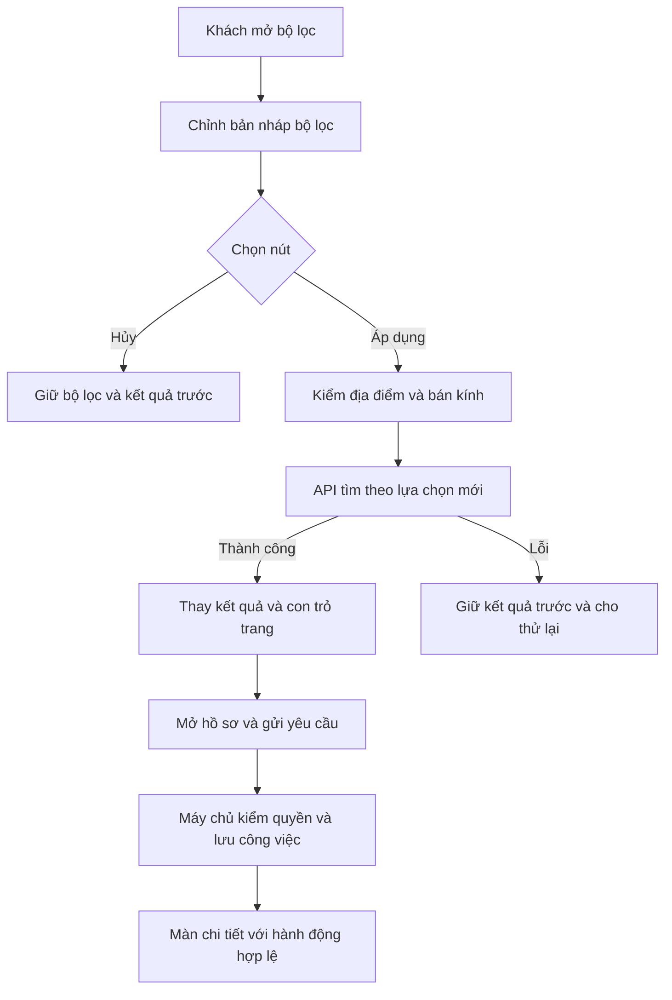

Khi đổi lọc lần nữa trước khi lần trước trả lời, `PartnerSearch.load` nhận biết yêu cầu cũ và bỏ phản hồi cũ. Con trỏ sang trang tiếp theo không được dùng lẫn giữa hai truy vấn. Vì vậy kết quả không bị trộn chỉ vì mạng trả lời khác thứ tự.

Ở hóa đơn, `usePageActions` đưa nút của bước hiện tại xuống thanh hành động. Nó giữ đúng hàm đang dùng bản nháp mới nhất, không chuyển dữ liệu nhập sang một form khác. `Screen` dành vùng cho thanh này và xử lý bàn phím iOS; Android co chiều cao phần nội dung theo bàn phím; khoảng an toàn phía trên được tính vào vị trí bàn phím. Khi rời form, nút của form được gỡ khỏi thanh.

## 3. Đọc code theo thứ tự nào?

Các đường dẫn bên dưới tính từ báo cáo này; tên hàm là tên thật trong source.

| Bước | File và hàm | Nhận gì, làm gì, trả lại gì? |
|---|---|---|
| 1 | [SearchScreen.tsx](../../../apps/mobile/src/features/search/screens/SearchScreen.tsx), `openFilters`, `applyFilters`, `submit` | Tách bộ lọc đang dùng khỏi nháp; kiểm nhập và gửi truy vấn mới |
| 2 | [partner-search.ts](../../../apps/mobile/src/features/search/state/partner-search.ts), `PartnerSearch.load`, `cancel`, `resume` | Gọi API, bỏ phản hồi cũ, giữ kết quả lúc tải và khôi phục truy vấn bị gián đoạn |
| 3 | [ProductShell.tsx](../../../apps/mobile/src/app/layout/ProductShell.tsx), `usePageActions`, `PageActionSlot` | Nhận nút từ màn con, hiển thị ở thanh dưới; chỉ thanh đăng ký nhận cập nhật |
| 4 | [Screen.tsx](../../../apps/mobile/src/components/ui/Screen.tsx), `Screen` | Sắp header, vùng cuộn, thanh nút và khoảng tránh bàn phím |
| 5 | [JobDetailScreen.tsx](../../../apps/mobile/src/features/jobs/screens/JobDetailScreen.tsx) | Nhận công việc và `allowed_actions`; chọn bước chính, giữ lý do/thời gian/phiên bản khi gửi |
| 6 | [InvoiceScreen.tsx](../../../apps/mobile/src/features/invoices/screens/InvoiceScreen.tsx), `InvoiceContent`, `afterRead` | Hiển thị hóa đơn, tải tài chính/ảnh/lịch sử theo phạm vi; trước ghi phải chờ dữ liệu cần thiết |
| 7 | [ConversationScreen.tsx](../../../apps/mobile/src/features/chat/screens/ConversationScreen.tsx), `Room`, `markVisibleRead`, `showLatest` | Gộp tin theo ID/thứ tự, giữ vị trí đọc và chỉ cập nhật mốc đọc khi xem cuối |
| 8 | [mutation.ts](../../../apps/mobile/src/features/jobs/state/mutation.ts), `Mutation.run` | Giữ khóa và nội dung của thao tác chưa rõ kết quả để thử lại an toàn |

## 4. Các nút và nhóm màn đã sửa

| Nhóm | Thay đổi quan trọng | Điều được giữ |
|---|---|---|
| Tìm dịch vụ / hồ sơ công khai | Tìm rõ nhãn, lọc nháp, tự tìm khi đổi sort, CTA thuê theo quyền | Dịch vụ, địa điểm, bản đồ và quyền thuê/liên hệ thật |
| Tạo / chi tiết công việc | Nút chính dưới màn, trạng thái có chữ và biểu tượng, hành động nguy hiểm riêng | Thời gian, lý do, người được giao, version và `allowed_actions` |
| Hóa đơn | Lưu nháp/gửi/xác nhận theo bước; ảnh/lịch sử lỗi không che nội dung chính | Công thức Point/phí/tiền, ảnh đã lưu, hai xác nhận thanh toán |
| Chat / gọi | Hàng trò chuyện dễ bấm, nút xem tin mới, trạng thái micro/loa; bỏ text thừa dưới View native | API phân trang hiện có, media và retry cuộc gọi hiện hành |
| Đánh giá / hỗ trợ | Sao được chọn nổi bật; xác nhận gỡ; tab lọc hỗ trợ, tiêu đề trước mã | Ảnh/phản hồi/báo cáo, quyền và hỗ trợ tài khoản bị hạn chế |
| Hồ sơ cung cấp / gallery / xác minh | Tab gọn, giữ nháp qua tab, lên/xuống ảnh và trạng thái upload rõ | Vùng phục vụ, kỹ năng, công khai khác nhận việc; chứng cứ riêng |
| Tài khoản / địa chỉ / phiên | Menu theo nhóm, nút lưu rõ; xác nhận thu hồi có thời gian thật | Không bịa tên thiết bị, không mất luồng xác minh/khôi phục |
| Thông báo / bảo mật | Giữ nháp bốn công tắc; tab bảo mật; resend/expiry theo server | Không gửi push thật từ việc chỉnh bố cục; giữ MFA/OTP/reauth |
| Đội ngũ / quyền quản trị | Tên quyền dễ hiểu, tóm tắt đổi quyền, no-op không lưu | Bàn giao nghĩa vụ, phạm vi quyền và phiên bản |
| Ví / quản trị xử lý | Lý do không rút được, kiểm nhập, chặn gửi trùng, mở chi tiết sau gửi | Quyền ví/ngân hàng; unknown chỉ đối soát lệnh cũ; ghi chú nội bộ riêng |

## 5. Dữ liệu, lỗi và thử lại

- Native dùng API hiện tại nối **`dvqb_local`**, với tài khoản/dữ liệu vận hành mô phỏng đã seed; không reset DB. Có bản sao lưu trước kiểm tại `.local/ux-01-audit/before-implementation-native.dump` (local riêng, không đưa vào Git).
- Các bài hồi quy có fixture chạy trên `dvqb_test` riêng để không xóa dữ liệu ứng dụng. Chúng bổ sung kiểm logic, không được ghi là nghiệm thu `dvqb_local`.
- Bản nháp form ở bộ nhớ màn hình; chuyển tab trong cùng form giữ nháp. Riêng cài đặt thông báo giữ trong phiên tài khoản để quay về rồi mở lại vẫn còn, và xóa khi đổi tài khoản/đăng xuất/mất quyền. Không hứa giữ sau khi đóng app hoặc đăng xuất. Khi đổi tài khoản/mất quyền, dữ liệu riêng phải được bỏ.
- Mất mạng sau khi bấm gửi có thể chưa biết máy chủ đã ghi chưa. Nút thử lại giữ cùng nội dung và khóa chống trùng; không tạo lệnh chuyển tiền hoặc hóa đơn mới chỉ vì bấm lại.
- Màn Point lỗi khóa xác nhận nhưng giữ nội dung hóa đơn; ảnh lỗi có nút tải lại. Chat tách lỗi đánh dấu đọc khỏi lỗi tải tin và xóa đúng lỗi khi thử lại thành công.

## 6. Cách tự thử

1. Chọn địa điểm đã lưu, mở lọc rồi đổi bán kính và Hủy: kết quả cũ vẫn ở đó. Mở lại, đổi bán kính và Áp dụng: tìm ngay. Đổi sắp xếp, mở một hồ sơ, quay lại: giữ truy vấn.
2. Mở một hóa đơn nháp: nhập chi phí và mở bàn phím. Cuộn xuống ảnh rồi quay lên; kiểm nội dung còn và nút lưu/gửi ở đúng bước. Chưa thêm ảnh thì gửi bị khóa nhưng vẫn lưu nháp được.
3. Mở chat dài, cuộn lên tin cũ, gửi tin từ đầu kia: màn không tự kéo xuống. Bấm nút tin mới để tới cuối. Thử ngắt mạng rồi gửi: nội dung giữ lại và có thử lại.
4. Đổi một công tắc thông báo, quay về rồi mở lại: nháp vẫn còn. Chỉ **Lưu cài đặt** mới ghi máy chủ.
5. Mở đánh giá của mình, bấm Gỡ rồi Hủy: đánh giá vẫn công khai. Với ví, xem lý do bị khóa và đường bổ sung ngân hàng theo quyền.

Câu hỏi học code: Vì sao giữ kết quả nhưng xóa con trỏ khi đổi truy vấn? Vì sao Point chưa tải được không thể là 0? Vì sao thử lại thao tác tài chính phải dùng cùng khóa? Gợi ý lần lượt ở `PartnerSearch.load`, `financeReady` và `Mutation.run`.

## 7. Bằng chứng và giới hạn

Kiểm toàn bộ mobile sau sửa: **74 suite / 390 test đạt**; lint và typecheck toàn workspace đạt. Có thêm các ca giữ nháp, lọc Apply/Cancel, phản hồi cũ, footer lấy đúng nháp, ảnh/Point lỗi, gỡ đánh giá xác nhận và chat đọc lịch sử. Một vòng review độc lập phát hiện banner lỗi đọc chat không biến mất sau retry; đã sửa và kiểm lại ca đó.

Hồi quy web phát hiện nút Quay lại bị bỏ qua khi ví đang tải lại. Đã bổ sung ca kiểm giữ phản hồi đọc để tái hiện lỗi, sửa để cho quay lại trong lúc đọc dữ liệu nhưng vẫn chặn khi đang gửi hoặc thử lại giao dịch. Phản hồi chi tiết đến muộn không mở lại trang cũ và kết thúc tải phải bỏ trạng thái khóa nút. Hai ca hồi quy này đạt; đường quay về ví đã kiểm lại trên Android/iOS, luồng tài chính web chạy lại đạt. Lượt SDD đầu được chủ động dừng tại đây; chỉ dùng lượt đầy đủ sau sửa làm kết quả cuối.

Lượt web tiếp theo phát hiện kết quả của địa điểm cũ còn hiển thị sau khi chọn khu vực mới. Đã xóa kết quả/bản đồ cũ ngay khi đổi tọa độ và bỏ phản hồi cũ đến muộn; giữ hành vi giữ kết quả khi đổi lọc hoặc sắp xếp trong truy vấn đang cập nhật. Ca hồi quy mới và bài bản đồ đạt. Hai phép kiểm cũ được cập nhật theo giao diện đã duyệt: tiêu đề tiếng Nhật mới và chỉ đếm tab điều hướng chính, không đếm cả tab nội dung. Giữ nguyên các kiểm về locale, quyền ví và dữ liệu riêng.

SDD giữ toàn bộ **156 tiêu chí**, QA **97 partial / 12 unmapped**, không đổi hash nguồn hoặc giảm tiêu chí. `prepare` đã đạt sau đăng ký code/test mới; ảnh và báo cáo cũng được đăng ký trong inventory. Bộ chạy đầy đủ và kiểm phiên bản cuối lưu tại `test-results/sdd/SDD-PROJECT/`; đọc `result.json` và kết quả `verify` của bộ file hiện tại, không dùng kết quả trước sửa. Đây là bằng chứng local; chưa có CI mới hoặc UAT của chủ dự án.

Phần native và ảnh sau sửa được bổ sung bên dưới theo từng lượt thực sự hoàn tất. Theo yêu cầu ngày 02/11, ảnh B00-14/UX-01 trước sửa đã được xóa để giảm dung lượng. [Báo cáo tổng B00-14](B00-14-bao-cao-man-hinh.html) đã có đợt chụp riêng ngày 02/11: 268 ảnh chính, 134/135 mục trên cả hai nền tảng, cùng bảng lỗi và mục chưa có đường vào. 15 ảnh bên dưới giữ bằng chứng kiểm thao tác của B00-15; bảng audit trước sửa chỉ còn nội dung và nhật ký lịch sử. Chưa đo đủ cặp baseline/trung vị cùng thiết bị, nên không cam kết nhanh hơn một tỷ lệ cụ thể. Không chứng nhận media gọi hai đầu, provider live, điện thoại vật lý hoặc mọi tổ hợp quyền/444 mô tả nút từ các lượt này.

### Native sau sửa — ngày 02/11/2026

Dữ liệu lấy từ API nối **dvqb_local**, tài khoản vận hành mô phỏng. Thiết bị kiểm là **Android Emulator DVQB_API_36** và **iPhone 18 Pro / iOS 27 Simulator**, không phải điện thoại vật lý. [Kết quả các lượt kiểm và đối chiếu DB](bang-chung/B00-15-native.json).

| Luồng thực sự đã kiểm | Android | iOS | Phạm vi kết luận |
|---|---|---|---|
| Khách: trang tìm → địa chỉ đã lưu → Áp dụng → đổi sắp xếp → Hủy lọc | Đạt | Đạt | Kết quả tìm còn sau Hủy; đổi sort/Apply gọi tìm |
| Thông báo: đổi công tắc → quay lại → mở lại | Đạt | Đạt | Nháp còn sau pop màn; đổi về giá trị cũ thì nút lưu khóa; không ghi cài đặt |
| Xem công việc và hóa đơn đã gửi / đã khóa | Đạt | Đạt | Bố cục, điều hướng, hành động theo quyền; không xác nhận thanh toán trong lượt này |
| Mở chat và gửi tin | Đạt | Đạt | Hai tin kiểm được đối chiếu đã lưu trong DB; không chỉ dựa vào chữ trong ô nhập |
| Chủ hồ sơ: sửa tên nháp → tab kỹ năng → quay lại | Đạt | Đạt | Nháp không bị thay bằng tên từ server; chưa lưu tên sửa |
| Chủ hồ sơ: ví → nháp nạp tiền → rút tiền | Đạt | Đạt | Số dư/đường đi/nút khóa hợp lệ; không gửi lệnh ngân hàng |
| Chủ hồ sơ: hóa đơn nháp, yêu cầu sửa, khách báo thanh toán | Đạt | Đạt | Mở và nhập form; chưa chạy quyết toán từ các lượt này |
| Bàn phím ảo với hóa đơn, chat và bộ lọc | Đạt sau sửa | Chưa xác nhận | Android kiểm vùng nhập/nút còn thấy khi mở bàn phím; iOS chỉ kiểm nhập và bố cục không có bàn phím ảo |

Native đã phát hiện hai lỗi mà unit ban đầu chưa chỉ ra: nháp thông báo mất khi màn bị tháo khỏi stack và bàn phím Android che ô chat/thanh nút. Đã sửa vòng đời nháp theo phiên tài khoản, xử lý tránh bàn phím tại `Screen`, rồi chạy lại. Lỗi phép kiểm tên hồ sơ (còn hậu tố), thao tác chạm sai vùng khi cuộn và deep link iOS chưa chuyển xong được phân biệt với lỗi sản phẩm; nhật ký local giữ các lượt dừng, không gộp chúng thành đạt.

Ảnh dưới đây là ảnh app sau sửa, dùng dữ liệu mô phỏng; cột trái iOS Simulator, cột phải Android Emulator. Các ảnh đầu thể hiện luồng trước tinh chỉnh cuối về bàn phím/số thứ tự phần hóa đơn; ảnh cuối kiểm riêng bố cục cuối.

| iOS Simulator | Android Emulator |
|---|---|
| 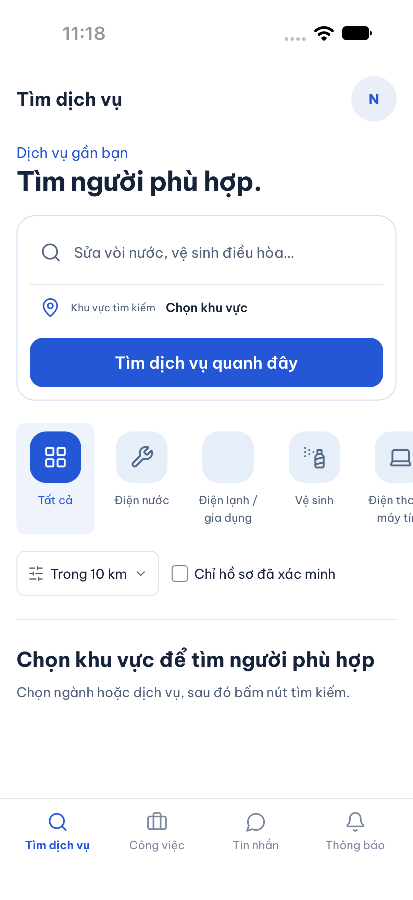 | 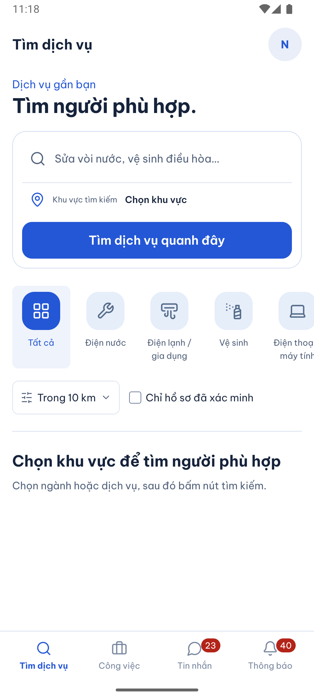 |
| 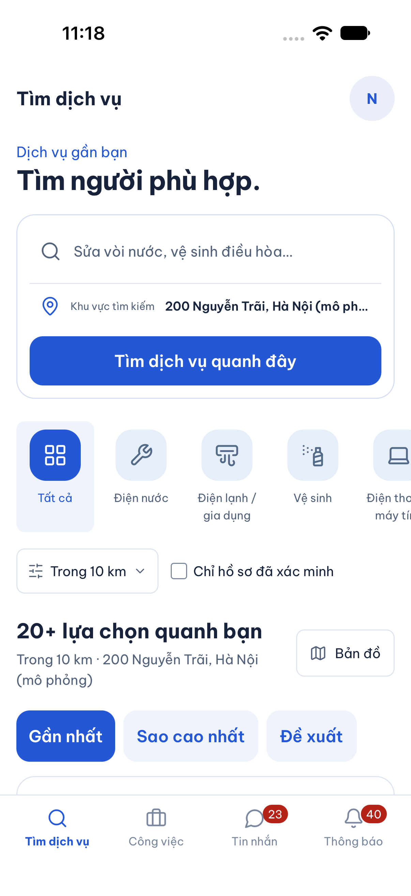 | 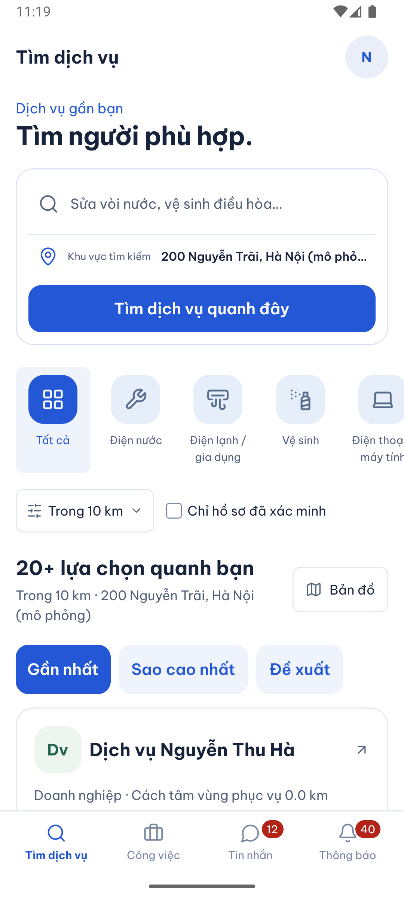 |
| 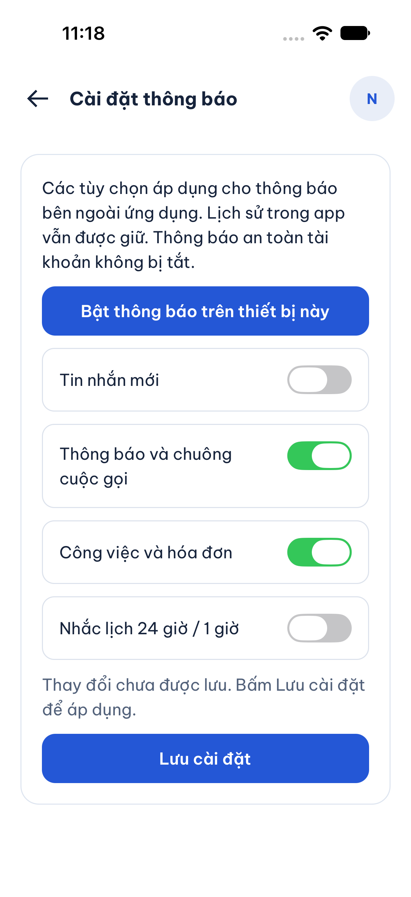 | 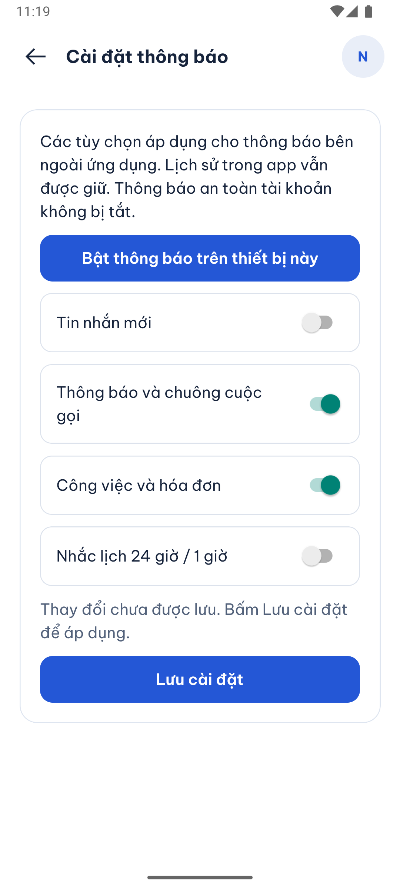 |
| 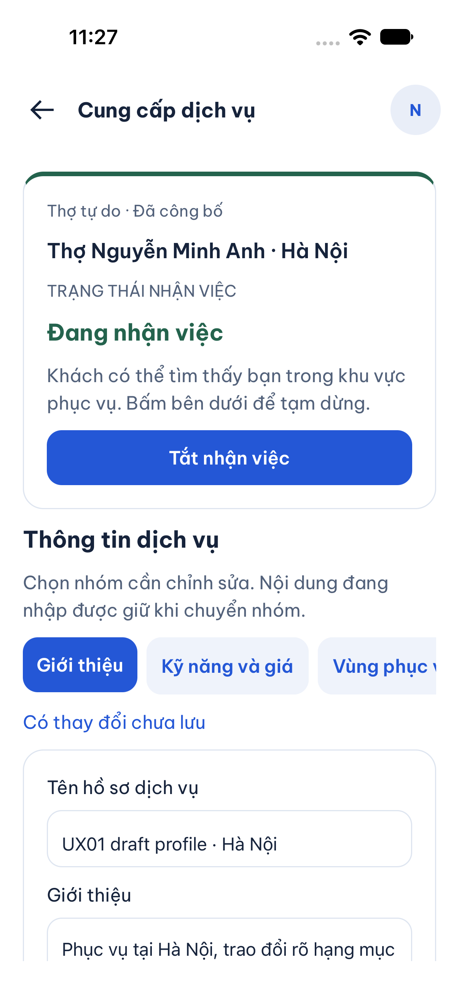 | 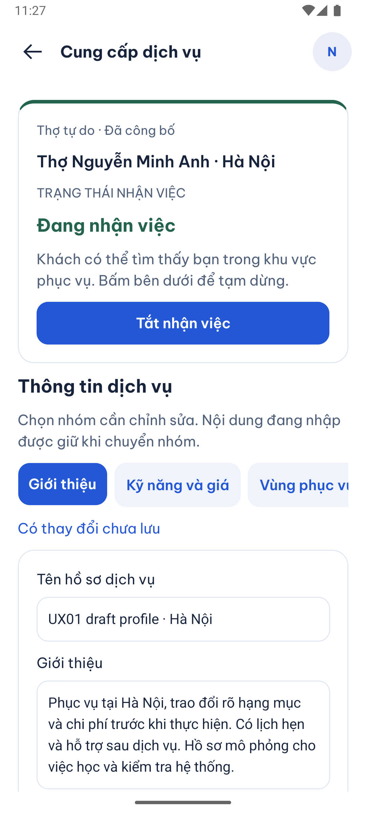 |
| 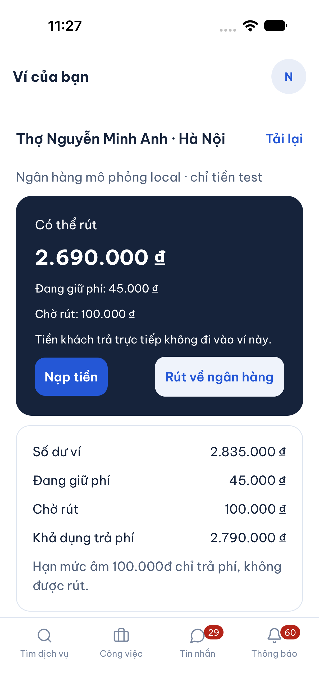 | 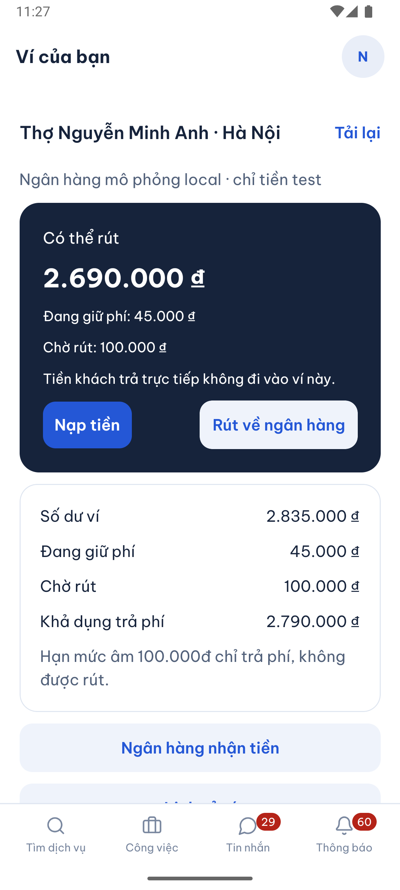 |
| 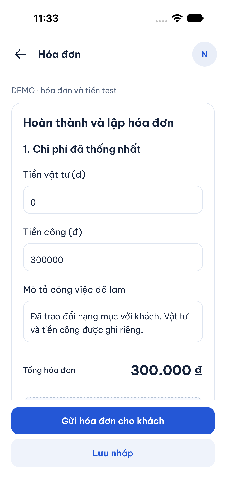 | 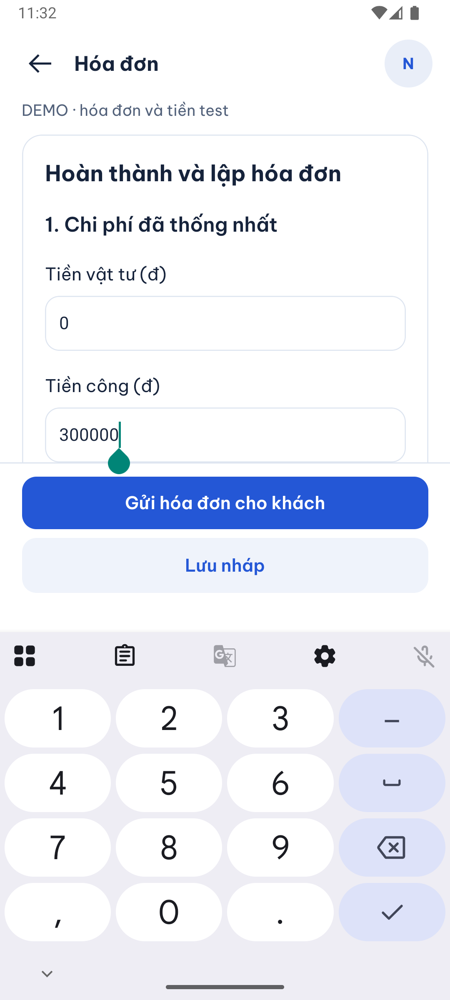 |
| 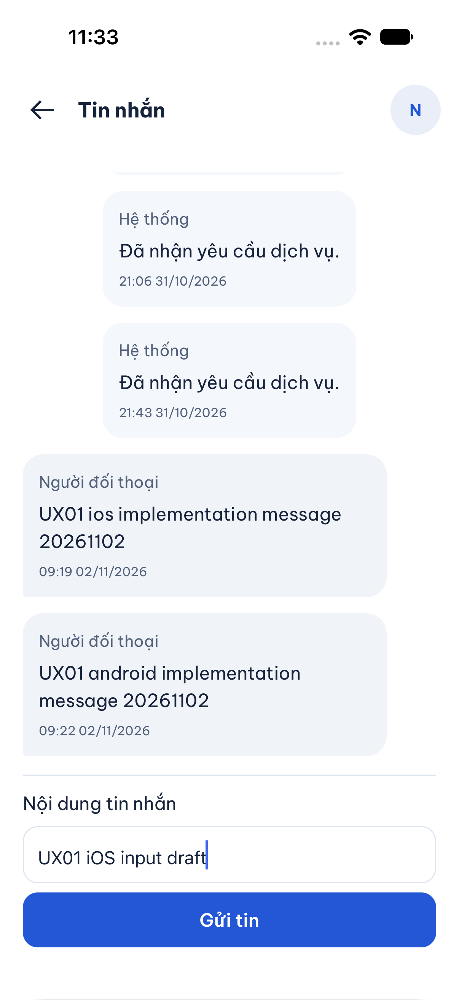 | 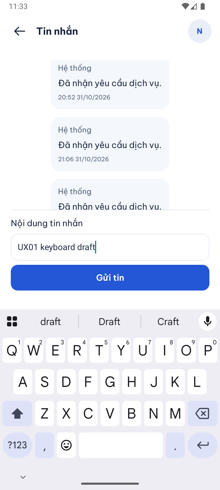 |

Cửa sổ bộ lọc Android cũng đã được kiểm riêng và sửa tránh bàn phím: cả **Áp dụng bộ lọc** và **Hủy** còn nhìn thấy khi nhập bán kính. Lượt này mở form rồi hủy, không ghi dữ liệu.

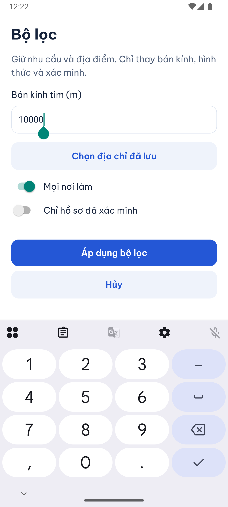

**Còn giới hạn:** chưa chạy lại mọi nút cho toàn bộ role quản trị/thành viên đội trên native sau đợt này; các nhóm đó có hồi quy component/API/web trong SDD, không được xem là thay thế kiểm native. Chưa xác nhận bàn phím ảo iOS, cỡ chữ trợ năng lớn, media cuộc gọi hai đầu, thiết bị vật lý, CI mới hoặc UAT. Không đóng toàn bộ audit 444 mô tả nút chỉ từ các lượt đại diện trên.

## Phạm vi bàn giao Git ngày 02/11/2026

Theo yêu cầu chủ dự án, bản bàn giao gồm UX-01, seed vận hành local và bộ báo cáo/ảnh. Toàn bộ thay đổi AWS/cloud, Terraform, CI/build hạ tầng, adapter S3/SES/SNS, DB TLS, dependency cloud và tài liệu AWS được giữ riêng trên máy, chưa đưa vào commit này. File cấu hình chung chỉ giữ lựa chọn vận hành trên `dvqb_local`; không có `CLOUD_PILOT`.

SDD của bản tách giữ nguyên 151 tiêu chí, 108 QA và toàn bộ bước hồi quy đã có trước đợt AWS. Năm tiêu chí AWS-01 cùng QA-109 đi với phần hạ tầng chưa push, không bị xóa khỏi workspace gốc. Kết quả trên bộ code có infra ở lượt trước không chứng nhận bản tách này; dùng bằng chứng SDD/CI mới trên commit bàn giao. Các lỗi native đã nêu trong B00-14 vẫn còn mở.
