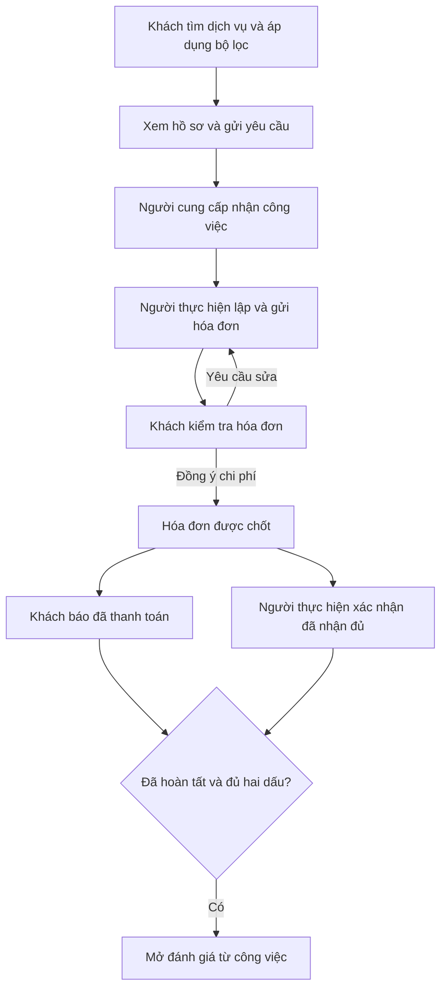

# B00-16 — Bản thiết kế UX-01 để duyệt trước khi sửa sản phẩm

Ngày: **02/11/2026**. Phạm vi: **thiết kế HTML trong repo**, chưa áp dụng vào app/API. [Mở bản mẫu](../de-xuat/UX-01-thiet-ke-giao-dien.html) · [Cách xem, bài thử và phạm vi từng nhóm](../de-xuat/UX-01-thiet-ke-giao-dien.md).

## Kết quả người dùng thấy

Chọn vai trò rồi bấm trực tiếp qua các màn mới. Bộ lọc tìm dịch vụ có Hủy/Áp dụng rõ nghĩa; công việc cho biết đang chờ ai; hóa đơn đặt số tiền và hai dấu thanh toán trước nội dung phụ. Bên cạnh điện thoại có giải thích nút, nguồn quan sát và tình huống để xem nhanh. Có 30 màn mẫu theo 7 vai, 6 nhóm luồng; iPhone/Android là hai khung HTML, không phải app native.

Đây là bản xem trước để chủ dự án duyệt bố cục và hành vi mong muốn. Không phải báo cáo “đã sửa xong UX-01”. Audit toàn bộ native và các quyết định API còn thiếu vẫn giữ nguyên trạng thái.

## Luồng thao tác mẫu

Sơ đồ mô tả kịch bản thiết kế, không thay quy tắc backend. Xác nhận hóa đơn khác với báo trả tiền; admin hoàn tất thay không tự điền dấu nhận tiền của người thực hiện. Kịch bản hiện dùng **0 Point**, không mô phỏng công thức phí/ledger/quyết toán thật.

## Đọc file theo thứ tự

| File / hàm | Nhận gì, làm gì, trả gì |
|---|---|
| [HTML](../de-xuat/UX-01-thiet-ke-giao-dien.html) | Tạo khung chọn vai/luồng, điện thoại và phần giải thích |
| [style.css](../de-xuat/UX-01-thiet-ke/style.css) | Dùng bảng màu/font hiện có; chia ba cột, bố cục hẹp, khung Android/iPhone, chữ lớn, focus và nút |
| [app.js](../de-xuat/UX-01-thiet-ke/app.js) — `screens` | Danh sách 30 màn, vai được xem, nhóm UX, căn cứ và công dụng nút |
| `initial`, `roleChange`, `navigate`, `back` | Tạo dữ liệu mẫu trong bộ nhớ; đổi góc nhìn, giữ lịch sử màn và vị trí quay lại |
| `views`, `render`, `renderInspector` | Nhận vai/trạng thái, xuất bố cục điện thoại và phần giải thích tương ứng |
| `act`, `sheet`, `closeModal` | Nhận thao tác bấm; mở form/kiểm điều kiện/thay đổi trạng thái mô phỏng; Escape đóng, focus nằm trong hộp thoại |
| `searchUpdate`, `setScenario` | Mô phỏng chờ cập nhật hoặc nhánh lỗi/trống/trạng thái để chủ dự án duyệt |

Không có API/DB trong chuỗi này. Nội dung người nhập được escape trước khi đưa vào HTML. Không lưu thông tin xác thực; mọi thay đổi biến mất khi tải lại/reset. Quyền hiển thị ở đây chỉ để minh họa bố cục; backend thật vẫn quyết định quyền khi triển khai.

## Kiểm tra bản thiết kế

Đã dùng Chromium/Playwright mở file offline, kiểm các nhóm hành vi sau (nhật ký local ở `.local/ux-01-design/check-results.json`):

- Áp dụng/Hủy bộ lọc, sort giữ kết quả và địa chỉ, tìm màn không dấu và thông báo không có kết quả.
- Xuyên luồng gửi yêu cầu → nhận việc → nháp/gửi/sửa hóa đơn → chốt → hai dấu thanh toán → đánh giá; nháp thiếu ảnh và sửa thiếu lý do khóa gửi.
- Lỗi Point giữ phần tiền nhưng khóa xác nhận; admin hoàn tất thay vẫn thiếu dấu người thực hiện; chưa tick nhận tiền thì nút khóa.
- Chat gửi lỗi giữ bản nháp, thử lại đúng nội dung; nhân viên cơ bản không có điểm vào ví/đội ngũ; admin chỉ hỗ trợ không có khu tài chính.
- Ví chưa ngân hàng khóa rút; yêu cầu rút không báo đã chuyển, chi tiết giữ đúng số tiền; trạng thái tài chính chưa rõ không bật chuyển lần hai.
- Tài khoản hạn chế vẫn gửi hỗ trợ; khách vãng lai đăng nhập mô phỏng rồi về form yêu cầu, không tự gửi.
- Mọi màn trong danh mục theo vai được mở ở hai khung và viewport 1440/390 px; không tràn ngang, không có lỗi JavaScript hoặc request HTTP/API ngoài. Có kiểm chữ lớn ở hóa đơn; chưa chứng nhận WCAG/native accessibility toàn bộ.

Ảnh kiểm bố cục là screenshot trình duyệt local, không dùng lại hoặc ghi đè ảnh native B00-14/UX-01. Không chạy kiểm nghiệm thu nghiệp vụ trên DB cho một bản mẫu giao diện tách biệt.

SDD prepare trước khi tạo bản mẫu đã đạt 156 tiêu chí liên kết; QA vẫn 97 partial / 12 unmapped. Kiểm lại inventory và chạy `sdd:run`/`verify` theo quy định riêng sau khi chốt file. Kết quả SDD toàn repo phải đọc ở `test-results/sdd/SDD-PROJECT/` và thông báo bàn giao, không suy ra từ các kiểm HTML ở trên.

## Giới hạn và điểm duyệt

- 30 màn thiết kế không đồng nghĩa toàn bộ 135 mục/444 mô tả nút đã được kiểm hoặc thiết kế chi tiết. Bảng phạm vi liên kết ở đầu báo cáo ghi rõ G03 chưa dựng, các nhánh tài chính/quyền/admin/khôi phục chỉ mô phỏng một phần.
- Chưa kiểm bàn phím, Back Android, vuốt iOS, media, provider, chữ lớn cấp hệ điều hành, tiếng Anh/Nhật hoặc điện thoại vật lý. Hai khung HTML không thay bằng chứng native.
- Các số liệu, ảnh dạng thẻ và danh tính là minh họa; không phản ánh trạng thái `dvqb_local` hiện tại. Không chuyển sang database test để nghiệm thu app thật.
- Cần chủ dự án duyệt bố cục và nhóm thay đổi trước khi áp dụng code. D01–D04 và các giả thuyết chưa kiểm vẫn chưa chốt; không mở phê duyệt tiền thật/production.

Bài thử cho chủ dự án: thử Hủy rồi Áp dụng cùng bộ lọc; thử xác nhận hóa đơn nhưng chưa trả; đổi vai để thấy dấu còn thiếu; thử xem tài khoản nhân viên cơ bản và admin chỉ hỗ trợ. Với từng màn, đánh giá xem hành động tiếp theo có rõ, nhãn nút có đúng hậu quả, phần phụ có dễ tìm và có cần thanh nút dưới màn hay không.
