# B00-17 — Sửa lỗi sau kiểm tra Android và iOS

Ngày **04/11/2026** · UX-01 · Code đang sửa trên máy, chưa commit/push hoặc có CI mới. [Báo cáo tổng tương tác](B00-14-bao-cao-man-hinh.html) · [Bằng chứng native](bang-chung/B00-17-native.json) · [Mục lục](../README.md).

## 1. Bạn đã dùng được những gì?

Khi máy chủ local chưa bật cuộc gọi, bấm Gọi sẽ có thông báo và nút **Đóng**, không mắc kẹt ở nút Thử lại. Khi bật máy chủ gọi bằng lệnh bên dưới, Android và iOS đã kết nối, tắt mic và kết thúc được. Mở xác minh hồ sơ đã đọc được kết quả mà không cần bấm tải lại. Bấm giao dịch trong ví mở ngay màn chi tiết riêng; đóng để trở về lịch sử. Điểm đánh giá được hiển thị gọn, ví dụ **2,3 (3 đánh giá)**.

Theo lựa chọn của chủ dự án, đã **bỏ màn CatalogCategory cũ**, giữ bộ chọn ngành/nhóm/kỹ năng hiện hành trong tìm kiếm. Báo cáo còn **134 mục hiện hành**, đủ 268 ảnh chính cho hai nền tảng. Đây là số mục màn/tab/trạng thái, không phải số route độc lập hoặc chứng nhận mọi nút đã đạt.

**Còn mở: NATIVE-05 — một lần Android văng app ngày 02/11.** Bản release mới build đã mở 10 lần, mỗi lần kiểm process sau 5 giây, chưa tái hiện. Chưa tìm được nguyên nhân, nên không đánh dấu đã sửa và không đổi phiên bản thư viện theo suy đoán.

## 2. Luồng mới đi qua code như thế nào?

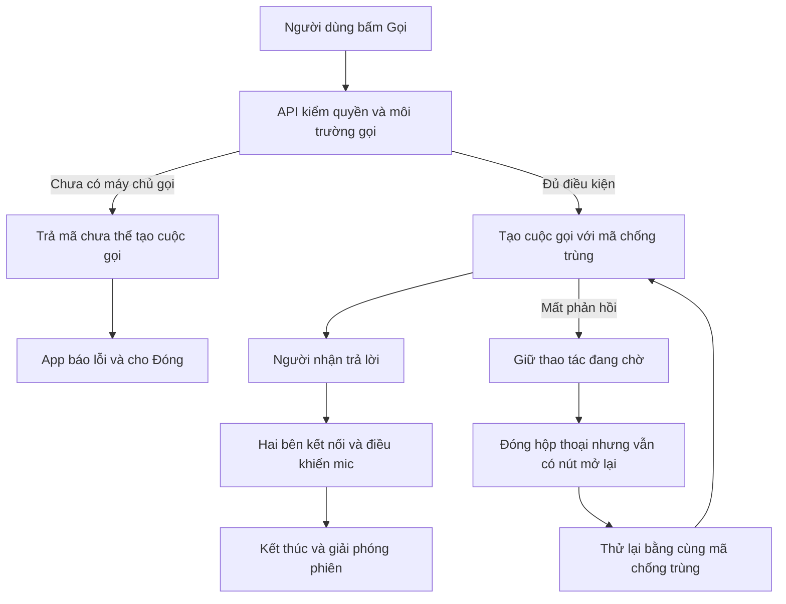

API là chương trình xử lý phía máy chủ; app gửi yêu cầu cho API thay vì tự ghi database. **Mã chống trùng** giúp máy chủ nhận biết lần thử lại của cùng thao tác. Nếu mất mạng sau khi gửi, app chưa biết máy chủ đã tạo cuộc gọi hay chưa: đóng hộp thoại chỉ ẩn phần hiển thị, không xóa thao tác đang chờ. Nút mở lại giữ nguyên dữ liệu và mã đó. Thông tin tạm này nằm trong phiên app, không phải hàng đợi tồn tại qua việc tắt hẳn ứng dụng.

Lỗi thiếu cấu hình khác ở chỗ `CallsService.create` từ chối trước khi ghi cuộc gọi. Đợt này phát hiện cả bộ xử lý lỗi chung của API lẫn bộ đọc HTTP của app đều làm mất mã `CALLS_UNAVAILABLE`. Hai nơi đã được sửa để chỉ giữ mã cho phép này với HTTP 503; các lỗi 503 khác vẫn được coi là chưa rõ kết quả.

## 3. Đọc file theo thứ tự

| File / hàm thật | Nhận gì → làm gì → trả gì |
|---|---|
| [CallsService.create](../../../services/api/src/modules/calls/calls.service.ts) | Mã công việc/người nhận → kiểm quyền, trạng thái và media → cuộc gọi hoặc lỗi; không thay quy tắc nghiệp vụ |
| [HttpExceptionFilter.catch](../../../services/api/src/common/http/http-exception.filter.ts) và [requestJson](../../../apps/mobile/src/lib/http/request.ts) | Lỗi API → giữ `CALLS_UNAVAILABLE` trong danh sách cho phép → app phân biệt với lỗi chưa rõ kết quả |
| [CallsProvider — execute, dismiss](../../../apps/mobile/src/features/calls/CallsProvider.tsx) | Kết quả gọi → lưu cuộc gọi/thao tác chờ, mở/ẩn hộp thoại → Đóng, mở lại, Thử lại hoặc Kết thúc đúng trạng thái |
| [VerificationDesk](../../../apps/mobile/src/features/verification/screens/VerificationScreen.tsx) và [sessionOperation](../../../apps/mobile/src/features/jobs/state/session-ready.ts) | Hồ sơ và lượt mở màn → chờ phiên rảnh, thử lại tranh chấp `BUSY`, kiểm lượt tải còn hiệu lực → kết quả xác minh; bỏ lượt đã rời màn |
| [RefreshError](../../../apps/mobile/src/components/ui/Feedback.tsx) | Mã lỗi `BUSY` → thông báo đang xử lý → không nói sai là mất mạng |
| [FinanceContent — openDetail, closeDetail](../../../apps/mobile/src/features/finance/screens/FinanceScreen.tsx) | Mã giao dịch → API đọc chi tiết → hộp màn riêng; đóng xóa chi tiết, giữ danh sách/bộ lọc bên dưới |
| [formatRating](../../../apps/mobile/src/lib/i18n/formatters.ts) và [SearchScreen](../../../apps/mobile/src/features/search/screens/SearchScreen.tsx) | Số sao + ngôn ngữ → tối đa một chữ số thập phân → chuỗi hiển thị; không sửa điểm gốc hoặc thứ tự tìm kiếm |
| [AppNavigator](../../../apps/mobile/src/app/navigation/AppNavigator.tsx), [routes](../../../apps/mobile/src/app/navigation/routes.ts), [ServiceFilter](../../../apps/mobile/src/features/search/components/ServiceFilter.tsx) | Bỏ đăng ký màn cũ; tiếp tục duyệt danh mục qua bộ lọc hiện hành. Các kiểm thử danh mục cần giữ được chuyển sang bộ lọc thật |
| [start-operational-api — operationalRuntime, start](../../../scripts/review/start-operational-api.mjs) | Cấu hình local + tùy chọn `--calls` → kiểm DB/bind/cổng, chạy API và media nếu yêu cầu → runtime có thể dừng bằng Ctrl-C |

## 4. Dữ liệu, quyền và xử lý lỗi

- Native dùng **dvqb_local đang có**, tài khoản/hồ sơ vận hành mô phỏng đã seed. Không reset, chạy lại seed, duyệt tiền hay thay quyền. Các bộ test tự động vẫn dùng cơ sở dữ liệu kiểm thử cách ly, không được reset `dvqb_local`.
- Quyền xem/gọi/xem chứng từ/hủy giao dịch vẫn do API quyết định. Màn chi tiết không cấp thêm quyền; trong lúc gửi giao dịch hoặc chờ thử lại chưa rõ kết quả, nút đóng bị chặn để giữ thao tác.
- Xác minh dùng lượt tải có hiệu lực để bỏ yêu cầu cũ khi rời màn. Đã tái hiện và xử lý xung đột phiên; chưa kết luận thư viện nào làm phát sinh hai callback focus trước đây.
- Chỉ định dạng điểm sao khi hiển thị. Tiếng Việt dùng `2,3`; tiếng Anh/Nhật dùng `2.3`.
- Cuộc gọi kiểm ngày 04/11: `3d9d22b1-b4b8-4622-a9bc-e5de8f6f9e13`, Android chủ hồ sơ 0 gọi iOS khách 151. Hai participant ACTIVE, hai track micro đã chuyển `muted=true`. Sau kết thúc: `ended`, `cleanup_pending=false`, `active_call_users=0`. Lịch sử được giữ trong DB.

## 5. Ảnh và thao tác đã kiểm trên app

Android **DVQB_API_36 / Android 16 Emulator**; iPhone **18 Pro / iOS 27 Simulator**. Ngày **04/11/2026**, app native nối API local; không phải thiết bị vật lý. Ảnh đã đối chiếu trực quan, dùng dữ liệu DEMO.

| Màn / kiểm thao tác | Android | iOS |
|---|---|---|
| Thiếu media: hiện và bấm được Đóng | 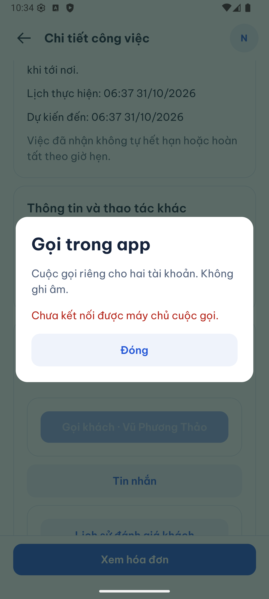 | 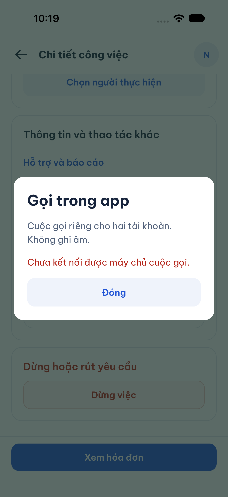 |
| Đã kết nối; hai bên tắt mic; sau đó kết thúc | 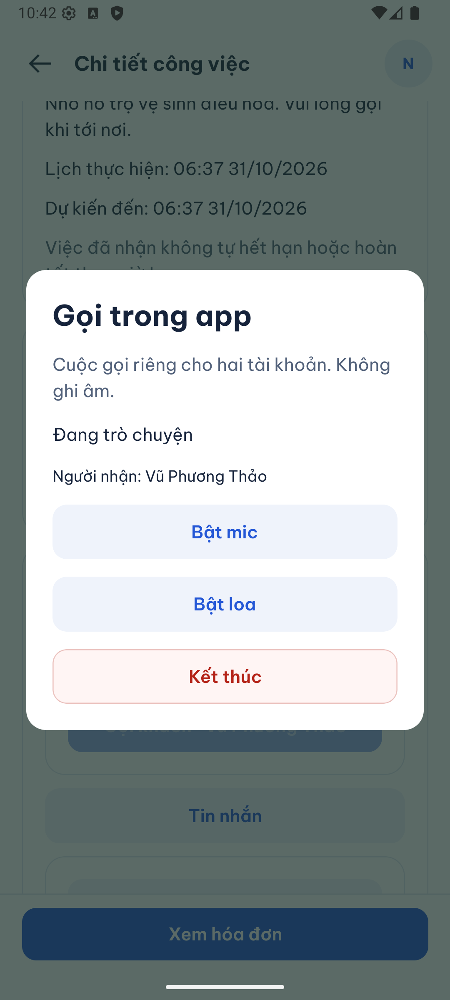 | 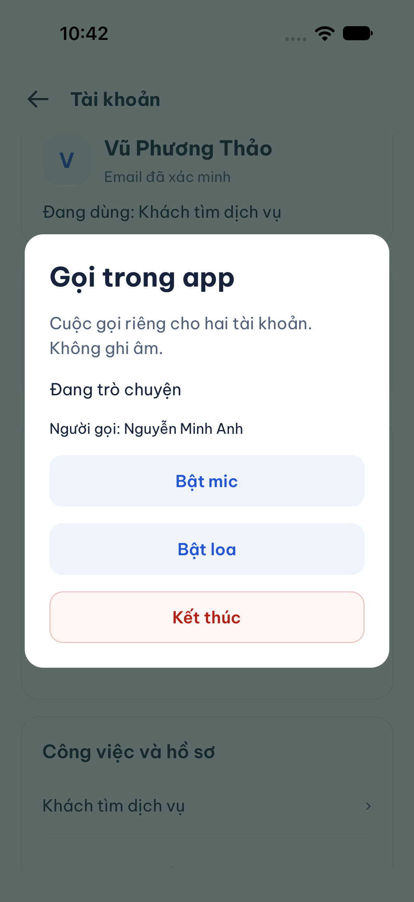 |
| Xác minh: đọc được kết quả, không bấm thử lại | 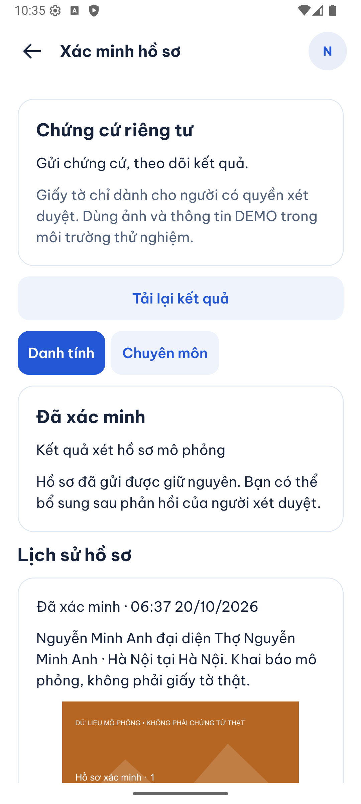 | 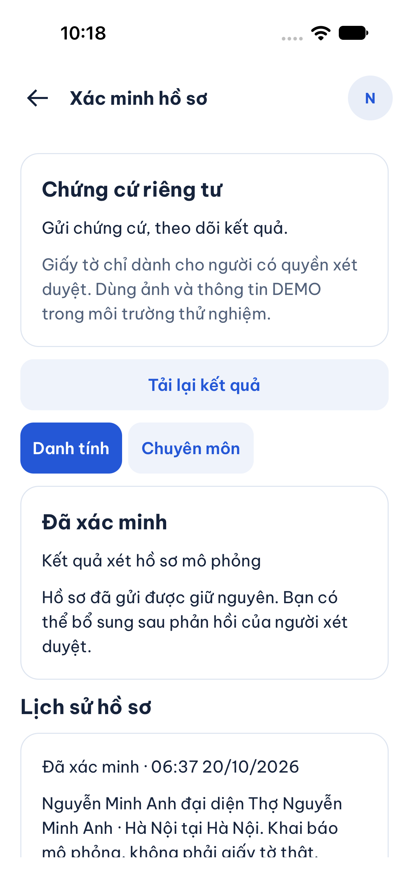 |
| Bấm giao dịch mở chi tiết; đóng về lịch sử | 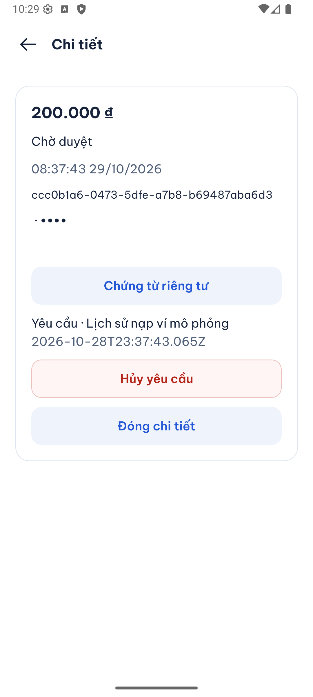 | 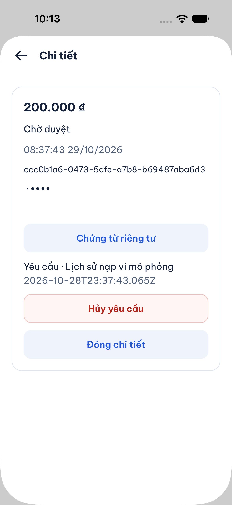 |
| Cùng hồ sơ hiện 2,3 thay chuỗi số dài | 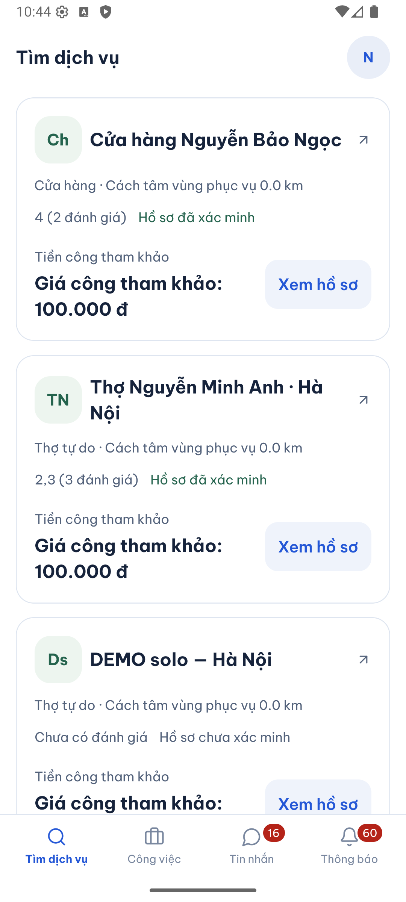 | 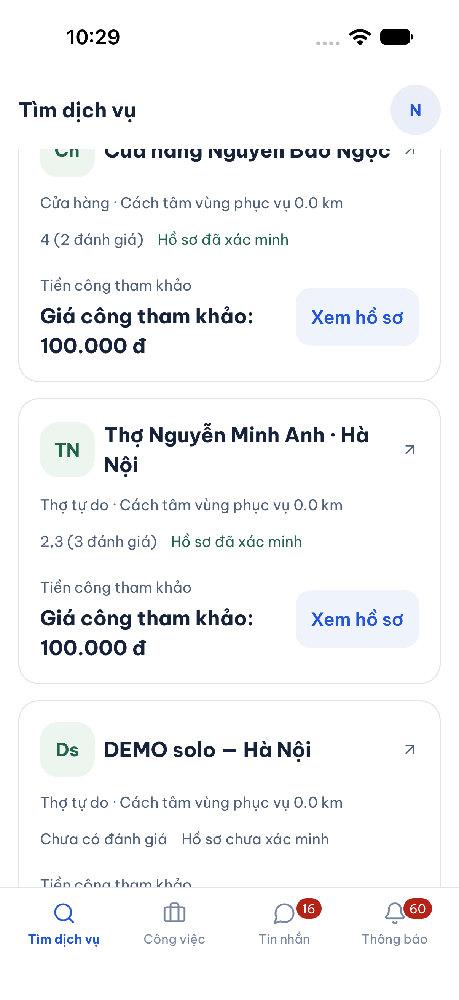 |

Android đầu đợt có bản cài thiếu module WebRTC so với JavaScript hiện hành. Đã build/cài lại development client, giữ dữ liệu app, rồi kiểm các luồng trên. Bản release build thành công chỉ dùng kiểm 10 lượt khởi động; chưa dùng làm bằng chứng hành trình API local. Lỗi UiAutomation khi hai công cụ điều khiển cùng chạy được tách khỏi crash sản phẩm.

## 6. Kiểm tự động và giới hạn

Đã viết các ca tái hiện trước khi sửa: lỗi gọi 503 bị đổi mã; đóng thao tác chưa rõ kết quả phải giữ payload/mã chống trùng; xác minh gặp `BUSY` và rời màn lúc chờ; chi tiết ví mở riêng/giữ bộ lọc; điểm sao theo VI/EN/JA. Các ca mục tiêu đã qua sau sửa. Test HTTP mới kiểm đồng thời phản hồi `CALLS_UNAVAILABLE` và **không tạo cuộc gọi/khóa người gọi**. Test runner kiểm từ chối production, DB ngoài local và địa chỉ bind công khai. Lint và typecheck mục tiêu đã qua.

Hành trình trình duyệt [finance.spec.mjs](../../../tests/e2e/web/finance.spec.mjs) đã qua sau khi cập nhật bước đóng màn chi tiết trước khi quay về tổng quan. Bài kiểm xác nhận bộ lọc nạp/rút vẫn được chọn khi đóng modal, đồng thời giữ các kiểm tra phản hồi bị mất, mã chống trùng, số dư, khoản giữ, duy nhất một lệnh chuyển và tổng bút toán cân bằng. Không bỏ kiểm tra tài chính để khớp giao diện.

SDD-PROJECT giữ nguyên 151 tiêu chí, các giới hạn QA `partial`/`unmapped`; chỉ cập nhật ánh xạ test và inventory cho file thêm/xóa. Bộ chạy toàn dự án ghi kết quả theo nguồn hiện tại ở [evidence.json](../../../test-results/sdd/SDD-PROJECT/evidence.json) và log từng suite cùng thư mục. Đây là artifact local bị Git bỏ qua, chỉ có giá trị khi `sdd:check --phase verify` xác nhận khớp nguồn; không lấy bằng chứng cũ để suy ra đạt. Nếu chạy thất bại thì chưa có evidence hoàn tất và phải xem log suite thất bại.

Chưa kiểm: điện thoại thật/UAT, chất lượng nghe hai chiều, loa ngoài, mạng di động, nền/khóa màn; lỗi mạng chưa rõ kết quả trên native (nhánh này có test tự động). Không tuyên bố mọi nút toàn app đã được kiểm lại. NATIVE-05 vẫn cần chuỗi tái hiện ổn định. Không đồng bộ Google Drive, Excel hoặc `ui-ux`; không đổi AWS/production.

## 7. Tự chạy lại và bài thử

Tại thư mục repo, dùng Node 24.22.1. Dừng API local đang chiếm cổng 3110 trước khi chạy lệnh tương ứng. Runner từ chối cổng đang dùng, không tự giết tiến trình khác.

```sh
# API trên dvqb_local, cuộc gọi tắt
npm run review:api

# Hoặc API kèm LiveKit local; Ctrl-C dừng cả hai tiến trình do lệnh này tạo
npm run review:api -- --calls

# Một Metro phục vụ app native; chọn nền tảng cần mở
npm run review:mobile -- android

npm run sdd:check -- --change SDD-PROJECT --phase prepare
npm run sdd:run -- --change SDD-PROJECT
npm run sdd:check -- --change SDD-PROJECT --phase verify
npm run review:screens:build
npm run review:screens:check
```

`--calls` dùng binary LiveKit đã có ở `.local/p2/livekit/livekit/1.13.10/bin/livekit-server` hoặc đường dẫn `LIVEKIT_BIN`, cùng cấu hình local hiện có. Cổng API lấy từ `.env`; media local 7880/7881/7882. Không tải binary tự động, không mở billing. Sau kiểm ngày này đã tắt media và khôi phục API mặc định.

1. Không bật media → mở công việc đủ quyền → Gọi → Đóng. Vì sao được xóa thao tác chờ? Vì API chưa ghi cuộc gọi, có mã lỗi riêng được kiểm bằng HTTP test.
2. Ví → Lịch sử → chọn một bộ lọc → mở giao dịch → Đóng chi tiết. Bộ lọc và vị trí đọc phải còn; không cần bấm hủy giao dịch.
3. Mở xác minh rồi rời màn sớm. Vì sao phản hồi cũ không nên đè màn mới? Xem `valid()` và `sessionOperation`.

Nếu cần xử lý NATIVE-05 tiếp, giữ log crash có thời gian/phiên bản và chuỗi màn trước khi văng, thử lại trên release có môi trường API phù hợp và thiết bị thật. Chưa có căn cứ để đổi dependency hoặc tuyên bố hết crash.
