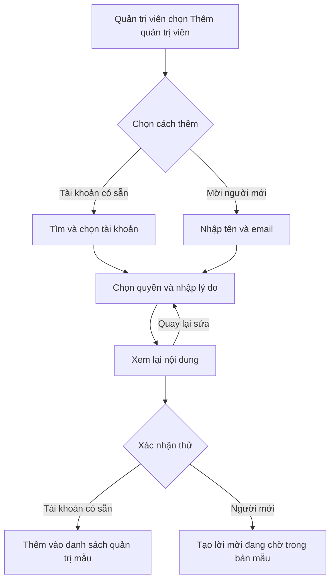
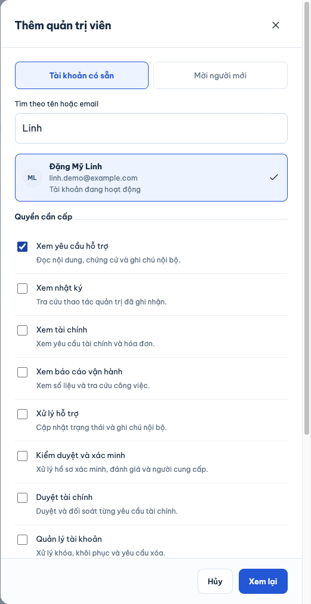
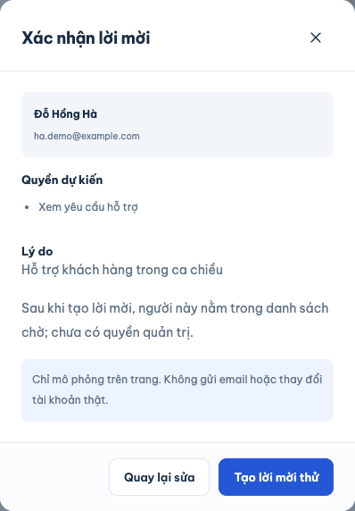
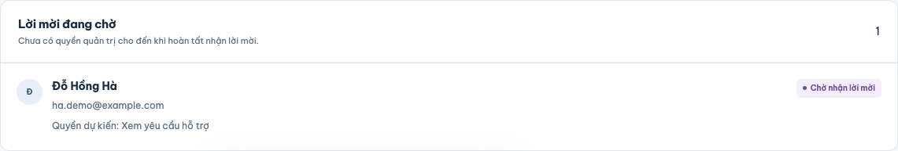
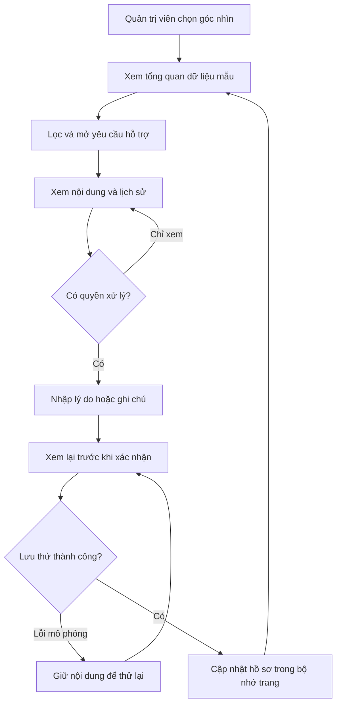
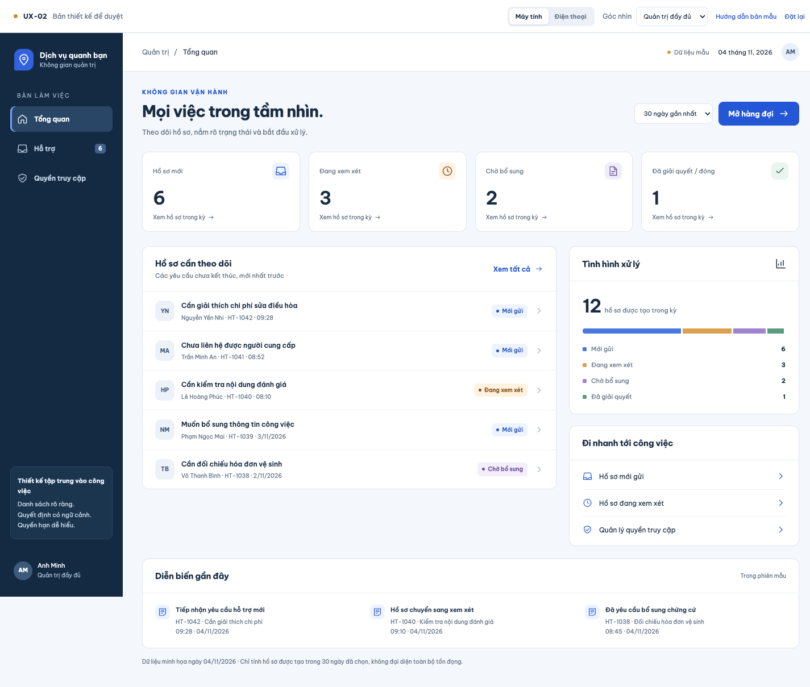
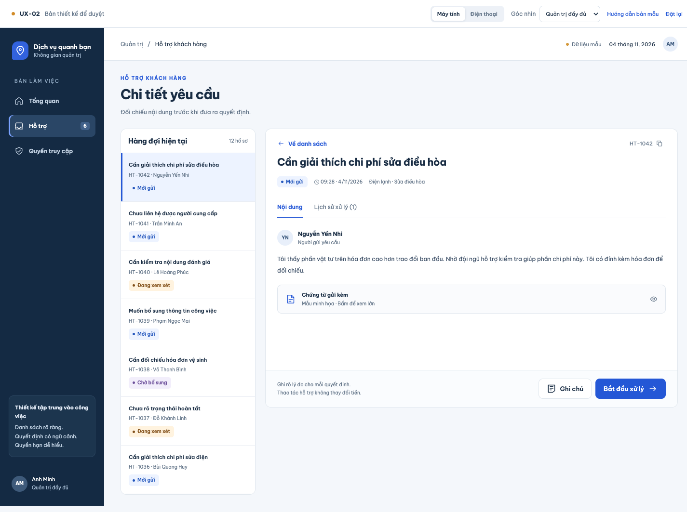
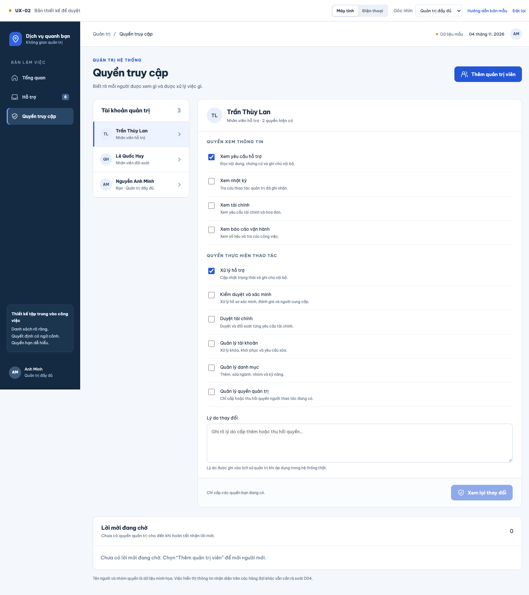
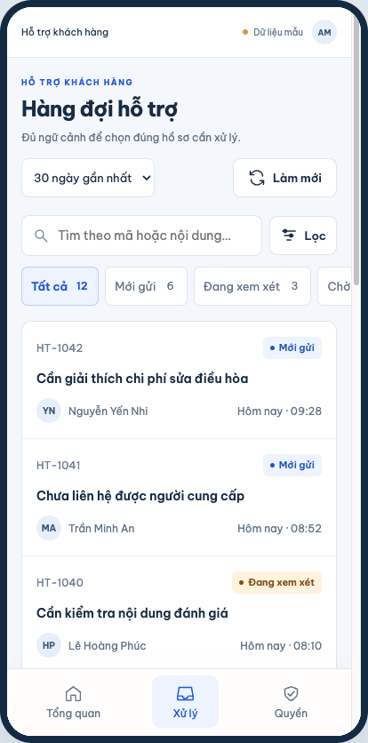
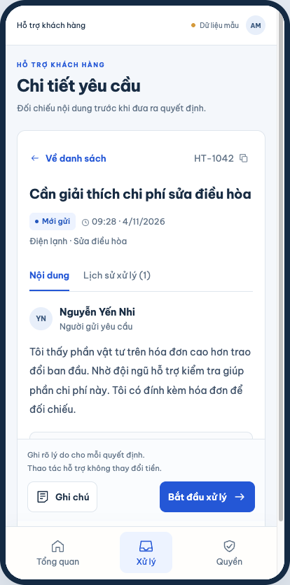

# B00-18 — Bản thiết kế quản trị cho web và điện thoại

Ngày tạo: **04/11/2026**; cập nhật bản mẫu và ảnh **05/11/2026**. [Mở HTML tương tác](../de-xuat/UX-02-quan-tri.html). Trạng thái: **đã dựng bản mẫu, chờ chủ dự án duyệt trước khi áp dụng vào code sản phẩm**.

## Kết quả và cách xem

Người quản lý mở Tổng quan để biết có bao nhiêu hồ sơ mới, đang xem xét hoặc chờ bổ sung. Bấm một chỉ số sẽ mở danh sách tương ứng. Danh sách có tiêu đề, người gửi, ngày gửi và trạng thái để chọn đúng việc. Khi mở hồ sơ, nội dung và lịch sử được chia thành hai tab; nút xử lý nằm cạnh nội dung cần quyết định. Quyền truy cập được diễn giải bằng tiếng Việt và có bảng tóm tắt cấp thêm/thu hồi trước khi lưu thử.

Mở file HTML trực tiếp bằng trình duyệt; không cần bật API. Thanh trên cùng có **Máy tính / Điện thoại**, ba góc nhìn quyền và **Đặt lại**. Khung điện thoại là bản HTML mô phỏng bố cục, không phải app React Native hoặc ảnh thiết bị thật. Font lấy từ tài nguyên có sẵn trong repo; khi gửi file cho người khác phải giữ các file CSS/JS và font tương đối, không chỉ gửi riêng HTML.

1. Ở Tổng quan, bấm **Hồ sơ mới** rồi thử tìm `1042` hoặc một phần nội dung.
2. Mở HT-1042, xem chứng từ, bấm **Bắt đầu xử lý**, chọn kết luận và nhập lý do. **Xem lại** mở bước xác nhận; **Xác nhận thử** chỉ đổi dữ liệu mẫu.
3. Thử **Ghi chú** để thấy nội dung nội bộ tách riêng phản hồi. Có thể mở **Tùy chọn kiểm tra bản mẫu** để mô phỏng lỗi trước khi lưu và thử lại.
4. Mở **Quyền truy cập**, chọn Thùy Lan, thay đổi một quyền và nhập lý do. Kiểm tra phần cấp thêm/thu hồi trước khi xác nhận. Tài khoản của chính người thao tác được khóa chỉnh sửa.
5. Chọn **Hỗ trợ chỉ xem** để thấy nút xử lý và mục quản lý quyền được ẩn. Trên điện thoại, mục **Quyền** mở trực tiếp quyền truy cập cho quản trị đầy đủ.
6. **Hướng dẫn bản mẫu** ở thanh xem bên ngoài ứng dụng có tình huống danh sách rỗng/lỗi tải; **Đặt lại** đưa dữ liệu về ban đầu.

## Bổ sung theo yêu cầu ngày 05/11/2026

Chủ dự án yêu cầu cả **cấp quyền cho tài khoản có sẵn** và **mời người mới** trong bản thiết kế. Đã đổi tên “Nhân sự quản trị” thành **Tài khoản quản trị** và thêm nút **Thêm quản trị viên** trên web/điện thoại.

- **Tài khoản có sẵn:** thử tìm `Linh`, `Nam` hoặc email mẫu → chọn tài khoản → chọn quyền → nhập lý do → xem lại → xác nhận thêm thử. Danh sách và số tài khoản cập nhật; người đã có quyền bị khóa chọn lại. Tài khoản mẫu trong danh bạ được xác định là đang hoạt động.
- **Mời người mới:** nhập tên và email (ví dụ `ha.demo@example.com`) → chọn quyền dự kiến → nhập lý do → xem lại → tạo lời mời thử. Lời mời nằm trong **Lời mời đang chờ**, tách khỏi danh sách tài khoản quản trị; chưa được cấp quyền. Chưa thiết kế màn người nhận chấp nhận lời mời.
- **Hướng dẫn bản mẫu:** giải thích dữ liệu giả, giới hạn và tình huống kiểm thử. Đây là công cụ duyệt thiết kế, không phải chức năng quản trị sản phẩm. Đã bỏ mục này khỏi menu mobile và liên kết trong Tổng quan, giữ tại thanh bên ngoài khung ứng dụng. Mobile quản trị đầy đủ dùng ba mục Tổng quan/Xử lý/Quyền; người hỗ trợ chỉ thấy Tổng quan/Xử lý.

Phạm vi duyệt ở lượt này là **bổ sung hai cách thêm vào HTML**, chưa phải duyệt triển khai app/API/provider email. Cơ chế nhận lời mời, thời hạn/hết hạn, gửi lại/hủy, xác minh và MFA phải được đối chiếu/chốt trước khi triển khai; không coi bản mẫu là contract backend đã có. D04 và các phần chưa duyệt khác giữ nguyên. Không gửi email, tạo tài khoản thật hoặc thay đổi quyền thật.

Các hàm mới nằm trong `app.js`: `accountResults` lọc danh bạ giả và khóa tài khoản đã có; `onboardingForm` giữ nháp hai lựa chọn; `onboardingProblem` kiểm đầu vào/trùng; `onboardingReview` hiển thị người, quyền, lý do; `onboardingSave` chỉ thêm vào `members` hoặc `invitations` trong bộ nhớ; `invitationList` hiển thị lời mời đang chờ. Hủy/Escape/đổi vai/tải lại bỏ nháp; Quay lại sửa giữ nháp; Đặt lại xóa tài khoản/lời mời vừa thêm. Nội dung tên/email/lý do nhập được escape khi hiển thị.

Đã kiểm Chromium/Playwright offline: chọn tài khoản/lý do/quyền bắt buộc; tìm `dang` ra Đặng Mỹ Linh; đổi từ khóa bỏ người đã chọn để tránh cấp nhầm; thêm tài khoản và chặn thêm trùng; email không hợp lệ, email đã có tài khoản và lời mời trùng không phân biệt hoa thường; quay lại giữ nháp; lời mời không tăng số tài khoản có quyền; vai chỉ xem không có điểm vào cấp quyền; Đặt lại khôi phục ba tài khoản và không còn lời mời. Hai form đã kiểm ở 1440/768/390/360 px, không tràn ngang trang/hộp thoại; không có lỗi JavaScript hoặc request HTTP. Sơ đồ mới đã render bằng Mermaid local. SDD lượt mới đọc evidence/verify trong `test-results/sdd/SDD-PROJECT/` và thông báo bàn giao; kết quả ngày 04/11 không thay bằng chứng của lần sửa này.

## Hướng thiết kế để duyệt

| Khu vực | Mục đích |
|---|---|
| Web | Một cấp điều hướng; bảng hàng đợi để quét nhiều hồ sơ; chi tiết có hàng đợi bên cạnh |
| Điện thoại | Danh sách dạng thẻ, chữ nội dung lớn hơn, điều hướng dưới và nút hành động dễ bấm; bộ lọc có Hủy/Áp dụng |
| Màu và chữ | Xanh navy, nền sáng, font Be Vietnam Pro hiện có; màu trạng thái đi kèm chữ |
| Quyết định | Có ngữ cảnh hồ sơ, lý do bắt buộc, bước xem lại và lỗi thử lại giữ nguyên nội dung |
| Phân quyền | Tên dễ hiểu, phân biệt quyền xem/thao tác, tóm tắt phần đổi trước khi lưu |

Đây là bốn màn đại diện: **Tổng quan, Hàng đợi hỗ trợ, Chi tiết hỗ trợ, Quyền truy cập**. Không thể hiện toàn bộ các phân hệ quản trị. Giao việc, hạn xử lý, duyệt hàng loạt, tài chính, đăng nhập/MFA và các phần còn lại chưa được thiết kế trong bản này.

## Luồng dữ liệu mẫu

Không có API hoặc cơ sở dữ liệu trong chuỗi trên. Tải lại trang sẽ mất thay đổi thử. Quyền ở bản mẫu chỉ minh họa cách hiển thị; khi triển khai, backend vẫn phải quyết định quyền và kiểm tra thao tác. Bản mẫu không chứng minh MFA hay chống ghi trùng của hệ thống thật.

## Đọc file và hàm theo thứ tự

| File / hàm | Nhận gì → xử lý → trả gì |
|---|---|
| [HTML](../de-xuat/UX-02-quan-tri.html) | Tạo thanh chọn thiết bị/quyền, khung ứng dụng và hộp thoại |
| [style.css](../de-xuat/UX-02-quan-tri/style.css) | Nhận chiều rộng khung → đổi bảng thành thẻ, bố trí nút và chữ → giao diện web/điện thoại |
| [app.js](../de-xuat/UX-02-quan-tri/app.js): `initialTickets`, `initialMembers` | Khởi tạo 12 hồ sơ và 3 nhân sự hư cấu; không đọc dữ liệu local hiện hành |
| `inPeriod`, `counts`, `filtered` | Nhận kỳ, từ khóa và trạng thái → lọc toàn bộ tập mẫu → số đếm/danh sách nhất quán |
| `renderOverview`, `renderQueue`, `renderDetail`, `renderGrants` | Nhận trạng thái trang → xuất bố cục của bốn màn |
| `navigate`, `readRoute` | Nhận màn/mã hồ sơ → cập nhật địa chỉ `#...`, quay lại danh sách và vị trí cuộn |
| `decisionModal`, `reviewDecision`, `saveDecision` | Nhận quyết định/lý do → xem lại, mô phỏng lỗi/thành công → cập nhật trạng thái và lịch sử mẫu |
| `changes`, `grantConfirm` | So quyền nháp với quyền mẫu đã lưu → trình bày cấp thêm/thu hồi → xác nhận trước khi lưu thử |
| `esc`, `openModal`, `closeModal` | Hiển thị nội dung nhập dưới dạng văn bản; mở/đóng hộp thoại và trả vị trí bàn phím |

Tìm kiếm mẫu không phân biệt dấu trong mã/tiêu đề/nội dung; chưa đề xuất tìm toàn bộ người dùng. Tổng quan chỉ đếm hồ sơ **được tạo trong kỳ**, không biểu diễn toàn bộ tồn đọng. Lọc ngày/sắp xếp toàn hàng đợi, nhãn mã HT ngắn và ngữ cảnh dịch vụ cần đối chiếu API khi triển khai; không suy ra mọi chức năng này đã có contract. **D04 vẫn chưa được duyệt**, đặc biệt dữ liệu nhận diện ở các hàng đợi khác.

## Kiểm tra và bằng chứng

Đã kiểm bằng Chromium/Playwright trên HTML local:

- 12 hồ sơ mẫu; tìm theo mã; tìm không có kết quả; xóa lọc; trạng thái lỗi tải và thử lại.
- Lý do bắt buộc; xem lại trước khi lưu; lỗi mô phỏng giữ nội dung; thử lại cập nhật lịch sử. Hồ sơ đóng khóa hành động.
- Ghi chú nội bộ riêng biệt; ký tự HTML nhập vào được giữ dưới dạng văn bản.
- Quyền chỉ xem không có nút quyết định hoặc mục quản lý quyền; cấp quyền có xác nhận; tự sửa quyền bị khóa.
- Bộ lọc điện thoại: Hủy giữ trạng thái cũ, Áp dụng đổi danh sách đúng số hồ sơ.
- Hộp thoại giữ focus bàn phím, Escape đóng. Đây chưa phải chứng nhận khả năng tiếp cận đầy đủ.
- Bốn màn ở chiều rộng 1440, 1024, 768, 390 và 360 px: không tràn ngang trang. Đã xem ảnh desktop và khung điện thoại; không có lỗi console ở lượt kiểm cuối.
- Mở file offline, thử ghi chú/đóng hồ sơ/hộp thoại: không có lỗi JavaScript hoặc request HTTP/API. `node --check` đạt.
- Sơ đồ Mermaid trên đã kiểm cú pháp và render bằng thư viện local.

Ảnh dưới đây chụp lại ngày **05/11/2026** (ngày dữ liệu minh họa trên giao diện vẫn là 04/11), dữ liệu **hư cấu**, nền tảng **Chromium trên macOS**. Không phải ảnh app Android/iOS, emulator/simulator hoặc thiết bị vật lý.

### Tổng quan web

### Chi tiết web

### Phân quyền web

### Điện thoại — hàng đợi và chi tiết

SDD prepare đầu đợt đạt 156 tiêu chí liên kết; giữ QA 97 partial / 12 unmapped. Đã bổ sung inventory cho bản mẫu/báo cáo/ảnh, không sửa nguồn chuẩn hoặc thu hẹp tiêu chí. Kết quả hồi quy toàn repo của `sdd:run` và `verify` phải đọc tại `test-results/sdd/SDD-PROJECT/` cùng thông báo bàn giao; bằng chứng này có cả thay đổi có trước trong worktree và không biến bản mẫu thành chức năng sản phẩm đã nghiệm thu.

## Kết quả SDD bổ sung ngày 05/11/2026

- `prepare` đạt; lint, typecheck, tooling, 393 kiểm app/73 bộ, API, hai ngưỡng coverage và build đạt trong lượt toàn dự án.
- Web đạt **30/31**, một bài `tests/e2e/web/reviews.spec.mjs:41` lỗi vì `getByText` nhận cùng nội dung phản hồi ở cả phần hiển thị và ô nhập chỉ đọc. Đây là bài kiểm luồng đánh giá sản phẩm, không đọc HTML UX-02.
- Chạy lại riêng bài đó **đạt**, giữ nguyên code/test, log tại `.local/ux-02-design-20261105/reviews-retry.log`. Kết quả riêng không thay thế lượt SDD toàn dự án bị dừng; chưa xác định/sửa nguyên nhân không ổn định trong đợt thiết kế.
- `verify` **chưa đạt** vì lượt toàn bộ chưa tạo được `evidence.json`. Load/build prototype/Storybook chưa chạy trong lượt này; log cũ không được tính là bằng chứng mới. Log lỗi giữ tại `test-results/sdd/SDD-PROJECT/web.log`, ảnh/trace tại `test-results/web/artifacts/reviews-reviews-both-direc-81e44-nd-removal-through-real-API/`.
- Kiểm trực tiếp bản HTML ở phần trên đã đạt. Không sửa app/API hoặc làm yếu assertion của bài kiểm để lấy SDD xanh; chưa có CI/native/UAT mới.

## Phạm vi bàn giao và bài thử

Chỉ tạo bản HTML, CSS/JS phục vụ thiết kế, ảnh và báo cáo/checklist trong repo. Giữ nhánh `main`; không sửa code ứng dụng/backend/infra trong đợt này, không commit/push, không đồng bộ Drive hoặc `ui-ux`. Các thay đổi có trước trong worktree được giữ nguyên. Chưa áp dụng thiết kế vào sản phẩm; chưa có CI mới/native/UAT cho thiết kế này.

Khi duyệt, thử tìm một yêu cầu rồi xử lý trên cả hai bố cục: có nhận ra đúng người/đúng nội dung, đọc được lý do và phân biệt ghi chú nội bộ không? Ở màn quyền, có hiểu người được chọn sẽ xem/thao tác được gì không? Chủ dự án duyệt bố cục và cách thao tác trước; những thay đổi API/spec còn thiếu cần được chốt rõ trong bước triển khai tiếp theo.
