# B00-19 — Triển khai giao diện quản trị UX-02

Ngày kiểm: 05/11/2026. Phạm vi: web quản trị và app điện thoại. Triển khai trên `main`, không tạo nhánh, commit hoặc push; không sửa hạ tầng trong đợt này. Các thay đổi AWS có sẵn trong workspace được giữ nguyên.

## Người dùng thấy gì?

Quản trị viên mở **Tổng quan** để xem số yêu cầu mới, đang xem xét, chờ bổ sung và đã giải quyết/đóng. Chọn một ô để mở đúng nhóm hồ sơ. Khoảng 7/30 ngày là **ngày tạo hồ sơ**; số liệu theo trạng thái hiện tại, không phải toàn bộ việc tồn từ trước kỳ. Số trên ô được API đếm trên toàn bộ dữ liệu trong kỳ, không lấy từ trang danh sách đang tải.

Trong **Xử lý hỗ trợ**, người dùng tìm theo mã/nội dung/người gửi, chọn trạng thái và thứ tự mới/cũ. Mở hồ sơ để xem nội dung, chứng cứ, ghi chú nội bộ hoặc lịch sử. Ghi chú riêng được tách khỏi quyết định đổi trạng thái. Có bước kiểm tra lý do trước khi gửi. Quyền chỉ đọc vẫn xem được hồ sơ nhưng không hiện thao tác xử lý.

Trong **Nhân sự quản trị**, danh sách người đang có quyền tách khỏi lời mời. **Thêm nhân sự** tìm tài khoản có sẵn theo tên, email hoặc mã; email trong kết quả được che bớt. **Mời qua email** dành cho người chưa có tài khoản. Trước khi lưu, quản trị viên xem người nhận, quyền cấp/thu hồi và lý do; không tự sửa quyền của mình.

Web dùng một menu bên trái. Điện thoại dùng các tab dưới cùng; **Chức năng khác** giữ các màn tài khoản, danh mục, kiểm duyệt, tài chính, báo cáo và bảo mật theo quyền. Không đưa hướng dẫn bản mẫu vào app.

## Quyết định đã được duyệt

Chủ dự án đã yêu cầu “tiến hành implement đi” sau bản HTML UX-02 cho cả web và điện thoại; tiếp đó chọn **“7 ngày theo đề xuất”** cho bộ quy tắc lời mời:

- Lời mời email có hiệu lực 7 ngày. Chỉ tài khoản đăng nhập có đúng email đã xác minh mới xem và nhận được quyền.
- Gửi lại tạo mã mới và làm mã cũ hết hiệu lực. Có thể hủy lời mời chờ hoặc hết hạn. Quyền của người mời phải còn hợp lệ tại thời điểm người nhận nhận lời mời.
- Nhận lời mời chưa được vào quản trị ngay: vẫn phải thiết lập/xác thực MFA (mã xác thực thứ hai ngoài mật khẩu).
- Thử bằng hộp thư local; chưa bật nhà cung cấp email bên ngoài. Giới hạn gửi thử và danh sách email cho phép vẫn được áp dụng.
- Bản HTML đã được duyệt cho việc triển khai code; không mở rộng D04 sang dữ liệu định danh của tất cả hàng đợi khác, không mở PROMO-02.

Chưa đồng bộ OpenAPI, Excel, Drive hoặc `ui-ux` vì chủ dự án không yêu cầu đợt đồng bộ tài liệu nghiệp vụ. Các route mới được đăng ký là khoảng trống hợp đồng trong SDD với căn cứ quyết định ở đây.

## Luồng sử dụng và dữ liệu

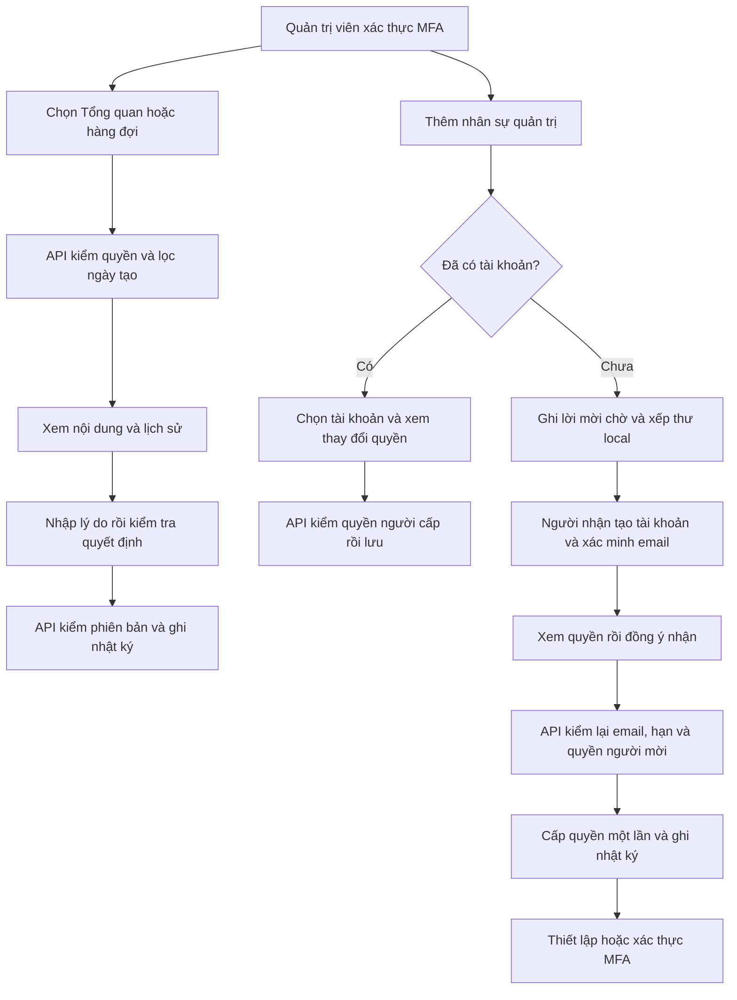

**Phiên bản** là số lần hồ sơ thay đổi. Khi hai quản trị viên cùng mở một hồ sơ, người lưu sau phải tải bản mới nếu số này đã đổi. **Khóa thao tác** (`Idempotency-Key`) giúp máy chủ nhận ra một lần gửi lại do mất mạng: app giữ đúng nội dung và khóa cũ để không cấp quyền hoặc tạo thư hai lần.

## Thứ tự đọc code

| Bước | File và hàm | Nhận gì → làm gì → trả gì |
|---|---|---|
| 1 | [Web P2Desk](../../../apps/admin/src/P2Desk.tsx), [mobile P2Desk](../../../apps/mobile/src/features/admin/screens/P2Desk.tsx) | Nhận danh sách quyền → tạo menu hợp lệ → mở màn tương ứng. |
| 2 | [useSupportOverview](../../../apps/admin/src/useSupportOverview.ts), [ModerationService.reportSummary/list](../../../services/api/src/modules/moderation/moderation.service.ts) | Nhận mốc ngày, trạng thái, tìm kiếm, thứ tự → API kiểm `support.read`, đếm/lọc → trả số lượng và trang hồ sơ. Con trỏ trang gắn với chính bộ lọc đó. |
| 3 | [Web Desk/Decision](../../../apps/admin/src/App.tsx), [AdminDesk](../../../apps/mobile/src/features/admin/screens/AdminDesk.tsx), [AdminDecision](../../../apps/mobile/src/features/admin/screens/AdminDecision.tsx) | Nhận hồ sơ và phiên bản → hiển thị nội dung/lịch sử, xem trước lý do → gửi quyết định hoặc ghi chú riêng. |
| 4 | [Web AdminTeam](../../../apps/admin/src/AdminTeam.tsx), [mobile AdminTeam](../../../apps/mobile/src/features/admin/screens/AdminTeam.tsx), [useAdminTeam](../../../apps/mobile/src/features/admin/useAdminTeam.ts) | Chọn người/nhập email → chọn quyền và xem lại → giữ nguyên yêu cầu khi cần thử lại; bỏ kết quả về trễ khi rời màn. |
| 5 | [BackofficeService.saveGrants/list](../../../services/api/src/modules/backoffice/backoffice.service.ts) | Kiểm quyền hiện tại, không tự sửa, không vượt quyền và phiên bản → lưu quyền/tăng phiên bản/thu hồi phiên quản trị cũ → trả bản mới. |
| 6 | [AdminInvitationsService](../../../services/api/src/modules/backoffice/admin-invitations.service.ts) — `invite/create/change/preview/accept/tx` | Kiểm quyền người cấp, email, hạn và mã → tạo/thay/hủy/nhận lời mời trong giao dịch → trả trạng thái không chứa mã bí mật. |
| 7 | [LocalMessages.queue/deliver](../../../services/api/src/integrations/local-messages.ts) | Nhận thư → mã hóa nội dung, xếp hàng → chỉ gửi nếu lời mời còn hợp lệ. Kết quả gửi chưa chắc chắn được giữ đúng trạng thái. |
| 8 | [AcceptAdminInvitation](../../../apps/mobile/src/features/admin/screens/AcceptAdminInvitation.tsx), [API client](../../../apps/mobile/src/features/admin/api/admin-invitations-api.ts) | Người nhận dán mã trong mục Tài khoản → xem quyền → đồng ý → tải lại hồ sơ đăng nhập để chuyển sang bước MFA. Dùng được trên app và bản web của app. |
| 9 | [Migration 025](../../../services/api/migrations/025_admin_invitations.sql) | Thêm bảng lời mời và liên kết hàng đợi thư; không sửa dữ liệu nghiệp vụ cũ. |

## Quyền, trạng thái và lỗi

`grant.manage` và MFA còn mới là điều kiện tạo, gửi lại, hủy lời mời hoặc lưu quyền. Quản trị viên chỉ có thể cấp những quyền mình đang có. Backend kiểm lại quyền trước cả việc trả kết quả thao tác đã xử lý trước đó.

Lời mời đi từ `pending` sang `accepted`, `revoked`, `expired` hoặc `replaced`. `replaced` giữ liên kết tới lời mời mới để tra cứu. Mã ngẫu nhiên 256 bit chỉ nằm trong thư đã mã hóa; bảng lời mời giữ dấu băm để đối chiếu. Danh sách trả email che bớt, không trả mã mời. Chấp nhận lời mời và sửa quyền dùng cùng thứ tự khóa dữ liệu để tránh cấp quyền dựa trên quyền đang bị thu hồi.

Lỗi mạng/timeout hoặc phản hồi không hợp lệ giữ nguyên nội dung và khóa để thử lại. `VERSION_CONFLICT`/`STATE_CONFLICT` cần tải dữ liệu mới. `ACCOUNT_EXISTS` hướng sang cấp quyền cho tài khoản có sẵn; `INVITATION_PENDING` hướng tới lời mời đang chờ; email không thuộc danh sách local không được gửi. Mất phiên/quyền đưa app về MFA/đăng nhập và xóa nội dung quản trị khỏi màn hình.

## API bổ sung trong đợt

| Route | Input chính | Kết quả / điều kiện |
|---|---|---|
| `GET /admin/reports-summary` | `from`, `to` (không gồm mốc cuối) | `counts`, `as_of`; MFA + `support.read`. |
| `GET /admin/reports` | thêm `from`, `to`, `sort=newest/oldest`, `state=done` | `done` gồm resolved/closed; con trỏ bị từ chối nếu thay bộ lọc. |
| `GET /admin/grant-users` | thêm `role=all/admins/candidates`, tìm email | Candidate đang active, chưa có quyền; kết quả email che bớt. |
| `GET/POST /admin/invitations` | phân trang / `name,email,permissions,reason` | Danh sách / tạo pending 7 ngày; POST có khóa thao tác. |
| `POST /admin/invitations/{id}/resend` hoặc `/revoke` | `expected_version,reason` + khóa thao tác | Thay mã / hủy; có kiểm quyền và giới hạn gửi. |
| `POST /admin-invitations/preview` | `token` | Đúng tài khoản/email đã xác minh mới xem được quyền. |
| `POST /admin-invitations/accept` | `token` + khóa thao tác | Cấp một lần, `requires_mfa=true`; không cấp lại khi thử lại. |

## Kiểm chứng và ảnh

Các kiểm tra tập trung đã đạt: typecheck các workspace; 4 bài API cho quyền/lời mời/danh sách/tổng quan; 19 bài mobile quản trị và nhân sự; các hành trình web quản trị hiện có và hành trình mới mời → nhận → MFA. Luồng mới kiểm cả trường hợp máy chủ đã lưu nhưng trình duyệt mất phản hồi: gửi lại giữ đúng khóa và nội dung, không tạo hai lời mời. Kiểm thư thực tế qua Mailpit local đạt `submitted`, tìm thấy đúng thư và người nhận DEMO; [bằng chứng đã bỏ mã bí mật](bang-chung/B00-19-local-mail.json).

Bộ kiểm hồi quy toàn repo dùng `SDD-PROJECT`; kết quả máy đọc của lần chạy cuối ở [result.json](../../../test-results/sdd/SDD-PROJECT/result.json), đối chiếu [evidence.json](../../../test-results/sdd/SDD-PROJECT/evidence.json) và chạy `--phase verify` để xác nhận khớp nguồn hiện tại. Không dùng một bài chạy riêng để thay kết quả toàn bộ. Đã đăng ký 160 tiêu chí; QA còn 98 `partial`, 12 `unmapped`. Chỉ thêm QA-110, giữ nguyên nội dung 109 QA trước và các khoảng trống cũ. Các artifact kiểm thử nằm local/CI, không phải tài liệu được track.

Test API/web/native dùng `dvqb_test` với schema riêng. Migration 025 đã áp dụng thành công vào `dvqb_local` sau bản sao lưu `.local/ux-02-implementation/dvqb-local-before-025.dump`; không reset/seed lại dữ liệu local. Bảng lời mời local ban đầu có 0 dòng. Sơ đồ Mermaid ở trên đã parse và render trong Chromium (16 nút, khung 976 × 884), không xuất ảnh sơ đồ riêng.

Ảnh dưới đây chụp app thật ngày **05/11/2026**, dữ liệu DEMO. Web là Chromium 1440 px; mobile-web là bản Expo web 390 px. Native là **iPhone 18 Pro/iOS 27 Simulator** và **Android API 36 Emulator**, không phải điện thoại vật lý. Đã kiểm đăng nhập/MFA, Tổng quan, Nhân sự, Lời mời trên hai nền tảng; iOS còn mở chi tiết hỗ trợ. Kiểm native phát hiện và đã sửa định dạng số BigInt trên Hermes, khoảng trắng JSX gây cảnh báo Text và vị trí cuộn khi mở chi tiết. Toàn bộ thao tác nhận/gửi lại/hủy chưa được chạy end-to-end riêng trên từng native; bằng chứng các nhánh này là API/mobile unit/web.

### Bổ sung khi chụp lại báo cáo tổng, 05/11/2026

Trong `AccountScreen`, phần Point và phần nhận lời mời cùng dùng mã người dùng làm khóa React ở cùng cấp. Khi mở Tài khoản, React báo hai phần có cùng khóa; việc nhận diện phần nào cần cập nhật không còn bảo đảm. Đã thêm tiền tố `admin-invitation:` cho khóa của phần lời mời, vẫn giữ cơ chế xóa trạng thái cũ khi đổi người dùng. Không đổi quyền hoặc quy tắc lời mời.

Bài hồi quy mới trong `AccountScreen.test.tsx` tái hiện cảnh báo trước sửa, rồi kiểm đồng thời Point và phần nhận lời mời sau sửa; cả 7 bài Tài khoản đạt. Đã chụp lại các vai trò sau sửa. Bộ ảnh đầy đủ của phạm vi UX-02 nằm trong [B00-14](B00-14-bao-cao-man-hinh.md), dùng `dvqb_local` và không gửi lời mời/đổi quyền/duyệt tiền trong đợt chụp. SDD cuối vẫn cần khớp toàn bộ nguồn như quy định phía trên.

### Web quản trị

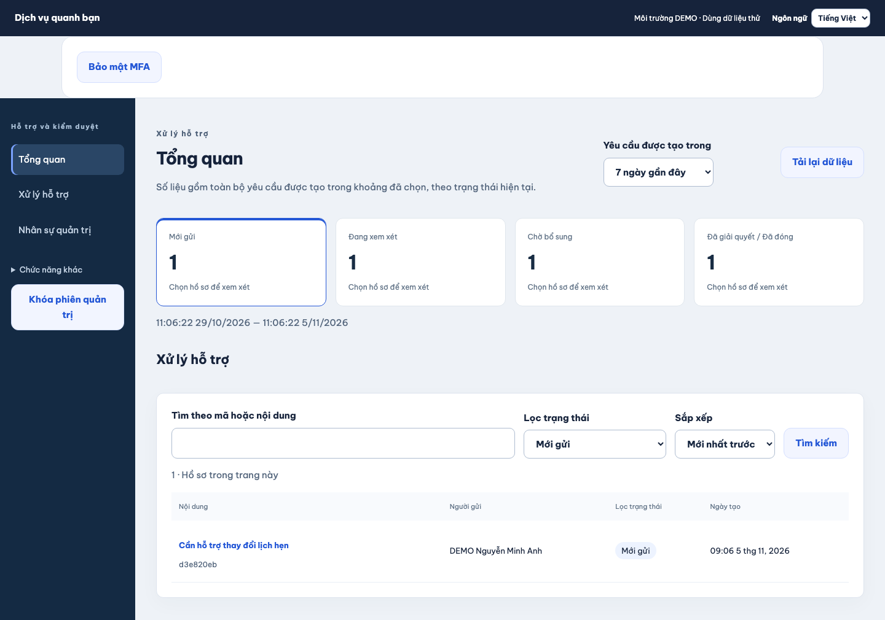

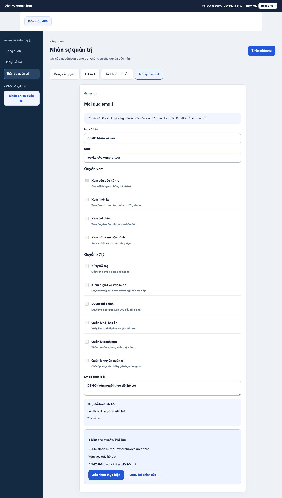

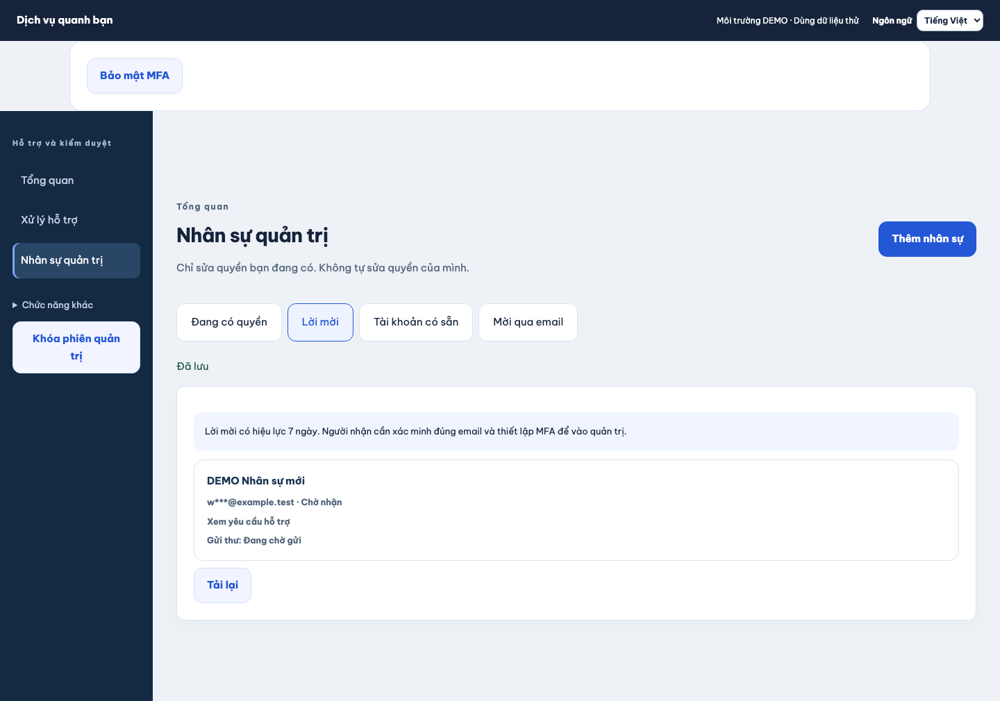

### iOS Simulator

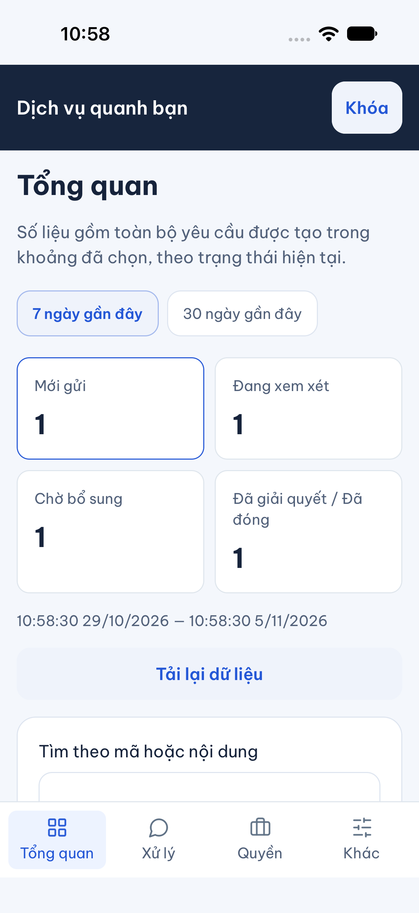

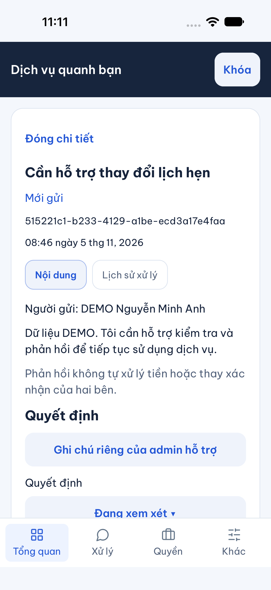

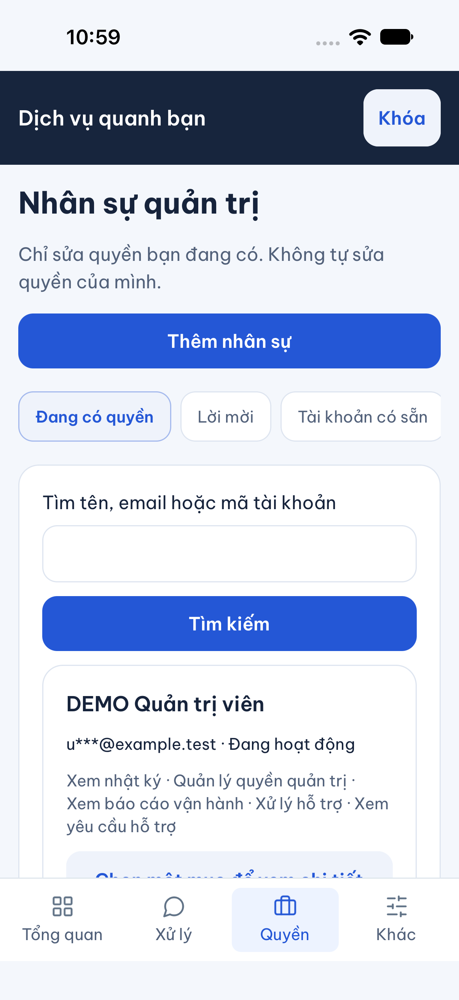

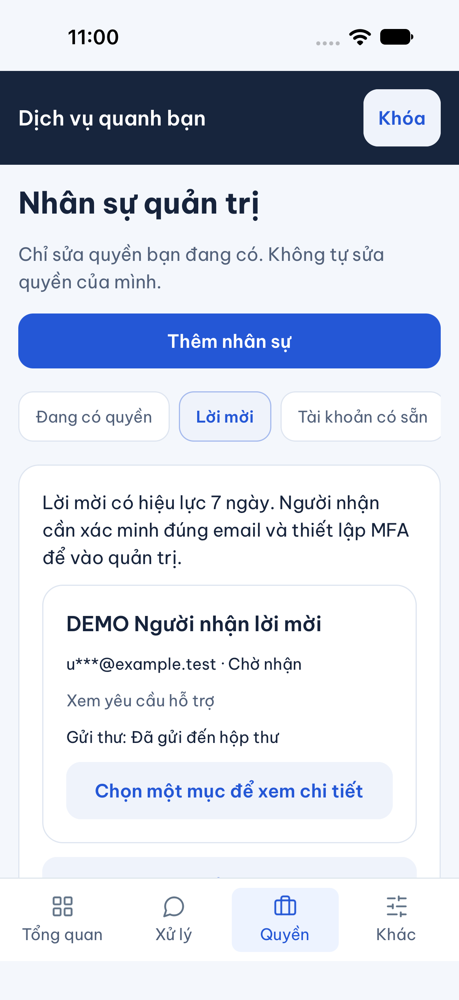

### Android Emulator

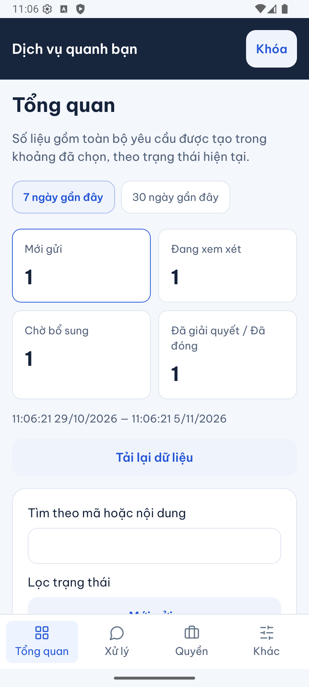

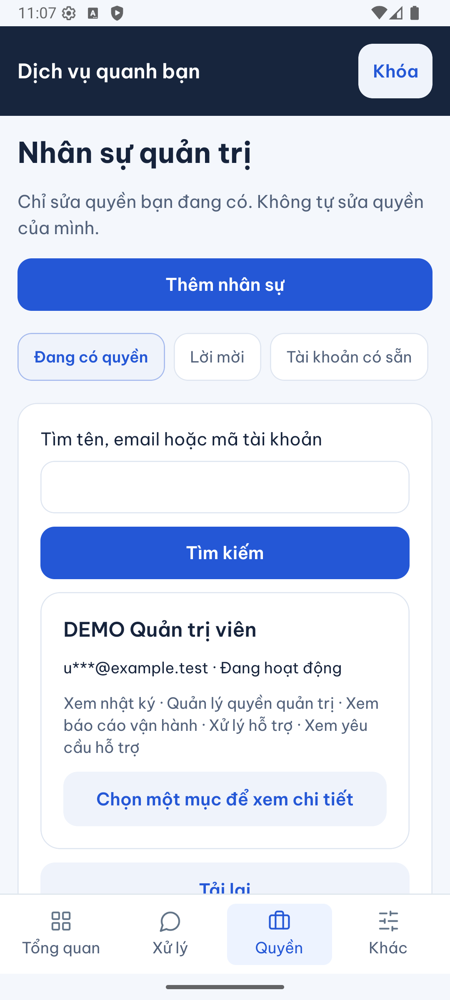

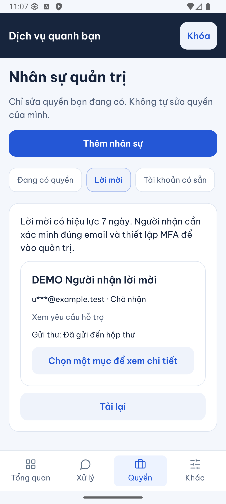

### Bản web của app điện thoại

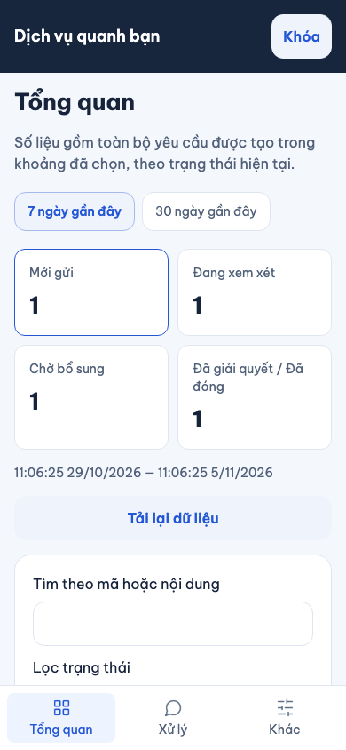

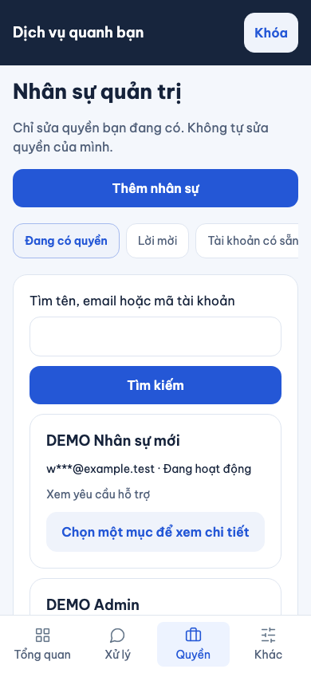

## Giới hạn

Chưa phải chứng nhận production, CI remote, thiết bị thật hoặc UAT của chủ dự án. Không gửi email ngoài máy, không thay cấu hình hạ tầng. Tài khoản nhận lời mời cần tự xác minh email theo luồng hiện có. Bản HTML là nguồn thiết kế; ảnh bàn giao phải lấy từ app chạy thực tế.

## Bài thử để hiểu code

1. Đổi kỳ 7 ngày thành 30 ngày: tại sao số trên ô không bằng số hàng của trang đầu?
2. Chọn tài khoản của chính mình: giao diện khóa gì và backend còn chặn gì nếu tự gửi request?
3. Bấm kiểm tra quyền nhưng chưa xác nhận: API ghi dữ liệu chưa?
4. Gửi lại lời mời rồi dùng mã cũ: tìm `recipient` để giải thích vì sao bị chặn.
5. Cắt phản hồi sau khi máy chủ đã lưu rồi bấm thử lại: đối chiếu khóa thao tác và số hàng quyền/lời mời trong test.
6. Thu hồi quyền người mời trước khi người nhận đồng ý: đọc `authority` để thấy quyền được kiểm tại thời điểm dùng, không chỉ lúc tạo.

## Lệnh tra cứu

- `npm run typecheck --workspaces`, `npm run lint`.
- `npm test -w apps/mobile -- --runInBand src/features/admin/screens/Admin.test.tsx src/features/admin/screens/AdminTeam.test.tsx`.
- Trong `services/api`: `node --import tsx --test test/integration/admin-invitations.test.ts`.
- `npx playwright test --config tests/e2e/web/playwright.config.mjs admin-invitations admin-moderation backoffice admin-operations admin-completion`.
- `npm run sdd:run -- --change SDD-PROJECT`, sau đó `npm run sdd:check -- --change SDD-PROJECT --phase verify`.
