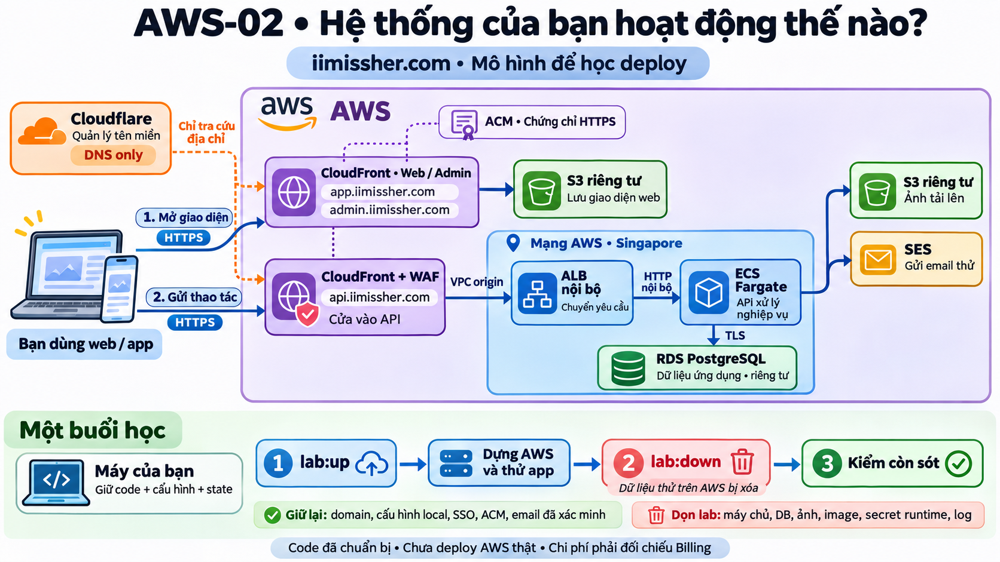
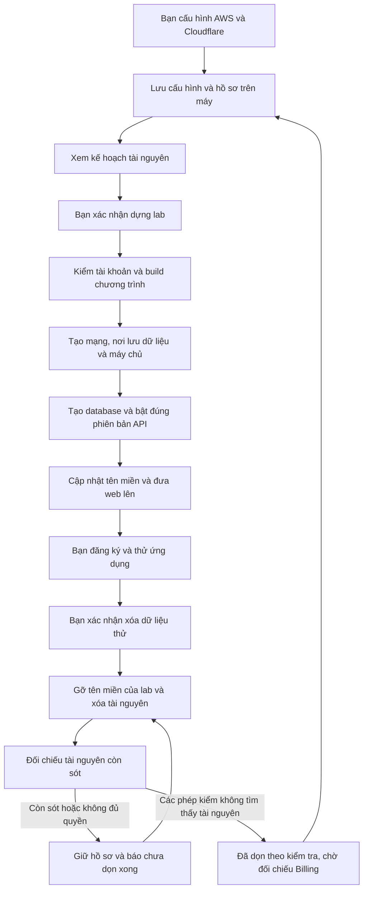

# B00-20 — Dựng và dọn môi trường học AWS-02

**Cập nhật OTP email:** [B00-21](B00-21-otp-email-lab.md) bổ sung chính sách email lab và Resend. Sơ đồ có SES bên dưới mô tả cấu hình nền trước bổ sung này; cấu hình mẫu mới chọn Resend.

05/11/2026 · AWS-02 · Phạm vi: code hạ tầng/công cụ vận hành/backend; không sửa UI hoặc spec nghiệp vụ. [Mục lục](../README.md) · [Hướng dẫn cấu hình từng bước](../../../infra/aws/lab/README.md).

**Bổ sung sau review kiến trúc, 05/11:** chủ dự án yêu cầu đưa chat realtime, gọi thoại và thông báo nền vào plan với chi phí thấp. Đã cập nhật [AWS-02, mục 8–10](../de-xuat/AWS-02-lab-khong-phi-khi-tat.md#8-bổ-sung-chat-realtime-gọi-thoại-và-thông-báo-nền), checklist và [bằng chứng giá](bang-chung/B00-20-aws02-gia.json). Dự toán 5–10 USD/tháng cho 30 giờ tài nguyên, LiveKit Build còn quota và tải thử nhỏ; chưa gồm thuế/domain/Apple/SMS. **Phần mở rộng mới là kế hoạch, chưa triển khai**; ảnh màu và review GPT-6 Astra bên dưới chỉ áp dụng hạ tầng cơ sở. Các kiểm thử local hiện tại không chứng minh realtime/gọi/push trên cloud. Ghi chú “bản đề xuất chưa đồng bộ” bên dưới là trạng thái trước lần cập nhật plan này; Drive/Excel/`ui-ux` vẫn ngoài phạm vi.

## 1. Bạn đã dùng được những gì?

Bạn có thể chuẩn bị cấu hình riêng trên máy bằng `lab:init`, đọc tiến độ bằng `lab:status`, sau khi cấu hình tài khoản thì xem kế hoạch dựng/xóa bằng `lab:up`/`lab:down`. Các lệnh mặc định không tạo/xóa AWS. Khi bạn chủ động dùng `--apply` và xác nhận account/lab, công cụ mới thực hiện quy trình tương ứng.

Mục tiêu của lần dựng là ba địa chỉ ổn định: `app.iimissher.com`, `admin.iimissher.com`, `api.iimissher.com`. Domain giữ ở Cloudflare. Code tự cập nhật ba CNAME **DNS only** thuộc lab sau khi API chạy đúng phiên bản; từ chối ghi đè record của nơi khác. Khi dọn, DB/tài khoản app/ảnh thử bị xóa, ba record của lab được gỡ. Lần sau dựng DB mới bằng cùng cấu hình. Đây chưa phải bằng chứng các địa chỉ đã hoạt động.

## 2. Quyết định và phạm vi đã được phép

Chủ dự án ngày 05/11/2026 cho biết đã mua `iimissher.com` ở Cloudflare, sau khi nghe các phần cần sửa đã yêu cầu “hãy sửa code đi rồi sau đó tôi sẽ bắt đầu cấu hình các bước để tiến hành deploy”. Triển khai AWS-02 trong repo, giữ nguyên AWS-01. Dùng `app/admin/api` làm mặc định cấu hình theo phương án vừa trao đổi; có thể đổi domain ở config trước khi khởi tạo lab.

So với bản kế hoạch AWS-02 ngày 29/10: không còn dùng URL AWS mặc định làm địa chỉ chính; thêm ACM công khai không export được chủ tài khoản cấu hình trước, DNS Cloudflare có dấu sở hữu và cập nhật tự động. Domain/ACM/SES identity/SSO giữ ngoài tài nguyên disposable; không có Route53/bucket state. `init` cố ý chỉ làm local; account/ACM/SES/DNS được kiểm khi chuẩn bị `up`, tránh người mới hiểu tạo cấu hình là đã kết nối AWS.

Đây là thay đổi cách vận hành, không đổi quyền, thanh toán, phone verification, MFA hoặc contract nghiệp vụ. Không tạo tài nguyên AWS, không ghi DNS hoặc gửi email bên ngoài trong đợt code. Không commit/push. Chưa đồng bộ bản đề xuất cũ, Excel/Drive/`ui-ux`; quyết định và phần chưa đồng bộ ghi ở báo cáo này theo AGENTS. Hướng dẫn AWS-01 là lịch sử của pilot, không phải lệnh lab hiện hành.

## 3. Theo một buổi học từ đầu đến cuối

### Mô hình kiến trúc có màu

*Ảnh minh họa do AI tạo, được GPT-6 Astra đánh giá độc lập ngày 05/11/2026 bằng cách đối chiếu ảnh, Terraform, công cụ dựng/dọn và cấu hình API. Kết luận: phù hợp để giải thích thiết kế môi trường học, không phát hiện lỗi trọng yếu trong phạm vi review. Đây không phải ảnh tài nguyên đang chạy hoặc bằng chứng đã deploy AWS thành công.*

Đọc theo mũi tên xanh: khi mở web, CloudFront lấy giao diện từ S3; khi bạn thao tác, request tới CloudFront của API, qua ALB rồi tới chương trình chạy trên Fargate. Chương trình đọc/ghi dữ liệu ở RDS, lưu ảnh ở S3 và gửi email qua SES. Đường cam nét đứt chỉ việc tra cứu địa chỉ ở Cloudflare; Cloudflare đang ở chế độ **DNS only**.

Hai lưu ý từ review độc lập:

- Fargate nằm trong subnet public và có IP công khai để kết nối ra ngoài; quy tắc mạng chỉ cho API nhận request từ ALB. ALB và RDS vẫn ở subnet private. Khung “Mạng AWS” trong ảnh không có nghĩa mọi thành phần đều ở subnet private.
- `lab:down` kiểm token/quyền Cloudflare và gỡ DNS của lab trước khi xóa AWS. Nếu bước này lỗi, cần xử lý rồi chạy lại; tài nguyên AWS vẫn tồn tại và có thể tiếp tục tính phí. Chỉ đánh giá dọn xong sau kiểm tài nguyên còn sót và đối chiếu Billing.

### Vòng đời một buổi học

*Terraform* là chương trình đọc cấu hình để tạo/xóa các dịch vụ. *State* là hồ sơ tài nguyên Terraform đang quản lý, chứa dữ liệu nhạy cảm; không phải bản sao database. *Journal* là file ghi công cụ đã đi tới bước nào để thử lại đúng lab.

Đường vào app vẫn qua HTTPS. CloudFront đưa API request vào ALB nội bộ (bộ chia request), ALB chỉ nhận lưu lượng CloudFront và chỉ chuyển request có khóa riêng của distribution. Chặng nội bộ dùng HTTP theo thiết kế lab; API tới RDS vẫn TLS. Backend đọc đúng IP người dùng qua hai lớp proxy và coi giao thức công khai là HTTPS; không tin tiền tố IP/giao thức do người gọi tự gửi.

## 4. Mở code theo thứ tự nào?

| Bước | File và hàm thật | Nhận gì, xử lý gì, chuyển đi đâu? |
|---|---|---|
| 1 | [lab.mjs — parseArgs/main](../../../scripts/aws/lab.mjs) | Nhận lệnh và lab ID, kiểm lựa chọn, lấy khóa tránh hai thao tác đồng thời; đọc cấu hình riêng. |
| 2 | [lab-core.mjs — validateConfig/assertIdentity/assertStateIdentity](../../../scripts/aws/lab-core.mjs) | Kiểm account/region/domain, đối chiếu state và journal; từ chối state pilot/khác lab hoặc sai account trước tạo/xóa. |
| 3 | [versions.tf](../../../infra/aws/lab/versions.tf), [network.tf](../../../infra/aws/lab/network.tf) | Dùng backend local và tag lab riêng; tạo mạng, DB private/mã hóa/TLS, chỉ bật xóa cho root lab. |
| 4 | [api-edge.tf](../../../infra/aws/lab/api-edge.tf), [waf.tf](../../../infra/aws/lab/waf.tf) | Dựng HTTPS API, đường CloudFront tới ALB nội bộ và tường lửa; không cache API/lỗi riêng tư; chống truy cập vòng qua distribution. |
| 5 | [compute.tf](../../../infra/aws/lab/compute.tf), [database.mjs — main/grantRuntime](../../../scripts/aws/database.mjs) | Task vận hành khởi tạo/migrate/seed catalog; tạo secret độc lập, cấp DB role giới hạn cho API. Task API khởi đầu 0 cho tới khi có digest và DB. |
| 6 | [bootstrap.ts — createApp](../../../services/api/src/bootstrap.ts), [environment.ts — config](../../../services/api/src/config/environment.ts) | Chế độ `cloudfront-alb` tin đúng 2 hop, chuẩn hóa HTTPS; pilot một hop và local không tin proxy giữ nguyên. |
| 7 | [lab-core.mjs — cloudflare](../../../scripts/aws/lab-core.mjs), [storage.tf](../../../infra/aws/lab/storage.tf) | Kiểm toàn bộ ba record trước ghi; chỉ sửa record mang dấu lab. Web build dùng API domain và public map key; private key không vào bundle. |
| 8 | [lab-core.mjs — auditResources/manualPages](../../../scripts/aws/lab-core.mjs) | Sau destroy, quét dịch vụ thực tế và phân trang VPC origins/WAF; trả danh sách còn sót. Bất kỳ lỗi quyền/scan nào đều không được coi đã dọn. |

## 5. Dữ liệu, quyền và thử lại

- `.local/aws-lab/<id>/config.json`: account, domain, email và ngưỡng cảnh báo. Không chứa token/key. `.local` đã bị Git ignore.
- `terraform.tfstate`, plan và journal giữ trên máy; file ghi bởi runner có quyền 600, thư mục mới 700. Secret origin nằm trong state nên cần ổ/bản sao mã hóa. Không bỏ state trước khi dọn.
- Mật khẩu database/khóa runtime trong Secrets Manager; tác vụ API không được lấy master password của RDS. Server map key truyền qua stdin, không vào argv/log. Docker login dùng stdin và file auth tạm được dọn ở `finally`.
- S3/ECR cho phép dọn nội dung trong root lab. DB không giữ final snapshot/automated backup sau xóa; runtime secret có recovery window 0. AWS-01 vẫn giữ bảo vệ xóa/backup.
- Sai account/root login, state khác lineage, DNS không thuộc lab hoặc khóa thao tác đang tồn tại đều dừng. Sau lỗi apply, ghi state thật và tiến độ; lần chạy lại tiếp tục cùng lab. Nếu cleanup đang dang dở, không cho `up` dựng đè.
- Nếu API rollback về bản cũ, kiểm task definition mới sẽ thất bại và chưa publish web. DNS cập nhật nhưng chưa lan truyền làm HTTPS smoke lỗi; dùng cùng lab/commit để thử lại.
- `up` kiểm code sạch và SDD verify trước tạo tài nguyên. Phiên bản khác khi lab còn chạy phải dọn trước: đây là công cụ dựng lại để học, chưa phải quy trình nâng cấp production không gián đoạn.
- Xác minh email trong SES khác xác minh email tài khoản app. Bạn vẫn đăng ký/xác minh trong app, bootstrap admin một lần rồi MFA; không có mật khẩu admin mặc định.

## 6. Bạn tự thử và tự kiểm hiểu

1. Đọc [hướng dẫn](../../../infra/aws/lab/README.md), chuẩn bị account/SSO, certificate, email, zone/token. Chưa dùng `--apply` khi chưa hiểu tài nguyên/chi phí.
2. Chạy `lab:init` và `lab:status`: chỉ tạo/đọc hồ sơ local. Kiểm lab ID/account chính xác.
3. Sau cấu hình thật, xem `lab:up` plan; chỉ khi bạn chủ động xác nhận mới chạy `--apply`.
4. Sau buổi thử, xem plan `lab:down`, xác nhận mất dữ liệu, đợi kiểm dọn và đối chiếu Billing sau đó.

Câu hỏi: vì sao domain giữ nguyên nhưng tài khoản app mất? Domain nằm ngoài DB disposable. Vì sao Terraform state rỗng chưa đủ kết luận hết tài nguyên? Backup, secret do dịch vụ tạo hoặc tài nguyên tạo dở có thể nằm ngoài state. Vì sao không bật proxy Cloudflare màu cam? Backend đang kiểm đường CloudFront → ALB, thêm lớp nữa sẽ đổi cách nhận IP.

## 7. Kiểm chứng và giới hạn

Kiểm tập trung ngày 05/11: 19/19 bài tooling/CLI và 5/5 Terraform mock run đạt; API unit 33/33 và bộ cloud/proxy tập trung 11/11 đạt. Sơ đồ Mermaid đã parse và render trong Chromium (14 nút), không tạo ảnh phụ. Các số này không thay kết quả SDD toàn repo ở bảng dưới.

Các bài tooling kiểm cấu hình sai/account sai, đồng thời, secret, DNS sở hữu, audit thiếu quyền/phân trang, deploy dở, cleanup thử lại và hai chu kỳ dựng/dọn qua CLI giả lập. Terraform test dùng provider mock; proxy HTTP dùng DB test riêng `dvqb_test`, không reset `dvqb_local`. Không có giao diện sản phẩm thay đổi nên không phát sinh ảnh native mới.

Lệnh kiểm và nơi lấy bằng chứng

| Mức kiểm | Lệnh/bằng chứng | Giới hạn |
|---|---|---|
| Proxy | API unit `cloud.test.ts`, integration `locations.test.ts` | HTTP local qua chuỗi header mô phỏng, không phải traffic AWS |
| Công cụ | `node --test scripts/test/aws-lab.test.mjs scripts/test/aws-lab-cli.test.mjs` | SDK/CLI/fetch được giả lập; không tạo AWS/DNS thật |
| Terraform | `init -backend=false`, `fmt -check`, `validate`, `test` tại `infra/aws/lab` | Mock plan; không chứng minh quota/IAM, thời gian dựng/xóa live |
| Image API local | Build `dvqb-api:infra-test` và `node scripts/aws/container-smoke.mjs` ngày 05/11 đạt: TLSv1.3, migration/catalog, quyền DB, auth/CORS, user 1000, filesystem read-only, shutdown | Container PostGIS tạm; không gọi AWS hoặc thay dvqb_local |
| Toàn repo | `npm run sdd:run -- --change SDD-PROJECT`, sau đó `sdd:check --phase verify` | Kết quả cuối đọc ở `test-results/sdd/SDD-PROJECT/result.json` và `evidence.json`, đúng snapshot nguồn hiện tại; artifact local bị Git ignore |
| CI | Workflow `AWS infrastructure` bổ sung validate/mock root lab, job `SDD project` giữ đầy đủ | Chưa có lượt CI mới cho code này |
| Live | Dựng → thử → dọn → đối chiếu Billing → dựng/dọn lần hai | **Chưa chạy**, chủ tài khoản sẽ cấu hình sau |

Thêm root Terraform với provider random để tạo khóa origin; dependency API/app không đổi. Không giảm criterion/QA/required step/baseline; giữ 160 tiêu chí và 110 QA trước, thêm 5 tiêu chí AWS-02 cùng QA-111. Đối chiếu JSON xác nhận 110 QA cũ không đổi; chỉ cập nhật hash nguồn QA cho phần append đã review. Giữ mọi `partial`/`unmapped` trước đây, tổng hiện tại 99 partial/12 unmapped. Bản AWS-02 đề xuất cũ không sửa hash; nguồn quyết định implementation mới là mục 2 của báo cáo này.

## 8. Việc còn lại trước nghiệm thu deploy

Chủ tài khoản cấu hình theo hướng dẫn rồi review plan và chi phí thật. Cần kiểm AWS thật: cấp quyền/quota, HTTPS/DNS, hai người dùng qua proxy, gửi/nhận SES, upload/đọc ảnh riêng, bootstrap MFA, deploy lỗi giữa chừng, cleanup đầy đủ và lặp chu kỳ thứ hai. Kiểm Billing sau khi dữ liệu cập nhật mới đánh giá khoản phí trong thời gian nghỉ. Scanner chỉ quản lý lab Singapore và tài nguyên phụ/global ở us-east-1; không cam kết tài khoản không có tài nguyên/thuê bao khác hoặc hóa đơn bằng 0. API gọi realtime, push, cuộc gọi, SMS/ngân hàng thật, native release và UAT vẫn ngoài bằng chứng lần này.
