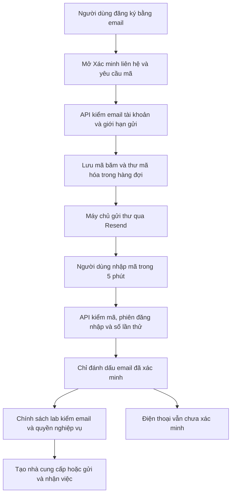
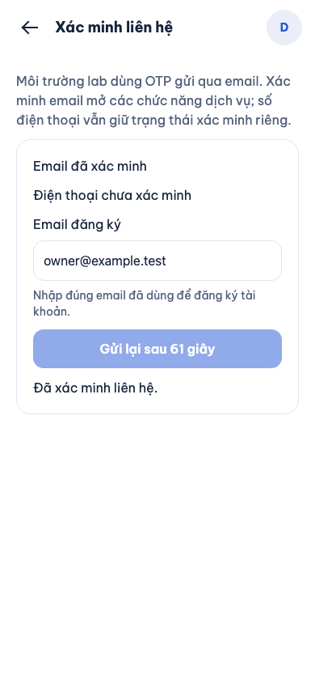
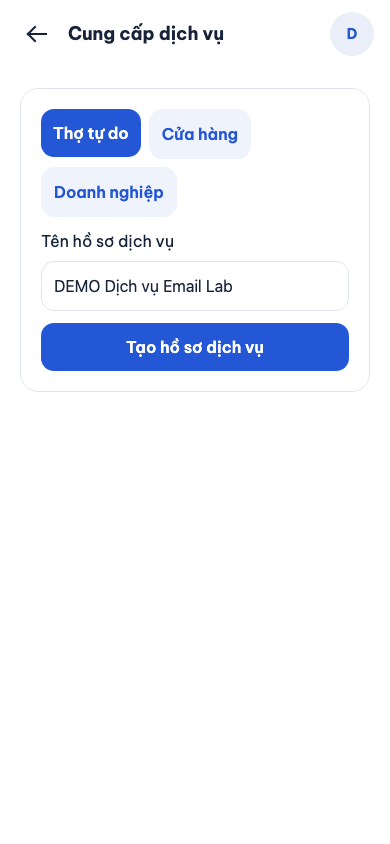

# B00-21 — Xác minh OTP email cho AWS-02

Ngày 05/11/2026 · Môi trường học AWS-02 · [Hướng dẫn cấu hình](../../../infra/aws/lab/README.md#3-email-thử-và-bản-đồ).

## 1. Người dùng thấy gì?

Đăng ký bằng email, mở **Tài khoản → Xác minh liên hệ**, nhập email đăng ký, nhận mã sáu chữ số và nhập mã. Khi email đã xác minh, người dùng có thể tạo hồ sơ nhà cung cấp, gửi yêu cầu dịch vụ và nhận việc theo quyền của mình. Không cần chờ SMS trong lab.

Điện thoại vẫn hiển thị **chưa xác minh**. Email không chứng minh quyền sở hữu số điện thoại, danh tính pháp lý, năng lực chuyên môn hay quyền quản trị. Các điều kiện khác như hồ sơ đã công khai, vùng phục vụ, không tự thuê mình và quyền thành viên vẫn được kiểm tra.

## 2. Quyết định đã chốt và phạm vi

Chủ dự án duyệt tạm dùng OTP email để các chức năng khác không bị chặn bởi SMS. Áp dụng `LAB_EMAIL_VERIFICATION=1` cho AWS-02 (`CLOUD_PILOT=1`, `CLOUD_PROXY_MODE=cloudfront-alb`) hoặc database local/test được phép. Mặc định và AWS-01 vẫn yêu cầu điện thoại. Không sửa `phone_verified`, không chuyển quyền xác minh của lời mời gửi số điện thoại sang email; trong lab hãy mời qua email.

Server bổ sung trường tùy chọn `verification_policy: "email_lab"` vào user của session và `/me` khi bật chính sách. App chỉ dùng trường này để hiển thị/mở nút; server đọc lại trạng thái email trong DB để quyết định quyền mỗi lần thao tác. API không nhận chính sách do client gửi lên. Không cần migration DB.

Resend là lựa chọn mặc định của **config mẫu lab mới**, dùng chung hàng đợi email cho xác minh, bảo mật tài khoản và lời mời. SES vẫn được hỗ trợ cho cấu hình cũ và pilot. Danh sách `pilot_emails` tiếp tục giới hạn đăng ký và người nhận trong lab; chưa mở đăng ký công khai. OTP đăng nhập/khôi phục dùng email hiện có theo kiểm tra riêng, không bỏ các điều kiện bảo mật để vượt lỗi SMS. MFA quản trị, xác minh hồ sơ và các ACL giữ nguyên.

Đã ghi nhận quyết định và contract bổ sung tại báo cáo này. Chưa đồng bộ OpenAPI, Excel, Drive hoặc `ui-ux`; chưa có yêu cầu đồng bộ toàn bộ hồ sơ. Realtime, LiveKit cloud, push nền và tiền thật không thuộc đợt OTP này.

## 3. Luồng xử lý

OTP là mã dùng một lần. API giữ mã băm để so sánh, nội dung thư được mã hóa trong DB và chỉ worker gửi thư giải mã. Worker là tác vụ đọc hàng đợi trong API; không thêm máy chủ hay dịch vụ hàng đợi riêng.

## 4. Thứ tự đọc code và input/output

| Thứ tự | File/hàm | Nhận gì → làm gì → trả gì |
|---|---|---|
| 1 | [environment.ts](../../../services/api/src/config/environment.ts) `config` | Biến môi trường → kiểm giới hạn lab/provider/secrets → cấu hình server |
| 2 | [VerifyContactScreen.tsx](../../../apps/mobile/src/features/organizations/screens/VerifyContactScreen.tsx) `send`, `verify` | Email, mã → gọi API và tải lại tài khoản → trạng thái xác minh |
| 3 | [challenges.service.ts](../../../services/api/src/modules/auth/challenges.service.ts) `request`, `verify` | Email/mã và phiên → kiểm đúng liên hệ, hạn dùng, quota → challenge hoặc email verified |
| 4 | [local-messages.ts](../../../services/api/src/integrations/local-messages.ts) `LocalMessages` | Thư mã hóa → gửi có giới hạn retry → trạng thái hàng đợi |
| 5 | [cloud.ts](../../../services/api/src/integrations/cloud.ts) `resendTransport` | ID thư, người nhận, nội dung → POST Resend có khóa chống gửi trùng → xác nhận provider đã nhận |
| 6 | [auth.service.ts](../../../services/api/src/modules/auth/auth.service.ts) `hasServiceVerification`, `me` | Trạng thái liên hệ thật từ DB + chính sách server → đủ/chưa đủ điều kiện dịch vụ |
| 7 | [partners.service.ts](../../../services/api/src/modules/partners/partners.service.ts), [jobs.service.ts](../../../services/api/src/modules/jobs/jobs.service.ts) | Tạo hồ sơ, quyền thuê, gửi/nhận việc → kiểm xác minh cùng quyền/trạng thái nghiệp vụ → kết quả hoặc 403 |
| 8 | [lab.mjs](../../../scripts/aws/lab.mjs), [compute.tf](../../../infra/aws/lab/compute.tf) | Config và khóa trong Terminal → Secrets Manager qua stdin → ECS inject khóa chỉ vào API |

Trường `email_verified`/`phone_verified` phản ánh `identities.verified_at` của đúng provider. Đổi/gỡ trạng thái email làm điều kiện dịch vụ mất hiệu lực ở lần gọi tiếp theo. Email đã xác minh không tự cấp `admin_permissions`; quản trị vẫn cần quyền và MFA riêng.

## 5. Lỗi, retry và giới hạn

- Mã hết hạn sau 5 phút, chỉ dùng một lần, tối đa 5 lần nhập sai; phải đúng người dùng và phiên/family đã yêu cầu. Gửi lại tối thiểu 60 giây, quota theo người nhận/người dùng/IP vẫn giữ.
- Email ngoài allowlist hoặc SMS chưa bật bị từ chối; nhập email khác email tài khoản không xác minh được tài khoản hiện tại.
- Resend 401/403/429/5xx, timeout hoặc phản hồi thiếu ID đều là lỗi gửi. Hàng đợi thử tối đa 3 lần, cách nhau 10 giây; bỏ thư challenge hết hạn/đã dùng. Không báo `submitted` chỉ vì HTTP trả 2xx thiếu ID.
- Mỗi delivery dùng `Idempotency-Key` cố định; Resend giữ chống trùng 24 giờ. Timeout không tạo mã OTP mới. Thư mời có hạn dài hơn cửa sổ này vẫn là at-least-once nếu tiến trình ngắt lâu; việc dùng token vẫn kiểm một lần ở server. [Tài liệu Resend](https://resend.com/docs/dashboard/emails/idempotency-keys).
- Provider nhận thư không chứng minh thư đã vào inbox. Chưa tích hợp bounce/delivery webhook; khi không nhận cần kiểm Spam, domain/key, quota và bảng điều khiển Resend rồi yêu cầu mã mới sau thời gian chờ.
- Khóa không đi qua tham số command, config Git, journal hoặc web build. Terraform chỉ giữ ARN/tham chiếu secret; task dùng Resend không được cấp SES SendEmail.

## 6. Kiểm thử và bằng chứng

- API local với Postgres test: đăng ký chưa xác minh bị chặn; nhập OTP email thật của challenge mở tạo/publish nhà cung cấp, `can_hire`, gửi job và nhận job; không tạo identity điện thoại; mất email verified bị chặn lại; không tự thuê mình; resend và reuse OTP bị chặn.
- Unit: config lab được giới hạn, mặc định vẫn phone; Resend payload/chống trùng/lỗi/SMS; SES cũ giữ nguyên.
- Mobile component: email verified + phone unverified mở nút tạo; các bài cũ cho mặc định phone vẫn chạy.
- Web Chromium 390×844, app và API chạy thật với dữ liệu DEMO/DB test; thư được đọc từ hàng đợi test, không gửi email ngoài. Ảnh dưới đây chụp ngày 05/11/2026, **không phải thiết bị native**.
- CLI mô phỏng: Resend bỏ bước SES, kiểm key trước tạo tài nguyên, chuyển key bằng stdin, xóa key khỏi môi trường build web; mock Terraform kiểm secret/policy và quyền SES không còn khi dùng Resend.
- Chạy hồi quy toàn bộ `SDD-PROJECT`; bằng chứng thực thi nằm trong `test-results/sdd/SDD-PROJECT/`. Báo cáo kết quả cuối cùng ở bàn giao; không dùng số lượng test cũ chứng minh phiên bản này.

**Chưa kiểm:** gửi Resend thật, DNS domain, AWS/ECS/Secrets Manager live, iOS/Android lần này, người dùng nghiệm thu. Chưa deploy, chưa commit/push. Full SDD local không thay các bước này.

## 7. Bạn cần cấu hình gì trước deploy?

1. Resend: xác minh domain `iimissher.com` hoặc subdomain gửi thư riêng bằng record DNS do Resend cung cấp tại Cloudflare. Đợi trạng thái Verified, tạo key chỉ có quyền gửi cho domain đó.
2. Config lab: `email_provider: "resend"`, `email_from: "no-reply@iimissher.com"`, `pilot_emails` là email người thử. Nếu xác minh subdomain, đổi sender cho khớp. Không dùng địa chỉ test `resend.dev` để gửi rộng.
3. Nạp `RESEND_API_KEY` ẩn trong Terminal theo README; script inject server. Preflight kiểm định dạng/key có mặt, **không tự xác minh domain hay gửi thử**.
4. Sau deploy: đăng ký email trong allowlist, nhập OTP nhận thật, tạo dịch vụ và gửi/nhận việc bằng hai tài khoản thử. Xác nhận điện thoại vẫn chưa xác minh; kiểm MFA riêng cho admin.

## 8. Tự thử để hiểu code

- Chưa nhập OTP, thử tạo dịch vụ: vì sao server trả 403 dù sửa giao diện để mở nút?
- Sau xác minh email, xem điện thoại vẫn chưa xác minh: điều gì trong `hasServiceVerification` thay đổi giữa lab và pilot?
- Nhập lại cùng mã hoặc gửi lại liên tiếp: lỗi nào bảo vệ tài khoản?
- Tắt `LAB_EMAIL_VERIFICATION`: email không còn thay điều kiện phone; đây là thay chính sách môi trường, không phải xóa dữ liệu xác minh.
