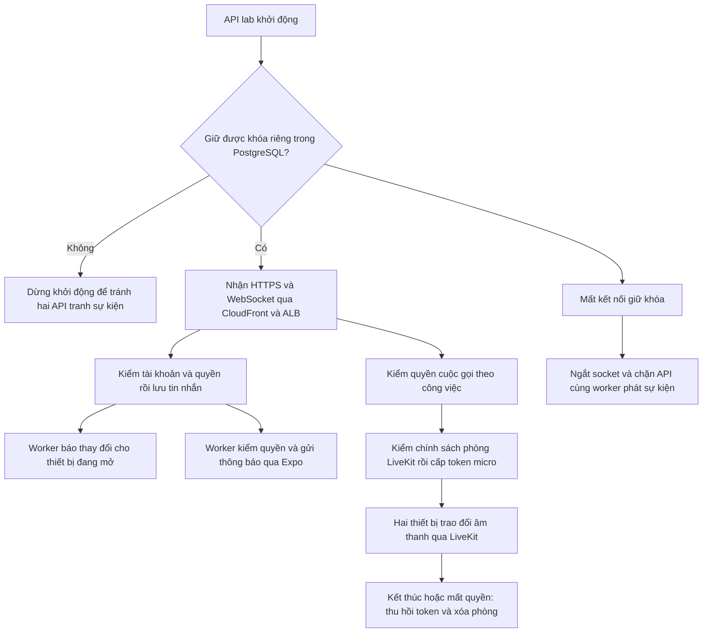

# B00-22 — Realtime, LiveKit cloud và push cho AWS-02

06/11/2026 · Code và kiểm thử local/mô phỏng · [Hướng dẫn cấu hình](../../../infra/aws/lab/README.md#31-realtime-livekit-cloud-và-push).

## 1. Người dùng sẽ làm được gì?

Khi máy chủ và các tài khoản provider đã cấu hình đúng, hai người đang mở app nhận cập nhật chat qua WebSocket (kết nối giữ mở để server báo ngay), gọi thoại theo quyền công việc qua LiveKit, và nhận thông báo qua Expo Push trên app native đã được cấp quyền. Giao diện chat/gọi/đăng ký push hiện có được dùng tiếp, không thêm màn hình mới ở đợt này.

Code đã nối chế độ cloud vào cấu hình và quy trình dựng/dọn. Bằng chứng hiện tại là API/WebSocket thật trên máy phát triển, PostgreSQL test và provider mô phỏng; chưa kết nối project LiveKit của chủ dự án, chưa nghe âm thanh cloud trên hai thiết bị, chưa gửi push thật hoặc deploy AWS. **Cấu hình provider là bước tiếp theo, không phải bằng chứng đã gọi được.**

## 2. Quyết định và giới hạn được giữ

Chủ dự án ngày 06/11 yêu cầu triển khai realtime, LiveKit cloud và push theo AWS-02. Dùng một API, chấp nhận gián đoạn ngắn khi thay task, chưa thêm Redis. Chỉ bật cloud mới trong `cloudfront-alb` + `LAB_REALTIME_SINGLETON=1`; pilot AWS-01 mặc định giữ tắt. OTP email theo B00-21, quyền thành viên/công việc, MFA và tài chính không thay đổi.

Cloud calls vẫn bắt buộc project **không tự tạo phòng khi người dùng cầm token vào một phòng chưa tồn tại**. `lab:media-check` kiểm bằng token probe không có quyền tạo phòng, yêu cầu phản hồi 404 với nội dung chính sách dự kiến. Không bỏ guard để làm kết nối xanh. Nếu project Cloud không cho cấu hình hoặc không qua probe, phần gọi bị chặn; cần kiểm với LiveKit hoặc duyệt phương án media khác. Không tự mua gói hay đổi sang self-host.

Token chỉ cho micro, hai người tối đa, không camera/data/screen share; phòng riêng theo account/lab/call. Khi kết thúc, thu hồi token của cả hai identity lưu trong DB (kể cả người đã rời/chưa vào), sau đó xóa phòng. Cloud adapter kiểm lại chính sách explicit rooms. Room không còn là kết quả cleanup thành công chỉ khi chính sách đã qua kiểm. Không tái sử dụng tên phòng của cuộc gọi cũ.

Push trong đợt này là **thông báo thường và chạm để mở app**, rồi kiểm quyền/trạng thái hiện tại. Không phải giao diện cuộc gọi hệ thống khi khóa màn hình. CallKit/PushKit, Android incoming-call UI và việc tiếp tục gọi khi app nền/terminated/force-stop chưa được triển khai/nghiệm thu đầy đủ; không đánh dấu các tiêu chí gọi nền trong plan đã xong. Không tự suy ra từ Expo Push.

Không thêm API nghiệp vụ/schema DB; chỉ mở chế độ vận hành đã duyệt. Không đồng bộ OpenAPI/Excel/Drive/`ui-ux`, không commit/push hoặc tạo tài nguyên.

## 3. Luồng xử lý

Tin nhắn và trạng thái gọi nằm trong DB. WebSocket chỉ báo thay đổi; app lấy dữ liệu qua HTTP nên reconnect có thể lấy bù. Khóa riêng là một PostgreSQL advisory lock giữ bằng kết nối chuyên biệt, không phải một dòng dữ liệu có thể quên xóa khi crash. Task cũ mất khóa không tự giành lại; readiness trả 503 để ECS thay task. Heartbeat khóa kiểm mỗi 500 ms và timeout 1 giây; đường phát sự kiện/cấp token/gửi push kiểm lại khóa. Khi mạng đang mất mà chưa phát hiện, phản hồi đang bay có thể đến trễ; HTTP và kiểm quyền sau reconnect vẫn là nguồn chuẩn, không hứa exactly-once.

## 4. Thứ tự đọc file, input/output

| File/hàm | Nhận → xử lý → kết quả |
|---|---|
| [environment.ts](../../../services/api/src/config/environment.ts) `config` | Biến môi trường → giới hạn cloud lab, URL/key/prefix → settings hoặc từ chối startup |
| [runtime-lease.ts](../../../services/api/src/database/runtime-lease.ts) `acquire`, `check`, `onLoss` | Kết nối DB → khóa theo database/schema → một chủ sở hữu hoặc lỗi; mất khóa đóng session và báo các thành phần |
| [bootstrap.ts](../../../services/api/src/bootstrap.ts) `createApp` | Settings → lấy khóa trước phục vụ → gắn gateway và chặn request khi không còn quyền giữ runtime |
| [realtime.gateway.ts](../../../services/api/src/modules/realtime/realtime.gateway.ts) `withAccess`, `publish` | Token và tài nguyên → kiểm ACL/khóa → event tối thiểu, không gửi nội dung chat riêng vào event |
| [realtime.worker.ts](../../../services/api/src/modules/realtime/realtime.worker.ts) `process` | Delivery DB → kiểm runtime và phát → trạng thái/retry; HTTP lấy bù nếu offline |
| [calls.service.ts](../../../services/api/src/modules/calls/calls.service.ts) `mediaToken`, `cleanup` | Call còn được phép → cấp token; call kết thúc → cleanup dùng cả caller/recipient từ DB |
| [livekit.adapter.ts](../../../services/api/src/integrations/livekit/livekit.adapter.ts) `token`, `close` | Tên call nội bộ → tên phòng riêng lab, probe policy, cấp micro token 30 giây → revoke có cutoff và delete room |
| [push.worker.ts](../../../services/api/src/modules/notifications/push.worker.ts) `allowed`, `api`, `process` | Delivery/device/phiên → kiểm quyền lại, key riêng server → ticket/receipt/retry; cuộc gọi dùng priority high và TTL không vượt thời gian reo còn lại, tối đa 30 giây |
| [lab-media.mjs](../../../scripts/aws/lab-media.mjs) `checkMedia`, `cleanMedia` | Project/key riêng → probe hoặc dọn đúng prefix → lỗi giữ lại tiến độ để retry |
| [lab.mjs](../../../scripts/aws/lab.mjs) | Config → preflight, inject secrets, bật app; khi down → dừng task, dọn media rồi dọn AWS |
| [app.config.js](../../../apps/mobile/app.config.js), [eas.json](../../../apps/mobile/eas.json) | Expo project UUID và profile lab → build app có realtime, nối đúng project push; giữ profile pilot |

## 5. Lỗi và khôi phục

- Hai task cùng khởi động: chỉ một task giữ khóa; task còn lại fail startup. ECS lab dùng minimum 0%, maximum 100%, desired tối đa 1. Ops task chỉ chạy lệnh DB, không khởi động API/gateway.
- Socket bị ngắt, session hết hạn hoặc mất quyền: giữ cơ chế đóng socket và lấy bù HTTP; không dùng kết nối cũ như bằng chứng quyền còn hiệu lực.
- Probe LiveKit sai policy, hết quota hoặc lỗi provider: không cấp token. Trong call đang kết thúc, lỗi cleanup giữ `cleanup_pending`; worker thử lại. Probe là điều kiện cấu hình, **không chứng minh audio/revocation trên cloud thật**.
- LiveKit refresh token tự động; Cloud hỗ trợ `revoke_token_ts`. Adapter chọn cutoff hiện tại +30 giây, trong khoảng API cho phép, để bao phủ token refresh gần thời điểm remove; lệch đồng hồ/provider từ chối thì giữ lỗi và retry. Explicit-room guard và xóa phòng là lớp ngăn token cũ tạo lại phòng. [Tài liệu quyền/token](https://docs.livekit.io/frontends/reference/tokens-grants/), [RemoveParticipant](https://docs.livekit.io/intro/basics/rooms-participants-tracks/participants/).
- Push không chứa token media/nội dung chat. Ticket chưa phải thiết bị nhận; receipt, token hết hạn, logout, đổi người dùng, tắt thông báo và cuộc gọi đã kết thúc vẫn được kiểm. Thông báo đã gửi không thể thu hồi chắc chắn; app kiểm trạng thái khi mở.
- `down`: phải có key media trước khi dừng tài nguyên. Dừng API/ops và chờ kết thúc trước khi xóa phòng thuộc đúng prefix. Provider lỗi giữ phase `cleaning-media` và intent `down`, không xóa state hoặc báo sạch. Sửa lỗi rồi chạy lại cùng lệnh. Project URL được ghi journal để không dọn nhầm project khi config bị đổi.
- API secret LiveKit và Expo access token đi vào Secrets Manager qua stdin, không nằm trong config/journal, tham số shell hoặc env build web. Expo project UUID là cấu hình công khai, không phải khóa bí mật.

## 6. Bằng chứng và phần còn thiếu

Kiểm riêng trên local ngày 06/11: cấu hình từ chối pilot/cloud sai mode; lease từ chối chủ thứ hai, mất DB session ngắt socket/chặn worker, task thay thế tiếp quản, timeout heartbeat không double-release; adapter cloud giữ probe, prefix, micro grants, remove hai identity trước delete và giữ lỗi để retry; cuộc gọi đã hết không phát push, TTL cuộc gọi được giới hạn; CLI mock kiểm secret injection, dọn sau API stop, lỗi provider và retry. Terraform mock kiểm single-task rollout và secret references.

Hành trình web hai tài khoản dùng runtime singleton, kiểm tin nhắn, badge và lấy bù khi mất mạng. Log thời gian hiện ở `test-results/web/report-screenshots/B05-02/latency.json`; đây là phép đo local từ nhập/bấm gửi đến hiển thị máy bên kia, không phải độ trễ AWS. Toàn bộ `SDD-PROJECT` chạy lại trước bàn giao; kết quả cuối trong `test-results/sdd/SDD-PROJECT/` và lời bàn giao. Giữ QA partial/unmapped, không đổi test cũ thành bằng chứng provider thật.

Chưa kiểm: project LiveKit live và việc tắt auto-create được tài khoản Build hỗ trợ; token cũ/refreshed/never-joined bị từ chối sau end ở provider thật; audio hai chiều khác mạng; CloudFront handshake thật; push qua FCM/APNs trên điện thoại thật; iOS/Android foreground/background/terminated; CallKit/PushKit; hai chu kỳ dựng/dọn live và Billing. Không thêm ảnh UI cũ rồi coi là bằng chứng mới: đợt này không sửa màn hình, chỉ code vận hành/transport/config.

## 7. Bước cấu hình và bài tự thử

Theo [README lab](../../../infra/aws/lab/README.md#31-realtime-livekit-cloud-và-push): chọn project LiveKit riêng, tắt auto-create nếu được hỗ trợ, nạp key; `lab:media-check` trước AWS. Cấu hình Expo project, enhanced push security và FCM/APNs; build native profile `lab`, cấp quyền mic/push khi app hỏi. Không đổi project ID mà giữ bộ credentials của project khác.

Sau deploy, dùng hai tài khoản email đã xác minh trên hai thiết bị: gửi tin qua lại, tắt/bật mạng rồi kiểm đủ tin; gọi/nhận/mute/end rồi thử token cũ trong kiểm thử kỹ thuật; đưa app nhận ra nền và chạm thông báo, thử chạm muộn sau khi cuộc gọi hết. Giữ native incoming-call UI chưa đạt cho đến khi có triển khai/bằng chứng riêng.

Câu tự kiểm: Vì sao `desired_count=1` chưa đủ? Vì deployment có thể chạy task cũ/mới cùng lúc. Vì sao TTL token ngắn chưa đủ? Vì LiveKit refresh token và người đang nối không tự bị ngắt chỉ do token cũ hết hạn. Vì sao AWS đã xóa chưa chắc dọn xong? Vì phòng LiveKit nằm ngoài AWS và phải được kiểm riêng.
