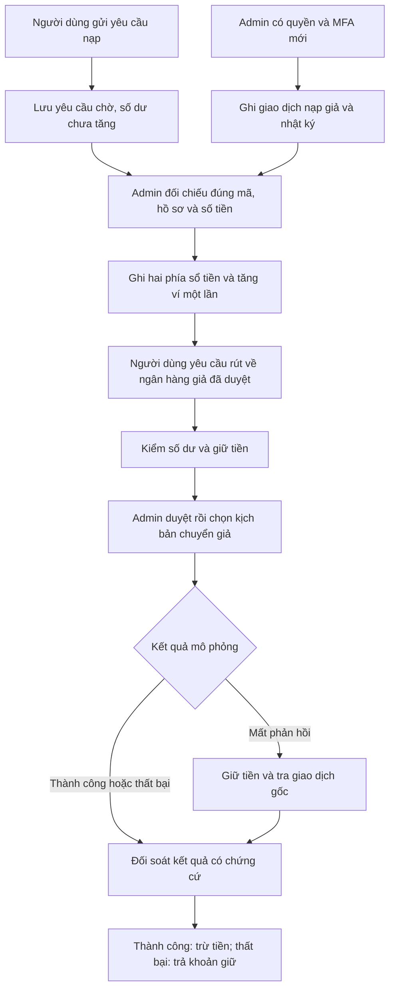
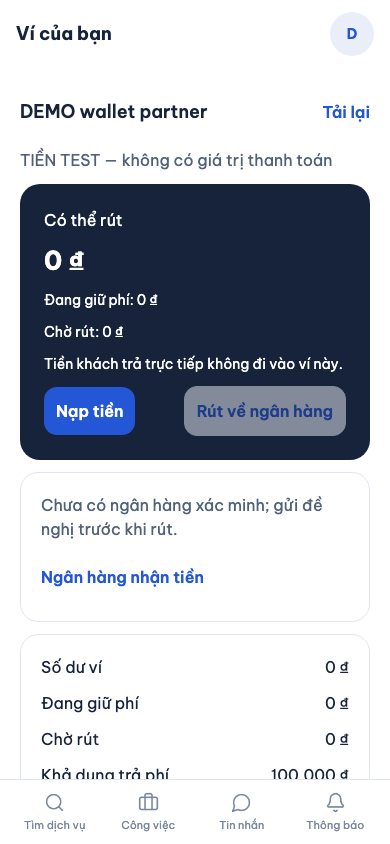
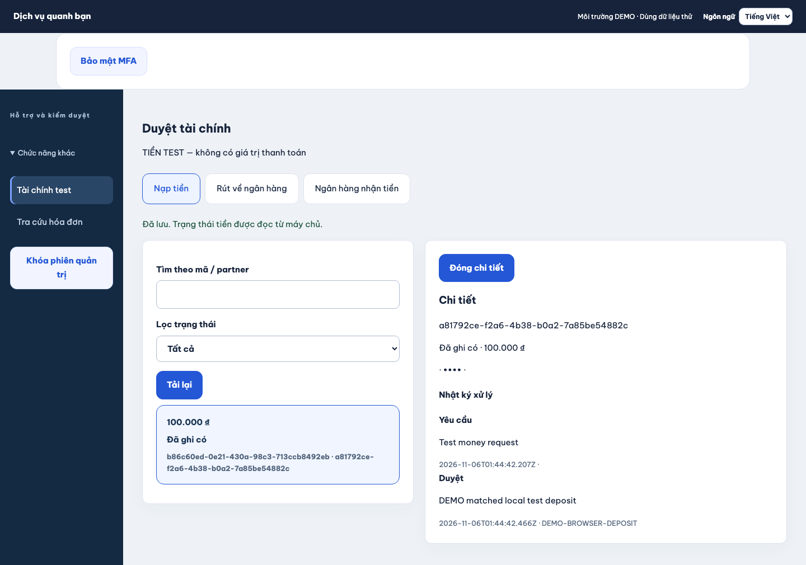
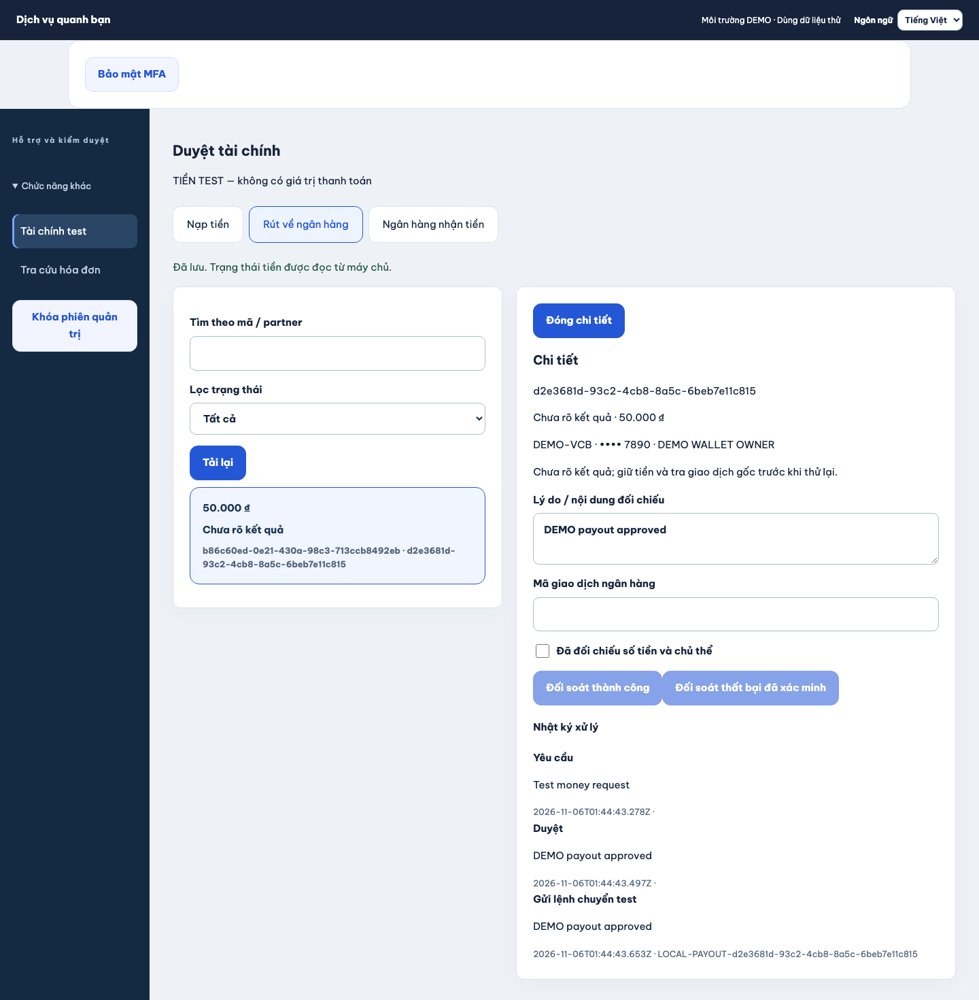
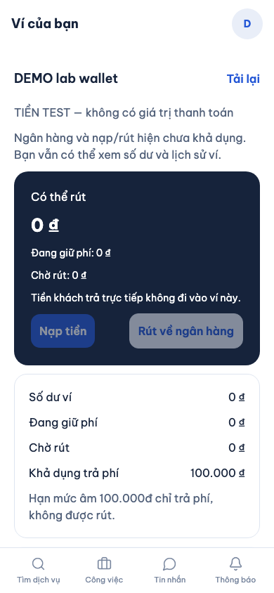

# B00-23 — Nạp/rút tiền test trên AWS-02 và tách lỗi màn Ví

06/11/2026 · Code và kiểm local/mô phỏng, chưa deploy AWS · [Hướng dẫn lab](../../../infra/aws/lab/README.md).

## 1. Người dùng thấy gì?

Trong lab đã bật tài chính test, chủ hồ sơ dịch vụ mở **Ví → Nạp tiền**, gửi yêu cầu; admin tạo giao dịch nạp giả khớp số tiền và hồ sơ rồi duyệt. Khi được duyệt, số dư tăng và có bút toán/lịch sử. Người dùng gửi thông tin ngân hàng giả để admin duyệt, sau đó có thể yêu cầu rút. Tiền được giữ lúc yêu cầu, chỉ trừ sau khi đối soát thành công. Không có khoản chuyển tới ngân hàng thật.

App và trang quản trị hiển thị **TIỀN TEST — không có giá trị thanh toán**, có bản dịch Việt/Anh/Nhật. Bộ mô phỏng dùng dữ liệu trong PostgreSQL của lab, không cần đăng ký ngân hàng hay dịch vụ tài chính bên ngoài. Giữ tên bảng `local_bank_*` để tương thích dữ liệu/test cũ; tên đó không còn có nghĩa bắt buộc máy chủ phải chạy trên laptop.

Nếu ngân hàng/nạp/rút tắt hoặc lỗi tạm thời, màn Ví vẫn hiển thị số dư và lịch sử bút toán đã đọc được. Nút nạp/rút/ngân hàng bị khóa; **Tải lại** sẽ mở lại khi đọc thành công. Nếu server từ chối quyền, dữ liệu ví riêng tư được xóa khỏi màn hình, không coi đây là lỗi tạm thời để giữ dữ liệu cũ.

## 2. Quyết định đã chốt và phạm vi

Chủ dự án ngày 06/11 chấp thuận đưa bộ mô phỏng nạp/rút lên AWS-02, không cần tiền/ngân hàng thật, hiển thị rõ tiền test, giữ quyền admin/MFA/nhật ký và tách tải Ví khỏi ngân hàng. Đây là thay đổi chế độ vận hành theo quyết định này; không đổi công thức phí/Point, hạn mức âm phục vụ phí, hạn mức rút tối thiểu, quyền nghiệp vụ hoặc hai dấu hoàn tất hóa đơn.

`finance_test: true` ở config riêng → Terraform lab `finance_test_enabled` → `LAB_FINANCE_TEST=1`. Server chỉ chấp nhận trong `CLOUD_PILOT=1` + `CLOUD_PROXY_MODE=cloudfront-alb` với `FINANCE_TEST_SECRET` riêng. Các kiểm production/TLS/allowlist/secret độc lập cũ vẫn chạy. AWS-01 không bật cờ này; `FINANCE_LOCAL_SECRET` vẫn chỉ dùng local. Không dựa vào biến public của app để cấp quyền tài chính.

Key tài chính được sinh một lần, lưu trong runtime secret của lab. Bootstrap/CLI giữ key đang có; key lỗi thì dừng, không tự xoay để làm mất khả năng đọc dữ liệu mã hóa hoặc kiểm grant. Tắt tài chính không xóa key; bật lại dùng key cũ. Chỉ root lab inject key vào API; task ops có cờ để khởi tạo key và thêm `finance.read`/`finance.review` cho admin đầu tiên. Bootstrap admin vẫn chỉ chạy một lần cho tài khoản đã xác minh. Admin có sẵn dùng quản lý quyền/MFA hiện hành, không tự cấp lại bằng SQL.

Không có API mới hoặc migration. Kết quả tạo giao dịch giả giữ các trường cũ, `environment` là `lab-test` trong lab, `local-test` ở local. Thêm audit `finance.simulator.deposit` gồm actor, hồ sơ, mã nguồn và số tiền test; retry cùng khóa không tạo audit/giao dịch thứ hai. Ghi nhận thay đổi tại báo cáo; không đồng bộ OpenAPI/Excel/Drive/`ui-ux` trong đợt này. Không commit/push, tạo AWS hay gọi provider thật.

## 3. Luồng nạp và rút

**Sổ tiền (ledger)** ghi hai phía đối ứng, tổng bằng không. **Khoản giữ (hold)** ngăn rút/chi cùng một số dư hai lần. **Khóa retry (Idempotency-Key)** nhận diện cùng một thao tác để mất mạng rồi gửi lại vẫn chỉ ghi tiền một lần. Các cơ chế này dùng chung với hóa đơn hiện có.

## 4. Thứ tự đọc file và input/output

| File/hàm | Nhận → xử lý → trả/lưu |
|---|---|
| [environment.ts](../../../services/api/src/config/environment.ts) `config` | Cờ lab và key → kiểm môi trường/key độc lập → `finance` có mode `lab-test`, hoặc từ chối startup |
| [lab-core.mjs](../../../scripts/aws/lab-core.mjs) `validateConfig`, `terraformVariables` | `finance_test` boolean → biến Terraform; không cho key bí mật vào config |
| [database.mjs](../../../scripts/aws/database.mjs) `withLabFinanceSecret`, `bootstrapPermissions` | Runtime secret → giữ/sinh key riêng; admin lab đầu tiên thêm quyền tài chính nhưng vẫn phải thiết lập MFA |
| [compute.tf](../../../infra/aws/lab/compute.tf) `runtime_keys`, `api_environment`, `ops_environment` | Cờ đã duyệt → key tham chiếu từ Secrets Manager, cờ server và ops; không inject key khi tắt |
| [lab.mjs](../../../scripts/aws/lab.mjs) | Runtime secret hiện có → giữ key, nạp qua stdin; loại mọi `FINANCE_*` khỏi môi trường build web |
| [FinanceScreen.tsx](../../../apps/mobile/src/features/finance/screens/FinanceScreen.tsx) `load` | Ví/lịch sử/quyền → cập nhật phần ví trước; ngân hàng/lịch sử yêu cầu lỗi tạm thì khóa thao tác, giữ ví; mất quyền thì xóa dữ liệu |
| [finance.service.ts](../../../services/api/src/modules/finance/finance.service.ts) `deposit`, `decision` | Admin/MFA + giao dịch giả → nguồn nạp/audit; duyệt mới ghi sổ; giao dịch gốc quyết định kết quả rút |
| [finance.service.ts](../../../services/api/src/modules/finance/finance.service.ts) `consume`, `create`, `post`, `endHold` | Grant mật khẩu một lần/quyền/số dư → giữ hoặc ghi tiền, không âm số tiền có thể rút |
| [messages.ts](../../../apps/mobile/src/features/finance/messages.ts), [finance-messages.ts](../../../apps/admin/src/finance-messages.ts) | Ngôn ngữ hiện tại → nhãn tiền test và thông báo dễ hiểu |

## 5. Dữ liệu, quyền và lỗi

Không seed số dư giả vào cloud. Người dùng bắt đầu từ ví trống và chỉ có số dư sau luồng admin ghi nguồn/duyệt nạp. Có thể dùng số dư này để thử phí và hóa đơn hiện hành; hạn mức âm 100.000đ vẫn chỉ phục vụ phí, không được rút. Ngân hàng giả gợi ý: mã `DEMO`, số `0000001234`, tên `DEMO TEST`; không nhập thông tin ngân hàng cá nhân thật.

Người đọc ví cần `wallet.read`; tạo nạp cần `wallet.topup`, rút cần `wallet.withdraw`, đổi ngân hàng cần `bank.manage`. Đổi ngân hàng/rút phải nhập lại mật khẩu để lấy grant một lần. Admin đọc cần `finance.read`, ghi nguồn/duyệt cần `finance.review` và MFA mới trong năm phút. Mất quyền chặn cả retry thao tác cũ.

Nạp chờ hoặc ảnh chứng từ không tự cộng tiền. Mã nguồn đã dùng, sai số tiền hoặc sai hồ sơ bị từ chối. Rút tối thiểu 50.000đ, không dùng hạn mức âm để rút. Lỗi giữa lúc ghi sổ rollback toàn bộ. Mất phản hồi chuyển giữ `unknown` và khoản giữ; admin phải đối soát giao dịch gốc, không gửi thêm lệnh. Từ chối trước chuyển hoặc đối soát thất bại giải phóng khoản giữ.

Dữ liệu giữ qua restart vì nằm trong RDS và key trong Secrets Manager. Khi `lab:down` xóa lab, lịch sử/số dư/key test cũng bị xóa theo vòng đời hiện có. Không dùng dữ liệu lab làm dữ liệu tiền thật hoặc nhập sang môi trường thanh toán thật.

## 6. Ảnh app đang chạy và kiểm thử

Ảnh ngày 06/11/2026: Expo web 390×844 và admin desktop trong trình duyệt Chromium, API/PostgreSQL test thật, dữ liệu DEMO. Không phải Android/iOS native, AWS live hoặc giao dịch ngân hàng thật. Đã xem lại nhãn tiền test, trạng thái và bố cục.

Kiểm có tên cụ thể trong SDD: cấu hình từ chối pilot/local/key thiếu hoặc dùng chung; key lab không đổi qua retry và không vào build web; API nguồn nạp/audit/MFA, nạp 200.000 và rút 50.000 còn 150.000, giữ tiền và đối soát một lần; component ví khi ngân hàng 503/403 và phục hồi; web nạp–duyệt–rút có mất phản hồi và ví khi ngân hàng lỗi. Terraform mock kiểm cờ/key trong lab; không gọi AWS. Các bài tài chính local cũ vẫn giữ để kiểm cạnh tranh, version, quyền, rollback và số nguyên lớn.

Trước sửa, đã thấy bài cấu hình lab và hai bài component thất bại đúng phần chức năng thiếu; sau sửa đã kiểm lại. Chạy toàn bộ `SDD-PROJECT` trước bàn giao; bằng chứng cuối ở `test-results/sdd/SDD-PROJECT/` và lời bàn giao, không dùng kết quả cũ. Chưa có kiểm deploy/RDS/Secrets Manager thật, native của đợt này hay UAT; QA giữ partial/unmapped.

## 7. Cấu hình và bài tự thử sau deploy

1. Config riêng của lab: `finance_test: true` (mẫu mới đã bật). Không điền key tài chính vào config, `.env` app hoặc chat. Script tự tạo/lưu key.
2. Sau dựng lab và xác minh tài khoản, chạy bootstrap admin theo README. Admin đầu tiên nhận quyền tài chính khi cờ bật, đăng nhập rồi thiết lập MFA. Admin đã có cần cấp quyền qua quy trình quản trị đang dùng.
3. Người dùng gửi ngân hàng DEMO, admin duyệt; gửi yêu cầu nạp 200.000. Admin ghi nguồn giả với đúng mã/hồ sơ/số tiền, rồi duyệt yêu cầu bằng mã đó. Kiểm ví tăng đúng một lần.
4. Rút 50.000: kiểm khoản giữ; admin chọn “Đã chuyển nhưng mất phản hồi”, kiểm `unknown`, rồi đối soát thành công. Ví còn 150.000, khoản giữ về 0. Thử lại cùng thao tác không trừ thêm.
5. Thử thiếu quyền/MFA cũ, mã nguồn trùng, rút quá tiền; thử lỗi đọc ngân hàng để thấy ví vẫn hiện và nút tiền bị khóa. Kiểm retry sau reload và restart trong môi trường lab thật.

Tự giải thích: vì sao ghi giao dịch giả chưa tăng ví? Vì sao không được xóa key khi tắt một tính năng? Vì sao giữ số dư khi lỗi mạng nhưng phải xóa khi mất quyền? Vì sao tiền bị giữ trong trạng thái “chưa rõ kết quả”?
