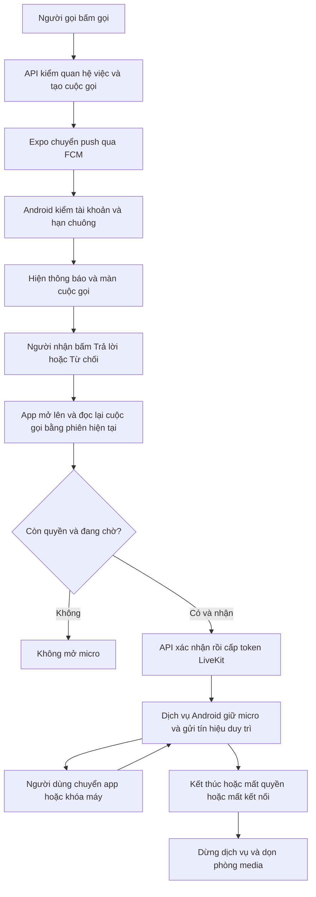
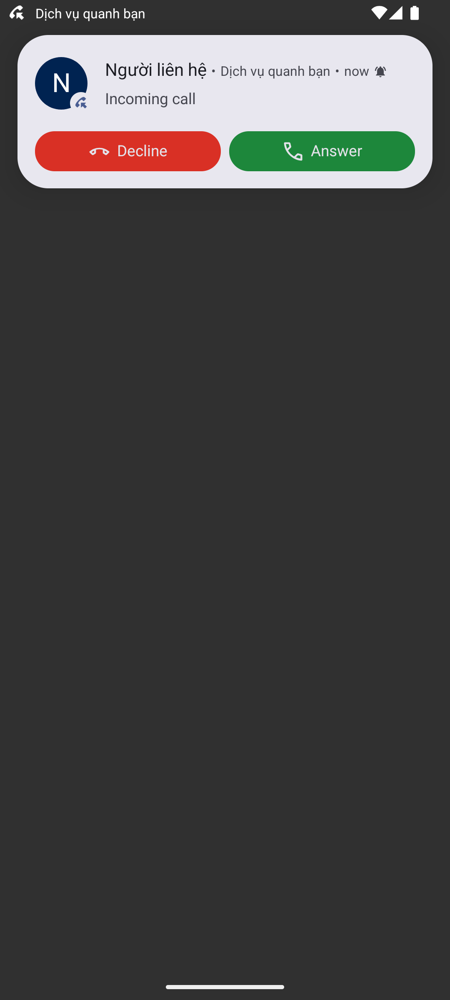
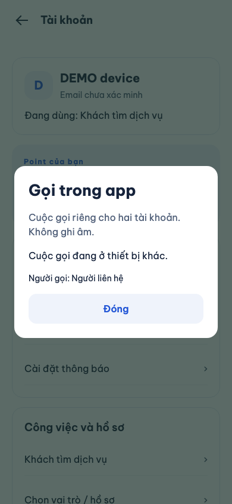

# B00-24 — Nhận cuộc gọi và duy trì gọi khi Android chạy nền

06/11/2026 · Android trước theo yêu cầu chủ dự án · Tiếp nối [B00-22](B00-22-realtime-livekit-push-lab.md).

## 1. Người dùng thấy gì?

Bản Android mới đăng ký nhận push sẽ có thông báo cuộc gọi riêng, nút **Trả lời / Từ chối**, chuông và màn cuộc gọi khi hệ điều hành cho phép hiển thị toàn màn hình. Nội dung khóa màn hình chỉ ghi “Người liên hệ”, không đưa tên, công việc hay nội dung chat ra ngoài. Khi đang nói chuyện, Android giữ thông báo **Đang gọi** với nút kết thúc; dịch vụ nền giữ CPU và micro trong thời gian cuộc gọi.

Nếu cuộc gọi đã được nhận bằng phiên trên máy khác, máy đang xem chỉ hiện **Cuộc gọi đang ở thiết bị khác**. Nó đọc trạng thái, không mở micro, không gửi heartbeat hoặc tự gửi fail/end. Nút Đóng chỉ đóng màn trên máy này. Đã tái hiện lỗi tự gửi fail trước sửa và kiểm lại bằng component/web; không thay quyền API kết thúc cuộc gọi hiện hành.

Hai nút nhận/từ chối đưa app lên trước để dùng phiên đăng nhập hiện hành, đọc lại trạng thái và thực hiện API. Có thể cần mở khóa máy. Đây chưa phải nhận/từ chối hoàn toàn ngay trên màn khóa mà không mở app. Cuộc gọi hết hạn, đã được nhận ở thiết bị khác hoặc sai tài khoản sẽ không mở micro. Khi mất mạng, hết phiên hoặc dịch vụ Android dừng, app/server ngắt thay vì giữ cuộc gọi vô hạn.

## 2. Quyết định đã chốt và phạm vi

Chủ dự án yêu cầu làm Android trước sau khi đã trao đổi duy trì cuộc gọi nền và thông báo cuộc gọi hệ thống. Giữ LiveKit và dùng đường **Expo Push → FCM** đã cấu hình, không thêm provider trả phí, máy chủ mới hoặc key FCM ở API. iOS/web và bản Android cũ tiếp tục luồng hiện hành. Chưa deploy AWS, gửi FCM/LiveKit thật, commit hoặc push trong đợt này.

Thêm migration `026_android_calls.sql` và thuộc tính tùy chọn `android_calls` của `POST /me/devices`. Chỉ bản Android có native module mới quảng bá khả năng này. Gửi lại đăng ký từ bản cũ tự đưa cờ về false. Đây là bổ sung triển khai được ghi tại báo cáo; chưa đồng bộ OpenAPI, Drive, Excel hoặc `ui-ux` theo quy tắc repo.

## 3. Luồng thao tác



“Tín hiệu duy trì” là request `/calls/:id/heartbeat`. Trước đây nó chỉ dựa vào bộ hẹn giờ JavaScript; nay dịch vụ Kotlin của Android cũng gửi mỗi 5 giây bằng access token hiện hành. App tiếp tục luân chuyển token bằng AuthSession, truyền token mới vào bộ nhớ native. Native không lưu token trên đĩa, không đưa vào Intent, thông báo hoặc log. Nếu JavaScript bị dừng quá lâu khiến token hết hạn, dịch vụ không tự lấy refresh token: nó dừng an toàn. Server giữ giới hạn 45 giây và kiểm quyền/phiên như trước, không nới điều kiện để che lỗi nền.

## 4. Thứ tự đọc code thật

| File/hàm | Nhận gì, làm gì và trả gì |
|---|---|
| [notifications.service.ts](../../../services/api/src/modules/notifications/notifications.service.ts) · `deviceInput`, `registerDevice` | Token Expo + nền tảng + cờ tùy chọn; kiểm kiểu/nền tảng, gắn thiết bị với người dùng và họ phiên. Không có route public mới. |
| [push.worker.ts](../../../services/api/src/modules/notifications/push.worker.ts) · `allowed`, `process` | Kiểm lại quyền, công tắc và hạn chuông; Android mới nhận data-only với call ID, recipient ID, thời hạn và TTL ≤30 giây. Bản cũ nhận thông báo thường. Không gửi token media. |
| [calls.service.ts](../../../services/api/src/modules/calls/calls.service.ts) · `changed` | Khi nhận/kết thúc, xếp tín hiệu dừng chuông cho thiết bị có khả năng native; không gửi thêm thông báo thường tới iPhone/bản cũ. |
| [CallRuntime.kt](../../../apps/mobile/plugins/android-calls/CallRuntime.kt) · `incoming`, `showIncoming`, `launch` | Nhận dữ liệu FCM do Expo chuyển; bỏ sai người, quá hạn và incoming đến sau dismiss. Đăng ký Telecom tự quản, hiện CallStyle. Hàng đợi nút chỉ ở bộ nhớ nội bộ; không đọc action từ launcher Intent công khai. |
| [CallActivity.kt](../../../apps/mobile/plugins/android-calls/CallActivity.kt) | Màn nhận cuộc gọi native riêng, tự đóng khi hết hạn, đổi người hoặc nhận dismiss; nút mở app để xác thực. |
| [CallsProvider.tsx](../../../apps/mobile/src/features/calls/CallsProvider.tsx) · `consume`, `execute` | Chỉ xử lý nút khi foreground và đúng owner; GET mới rồi action có version/idempotency. Lấy quyền micro trước accept; sau accept mới start dịch vụ và nối media. |
| [AndroidCallsModule.kt](../../../apps/mobile/plugins/android-calls/AndroidCallsModule.kt) | Cầu nối React Native ↔ Kotlin. Release chỉ dùng HTTPS; HTTP debug giới hạn localhost/emulator. Token chỉ ở RAM; endpoint lấy từ cấu hình app, không lấy từ push. |
| [CallAudioService.kt](../../../apps/mobile/plugins/android-calls/CallAudioService.kt) · `heartbeat`, `end`, `onDestroy` | Foreground service kiểu phoneCall/microphone, wake lock có hạn và gia hạn; heartbeat native. Thất bại liên tiếp >15 giây thì dừng; không tự restart sau bị hệ thống giết. Nút kết thúc dùng API hiện hành, server dọn nếu request cuối mất. |
| [with-android-calls.cjs](../../../apps/mobile/plugins/with-android-calls.cjs) | Tái tạo manifest/package/Kotlin qua Expo prebuild. Một FCM service kế thừa Expo, giữ push thường và cập nhật token. Activity/receiver/audio service không exported; ConnectionService chỉ hệ thống có quyền bind. |

## 5. Dữ liệu, quyền và lỗi

- Dữ liệu bền mới: `push_devices.android_calls`; điện thoại chỉ lưu ID chủ máy, locale và dấu dismiss gần nhất. Không tạo refresh token hoặc quyền media dài hạn.
- `call_push=false` chặn cuộc gọi incoming push; vẫn cho tín hiệu dừng chuông để dọn thông báo cũ. Không xóa lịch sử hoặc thay quyền gọi.
- Push chỉ là lời nhắc: không chứng nhận quyền nhận. App đọc lại API; recipient-only, version và idempotency hiện hành vẫn có hiệu lực. Không gọi ngân hàng hoặc SMS.
- Bản Android thiếu module vẫn hoạt động theo luồng cũ. Bản có module mà hệ điều hành từ chối dịch vụ sẽ kết thúc lần gọi thay vì âm thầm nối media không có bảo vệ nền.
- Notification channel có thể bị tắt, quyền full-screen có thể bị từ chối; khi đó không cam kết tự mở màn toàn màn hình. Buộc dừng app, tiết kiệm pin theo hãng và mạng mất vẫn là giới hạn của Android, cần nghiệm thu trên máy thật.
- Gạt app khỏi recent/task dừng dịch vụ; không hứa tiếp tục cuộc gọi sau hành động này. App trong nền bằng Home hoặc khóa màn hình là trường hợp khác.
- Thông báo đến trễ bị bỏ; dismiss xử lý cả thứ tự đảo trong cửa sổ chuông. Khi thiết bị offline không nhận dismiss, thông báo có timeout theo `ring_until`.

## 6. Kiểm chứng và ảnh

- API/PostgreSQL local: capability đúng kiểu/Android, cờ mặc định cho bản cũ, data-only không chứa bí mật, TTL, dismiss sau accept; giữ kiểm công tắc, hết hạn, logout và thu hồi quyền.
- Component: nhận/từ chối đọc phiên bản mới, không mở micro với thông báo sai người/hết hiệu lực; dịch vụ lỗi không nối media. Bridge iOS không khởi động phần Android.
- Plugin: chạy tạo project tạm hai lần, kiểm tính lặp lại, entry point riêng tư, FCM duy nhất, dependency/package và Kotlin sao chép đúng nguồn.
- Build debug Kotlin/APK và instrumentation Android được kiểm riêng ngoài SDD; lệnh tái hiện bên dưới. Instrumentation dùng payload DEMO và HTTP giả lập, không phải push FCM hoặc âm thanh thật.
- Đã build debug app/test APK; ca instrumentation trên API 36 đã qua các assertions: sai người/quá hạn, hiện và dismiss, incoming đảo thứ tự, heartbeat sau Home, kết thúc và tự dừng khi token hết hạn. HTTP mô phỏng quan sát 4 heartbeat hợp lệ, 1 lệnh end và 4 lần từ chối token. Đây không phải LiveKit hoặc FCM thật. Sơ đồ Mermaid đã render 14 nút.
- Hồi quy phát hiện bài ví 403 chưa chờ hết cập nhật React sau bấm Tải lại; đã dùng async `act` để chờ thao tác, giữ nguyên assertion xóa dữ liệu riêng tư. Không đổi code ví trong đợt này. Bài migration được cập nhật từ 25 lên 26 và kiểm cột capability boolean/not-null/default false, không bỏ kiểm migration cũ. Fixture native dùng Activity DEMO độc lập để phiên React Native đang có không ghi đè người dùng mô phỏng.
- Bộ SDD toàn repo phải chạy/verify sau khi chốt nguồn; xem `test-results/sdd/SDD-PROJECT/` và lời bàn giao cho kết quả cuối, không dùng lượt cũ thay bằng chứng.

Ảnh Android Emulator API 36 ngày 06/11/2026, màn native của app với dữ liệu DEMO. Không phải điện thoại vật lý, ảnh này không chứng minh khóa màn hình có PIN hoặc LiveKit hai chiều.



Ảnh Expo web 390×844, ngày 06/11/2026: đăng nhập/API/PostgreSQL fixture thật, phản hồi cuộc gọi được mô phỏng theo ràng buộc họ phiên của server. Không phải bằng chứng hai máy vật lý hoặc media LiveKit.



## 7. Cấu hình và thử sau deploy

1. Deploy API có migration 026; giữ cấu hình realtime/LiveKit/Expo của B00-22 và kiểm policy phòng LiveKit.
2. Build lại **Android development/release**, không dùng Expo Go hoặc bản APK cũ. Không chỉ OTA JavaScript vì có Kotlin/manifest mới.
3. Đăng nhập, vào thông báo bấm đăng ký push lại, cấp quyền thông báo và micro. Với Android 14+, kiểm quyền thông báo toàn màn hình trong cài đặt hệ thống của app; nếu không cấp, dùng thông báo có nút.
4. Hai tài khoản thuộc công việc hợp lệ: thử gọi/nhận/từ chối/kết thúc; người nhận ở app khác, màn hình khóa, app bị hệ thống dọn, và trường hợp buộc dừng riêng. Kiểm nhật ký/lịch sử đúng kết quả.
5. Nói hai chiều qua tai nghe/loa; bấm Home và khóa máy >60 giây; thử vượt hạn access token, đổi Wi-Fi/mobile data, logout/thu hồi quyền và tắt call_push. Cuộc gọi hết quyền phải dừng, không chỉ ẩn UI.
6. Một tài khoản trên hai máy: nhận một máy, máy kia hết chuông; thao tác từ thông báo cũ không giành phòng. Kiểm máy Android của ít nhất hai hãng trước khi công bố hỗ trợ ổn định.

Lệnh kiểm native local (cần emulator đã mở, SDK/JDK, bản debug không chứa dữ liệu thật):

```sh
cd apps/mobile
npx expo prebuild --platform android --no-install
cd android
./gradlew :app:assembleDebug :app:assembleDebugAndroidTest -PreactNativeArchitectures=arm64-v8a
cd ../../..
node scripts/test/android-calls.mjs
```

Script chỉ chấp nhận serial emulator, mở HTTP DEMO tại cổng 4317, cài APK debug/test rồi kiểm. Bằng chứng nằm ở `test-results/android-calls/`. Không dùng runner này trên máy thật đang có cuộc gọi. Lượt dùng UiAutomation trên emulator gặp lỗi kết nối công cụ; runner dùng adb chụp ảnh/bấm Home để tách lỗi công cụ khỏi app.

## 8. Giới hạn và bài học

Chưa nghiệm thu âm thanh LiveKit hai chiều khi khóa màn hình, FCM thật/cold-start, release/Play policy, thiết bị vật lý, AWS live hoặc UAT. iOS CallKit/PushKit vẫn chưa triển khai. Các bài mock không chứng minh người dùng thực sự nhận được push hoặc nghe được âm thanh.

Tự thử: vì sao thông báo không chứa token media? Vì người nhận phải được kiểm quyền lại. Vì sao native không giữ refresh token riêng? Vì tránh hai nơi tự xoay phiên và tăng rủi ro lộ phiên. Vì sao không tăng timeout 45 giây lên vô hạn? Vì mất app/quyền vẫn phải kết thúc cuộc gọi và dọn phòng.

Nguồn nền tảng: [Android Telecom](https://developer.android.com/develop/connectivity/telecom/dialer-app), [foreground service types](https://developer.android.com/develop/background-work/services/fgs/service-types), [Expo Push](https://docs.expo.dev/push-notifications/sending-notifications/). Đây là gọi qua Internet giữa người dùng app, không phải gọi số điện thoại/SIM.
