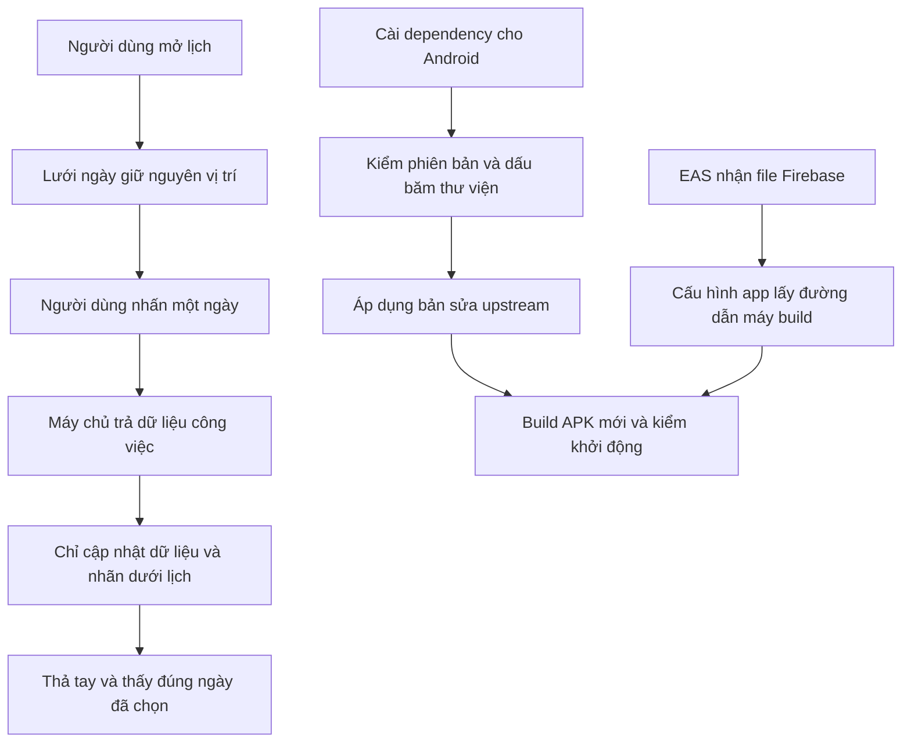
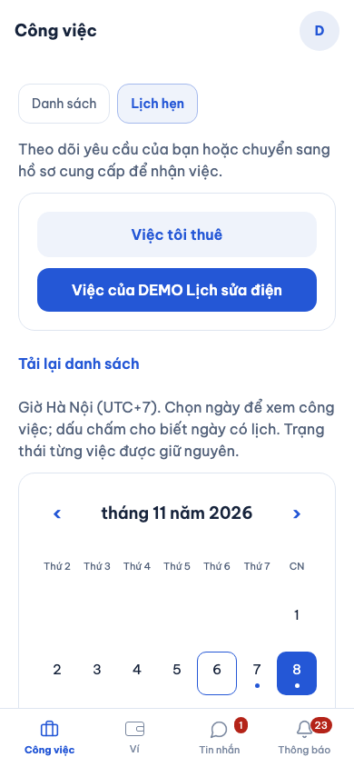

# B00-25 — Kiểm nguyên nhân và sửa lỗi trước deploy

06/11/2026 · Theo yêu cầu kiểm kỹ các điểm nghi lỗi rồi sửa lỗi thật · Code chưa commit/push trong đợt này.

## 1. Người dùng thấy gì?

- Trong **Công việc → Lịch hẹn**, nếu dữ liệu về đúng lúc đang bấm một ngày, ô ngày giữ nguyên vị trí và thao tác chọn vẫn có hiệu lực. Trước sửa, dòng “Đang tải…” phía trên biến mất làm cả lịch dịch lên; bài kiểm bấm ngày 8 nhưng màn hình vẫn ghi ngày 6.
- Khi build Android trên EAS, app đọc được file Firebase từ biến file `GOOGLE_SERVICES_JSON`. Trước sửa, app luôn dùng đường dẫn local, dù máy build đã được cấp file ở nơi khác. Môi trường `preview` cần được khai báo theo [runbook](../../../infra/aws/lab/README.md#build-android-trên-eas).
- Lỗi văng Android **NATIVE-05 đã tái hiện lại**, cùng dấu hiệu `MountingCoordinator::pullTransaction` như ngày 02/11. Đã áp dụng bản sửa upstream trong thư viện `react-native-screens`, giữ phiên bản 4.26.0 mà Expo SDK 57 đang yêu cầu. Phải build/cài APK mới; cập nhật JavaScript đơn thuần không thay mã native C++.

Đây là sửa cách triển khai, không thay quyền, nghiệp vụ, database hoặc nhà cung cấp. Không đồng bộ Drive, Excel hay `ui-ux`.

## 2. Vì sao các lỗi xảy ra và đã sửa thế nào?

### Chọn ngày lúc đang tải

Màn Công việc có một dòng báo tải phía trên lịch; chính `JobCalendar` đã có dòng báo tải bên dưới lưới ngày. Khi API trả dữ liệu, dòng phía trên bị gỡ, làm tọa độ ô ngày thay đổi giữa lúc nhấn và thả. Bản sửa chỉ giữ dòng phía trên cho chế độ **Danh sách**, còn lịch dùng dòng của nó. Không bỏ trạng thái tải, khóa chọn ngày hoặc tăng thời gian chờ test.

Bài kiểm giữ lại request thật rồi cho nó đi tiếp giữa `mouse.down()` và `mouse.up()`. Nó kiểm ngày hiển thị, vị trí ô ngày và cuộc hẹn từ trang thứ hai, cùng quyền khách/nhà cung cấp và đổi lịch như trước.

### File Firebase của EAS

EAS đưa file đã tải lên vào máy build và cung cấp **đường dẫn** qua biến môi trường. `app.config.js` nay đọc đường dẫn ấy; nếu không có biến thì giữ `./google-services.json` cho local. Cấu hình package Android, trường `extra` và project Expo vẫn được bảo toàn. File Firebase không thay credentials FCM v1 của project EAS.

### Văng app Android

Tìm lại stack cũ, rồi chạy APK debug hiện tại với Metro và API offline trên Android Emulator API 36. Hai lượt 3 và 5 trong 10 lượt mở bị SIGSEGV sau khoảng 4 giây; cùng BuildId React Native và vị trí `pullTransaction+520/+524`.

[PR upstream #4413](https://github.com/software-mansion/react-native-screens/pull/4413) giải thích hai luồng có thể cùng khởi tạo bộ nhận sự kiện đóng màn hình, khiến con trỏ tham chiếu tới vùng nhớ đã giải phóng. Bản sửa dùng khởi tạo dùng chung an toàn giữa các luồng, khóa khi thay callback và mã sở hữu để việc dọn phiên cũ không xóa callback của phiên mới.

Bốn file C++ được lấy nguyên từ commit `204d36b45f2a718c6f86e00cfc70765cbde06565`; hai file upstream ở `cpp/legacy/` được đặt vào `cpp/` theo cấu trúc 4.26.0. Script cài đặt kiểm phiên bản và dấu băm của **tất cả** file trước khi ghi; file lạ hoặc phiên bản mới sẽ dừng để review. Chạy lại không vá trùng. Bản cài chỉ API không có thư viện này thì bỏ qua; Docker đã chép đủ script/bản vá trước `npm ci`. Giấy phép MIT giữ cùng bản vá.

## 3. Luồng dễ hình dung



Sơ đồ đã parse và render local: 12 nút, kích thước khoảng 907 × 476.

## 4. Thứ tự đọc code và input/output

| File / hàm | Nhận gì → làm gì → trả gì |
|---|---|
| [JobsScreen.tsx — List](../../../apps/mobile/src/features/jobs/screens/JobsScreen.tsx) | Chế độ lịch, `busy`, `items` → chọn vị trí nhãn tải → lưới không nhảy khi hoàn tất request |
| [JobCalendar.tsx — JobCalendar](../../../apps/mobile/src/features/jobs/components/JobCalendar.tsx) | Danh sách việc, ngày chọn, `loading` → nhóm việc theo giờ Việt Nam → ngày và cuộc hẹn có quyền xem |
| [app.config.js](../../../apps/mobile/app.config.js) | Project UUID và đường dẫn Firebase nếu có → ghép cấu hình, kiểm UUID → cấu hình Expo; UUID sai thì dừng |
| [screens-patch.mjs — applyScreensPatch](../../../scripts/install/screens-patch.mjs) | Thư viện đã cài và manifest → kiểm phiên bản/dấu băm → vá bốn file hoặc báo lỗi rõ; không tải mạng |
| [README bản vá](../../../patches/react-native-screens-4.26.0/README.md) | Nguồn upstream, giấy phép và hướng dẫn gỡ bản vá khi nâng dependency |
| [calendar.spec.mjs](../../../tests/e2e/web/calendar.spec.mjs) | Dữ liệu DEMO qua API/DB thật → điều khiển thời điểm trả dữ liệu → kiểm thao tác chọn không bị mất |

Quyền và trạng thái công việc giữ ở API như trước; bản sửa lịch không thay dữ liệu được phép xem. Lỗi tải/retry vẫn dùng `JobFeedback`, dữ liệu mất quyền vẫn bị xóa. Script bản vá không tự chấp nhận source mới khi kiểm hash thất bại.

## 5. Bằng chứng kiểm thử

| Kiểm | Kết quả / giới hạn |
|---|---|
| Lịch trước sửa | Bài tái hiện thất bại: mong Chủ Nhật 8/11, thực tế Thứ Sáu 6/11 |
| Lịch sau sửa | Cùng bài kiểm đạt; giữ kiểm đủ trang, đổi lịch, hai phạm vi và thêm kiểm tọa độ ổn định |
| Cấu hình EAS | Bài kiểm trước sửa thất bại do bỏ qua file EAS; sau sửa đạt cả file-only, kết hợp UUID, fallback local và không đổi cấu hình gốc |
| Lab CLI/config | 29/29 đạt với provider giả lập; không tạo AWS/Cloudflare/LiveKit Cloud |
| Đóng gói bản vá | Kiểm archive npm theo integrity của lockfile; áp dụng lên bản 4.26.0 nguyên gốc rồi chạy lại đạt; test từ chối phiên bản/source lạ và API-only đạt |
| Android trước vá | 2/10 lượt cold-start debug bị SIGSEGV; giữ dữ liệu emulator, API offline |
| Android sau vá | 30/30 lượt debug cold-start còn process sau 8 giây, không có app crash trong buffer từ đầu lượt mới; [JSON trước/sau](bang-chung/B00-25-native.json). Không thay release/máy thật |
| Native call sau vá | Instrumentation đạt: thông báo/cuộc gọi đến, dismiss/reorder, heartbeat sau Home, kết thúc và chặn phiên hết hạn; 4 heartbeat, 1 end, 4 từ chối token. Push/HTTP giả lập, không FCM thật |
| LiveKit local thực | LiveKit 1.13.10 + SDK 2.23.0 truyền âm DEMO 440/880 Hz hai chiều; mute/unmute, end/logout ngắt cả hai và token gốc/refreshed đều bị chặn khi vào lại |
| Docker API | Build local thành công; postinstall không làm hỏng bản cài chỉ API. Chưa push image/AWS |
| SDD toàn repo | Kết quả cuối ở `test-results/sdd/SDD-PROJECT/evidence.json`; chỉ dùng khi `verify` khớp nguồn hiện tại. Giữ 177 tiêu chí và các QA partial/unmapped |

Ảnh Expo web 390×844 ngày 06/11/2026, dữ liệu DEMO/API/PostgreSQL thật sau bài kiểm lịch. Không phải ảnh thiết bị vật lý.



## 6. Giới hạn và cách tự thử

- LiveKit Cloud: chưa có project đã cấu hình để probe; **giữ** `lab:media-check`, chính sách không tự tạo lại phòng và thu hồi hai danh tính. Tài liệu [LiveKit về token](https://docs.livekit.io/frontends/reference/tokens-grants/) không thay kiểm trên project cụ thể. Không bỏ chốt để cho deploy qua.
- Âm thanh thử local là tín hiệu tạo trong trình duyệt, không phải tiếng người trên hai điện thoại. FCM thật, mic/loa khi khóa màn hình, EAS remote build và UAT vẫn cần kiểm sau cấu hình. Android nhận/từ chối vẫn mở app, có thể cần mở khóa; iOS CallKit/PushKit chưa làm.
- NATIVE-05: ghi kết quả sau vá theo APK mới; không suy ra mọi crash hoặc mọi thiết bị đã được xử lý từ một chuỗi chạy emulator.
- Chưa có CI trên commit mới, chưa push/deploy trong đợt này.

Tự thử: bật mạng chậm rồi chọn ngày trong lúc lịch đang tải. Vì sao không nên chỉ tăng timeout test? Vì thao tác đã bị mất thì chờ thêm không tự chọn lại ngày. Khi đổi phiên bản `react-native-screens`, vì sao script phải dừng? Vì bản vá đã được review cho đúng source 4.26.0, không được ghi đè tùy ý thư viện khác.

<details><summary>Lệnh kiểm để tra cứu</summary>

```sh
npm run sdd:check -- --change SDD-PROJECT --phase prepare
node --test scripts/test/aws-lab.test.mjs scripts/test/aws-lab-cli.test.mjs scripts/test/screens-patch.test.mjs
npm exec -- playwright test --config tests/e2e/web/playwright.config.mjs calendar.spec.mjs
node scripts/install/screens-patch.mjs
# Trong apps/mobile/android:
./gradlew :app:assembleDebug :app:assembleDebugAndroidTest -PreactNativeArchitectures=arm64-v8a
# Tại root, emulator riêng đã mở:
node scripts/test/android-calls.mjs
npm run sdd:run -- --change SDD-PROJECT
npm run sdd:check -- --change SDD-PROJECT --phase verify
```

Phép thử media tùy chọn chạy từ `services/api`, LiveKit local riêng dùng `auto_create:false`, key DEMO trong fixture: `LIVEKIT_TEST_URL=ws://127.0.0.1:7895 node --import tsx --test test/manual/calls-media.manual.ts`. Không trỏ bài này vào project cloud.

</details>


## 7. Bổ sung khi đưa code vào main — 10/11/2026

CI [42764634309](https://github.com/anhthaingd/dich-vu-quanh-ban/actions/runs/42764634309) tại `933036b` đạt 34/35 hành trình web; bài lịch thất bại khi mong ngày 12/11 nhưng vẫn chọn 10/11. Trace ghi chuột nhấn/thả tại `(195, 741)` trong viewport `390 × 844`; ảnh cùng thời điểm cho thấy vị trí đó bị thanh điều hướng cố định phía dưới che. File test và code lịch không đổi so với `d0116ca`. Chạy nguyên bài trên macOS đạt, nên không coi đây là lỗi luôn tái hiện ở mọi môi trường.

Nguyên nhân trong cách điều khiển test: `scrollIntoViewIfNeeded()` chỉ đưa phần tử vào vùng nhìn, không bảo đảm nó nhận được cú bấm khi có lớp khác đè lên. Chuỗi `mouse.down()`/`mouse.up()` dùng tọa độ thô nên không tự kiểm tra điều này. Bài kiểm nay dùng `target.click({trial: true})` để Playwright kiểm phần tử nhận được thao tác và cuộn khi cần, nhưng chưa bấm chọn ngày. Có thêm assertion ngày chọn không đổi trong bước trial, kể cả khi bài chạy qua đầu tháng. Sau đó vẫn giữ request API giữa nhấn/thả và giữ nguyên kiểm ngày, tọa độ không dịch, đủ trang, đổi lịch và hai phạm vi người dùng. Không dùng force, retry bài kiểm, tăng timeout hoặc bỏ assertion.

Đây chỉ là sửa test; không đổi code sản phẩm, quyền hoặc spec. [Tài liệu Playwright về trial click](https://playwright.dev/docs/api/class-locator#locator-click) mô tả việc kiểm khả năng thao tác mà không thực hiện cú bấm. Câu hỏi tự kiểm: vì sao một ô nhìn thấy trong viewport vẫn chưa chắc bấm được?

Kiểm riêng sau sửa đạt 3/3 lượt liên tiếp trên macOS; sau khi chỉnh assertion giữ nguyên ngày để hỗ trợ ranh giới tháng, kiểm lại bài lịch. Lint và SDD prepare đạt. CI toàn bộ phải được đối chiếu theo commit cuối; kết quả remote ở trang Actions, không suy từ kiểm riêng local.
