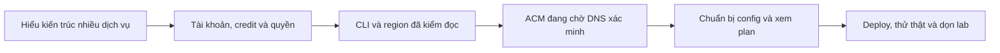

# B00-26 Bộ tài liệu học cấu hình và deploy AWS

09/11/2026 · AWS-02 · Yêu cầu trực tiếp: ghi lại hướng dẫn đã đi qua, mục đích và lý do cấu hình để đọc lại sau deploy.

## Kết quả và phạm vi

Chủ dự án có thể mở [bộ tài liệu học deploy](../hoc-deploy-aws02/README.md), đọc theo sáu phần và tra checklist hiện tại. Bộ tài liệu nối thao tác Console/terminal với vai trò dịch vụ, giải thích input/output và chỉ ra lúc bắt đầu tạo tài nguyên hoặc xóa dữ liệu.

Đợt này chỉ biên soạn trong repo và đăng ký inventory tài liệu. Không đổi code ứng dụng, Terraform, contract nghiệp vụ, Excel, Drive hay `ui-ux`. Không gọi AWS/Cloudflare để tạo, sửa hoặc xóa tài nguyên. Không commit/push.

## Theo hành trình người học

Phần 01 nối sơ đồ kiến trúc với file Terraform. Phần 03 giải thích câu lệnh và giới hạn bằng chứng. Phần 04 hướng dẫn tiếp từ chứng chỉ Pending hiện tại. Phần 05 giải thích dữ liệu config/key và trình tự runner; phần 06 có bảng đọc file/hàm thật, lỗi/retry, dữ liệu/state và câu hỏi tự kiểm hiểu.

## Nguồn và mức bằng chứng

- Hội thoại/ảnh của chủ dự án: credit 200 USD tại mốc ảnh, activation thành công, SCP được cung cấp, kết quả đọc VPC Singapore, chứng chỉ Pending đúng account/us-east-1.
- Code/runbook hiện tại: [lab README](../../../infra/aws/lab/README.md), [runner](../../../scripts/aws/lab.mjs), [core](../../../scripts/aws/lab-core.mjs), [Terraform](../../../infra/aws/lab/versions.tf).
- Tài liệu AWS/Cloudflare chính thức được liên kết cạnh hướng dẫn có phụ thuộc chính sách sản phẩm; đối chiếu ngày 09/11/2026.
- Chưa xác nhận CNAME/Issued, chưa deploy project, chưa nghiệm thu provider/native/UAT. Không biến hướng dẫn bước sau thành kết quả đã làm.

## Kiểm tra tài liệu

Đối chiếu lệnh với runner, đường dẫn tương đối với file thật, sơ đồ Mermaid với trình render và phân loại file mới trong inventory SDD. Không thay hash nguồn/spec để làm xanh.

- SDD prepare trước sửa: đạt, 177 tiêu chí; QA vẫn 103 partial và 12 unmapped.
- Kiểm tám file mới: 54 liên kết nội bộ mở tới file tồn tại, code fence cân bằng, không thấy mẫu access key/private key/Resend key thật; inventory thêm đúng tám mục `documentation`, không xóa mục cũ.
- Bốn sơ đồ Mermaid parse và render thành công trong Chromium; đã xem ảnh render tạm để kiểm chữ/luồng. Lượt đầu bị sandbox chặn trình duyệt; lượt render ngoài sandbox đạt. Chỉ giữ Mermaid trong Markdown, không thêm file ảnh/sơ đồ xuất vào repo.
- `git diff --check`: đạt ở lượt kiểm biên soạn.
- `npm run sdd:run -- --change SDD-PROJECT`: prepare, lint, typecheck, tooling, mobile, mobile-coverage, api, api-coverage và build qua trong lượt chạy; dừng ở web. Chromium bị `bootstrap_check_in ... Permission denied (1100)` trước khi chạy hành trình, không phải bằng chứng lỗi nghiệp vụ của ứng dụng.
- SDD toàn bộ **chưa đạt verify**: runner dừng trước load/prototype/storybook và không tạo evidence hoàn tất. Log tại `test-results/sdd/SDD-PROJECT/web.log` trên máy, không track Git. Phần văn bản kết quả được ghi sau lượt chạy; cần SDD mới khớp nguồn cuối trong môi trường cho phép Chromium trước deploy. Không sử dụng kết quả các bước đã qua làm chứng nhận toàn repo.

Các bước kiểm tài liệu không gọi AWS/Cloudflare và không chứng nhận môi trường cloud. CI remote/native/UAT không được chạy trong đợt biên soạn.

## Bước tiếp theo của người học

Hoàn tất [CNAME xác minh ACM](../hoc-deploy-aws02/04-domain-https.md), ghi trạng thái Issued rồi mới chuyển sang chuẩn bị provider/config. Bộ tài liệu là bản hướng dẫn và trạng thái đến 09/11, không tự đảm bảo snapshot account sẽ giữ nguyên về sau.
