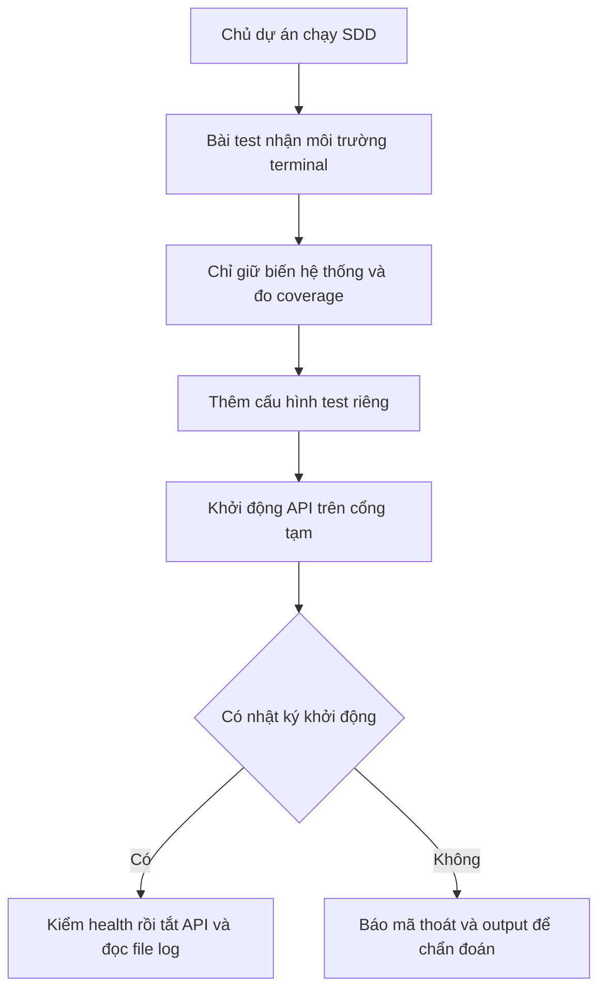

# B00-27 — Sửa môi trường khởi động API khi chạy SDD

10/11/2026 · Thay đổi kiểm thử theo LOGTEST-01, không đổi nghiệp vụ hoặc cấu hình deploy. [Checklist](../01-checklist.md) · [Mục lục](../README.md).

## 1. Kết quả và nguyên nhân

Khi chạy SDD trong terminal đã export khóa LiveKit để học deploy, bài kiểm khởi động API có thể thất bại dù cùng code chạy riêng ở terminal khác lại đạt. Đã tái hiện bằng hai khóa giả: `LIVEKIT_API_KEY` và `LIVEKIT_API_SECRET`. Test cũ chuyển toàn bộ biến môi trường của terminal sang tiến trình API. API thấy khóa, thử đọc `LIVEKIT_URL` không tồn tại và dừng với `TypeError` tại `environment.ts:74` trước khi ghi `app.started`.

Kết quả gốc có 204 test đạt và 1 lỗi tại `lifecycle.test.ts:21`. Log cũ không giữ môi trường terminal nên không thể chứng minh chắc chắn nguyên nhân lịch sử; phép tái hiện chứng minh lỗi kế thừa cấu hình có thật và tạo cùng triệu chứng. Thông báo assertion cũ trống vì chỉ lấy `stderr`, trong khi lỗi khởi động nằm ở `stdout`.

Đã sửa helper chạy API/CLI của bài test: chỉ kế thừa biến hệ thống cần thiết và `NODE_V8_COVERAGE` để tiếp tục đo code được chạy; mọi cấu hình ứng dụng phải đến từ dữ liệu test. Không cần xóa khóa deploy của người dùng. Khi API không khởi động, assertion đưa mã thoát, signal và hai luồng output vào báo cáo JUnit.

## 2. Luồng chạy dễ hiểu

Biến môi trường là cấu hình terminal truyền cho chương trình con. Fixture là dữ liệu/cấu hình riêng của bài test. `stdout` là luồng xuất thông thường; API ghi nhật ký JSON đã lọc bí mật vào đó. `stderr` là luồng lỗi riêng, có thể rỗng dù chương trình thất bại.



## 3. Thứ tự đọc code

| Bước | File và hàm | Nhận gì, làm gì, trả gì? |
|---|---|---|
| 1 | [run.mjs — projectRecipes](../../../scripts/sdd/run.mjs) | Chọn bộ API có coverage và ghi kết quả JSON/JUnit; dừng SDD nếu tiến trình test thất bại. |
| 2 | [lifecycle.test.ts — child](../../../services/api/test/integration/lifecycle.test.ts) | Nhận cấu hình fixture và môi trường cha, lọc môi trường rồi mở tiến trình API/CLI; giữ output và trạng thái đóng. |
| 3 | [lifecycle.test.ts — checkLifecycle](../../../services/api/test/integration/lifecycle.test.ts) | Cấp cổng tạm, đợi `app.started`, gọi health, gửi SIGTERM rồi kiểm log được lưu và quyền file. |
| 4 | [environment.ts — config](../../../services/api/src/config/environment.ts) | Kiểm cấu hình API. Các khóa LiveKit sẽ mở nhánh kiểm URL/secret; đây là hành vi sản phẩm giữ nguyên. |
| 5 | [main.ts — khởi động và close](../../../services/api/src/main.ts) | Tạo API, ghi sự kiện khởi động/tắt; lỗi khởi động ghi JSON đã lọc qua AppLog và trả mã lỗi. |

## 4. Dữ liệu, quyền và xử lý lỗi

Chỉ dùng khóa giả trong hồi quy. Health fixture trỏ vào địa chỉ DB không hoạt động và không cần truy vấn DB. CLI migration/seed dùng `dvqb_test` với schema riêng, dọn trong `finally`. File log thành công được kiểm quyền `0600` và dọn sau test. Không dùng DB làm việc, gọi LiveKit/AWS, đổi quyền người dùng hay trạng thái nghiệp vụ. Không tăng timeout, thêm retry hoặc hạ ngưỡng coverage.

Ca hồi quy mới chạy cả trường hợp hai khóa LiveKit và trường hợp cấu hình cloud/local/host/auth từ môi trường cha. Nó vẫn kiểm health, shutdown, log JSON, không lộ canary và file log như ca chính; không chỉ kiểm một danh sách biến.

## 5. Tự thử và tự kiểm hiểu

Từ `services/api`, chạy lệnh bên dưới. Trước bản sửa, test khởi động thất bại; sau bản sửa, cả 5 bài lifecycle đạt:

```sh
LIVEKIT_API_KEY=fixture-key LIVEKIT_API_SECRET=fixture-secret node --import tsx --test test/integration/lifecycle.test.ts
```

- Vì sao chạy riêng có thể đạt? Terminal khác có thể không có các biến deploy đã export.
- Vì sao không sửa API để bỏ qua khóa sai? API phải tiếp tục kiểm cấu hình thật; bài test cần tự kiểm soát cấu hình của mình.
- Vì sao giữ `NODE_V8_COVERAGE`? Nếu bỏ, việc đo coverage có thể mất phần code chạy trong tiến trình con.

## 6. Kiểm chứng và giới hạn

Đã quan sát test cũ lỗi với hai khóa giả, sau đó thêm ca hồi quy và thấy lỗi trước sửa. Output chẩn đoán ghi `exit=1`, `app.start_failed`, frame `74:27` trong cấu hình. Sau sửa, chạy đủ 5 bài lifecycle với hai khóa giả, `CI=1`, `NODE_ENV=test` và c8: đạt 5/5. Coverage thu được từ tiến trình con: `main.ts` 28/29 dòng, `logging/output.ts` 20/20 dòng.

Kết quả toàn dự án được lưu tại [thư mục SDD](../../../test-results/sdd/SDD-PROJECT/) và chỉ được chứng nhận khi `sdd:check --phase verify` đạt trên cùng nguồn. Đọc `api.json`, `api-coverage.log`, `web.json` và `evidence.json` của lượt hiện hành; không dùng số test lịch sử để thay kết quả mới. Artifact bị Git ignore, có thể bị thay ở lượt chạy sau.

```sh
npm run sdd:run -- --change SDD-PROJECT
npm run sdd:check -- --change SDD-PROJECT --phase verify
```

Phạm vi kiểm là local/test. Chưa commit/push, chưa CI remote, native, UAT hoặc deploy provider. Không đổi UI nên không có màn hình mới cần chụp. Spec LOGTEST-01 yêu cầu test độc lập và log không chứa bí mật vẫn giữ nguyên; không đồng bộ Drive/Excel/ui-ux. Inventory chỉ bổ sung báo cáo này, giữ nguyên tiêu chí và phạm vi SDD.

Nguồn hiện hành: [thiết kế log/test](../../specs/2026-09-28-logging-testing-design.md) và [hướng dẫn SDD](../sdd/README.md).
