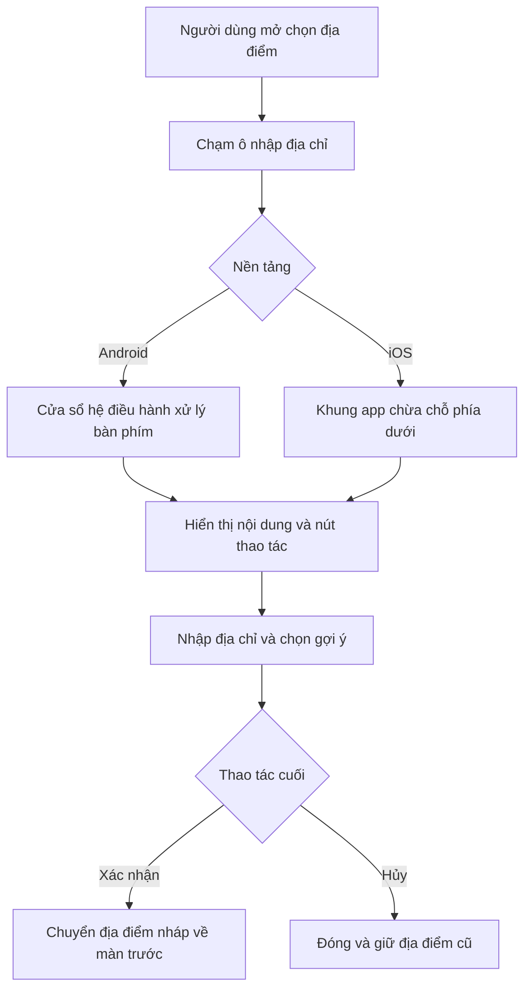
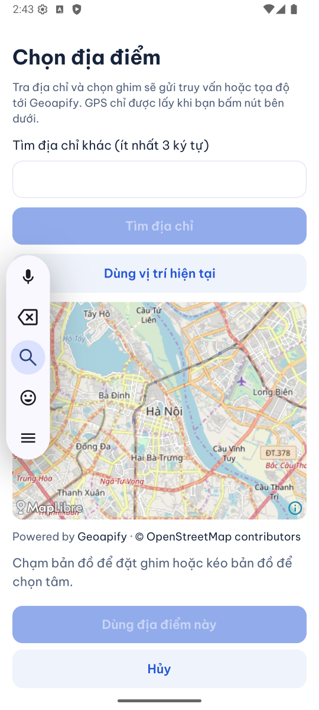
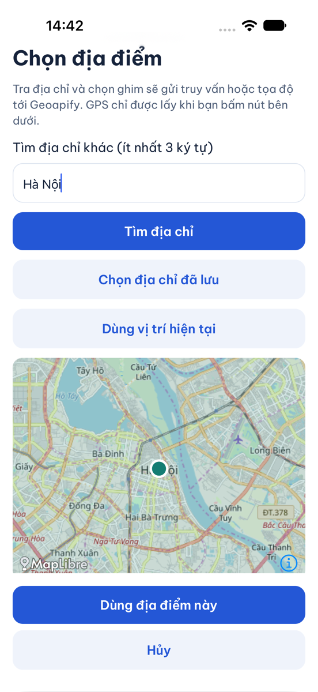

# B00-28 — Sửa nhấp nháy khi chọn địa điểm trên Android

10/11/2026 · Sửa cách bố trí màn hình theo MAP-01, không đổi nghiệp vụ. [Checklist](../01-checklist.md) · [Mục lục](../README.md).

## 1. Người dùng thấy gì?

Khi mở **Khu vực tìm kiếm** rồi chạm ô nhập địa chỉ trên Android, hai nút **Dùng địa điểm này / Hủy** có thể nhảy lên xuống dù không gõ. Đã xem clip chủ dự án gửi và tái hiện trên DVQB_API_36. Bản sửa giữ hai nút ổn định trong tình huống bàn phím nổi đó; tìm gợi ý và hủy vẫn hoạt động. iOS vẫn chọn và xác nhận Hà Nội về màn tìm dịch vụ được.

Nguyên nhân nằm ở hai lớp cùng điều chỉnh chiều cao: cửa sổ Android của `Modal` đã dùng `adjustResize`, còn `KeyboardAvoidingView` lại đặt chiều cao trong JavaScript mỗi khi bàn phím báo hiện/ẩn. Với thanh nhập nổi, điều chỉnh thứ hai làm chân màn hình dao động. Bản sửa dùng `enabled={Platform.OS !== 'android'}` để Android chỉ giao việc này cho cửa sổ native. Hành vi iOS và web giữ nguyên.

## 2. Theo một thao tác

`Modal` là màn nổi phủ lên màn tìm kiếm. `KeyboardAvoidingView` là khung React Native chừa chỗ cho bàn phím. `LocationDraft` giữ địa điểm nháp, chưa chuyển cho màn trước cho tới khi xác nhận.



## 3. Thứ tự đọc code

| File và hàm | Nhận gì, làm gì, trả gì? |
|---|---|
| [LocationField.tsx — LocationField](../../../apps/mobile/src/features/location/components/LocationField.tsx) | Nhận tọa độ/địa chỉ hiện tại, mở picker, chỉ gọi `onChange` khi xác nhận. |
| [LocationField.tsx — LocationPicker](../../../apps/mobile/src/features/location/components/LocationField.tsx) | Dựng khung theo nền tảng, hiển thị ô nhập, bản đồ và hai nút. Android không tự trừ chiều cao bàn phím thêm trong JavaScript. |
| [location-draft.ts — LocationDraft](../../../apps/mobile/src/features/location/state/location-draft.ts) | Nhận truy vấn/gợi ý/ghim, giữ bản nháp và trạng thái tải/lỗi. Sửa truy vấn làm lựa chọn cũ mất hiệu lực. |
| [LocationField.test.tsx — keyboardFixture](../../../apps/mobile/src/features/location/components/LocationField.test.tsx) | Phát sự kiện bàn phím và thay kích thước cửa sổ cho khung thật của React Native; kiểm Android không áp chiều cao cố định, iOS vẫn thêm/bỏ khoảng trống. |

Không sửa API, dữ liệu, quyền hay cơ chế định vị. Chỉ thử địa danh công khai Hà Nội; không lấy GPS cá nhân. Nếu tra địa chỉ lỗi, người dùng vẫn có thể thử lại hoặc chọn ghim như contract hiện hành. Việc rời picker vẫn hủy yêu cầu nháp; không thêm retry hoặc gọi mạng từ thay đổi bàn phím.

## 4. Ảnh app chạy thật

Ngày 10/11/2026, môi trường local/demo. Đây là máy ảo, chưa phải điện thoại thật. Ảnh tĩnh minh họa trạng thái; kết luận ổn định dựa thêm vào các lần đo liên tiếp.

Android emulator DVQB_API_36 / Android 16, ô nhập đang được chọn và thanh nhập nổi đang mở:



iPhone 18 Pro simulator / iOS 27.0, đã chọn gợi ý Hà Nội và có thể xác nhận:



## 5. Tự thử và kiểm hiểu

1. Mở Tìm dịch vụ → Khu vực tìm kiếm → chạm ô nhập. Để yên vài giây: hai nút dưới không nhảy liên tục.
2. Gõ `Hanoi`, chọn gợi ý Hà Nội. Nút xác nhận được bật; bấm Hủy thì khu vực trước đó giữ nguyên.
3. Mở lại, chọn gợi ý rồi xác nhận. Địa danh trở về màn tìm dịch vụ.

Vì sao không tắt bàn phím? Lỗi nằm ở khung bị co thêm, người dùng vẫn cần nhập địa chỉ. Vì sao không sửa bản đồ? Trong phép tái hiện, bản đồ giữ vị trí trong khi chân màn hình nhảy. Vì sao vẫn kiểm iOS? Hai nền tảng dùng chung component nhưng xử lý bàn phím khác nhau.

## 6. Bằng chứng và giới hạn

- Trước sửa trên Android: tọa độ dọc của nút xác nhận đổi giữa 1859 và 2048 px; nút Hủy giữa 2006 và 2195 px. Ô nhập và khung bản đồ ổn định. Chênh lệch 189 px tương ứng 72 đơn vị bố trí trên emulator này.
- Ca hồi quy Android đã đỏ trước sửa: khung tự áp chiều cao 828 khi cửa sổ giả lập cao 900 và bàn phím cao 72. Sau sửa, 10/10 test của picker và trạng thái nháp đạt, gồm hai test bàn phím mới; typecheck mobile đạt.
- Sau tải lại app và kiểm bản sửa cuối: 6 mẫu liên tiếp khi ô nhập có focus cho cùng tọa độ xác nhận 2048 và Hủy 2195 px. Đã thử thanh nhập nổi, mở bàn phím chữ nổi, gợi ý Hà Nội và Hủy trên Android. iOS nhập/gợi ý/chọn/xác nhận thành công, màn trước hiện Hà Nội.
- iOS simulator đang dùng nhập từ bàn phím máy tính; chưa chứng minh trực tiếp mọi kiểu bàn phím mềm iOS. Chuyển hiện/ẩn iOS được kiểm bằng test khung thật. Chưa kiểm bàn phím dock Android, xoay màn hình, trọn bốn nơi gọi picker hoặc thiết bị thật trong đợt này.
- Theo yêu cầu tiếp của chủ dự án, đã dừng lượt SDD đang chạy ở bước tooling để chủ dự án tự chạy. Prepare, lint và typecheck đã qua; chưa có kết quả full/verify cho bản sửa này. Đã dọn khóa của lượt dừng để lần chạy tiếp không bị chặn.
- SDD toàn dự án dùng bằng chứng mới tại [test-results/sdd/SDD-PROJECT](../../../test-results/sdd/SDD-PROJECT/). Chỉ coi lượt chạy đạt khi `sdd:check --phase verify` đạt trên cùng nguồn. Artifact bị Git ignore và có thể được thay ở lượt sau. Giữ 177 tiêu chí, QA partial/unmapped và ngưỡng coverage.

```sh
npm run test -w apps/mobile -- --runTestsByPath src/features/location/components/LocationField.test.tsx src/features/location/state/location-draft.test.ts
npm run sdd:run -- --change SDD-PROJECT
npm run sdd:check -- --change SDD-PROJECT --phase verify
```

Chưa commit/push, CI remote hoặc UAT. Không đổi spec, không đồng bộ Drive/Excel/ui-ux. Nguồn hiện hành: [MAP-01](../de-xuat/MAP-01-ban-do-mien-phi.md), [báo cáo bộ chọn địa điểm](B03-01-chon-dia-diem-va-ban-do.md), [SDD](../sdd/README.md).
