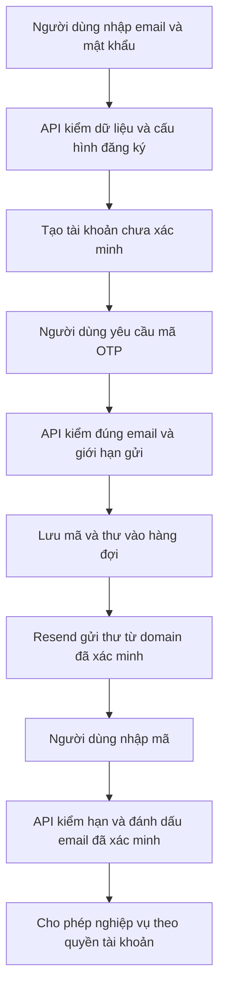

# B00-29 — Mở đăng ký và gửi OTP cho email ngoài pilot

11/11/2026 · AWS-02 · [Checklist](../01-checklist.md) · [Mục lục](../README.md).

## Người dùng thấy gì?

Trước đây, email ngoài danh sách người thử bị từ chối ngay khi đăng ký và cũng bị chặn ở hàng đợi gửi thư. Vì vậy thông báo chung trên app không giúp nhận ra đây là giới hạn của lab. Bản sửa thêm lựa chọn mở đăng ký cho mọi email hợp lệ; người dùng vẫn phải nhận và nhập OTP để sử dụng các chức năng cần xác minh. Không tự đánh dấu email đã xác minh.

Chủ dự án đã chốt mở phạm vi này ngày 11/11/2026. Đây là quyết định mới thay giới hạn người nhận của lab trong B00-21 khi cờ được bật. Spec gốc/Drive/ui-ux chưa đồng bộ và không thuộc lần sửa này. Không sửa cách trình bày thông báo lỗi chung trong đợt này.

## Một lần đăng ký đi qua những đâu?

`OTP` là mã dùng một lần. `Hàng đợi` giữ yêu cầu gửi để máy chủ thử lại khi nhà cung cấp thư tạm lỗi. `Resend` là dịch vụ gửi thư, khác với phần app quyết định email nào được đăng ký.

Sơ đồ mô tả nhánh thành công, không khẳng định đã thử inbox thật. Email hợp lệ không có nghĩa hộp thư tồn tại hoặc thư chắc chắn vào Inbox.

## Đọc code theo thứ tự

| File / hàm | Nhận gì, làm gì và vì sao |
|---|---|
| [lab-core.mjs](../../../scripts/aws/lab-core.mjs), `validateConfig`, `terraformVariables` | Đọc `public_email_registration` dạng boolean, chỉ chấp nhận mở với Resend rồi chuyển sang biến Terraform. |
| [variables.tf](../../../infra/aws/lab/variables.tf), [compute.tf](../../../infra/aws/lab/compute.tf) | Mặc định đóng. Chuyển cờ thành `PUBLIC_EMAIL_REGISTRATION=1` trong container API trên ECS. |
| [environment.ts](../../../services/api/src/config/environment.ts), `config` | Chỉ mở trong cloud lab dùng Resend và xác minh email. Bỏ bộ lọc đăng ký theo pilot, bật `allowAnyEmail` cho hàng đợi. |
| [auth.service.ts](../../../services/api/src/modules/auth/auth.service.ts), `register` | Kiểm dữ liệu, lưu tài khoản và phiên; vẫn chưa xác minh email. |
| [challenges.service.ts](../../../services/api/src/modules/auth/challenges.service.ts), `request`, `verify` | Kiểm liên hệ thuộc tài khoản, quota, hạn dùng, số lần nhập sai và dùng mã một lần. |
| [local-messages.ts](../../../services/api/src/integrations/local-messages.ts), `requireContact`, `queue` | Khi mở email, chấp nhận địa chỉ email hợp lệ ngoài danh sách. Số điện thoại vẫn cần danh sách riêng. |
| [cloud.ts](../../../services/api/src/integrations/cloud.ts), `resendTransport` | Dùng khóa server gửi thư; lỗi provider vẫn đi qua retry hiện có. |

## Dữ liệu và quyền

Không đổi schema hoặc chạy migration cho thay đổi này. Tài khoản, trạng thái xác minh và hàng đợi nằm trong PostgreSQL. Mật khẩu, khóa Resend và mã OTP không được ghi vào báo cáo. Danh sách `pilot_emails` vẫn giữ trong config để lệnh `lab:admin` giới hạn người được cấp admin. Tài khoản mới không tự có grant quản trị; MFA quản trị vẫn bắt buộc.

Mặc định `false` giữ hành vi cũ. Chỉ bật `true` cho lab đã được duyệt; không thay mặc định môi trường khác. Cờ không bật SMS hoặc cho phép gửi thư tùy ý qua một API công khai. Các luồng thư mời/khôi phục vẫn phải qua điều kiện nghiệp vụ và kiểm quyền hiện có.

## Lỗi và thử lại

- Gửi OTP liên tiếp: chờ cooldown 60 giây; quota theo tài khoản, liên hệ và IP vẫn áp dụng.
- Mã hết hạn, nhập sai quá số lần hoặc dùng lại: yêu cầu mã mới theo giới hạn hiện có.
- Resend lỗi/quá quota: hàng đợi retry như trước. Mở danh sách người nhận không tăng quota của gói Resend.
- Chưa thấy thư: kiểm Spam và trạng thái gửi của Resend; HTTP thành công không chứng minh thư đã vào Inbox.

## Bằng chứng và giới hạn

Đã kiểm riêng trên máy phát triển trước phát hành: unit cloud 12/12; tooling AWS lab 30/30; luồng tích hợp với PostgreSQL test đạt, nhận email ngoài danh sách rỗng, giữ trạng thái chưa xác minh, cooldown, mã dùng một lần, chặn SMS, chặn nghiệp vụ khi mất xác minh. Luồng tích hợp kiểm bảng admin không tự có grant. Kiểm tích hợp đọc OTP từ hàng đợi test, không gửi thư ra ngoài.

Toàn SDD dùng `test-results/sdd/SDD-PROJECT/evidence.json` và `npm run sdd:check -- --change SDD-PROJECT --phase verify`; chỉ kết quả khớp nguồn hiện hành có giá trị. Giữ nguyên các QA partial/unmapped. Không có bằng chứng CI remote mới cho code chưa commit.

Khi chạy toàn bộ, kiểm thử `runtime-lease.test.ts` lộ điểm chạy đua: lệnh `drain()` có thể dùng lại lượt đang chạy đã kiểm lease trước khi kết nối bị cắt. Kiểm thử nay dừng lịch nền và chờ lượt đó kết thúc trước khi tạo lỗi; vẫn bắt buộc lượt mới sau mất lease bị từ chối. Không đổi worker sản phẩm hoặc bỏ kiểm quyền.

Kết quả phát hành trong receipt local `.local/aws-lab/learn/public-email-release.json`: phải có image digest, task definition kỳ vọng, deployment ECS hoàn tất và readiness. Không coi việc tạo file kế hoạch/đổi config là thành công trên AWS. Đây là cập nhật API lab hiện có, không dựng lại DB, không chạy lại full `lab:up`, không đổi web/DNS/khóa. Receipt không nằm trong Git và không thay bằng chứng nhận thư thật.

Chưa nghiệm thu inbox thật cho email mới, chưa kiểm native trong đợt này, chưa commit/push. Giao diện không đổi nên không có ảnh màn hình mới. Mermaid phải được render kiểm trước bàn giao.

## Tự thử sau khi API cập nhật

1. Mở app, đăng ký email khác email chủ lab mà bạn kiểm soát.
2. Yêu cầu OTP, kiểm Inbox/Spam và xác minh bằng mã mới.
3. Đăng xuất/đăng nhập lại; kiểm tài khoản thường dùng được nghiệp vụ và không có quyền admin.

Tự kiểm hiểu: Vì sao mở email chưa đồng nghĩa email đã xác minh? Vì sao vẫn giữ `pilot_emails`? Nếu Resend hết quota thì cờ mở đăng ký có giúp gửi thư không? Đối chiếu các mục dữ liệu/quyền và lỗi phía trên.
