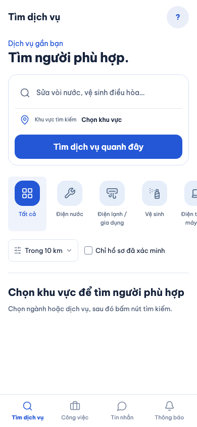
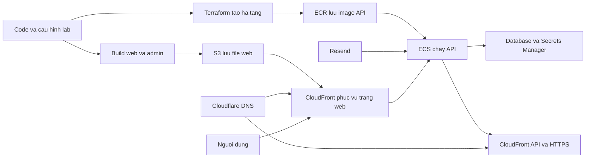

# B00-30 — Tổng kết hành trình deploy AWS-02

11/11/2026 · AWS-02 · [Checklist](../01-checklist.md) · [Mục lục](../README.md) · [Bộ hướng dẫn học deploy](../hoc-deploy-aws02/README.md) · [B00-29: mở đăng ký email lab](B00-29-mo-dang-ky-email-lab.md).

## Trạng thái hiện tại

Project cá nhân đã được dựng trên AWS và mở được qua tên miền riêng. API đang chạy task revision **7** với image digest `sha256:ca9fba5aaf43791d8def0c902a2dda45b94937e58721360f23f25e25c71629ff`. Bằng chứng phát hành nằm trong receipt cục bộ `.local/aws-lab/learn/public-email-release.json`; file đó và thông tin xác thực không đưa vào Git.

Bạn đã kiểm tra `https://api.iimissher.com/v1/ready` và nhận HTTP 200 cùng `{"status":"ready"}`. Runner cũng ghi nhận HTTPS cho admin, API readiness và categories; web/admin đã được tải lên S3/CloudFront. API lab hiện bật đăng ký email ngoài pilot, nhưng **chưa có nghiệm thu bằng hộp thư thật**. Trước đây màn app từng báo không tải được danh mục và lỗi đăng ký chung. Lần kiểm lại tối 11/11 trên revision 7 (mục 5 bên dưới) thấy trang chủ web tải đủ danh mục; lỗi đăng ký chưa được thử lại vì cần hộp thư thật của bạn. Không coi mã đã deploy là bằng chứng mọi hành trình người dùng đã đạt.

## Những việc đã làm

### 1. Tài khoản và học AWS

- Tạo account AWS cá nhân, bật MFA và dùng AWS CLI profile `dvqb-learn` đăng nhập bằng role. `aws sts get-caller-identity` từng xác nhận đúng account/role.
- Hoàn thành các hoạt động Explore AWS để nhận credits. Billing từng hiển thị **$200 credits available**. Trong luồng tạo project đã chọn giới hạn chi tiêu **$20**; đây là mức giới hạn project được chọn trong console, không phải khẳng định mọi khoản phí AWS đều bị chặn tuyệt đối.
- Kích hoạt advanced features và chọn region Singapore (`ap-southeast-1`) cho lab. Region khác được dùng riêng khi AWS yêu cầu, ví dụ ACM cho CloudFront ở `us-east-1`.
- Tạo tài nguyên học EC2, Lambda và budget/chi phí trong các hoạt động onboarding. Những activity này là bài học/credit onboarding, tách biệt với hạ tầng ứng dụng AWS-02.

### 2. Domain, HTTPS và dịch vụ ngoài

- Cấu hình DNS `iimissher.com` qua Cloudflare; thêm CNAME xác minh ACM. Chứng chỉ cho `app`, `api`, `admin` chuyển sang **Issued**.
- Resend đã xác minh subdomain gửi thư riêng `lab-mail.iimissher.com`; DKIM và SPF hiển thị Verified. Dùng subdomain riêng để tách cấu hình ứng dụng lab khỏi domain Resend hiện có của ứng dụng khác.
- Tạo Resend API key dùng phía server; giá trị chỉ lưu trong `.local/aws-lab-input/deploy.env`/config cục bộ, không ghi vào báo cáo.
- Tạo project LiveKit Cloud và cấu hình Expo project/access token cho phần tích hợp. Việc tạo project/credential không chứng minh cuộc gọi hay push chạy thành công trên thiết bị thật.

### 3. Dựng và phát hành ứng dụng

- Chuẩn bị Terraform lab riêng, state và cấu hình cục bộ; xem [runbook AWS lab](../../../infra/aws/lab/README.md). Kế hoạch ban đầu dự kiến 78 tài nguyên tạo mới; con số trong plan không có nghĩa 78 tài nguyên đều được tạo nguyên trạng.
- Chạy apply và các bước phục hồi phát hành sau sự cố. Ban đầu API chưa đạt deployment mong đợi; sau đó runner `resume-publish.mjs` đưa web/admin lên và kiểm tra HTTPS.
- Tạo các lớp hạ tầng chính: VPC/subnet/security group, ECR, ECS, database được quản lý, Secrets Manager, CloudFront, S3 cho web/admin/assets, DNS và log. Chi tiết ID tài nguyên có thể đọc từ Terraform output hiện tại; không chép danh sách nhạy cảm/có thể đổi vào đây.
- Endpoint hiện dùng: `https://app.iimissher.com`, `https://admin.iimissher.com`, `https://api.iimissher.com`. API readiness/categories từng trả thành công trong bước kiểm tra phát hành.
- Khởi tạo quyền admin cho email đã cấu hình pilot. Sau đó MFA ứng dụng vẫn phải được thiết lập riêng; bạn đã thêm mục DVQB vào Authenticator và báo đã vào được bước tiếp theo. Không lưu OTP, recovery code hay mật khẩu ở tài liệu.

### 4. Mở đăng ký email ngoài pilot

- B00-29 thêm cờ `PUBLIC_EMAIL_REGISTRATION` cho lab. Cờ được bật trên API revision 7, còn mặc định ở các môi trường khác không tự mở.
- Người dùng mới vẫn phải nhận và xác minh OTP. Quota/cooldown, xác minh email, giới hạn SMS, quyền admin và MFA quản trị vẫn giữ nguyên. `pilot_emails` vẫn dùng cho cấp quyền quản trị.
- Kiểm thử local và SDD được ghi trong [B00-29](B00-29-mo-dang-ky-email-lab.md). Hàng đợi test không gửi thư ra Internet; inbox thật còn phải do bạn xác nhận.

### 5. Kiểm lại sau phát hành, tối 11/11/2026

Phần này do Claude kiểm từ máy phát triển, chỉ **đọc** trạng thái: không đăng ký tài khoản, không gửi thư và không sửa tài nguyên AWS.

- **Danh mục trên app:** mở `https://app.iimissher.com` bằng Chromium headless (khổ điện thoại 390×844). Trang gọi 11 request `GET /v1/categories`, đều trả **200**, không có lỗi console; thanh ngành hiện Điện nước, Điện lạnh, Vệ sinh… Lỗi "không tải được danh mục" **không tái hiện** trên bản hiện tại. Nguyên nhân lần lỗi trước chưa được xác định chắc chắn; khả năng cao là app được mở trong lúc API chưa lên revision ổn định, nhưng đây chỉ là suy đoán, không có log cùng thời điểm để chứng minh.
- **CORS** (quy tắc trình duyệt cho phép trang `app` gọi sang tên miền `api`): request và preflight `OPTIONS /v1/auth/register` từ origin `https://app.iimissher.com` đều được cho phép. Các header mà bundle web thực sự gửi (`Authorization`, `Content-Type`, `X-Client-Request-Id`, `Idempotency-Key`) đều nằm trong danh sách API chấp nhận. Bundle web đã deploy gọi đúng `https://api.iimissher.com/v1`.
- **ECS:** service `dvqb-lab-learn-api` chạy 1/1 task, task definition revision **7**, rollout `COMPLETED`.
- **Tài nguyên tính phí đang chạy:** RDS `db.t4g.micro` 20 GB, không Multi-AZ; 1 Application Load Balancer; **không** có NAT Gateway; **không** có EC2 nào đang chạy ở Singapore (máy EC2 từ bài onboarding không còn chạy).
- **Budget (đọc qua AWS Budgets, không tốn phí gọi):** `dvqb-learning-monthly` ghi chi phí thực **$0.446** trên giới hạn $20; `dvqb-lab-learn` ghi **$0.00**/$20. AWS cập nhật Billing trễ tới khoảng 24 giờ, và budget lọc theo tag thường chưa thấy phí ngay, nên đây **chưa phải** số chốt. Không gọi Cost Explorer vì mỗi request tính $0.01.

*Ảnh: web live `app.iimissher.com`, Chromium headless trên macOS, khổ 390×844, 11/11/2026. Trang công khai, chưa đăng nhập, không có dữ liệu cá nhân. Không phải thiết bị thật.*

## Luồng deploy nhìn từ trên xuống

Sơ đồ cho biết vai trò chính, không vẽ mọi dịch vụ/phụ thuộc. Terraform mô tả trạng thái mong muốn; lệnh `plan` chỉ xem thay đổi, `apply` mới gọi AWS để tạo/sửa tài nguyên. Build container, khởi tạo dữ liệu và đăng file web là các bước phát hành bổ sung của lab runner.

## Việc còn dang dở và thứ tự tiếp theo

1. **Kiểm đăng ký bằng một email khác ngoài pilot mà bạn kiểm soát.** Mở app, đăng ký, yêu cầu OTP, xác minh từ hộp thư. Kiểm cả Spam và trạng thái gửi trong Resend. Không gửi mã OTP hoặc API key cho tôi.
2. **Thử đăng nhập lại và luồng người dùng thường.** Xác nhận email đã được đánh dấu verified và tài khoản mới không có quyền admin. Danh mục trên web đã kiểm lại ở mục 5 khi chưa đăng nhập; vẫn nên nhìn lại sau khi đăng nhập. Thử vào admin bằng tài khoản quản trị đã bật MFA riêng.
3. **Nếu vẫn lỗi, lấy bằng chứng cụ thể.** Trong trình duyệt mở Developer Tools → Network, ghi endpoint, HTTP status, response message và `X-Request-Id`; tra cùng thời điểm trong CloudWatch log group `/ecs/dvqb-lab-learn`. Che email cá nhân/token trước khi chia sẻ. Nếu không nhận OTP, kiểm Resend Events/Suppressions/Quota và Spam trước khi sửa DNS.
4. **Đối chiếu chi phí và tài nguyên đang chạy.** Đã đọc ECS, RDS, NAT, ALB, EC2 và Budgets tối 11/11 (mục 5). Còn lại: xem lại Billing/credits sau khoảng 24 giờ để có số đã cập nhật, và kiểm credits đã trừ đúng vào phí. Credits làm giảm số dư phải trả theo điều khoản của chúng, nhưng không phải ngân sách được cấp lại mỗi tháng. Khi nghỉ học lâu, dùng quy trình `lab:down` đã ghi trong runbook và kiểm tài nguyên còn sót/Billing sau đó.
5. **Chưa làm trong đợt này:** nghiệm thu thật trên Android/iOS; gọi thoại/realtime/push; full UAT nghiệp vụ; kiểm chu kỳ dựng/dọn và phí sau khi AWS cập nhật Billing. Không coi bài test local hoặc API health là đã đạt các mục này.

## Bằng chứng và giới hạn

| Hạng mục | Trạng thái tại 11/11/2026 |
|---|---|
| Terraform/apply và tài nguyên AWS | Đã chạy; API task revision 7; state đã đối chiếu theo receipt local |
| HTTPS API readiness | Người dùng chạy `curl`, HTTP 200 |
| HTTPS app/admin và API categories | Runner ghi nhận OK trong lần publish gần nhất. Tối 11/11: web live gọi 11 request categories đều 200, CORS từ `app` đạt, có ảnh ở mục 5 |
| Mở đăng ký email ngoài pilot | Đã cấu hình và phát hành; inbox thật/UAT đang chờ |
| Test riêng cho thay đổi B00-29 | Đạt theo báo cáo B00-29; không đồng nghĩa toàn bộ web/app đã UAT |
| SDD toàn repo, lần 1 (phiên lập tài liệu) | Web E2E dừng với 35 test lỗi khởi động Chromium do macOS từ chối `bootstrap_check_in` (`Permission denied (1100)`). Đây là lỗi môi trường chạy trình duyệt của phiên đó, không phải lỗi app. |
| SDD toàn repo, lần 2 (tối 11/11) | **Đạt cả 12 bước**, Chromium khởi động bình thường: lint, typecheck, tooling 92/92, mobile 411/411, coverage mobile (core 100% dòng, app 89,8% dòng), API 207/207 có PostGIS, coverage API (core 100% dòng, app 95,9% dòng), build, **web E2E 35/35** (9,2 phút), kiểm tải danh mục (p95 khoảng 36 ms), prototype, Storybook. |
| SDD verify | `sdd:check --phase verify` **ĐẠT** trên HEAD `63c65b9` cộng thay đổi chưa commit, dấu băm `b0bd309a…`. Sau đó báo cáo này, checklist, inventory và ảnh mục 5 được sửa. Vì SDD băm cả `docs/`, bằng chứng local **không còn khớp** cây hiện tại; không tự làm mới hash. Bằng chứng hợp lệ cho bản cuối phải là check `SDD project` trên CI của commit mới. |
| CI remote, commit/push của thay đổi B00-29 | Chưa có bằng chứng commit/CI mới; thay đổi hiện tại chưa commit/push |
| Credits/Billing sau vận hành và dọn | Đọc Budgets tối 11/11: $0.446 và $0.00 trên giới hạn $20 mỗi budget. Billing có thể trễ khoảng 24 giờ; chưa đối chiếu credits và chưa chạy chu kỳ dọn |
| Thiết bị thật, email/push/cuộc gọi | Chưa nghiệm thu đầy đủ |

SDD chỉ kiểm code trên máy phát triển, không thay đổi hay xác nhận trạng thái AWS. Lần 1 lỗi Chromium được giải quyết bằng cách chạy lại trong môi trường cho phép trình duyệt khởi động; không sửa app hay bài test nào để có kết quả xanh.

## Bảo vệ thông tin

Tài liệu này không chứa Resend/Cloudflare/LiveKit/Expo token, mật khẩu, OTP, khóa MFA hoặc Terraform state. Các giá trị bí mật nằm trong `.local/`, thư mục bị Git bỏ qua. Không paste chúng vào chat, commit hay ảnh chụp màn hình. Khi API key bị lộ, thu hồi key cũ rồi tạo key mới.

## Tự kiểm hiểu

- Vì sao trạng thái API `ready` không đồng nghĩa người dùng đã đăng ký và xác minh email thành công?
- Resend dùng subdomain riêng có lợi gì khi domain gốc đã được ứng dụng khác sử dụng?
- Khi `terraform plan` hiện thay đổi không mong đợi, vì sao nên dừng trước `apply`?

Gợi ý: lần lượt xem bảng bằng chứng, mục Domain/HTTPS, và bộ [hướng dẫn học deploy](../hoc-deploy-aws02/README.md). Mermaid được viết trực tiếp trong file; đã kiểm tra sơ đồ có cú pháp flowchart chuẩn.
