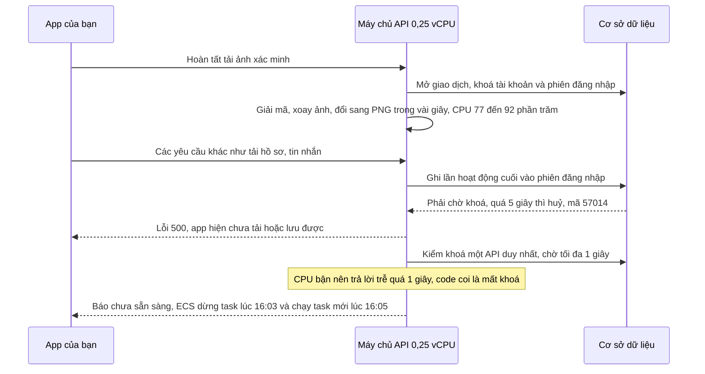

# B00-31 — Sửa API treo khi tải ảnh, lịch mất thao tác chọn ngày và CI chạy trùng

12/11/2026 · AWS-02 · PR #1 (`feat/lab-public-email-registration`) · [Checklist](../01-checklist.md) · [Mục lục](../README.md) · Liên quan: [B00-30](B00-30-tong-ket-deploy-aws02.md).

## 1. Bạn đã gặp gì và bây giờ thế nào?

Chiều 12/11 (giờ Việt Nam), khi bạn tạo hồ sơ thợ tự do và gửi ảnh xác minh trên lab AWS, app báo *“chưa tải hoặc lưu được, kiểm tra kết nối và thử lại”*. Khoảng 16:01–16:05 API ngừng trả lời rồi tự khởi động lại. Cùng ngày, lượt CI của PR #1 báo đỏ ở bài test lịch.

Đợt này sửa code ở ba chỗ, **chưa deploy lên lab**:

- **Tải ảnh không còn làm treo các thao tác khác.** Ảnh được xử lý trước, ngoài phần ghi dữ liệu; giao dịch chỉ còn bước đổi trạng thái ảnh.
- **Đọc dữ liệu không phải xếp hàng sau thao tác ghi** của cùng tài khoản. Thu hồi phiên đăng nhập vẫn chờ thao tác ghi đang chạy như trước.
- **Một lần CPU bận không còn làm API tự tắt.**
- **Lịch giữ đúng ngày bạn bấm** dù danh sách việc tải xong đúng lúc đang nhấn.
- **CI chỉ chạy một lượt cho mỗi commit của PR**, thay vì hai lượt song song.
- **Log ghi đúng đường dẫn API** (ví dụ `/v1/partners/:id/verification`) thay vì “unmatched”.

Đã kiểm trên máy phát triển; kết quả CI của commit mới, deploy lab và UAT ghi ở mục 7.

## 2. Những khái niệm cần biết

| Từ | Nghĩa trong sự cố này |
|---|---|
| Giao dịch (transaction) | Một nhóm thao tác ghi DB được lưu cùng lúc hoặc huỷ cùng lúc. Trong lúc chạy, nó **khoá** các dòng dữ liệu đang sửa. |
| Khoá dòng | Dấu “đang dùng” trên một dòng dữ liệu. Khoá *độc quyền* bắt mọi người khác chờ; khoá *chia sẻ* cho nhiều người cùng đọc nhưng bắt người muốn sửa chờ. |
| `statement_timeout` | Giới hạn 5 giây cho mỗi câu lệnh DB. Quá hạn, PostgreSQL huỷ câu lệnh (mã lỗi `57014`) và app nhận lỗi 500. |
| Khoá “một API duy nhất” (lease) | Lab chỉ cho một task API giữ kênh realtime. Task giữ một kết nối DB riêng và kiểm nó mỗi 0,5 giây. Mất khoá thì task tự báo “chưa sẵn sàng” để ECS thay task mới. |
| vCPU | Phần CPU cấp cho task. Task API lab có **0,25 vCPU**, tức một phần tư lõi. |

## 3. Chuyện gì đã xảy ra lúc 16:01?

Bằng chứng: log API (CloudWatch `/ecs/dvqb-lab-learn`), log PostgreSQL của RDS, số liệu CPU ECS và RDS. Giờ trong log là UTC; 09:01 UTC = 16:01 giờ Việt Nam.

Ba điểm yếu cộng lại:

1. **Xử lý ảnh nằm trong giao dịch.** Hàm hoàn tất tải ảnh giữ khoá tài khoản và phiên đăng nhập suốt thời gian đọc file, giải mã, xoay và chuyển ảnh điện thoại sang PNG, mã hoá rồi ghi lại.
2. **Mọi yêu cầu đều ghi vào dòng phiên đăng nhập** (`UPDATE sessions SET last_seen_at`). Đó là khoá độc quyền, nên cả các yêu cầu chỉ đọc cũng phải chờ giao dịch ở bước 1. Log PostgreSQL ghi đúng câu lệnh này bị huỷ hai lần (`while updating tuple (0,33) in relation "sessions"`).
3. **Nhịp kiểm khoá chỉ chờ 1 giây.** CPU nghẽn làm câu `SELECT 1` trên một kết nối vẫn sống trả lời trễ, và code coi đó là mất khoá vĩnh viễn.

Database không quá tải: CPU RDS 6–8%, tối đa 5 kết nối, dung lượng trống 18 GB.

## 4. Đã sửa gì, mở code theo thứ tự nào?

| Bước | File và hàm | Trước → sau |
|---|---|---|
| 1 | [assets.service.ts](../../../services/api/src/modules/assets/assets.service.ts), `complete`, `derive` | Trước: đọc, giải mã, `sharp` và ghi lại đều trong `tx.run`. Sau: đọc trước (không khoá) để lấy ảnh *đang chờ* của đúng người tải lên, chạy `derive` ngoài giao dịch, rồi mới mở giao dịch để kiểm lại mọi điều kiện và đổi trạng thái `ready`. Nếu dữ liệu đổi giữa hai bước, `derive` chạy lại bên trong như cách cũ. `sharp.concurrency(1)` cho xử lý một ảnh mỗi lúc. |
| 2 | [auth.service.ts](../../../services/api/src/modules/auth/auth.service.ts), `authenticate`, `touch` | Trước: mọi yêu cầu `UPDATE` dòng phiên. Sau: trong giao dịch chỉ `SELECT … FOR SHARE`, nên thu hồi phiên vẫn chờ thao tác ghi đang chạy; ngoài giao dịch `SELECT` không khoá. `touch` ghi `last_seen_at` tối đa mỗi phút một lần và bỏ qua nếu dòng đang bị khoá (`SKIP LOCKED`). |
| 3 | [runtime-lease.ts](../../../services/api/src/database/runtime-lease.ts), `check` | Thời gian chờ nhịp kiểm từ 1 giây lên 10 giây (`heartbeatTimeoutMs`). Kết nối thật sự đứt vẫn được phát hiện ngay qua sự kiện `error`. PostgreSQL giữ khoá cho tới khi phiên kết nối kết thúc, nên trả lời chậm không có nghĩa đã mất khoá. |
| 4 | [database.module.ts](../../../services/api/src/database/database.module.ts) | Pool kết nối từ 5 lên 10, vì khoá ở bước 3 chiếm riêng 1 kết nối suốt đời task. |
| 5 | [sanitize.ts](../../../services/api/src/logging/sanitize.ts) `loggedRoute`, [request-context.ts](../../../services/api/src/common/http/request-context.ts) | Log lấy mẫu route mà router đã khớp, chỉ có tên tham số, không có giá trị. Đoạn trông giống UUID hoặc ký tự lạ bị từ chối và quay về danh sách cũ. |
| 6 | [JobsScreen.tsx](../../../apps/mobile/src/features/jobs/screens/JobsScreen.tsx) | Nút “Việc của <hồ sơ>” phía trên lịch được hiện ngay khi biết danh sách hồ sơ, trước khi tải các trang việc. Trước đây nút xuất hiện cùng lúc với danh sách việc, đẩy lịch xuống khoảng 60 px khi đang nhấn, nên lần chọn ngày bị huỷ. |
| 7 | [quality.yml](../../../.github/workflows/quality.yml) | `push` chỉ chạy trên `main`, PR chạy qua `pull_request`. Nhóm huỷ theo số PR; lượt trên `main` không bị huỷ. |

## 5. Dữ liệu, quyền và trường hợp lỗi

- **Không đổi schema, API hay spec.** Không cần migration.
- **Quyền giữ nguyên:** bước đọc trước của ảnh dùng cùng điều kiện với bước kiểm quyền (đúng người tải lên; tài khoản bị tạm khoá chỉ được xử lý ảnh bằng chứng). Mọi điều kiện được kiểm lại dưới khoá trước khi đổi `ready`.
- **Bấm hai lần hoặc thử lại:** ảnh được ghi vào cùng một khoá lưu trữ với cùng nội dung; idempotency key giữ nguyên kết quả cũ.
- **Phiên bị thu hồi giữa chừng:** thao tác ghi đang chạy hoàn tất trước, lần gọi tiếp theo nhận 401. Yêu cầu chỉ đọc chạy đúng lúc thu hồi có thể vẫn trả dữ liệu, như thể đã chạy ngay trước khi thu hồi.
- **`last_seen_at`** (thời điểm hoạt động trong danh sách phiên đăng nhập) giờ chính xác tới khoảng 1 phút.
- **Còn lại:** 0,25 vCPU vẫn nhỏ cho ảnh điện thoại lớn. Ảnh lớn sẽ xử lý chậm hơn, nhưng không còn chặn các thao tác khác hay làm API tự tắt. Tăng CPU là thay đổi chi phí, chưa làm.

## 6. Tự thử và tự kiểm hiểu

Sau khi bản sửa được deploy lên lab:

1. Đăng nhập tài khoản thợ, gửi xác minh với 2–3 ảnh chụp bằng điện thoại.
2. Trong lúc ảnh đang tải, chuyển qua lại các màn Công việc, Tin nhắn. Các màn vẫn tải được, không hiện “chưa tải hoặc lưu được”.
3. Mở Lịch hẹn của hồ sơ thợ, bấm ngay một ngày khi vừa mở: ngày được chọn đúng.

Câu hỏi:
- Vì sao xử lý ảnh *trong* giao dịch làm cả màn Tin nhắn bị lỗi? *(Gợi ý: mục 3, điểm 2.)*
- Vì sao vẫn giữ khoá chia sẻ trên phiên đăng nhập thay vì bỏ hẳn? *(Gợi ý: thu hồi phiên phải chờ thao tác ghi đang chạy.)*
- Nếu nâng thời gian chờ nhịp kiểm lên 10 giây, khi nào API vẫn tự tắt? *(Gợi ý: khi kết nối DB thật sự đứt.)*

## 7. Đã kiểm tra gì và còn giới hạn nào?

**Trên máy phát triển, ngày 12/11/2026, trước commit (macOS, PostgreSQL test):**

- **Test hồi quy mới** [request-locking.test.ts](../../../services/api/test/integration/request-locking.test.ts):
  1. Một giao dịch ghi đang mở, khoá chia sẻ phiên: `GET /me` của cùng phiên vẫn trả 200 trong dưới 2 giây; `logout` phải chờ tới khi giao dịch commit, sau đó phiên nhận 401. `last_seen_at` chỉ đổi khi đã cũ hơn 1 phút.
  2. Giữ bước xử lý ảnh đang chạy: một thao tác ghi khác của cùng người dùng (`PATCH /me`) vẫn hoàn tất trong dưới 2 giây; ảnh sau đó vẫn `ready`.
  - Đối chứng: chạy hai test này trên code cũ thì **cả hai thất bại**. Test 1 chứng minh trực tiếp lỗi khoá. Test 2 thất bại vì code cũ không có bước `derive` tách riêng; nó khoá cấu trúc mới chứ chưa đo trực tiếp khoá trên code cũ.
- [runtime-lease.test.ts](../../../services/api/test/integration/runtime-lease.test.ts): thêm ca nhịp kiểm trả lời sau 1,2 giây vẫn giữ khoá, còn sự kiện mất kết nối vẫn mất khoá ngay. [logging.test.ts](../../../services/api/test/unit/logging.test.ts): thêm ca ghi mẫu route, từ chối UUID và giá trị lạ.
- Test lịch [calendar.spec.mjs](../../../tests/e2e/web/calendar.spec.mjs) thêm bước kiểm nút hồ sơ đã hiện trước khi danh sách việc về. Trước khi sửa, chạy lặp 8 lần trên máy đều đạt: lỗi chỉ hiện trên máy CI chậm hơn (lượt `43185940403`, nhận "Thứ Bảy, 7 tháng 11" thay vì ngày 14).
- **SDD toàn dự án** (`sdd:run` + `verify` ĐẠT, dấu băm `2761cbf9…` trên nền commit `109337b` cộng thay đổi chưa commit): lint, typecheck, tooling 92/92, mobile 411/411, coverage mobile (core 100% dòng, app 89,8%), **API 211/211** có PostGIS, coverage API (core 100% dòng, app 95,9%), build, **web E2E 35/35** (12,5 phút), tải danh mục p95 khoảng 48 ms, prototype, Storybook.

**Chưa có / giới hạn:**

- Sửa báo cáo, checklist và inventory sau lần chạy làm bằng chứng local không còn khớp dấu băm. Bằng chứng cho bản cuối là check `SDD project` trên CI của commit mới.
- **Chưa deploy lên lab AWS.** API lab vẫn chạy revision 7 với code cũ, nên lỗi có thể lặp lại khi gửi ảnh lớn cho tới khi deploy. Deploy theo `lab:up` từ commit sau khi PR #1 merge.
- Chưa đo trên lab xem ảnh điện thoại thật mất bao lâu với 0,25 vCPU sau khi sửa. Tăng CPU task (khoảng +$9/tháng cho thêm 0,25 vCPU, ước tính) là quyết định chi phí, chưa làm.
- Sơ đồ Mermaid được kiểm cú pháp bằng mắt; máy này không có công cụ render Mermaid, và lệnh tải công cụ từ ngoài bị chặn.
- Lỗi 409/400 khi lưu hồ sơ thợ lúc 15:57–15:59 là xung đột phiên bản và dữ liệu không hợp lệ: API trả đúng. Việc app chỉ hiện thông báo chung chưa được sửa trong đợt này.
- Khoá phiên admin (15 phút cố định, khoá khi chuyển tab) giữ nguyên theo thiết kế B09-02/B09-03; nới lỏng cần chủ dự án quyết định.
