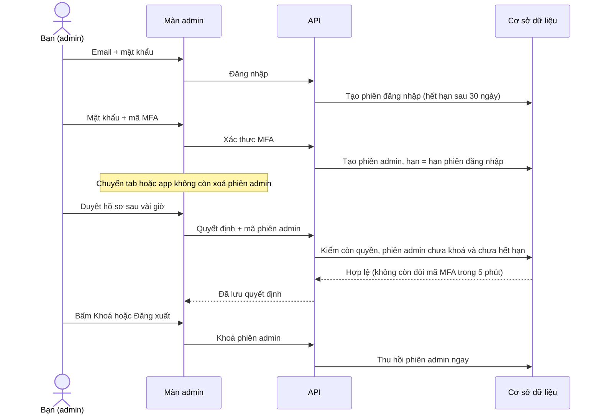

# B00-32 — Admin đăng nhập một lần, mật khẩu từ 8 ký tự, API 0,5 vCPU, tạm dừng SDD

12/11/2026 · AWS-02 · đẩy thẳng lên `main` · [Checklist](../01-checklist.md) · [Mục lục](../README.md) · Liên quan: [B00-31](B00-31-sua-api-treo-lich-va-ci.md), [B00-30](B00-30-tong-ket-deploy-aws02.md).

## 1. Bạn đã dùng được những gì?

Chủ dự án chốt trực tiếp 5 yêu cầu ngày 12/11/2026. Đợt này làm như sau:

| Yêu cầu | Bây giờ thế nào |
|---|---|
| 1. Tăng CPU | Task API trên lab dùng **0,5 vCPU** (trước 0,25). Có hiệu lực sau lần deploy kế tiếp; tốn thêm khoảng 9 USD/tháng, trừ vào credits. |
| 2. Admin chỉ đăng nhập một lần | Sau khi nhập mật khẩu và mã MFA một lần, màn admin dùng được tới khi bạn bấm **Khoá/Đăng xuất** hoặc hết phiên đăng nhập (30 ngày). Không còn hết hạn sau 15 phút, không còn đòi nhập lại mã sau 5 phút cho thao tác quyết định, và chuyển tab hoặc chuyển app không còn khoá màn admin. |
| 3. Không chạy SDD khi push | CI không còn tự chạy job `SDD project` khi push/PR. Chỉ chạy khi bạn bấm chạy tay. `lab:up` có cờ `--skip-sdd`. |
| 4. Mật khẩu từ 8 ký tự | Đăng ký, đặt lại và đổi mật khẩu chấp nhận **8–128 ký tự** (trước 15–128). Mật khẩu cũ vẫn đăng nhập bình thường. |
| 5. Đẩy thẳng lên `main` | Code đợt này được đẩy thẳng lên `main`. Phần gỡ bảo vệ nhánh trên GitHub cần chủ dự án tự bấm (xem mục 8). |

Ngoài ra, `lab:up` có thêm cờ **`--upgrade`** để cập nhật lab đang chạy sang commit mới. Trước đây công cụ từ chối, nên lần phát hành email (B00-29) phải làm thủ công.

Chưa đổi: tải lại trang (F5) trên bản web vẫn phải đăng nhập lại, vì token web cố ý chỉ giữ trong bộ nhớ (xem mục 8).

## 2. Những khái niệm cần biết

| Từ | Nghĩa |
|---|---|
| Phiên đăng nhập (login session) | Sinh ra khi bạn đăng nhập bằng email + mật khẩu. Gồm mã truy cập ngắn hạn (15 phút, tự làm mới) và mã làm mới (refresh token) sống 30 ngày. Các lần làm mới thuộc cùng một **họ phiên** (family). |
| Phiên admin (admin session) | Mã thứ hai, sinh ra sau khi nhập đúng mật khẩu và **mã MFA** 6 số từ app xác thực. Mọi API admin đòi cả hai mã. |
| MFA | Xác thực nhiều lớp: ngoài mật khẩu còn cần mã từ app xác thực trên điện thoại. |
| “Fresh” | Quy tắc cũ: thao tác quyết định (duyệt, tạm khoá, tài chính…) chỉ được làm trong 5 phút sau lần nhập mã gần nhất. Đã bỏ. |
| SDD | Bộ kiểm toàn dự án (`sdd:run`), mất khoảng 17–28 phút. |
| `setTimeout` | Hẹn giờ của trình duyệt. Giới hạn khoảng 24,8 ngày; hẹn lâu hơn thì trình duyệt chạy **ngay lập tức**. |

## 3. Theo một thao tác từ đầu đến cuối

Bạn mở màn admin, đăng nhập một lần rồi làm việc cả ngày:

## 4. Mở code theo thứ tự nào?

1. [admin-auth.service.ts](../../../services/api/src/modules/admin-auth/admin-auth.service.ts)
   - `issue()`: phiên admin lấy `expires_at` của phiên đăng nhập thay vì `+15 phút`. Trường `fresh_until` vẫn trả về (để không đổi contract) và bằng `expires_at`.
   - `check()`: chỉ còn kiểm mã đúng, chưa thu hồi, chưa hết hạn, vẫn có MFA và quyền. Bỏ điều kiện “xác thực trong 5 phút” và bỏ tham số `fresh` ở 14 chỗ gọi (tài chính, kiểm duyệt, mời admin, khoá tài khoản…).
2. [AdminScreen.tsx](../../../apps/mobile/src/features/admin/screens/AdminScreen.tsx) (màn admin trong app, gồm bản web `app.iimissher.com`): khi app hoặc tab xuống nền, chỉ xoá **form xác thực đang dở** (có thể đang hiện mã bí mật MFA), không khoá màn admin đã mở. Hẹn giờ hết phiên được giới hạn dưới 24,8 ngày.
3. [App.tsx](../../../apps/admin/src/App.tsx) (trang admin riêng): cùng giới hạn hẹn giờ `maxTimer`.
4. Mật khẩu: hằng `PASSWORD_MIN = 8` trong [auth.input.ts](../../../services/api/src/modules/auth/auth.input.ts), dùng lại trong [security.input.ts](../../../services/api/src/modules/account-security/security.input.ts). App đổi câu gợi ý trong [AccountScreen.tsx](../../../apps/mobile/src/features/auth/screens/AccountScreen.tsx), [SecurityScreen.tsx](../../../apps/mobile/src/features/account-security/screens/SecurityScreen.tsx) và [messages.ts](../../../apps/mobile/src/features/account-security/messages.ts).
5. CPU: `cpu = 512` trong [compute.tf](../../../infra/aws/lab/compute.tf).
6. Deploy: [lab.mjs](../../../scripts/aws/lab.mjs)
   - `--upgrade` cho phép cập nhật lab đang chạy. Lab đang chạy chỉ chạy **migrate**, không chạy `bootstrap`, để không nạp lại danh mục mẫu đè lên chỉnh sửa của admin.
   - `--skip-sdd` bỏ bước `sdd:check` và ghi `sdd_skipped` vào journal.
7. CI:
   - [quality.yml](../../../.github/workflows/quality.yml): job `SDD project` chỉ chạy khi `workflow_dispatch`.
   - [aws-build.yml](../../../.github/workflows/aws-build.yml): cổng build image pilot nay đòi đúng job `SDD project` thành công (lượt chạy tay), không chấp nhận lượt đã bỏ qua SDD.

## 5. Dữ liệu được nhớ ở đâu và nếu có lỗi thì sao?

- **Không đổi cấu trúc DB, không có migration.** Phiên admin cũ (tạo trước khi deploy) vẫn hết hạn sau 15 phút như lúc tạo. Nhập MFA một lần sau deploy là có phiên dài.
- Phiên admin vẫn kết thúc **ngay** khi:
  - bấm Khoá hoặc Đăng xuất;
  - phiên đăng nhập bị thu hồi (ví dụ dùng lại refresh token cũ);
  - bị rút quyền admin;
  - đổi hoặc khôi phục MFA;
  - admin khác reset MFA của bạn.
- Mật khẩu: API trả 400 nếu dưới 8 hoặc trên 128 ký tự (đếm theo ký tự, không theo byte). Đăng nhập không kiểm lại độ dài, nên mật khẩu cũ vẫn dùng được.
- Deploy bằng `--upgrade`: nếu dừng giữa chừng, chạy lại đúng lệnh đó. Journal đã ghi commit mới nên lần sau không cần `--upgrade` nữa.

## 6. Bạn có thể tự thử và tự kiểm hiểu

1. Sau deploy, đăng nhập admin và nhập mã MFA, rồi chuyển sang tab khác 1–2 phút. Quay lại, màn admin vẫn mở.
2. Để màn admin mở hơn 15 phút rồi duyệt một hồ sơ xác minh: lưu được, không bị đẩy về màn nhập mã.
3. Đăng ký tài khoản mới với mật khẩu 8 ký tự (ví dụ `abcd1234`): được. Thử 7 ký tự: bị từ chối.
4. Câu hỏi tự kiểm: vì sao màn admin trong app vẫn xoá form khi xuống nền *trong lúc đang cài MFA*? Gợi ý: lúc đó màn hình đang hiện mã bí mật.

## 7. Đã kiểm tra gì và còn giới hạn nào?

| Kiểm tra | Kết quả |
|---|---|
| API unit + toàn bộ integration | Unit 41/41, integration 171/171 (máy phát triển, PostgreSQL test). |
| Test mới/sửa | `password-policy.test.ts` (8 ký tự đạt, 7 ký tự trượt, ký tự có dấu và emoji đếm đúng); `admin-moderation.test.ts` kiểm phiên admin hết hạn cùng phiên đăng nhập và quyết định 2 giờ sau vẫn được; 5 file test cũ chuyển từ “quá 5 phút bị chặn” sang “phiên admin hết hạn bị chặn”. |
| Mobile (admin, auth, bảo mật, i18n) | 84/84; test mới: màn admin không khoá khi app xuống nền. |
| Công cụ lab | 32/32; 2 test mới cho `--upgrade` (từ chối khi thiếu cờ, chỉ chạy migrate) và `--skip-sdd`. |
| Terraform lab | fmt, validate, test 8/8. |
| Typecheck tất cả workspace, ESLint phần đã sửa | Đạt. |

Giới hạn:

- **Đợt này không có bằng chứng SDD** (đã tạm dừng theo yêu cầu). Chưa chạy web E2E và native.
- Chưa deploy lên lab, chưa UAT. Giao diện chỉ đổi câu gợi ý mật khẩu nên không có ảnh màn hình mới.
- Sơ đồ Mermaid kiểm cú pháp bằng mắt; máy này không có công cụ render Mermaid.
- Tài liệu spec (OpenAPI mô tả phiên admin 15 phút, yêu cầu mật khẩu 15 ký tự, MFA “fresh” 5 phút) **chưa đồng bộ**, theo quy tắc chỉ đồng bộ khi chủ dự án yêu cầu.
- Bảo mật: phiên admin dài hơn đồng nghĩa nếu máy đang mở màn admin bị người khác dùng thì họ có quyền admin tới khi bạn khoá. Nên bấm **Khoá** khi rời máy.

## 8. Phần chưa làm và bước sau

- **Gỡ bảo vệ nhánh `main` trên GitHub:** công cụ của Claude không được phép tự nới kiểm soát CI. Chủ dự án vào GitHub → Settings → Branches → rule `main`, rồi tắt:
  - *Require status checks to pass*;
  - *Do not allow bypassing the above settings*.

  Giữ chặn force-push và xoá nhánh.
- **Deploy:** `npm run lab:up -- --lab learn --upgrade --skip-sdd`, xem plan, rồi thêm `--apply --confirm <ACCOUNT_ID>/learn`.
- **Câu hỏi còn mở:** có muốn bản web giữ đăng nhập qua F5 không? Muốn vậy phải lưu token vào bộ nhớ trình duyệt, đổi quy tắc bảo mật hiện tại “không lưu token web vào localStorage” cho mọi người dùng web.
- Bật lại SDD khi chủ dự án yêu cầu: chạy tay workflow Quality hoặc `npm run sdd:run -- --change SDD-PROJECT`.
