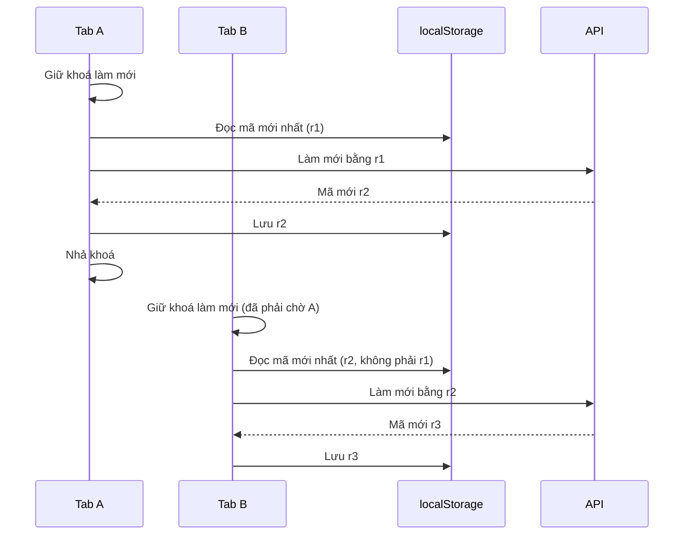

# B00-33 — Lưu đăng nhập trên trình duyệt

12/11/2026 · AWS-02 · [Checklist](../01-checklist.md) · [Mục lục](../README.md) · Tiếp nối: [B00-32](B00-32-noi-phien-admin-mat-khau-cpu-ci.md).

## 1. Bạn đã dùng được những gì?

Chủ dự án chốt ngày 12/11/2026: **“hãy lưu đăng nhập vào trình duyệt”**.

- **App web (`app.iimissher.com`):** sau khi đăng nhập, tải lại trang (F5), đóng mở lại tab hay mở tab mới đều vẫn đăng nhập.
- **Màn admin trong app web:** đã nhập mã MFA thì F5 không bắt nhập lại.
- **Trang admin riêng (`admin.iimissher.com`):** giữ cả đăng nhập lẫn phiên admin qua F5 và giữa các tab.
- **Đăng xuất** xoá mọi thứ đã lưu. **Khoá** admin xoá phiên admin đã lưu.
- App điện thoại không đổi: vốn đã lưu đăng nhập trong Keychain/Keystore. Phiên admin trên điện thoại vẫn chỉ giữ trong bộ nhớ.

## 2. Những khái niệm cần biết

| Từ | Nghĩa |
|---|---|
| localStorage | Ngăn lưu trữ của trình duyệt theo từng tên miền, còn nguyên sau F5 hoặc khi đóng trình duyệt. Mọi tab cùng tên miền dùng chung. |
| Refresh token | Mã dùng để xin mã truy cập mới. **Mỗi mã chỉ dùng được một lần.** Nếu ai dùng lại mã cũ, máy chủ coi là bị đánh cắp và **thu hồi cả phiên**. |
| Khoá giữa các tab (Web Locks) | Tính năng trình duyệt cho phép một tab giữ “lượt” trong khi các tab khác chờ. |

## 3. Theo một thao tác từ đầu đến cuối

Bẫy chính: hai tab cùng giữ một refresh token. Nếu cả hai cùng làm mới bằng mã đó, lần thứ hai là “dùng lại” và cả hai bị đăng xuất. Cách xử lý: tab nào muốn làm mới phải giữ khoá chung, rồi **đọc mã mới nhất trong localStorage**, không dùng mã nhớ riêng của tab.

Nếu một tab đăng xuất, máy chủ thu hồi cả phiên. Tab kia lần tới làm mới sẽ nhận 401 và tự về màn đăng nhập.

## 4. Mở code theo thứ tự nào?

1. [token-storage.ts](../../../apps/mobile/src/features/auth/state/token-storage.ts):
   - trên web, ghi/đọc/xoá refresh token trong `localStorage`;
   - trình duyệt chặn lưu trữ thì dùng bộ nhớ (vẫn đăng nhập được trong tab đó);
   - `exclusive()` dùng `navigator.locks`.
2. [auth-session.ts](../../../apps/mobile/src/features/auth/state/auth-session.ts):
   - `restore()` đọc, làm mới và lưu trong cùng một khoá;
   - `rotate()` đọc mã mới nhất trong kho chung trước khi làm mới.
3. [admin-api.ts](../../../apps/mobile/src/features/admin/api/admin-api.ts):
   - `browserMfaStore` lưu phiên admin theo đúng tài khoản (`owner`);
   - `clear()` (khi khoá, đăng xuất hoặc bị từ chối) xoá bản lưu; `detach()` (khi rời màn hình) chỉ huỷ việc đang chạy.
4. [AdminScreen.tsx](../../../apps/mobile/src/features/admin/screens/AdminScreen.tsx): còn phiên admin đã lưu thì mở thẳng bảng điều khiển.
5. [client.ts](../../../apps/admin/src/client.ts) (trang admin riêng):
   - `browserStore()` lưu `{session, mfa}`;
   - `refresh()` chạy dưới khoá. Nếu tab khác đã đổi mã thì nhận mã đó luôn, không làm mới lại.
6. [App.tsx](../../../apps/admin/src/App.tsx) và [main.tsx](../../../apps/admin/src/main.tsx): khởi động vào thẳng bảng điều khiển hoặc màn nhập MFA, tuỳ dữ liệu đã lưu.

## 5. Dữ liệu được nhớ ở đâu và nếu có lỗi thì sao?

Dữ liệu lưu trong localStorage:

| Khoá | Nội dung |
|---|---|
| `dvqb.auth.refresh.v1` | Refresh token của app. |
| `dvqb.admin.mfa.v1` | Phiên admin trong app, gắn với ID tài khoản. |
| `dvqb.admin.console.v1` | Phiên đăng nhập và phiên admin của trang admin riêng. |

Mã truy cập (JWT) của app không được lưu; test E2E kiểm không có chuỗi JWT trong localStorage.

Rủi ro đã chấp nhận: nếu trang bị chèn mã độc (XSS), mã đó đọc được token đã lưu. Trên máy dùng chung, người sau mở trình duyệt vẫn đang đăng nhập. Nên đăng xuất khi dùng máy chung, và bấm **Khoá** khi rời máy đang mở admin.

## 6. Bạn có thể tự thử và tự kiểm hiểu

1. Đăng nhập app web, bấm F5: vẫn ở trạng thái đã đăng nhập.
2. Mở thêm một tab cùng địa chỉ: tab mới cũng đã đăng nhập. Dùng cả hai tab hơn 15 phút: không tab nào bị đẩy ra.
3. Vào màn admin, nhập mã MFA, bấm F5: vào thẳng bảng điều khiển.
4. Đăng xuất ở một tab rồi thao tác ở tab kia: tab kia về màn đăng nhập.
5. Câu hỏi tự kiểm: vì sao tab B phải đọc lại localStorage thay vì dùng mã đang nhớ?

## 7. Đã kiểm tra gì và còn giới hạn nào?

| Kiểm tra | Kết quả |
|---|---|
| Mobile toàn bộ | 415/415. |
| Test mới | Lưu và đọc web, dùng bộ nhớ khi trình duyệt chặn, dùng khoá (`token-storage.test.ts`); hai tab làm mới đan xen mà không dùng lại mã, đăng xuất tab này thì tab kia tự ra (`auth-session.test.ts`); phiên admin lưu theo tài khoản, rời màn không xoá, khoá thì xoá (`admin-api.test.ts`); F5 có phiên admin thì không hỏi MFA (`Admin.test.tsx`); trang admin riêng 3/3 (`admin-client.test.mjs`). |
| Web E2E (Chromium, máy phát triển) | 10/10 cho `auth`, `i18n`, `admin-moderation`, `local-gallery-mfa`, `admin-operations`, `account-security`. `auth.spec` kiểm còn đăng nhập sau F5, chỉ một khoá `dvqb.auth.*`, không có JWT, đăng xuất xoá hết. |

Giới hạn:

- Không có bằng chứng SDD (đang tạm dừng). Chưa thử trên lab và chưa UAT.
- Spec bảo mật cũ (“không lưu token web vào localStorage”) **chưa đồng bộ** tài liệu, theo quy tắc chỉ đồng bộ khi chủ dự án yêu cầu.
- Trình duyệt không có Web Locks (rất cũ) vẫn chạy được, nhưng hai tab làm mới đúng cùng lúc có thể bị đăng xuất.

## 8. Phần chưa làm và bước sau

Deploy cùng B00-32 bằng `lab:up --upgrade --skip-sdd`, rồi thử các bước ở mục 6 trên `app.iimissher.com`.
