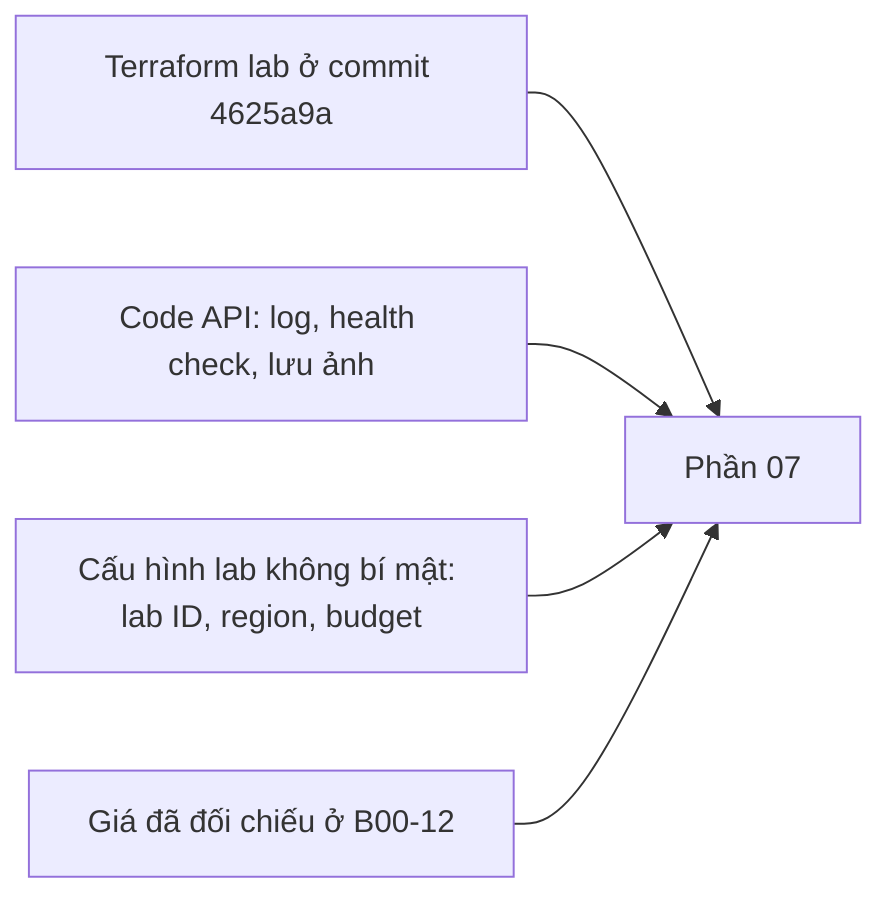

# B00-34 — Tài liệu học: dịch vụ AWS của lab và cách xem trên Console

17/11/2026 · AWS-02 · [Checklist](../01-checklist.md) · [Mục lục](../README.md) · Tiếp nối: [B00-26](B00-26-tai-lieu-hoc-deploy.md).

## 1. Bạn có gì sau đợt này

Chủ dự án hỏi ngày 17/11/2026, khi xem biểu đồ chi phí trên AWS: các dịch vụ này để làm gì, liên kết với nhau thế nào, xem thông số trên Console ở đâu, thay vì chỉ đọc Terraform.

Kết quả: [Phần 07 — Dịch vụ AWS và cách xem trên Console](../hoc-deploy-aws02/07-dich-vu-va-console.md) trong bộ tài liệu học deploy. Bài gồm:

- bảng "muốn biết gì thì mở đâu";
- hình dung cả hệ thống như một cửa hàng, kèm sơ đồ nối các dịch vụ;
- bốn hành trình: mở app, gọi API, tải ảnh, deploy;
- với từng dịch vụ: để làm gì, tên thật trong lab, nối với ai, tính tiền thế nào, các bước bấm trên Console, đọc chỉ số ra sao, nút nào không được bấm;
- giải thích từng dòng trên biểu đồ chi phí, cách dùng Cost Explorer, credits và budget 20 USD;
- truy vấn Logs Insights mẫu, kiểm sức khoẻ 5 phút, bảng tra sự cố, câu hỏi tự kiểm và bảng tên tài nguyên.

## 2. Nguồn và cách đối chiếu

- Tên tài nguyên, cổng, ngưỡng cảnh báo, luật WAF, quyền IAM, vòng đời S3/ECR lấy trực tiếp từ [network.tf](../../../infra/aws/lab/network.tf), [api-edge.tf](../../../infra/aws/lab/api-edge.tf), [compute.tf](../../../infra/aws/lab/compute.tf), [storage.tf](../../../infra/aws/lab/storage.tf), [waf.tf](../../../infra/aws/lab/waf.tf), [observability.tf](../../../infra/aws/lab/observability.tf).
- Trường log trong truy vấn mẫu theo [logger.ts](../../../services/api/src/logging/logger.ts) và [request-context.ts](../../../services/api/src/common/http/request-context.ts). Health check theo [health.controller.ts](../../../services/api/src/health/health.controller.ts). Đường ảnh qua API theo [cloud.ts](../../../services/api/src/integrations/cloud.ts).
- Budget 20 USD và lab ID `learn` đọc từ cấu hình riêng `.local/aws-lab/learn/config.json`; không chép email cảnh báo hay giá trị bí mật nào vào tài liệu.
- Số chi phí lấy từ ảnh Console chủ dự án gửi ngày 17/11 (12,39 USD đầu tháng tới nay) và B00-30 (1,72 USD ngày 12/11).

## 3. Đã sửa kèm

- [Phần 01](../hoc-deploy-aws02/01-kien-truc.md): dòng cấu hình Fargate đổi sang 0,5 vCPU cho khớp B00-32.
- [Mục lục bộ tài liệu](../hoc-deploy-aws02/README.md) và [phần 06](../hoc-deploy-aws02/06-van-hanh.md): thêm liên kết tới phần 07.

## 4. Kiểm tra

- Sáu sơ đồ Mermaid đã kiểm cú pháp và render.
- Các liên kết tương đối trỏ tới file có thật.
- Inventory SDD đã thêm hai file mới, loại `documentation`.
- Không có bằng chứng SDD (đang tạm dừng theo B00-32).

## 5. Giới hạn

- **Chưa đối chiếu trực tiếp trên Console** trong đợt này: các bước bấm viết theo giao diện AWS hiện biết và theo Terraform. Tên tab có thể khác chút; bài đã ghi cách tìm thay thế.
- Một số mục (IP Address Manager, lọc chi phí theo tag) phụ thuộc tính năng tài khoản đã bật hay chưa.
- Giá là giá công bố, chưa trừ credits/free tier, không phải hoá đơn.
- Không đổi Terraform, code ứng dụng, Excel, Drive hay `ui-ux`.

## 6. Bước sau

Đọc phần 07 cùng lúc mở Console. Gặp màn nào khác mô tả, gửi ảnh để cập nhật bài. Sau khi deploy B00-32/33, làm "kiểm sức khoẻ 5 phút" ở mục 18 của bài.
