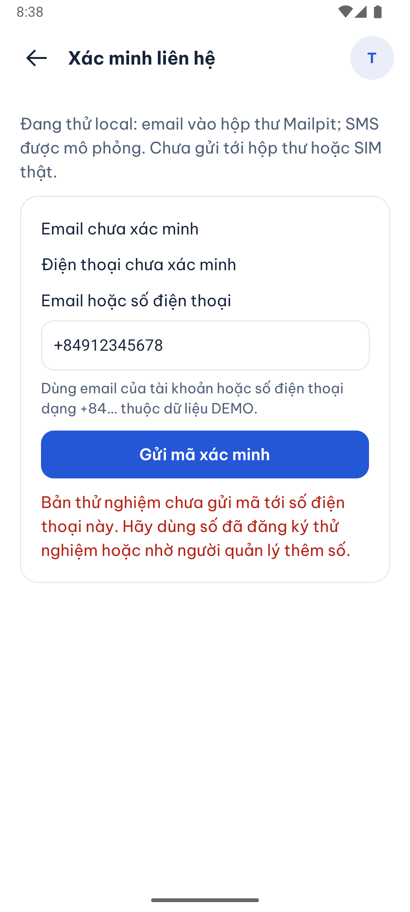
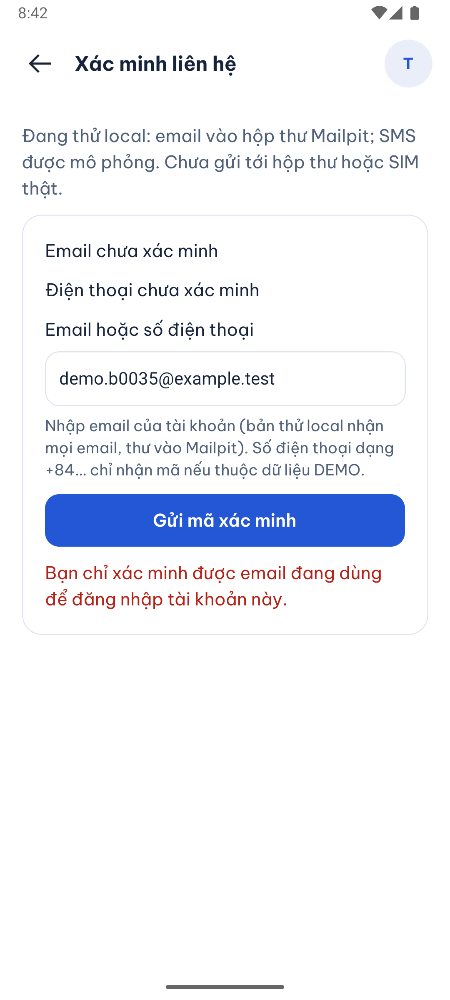
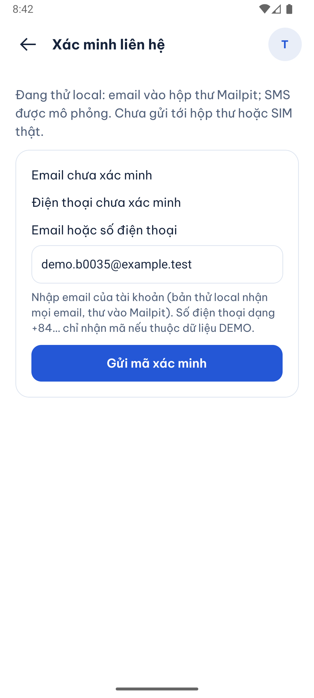
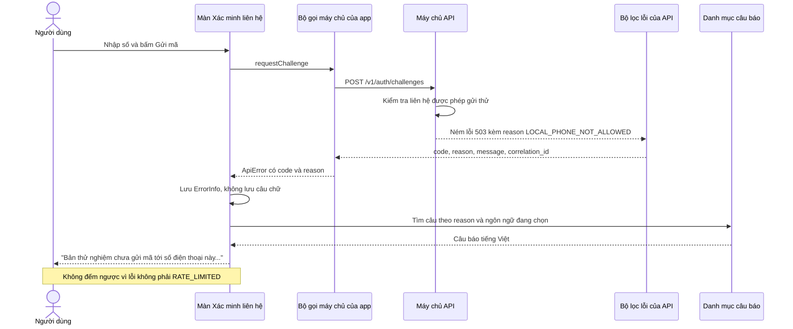

# B00-35 — Báo lỗi chính xác trên toàn hệ thống và đăng ký mọi email ở local

25/11/2026 · Yêu cầu trực tiếp của chủ dự án ngày 24/11/2026 · [Checklist](../01-checklist.md) · [Mục lục](../README.md)

> Yêu cầu: *“hãy cho mọi email có thể đăng ký … xem lại tất cả các báo lỗi mà hệ thống có, yêu cầu hiển thị chính xác lỗi để người dùng biết đó là lỗi gì chứ không hiển thị chung chung”.*
>
> Trạng thái: đã chạy trên máy phát triển (API + app Android emulator + database local). Chưa deploy lab, chưa kiểm iOS/thiết bị thật, chưa UAT. **Đợt này không có bằng chứng SDD** (SDD đang tạm dừng theo B00-32).

## 1. Bạn đã dùng được những gì?

**Trước đây**, khi bạn bấm “Gửi mã xác minh” với email `…@gmail.com`, app báo *“Chưa thực hiện được. Kiểm tra kết nối và cấu hình thử local rồi thử lại.”* và bắt chờ 60 giây. Thực ra mạng vẫn tốt: máy chủ từ chối vì email đó không nằm trong danh sách được gửi thử. Câu báo vừa sai nguyên nhân vừa bắt chờ vô ích.

**Bây giờ:**

- **Đăng ký và xác minh bằng mọi email ở local.** Email nào cũng nhận được mã thử; thư vào hộp thư thử Mailpit (http://127.0.0.1:8025), **không** gửi ra Gmail thật. Số điện thoại vẫn chỉ gửi được tới số trong dữ liệu DEMO.
- **Mỗi lỗi nói đúng chuyện gì đã xảy ra và nên làm gì tiếp.** Toàn hệ thống có **519 nguyên nhân lỗi** được đặt tên, mỗi nguyên nhân có câu báo bằng tiếng Việt, tiếng Anh và tiếng Nhật. Ví dụ:
  - Nhận việc khi khách đã rút yêu cầu → *“Khách đã rút yêu cầu này…”* thay vì *“Dữ liệu đã thay đổi”*.
  - Tải ảnh quá lớn → *“Ảnh lớn hơn 10 MB…”* thay vì *“Kiểm tra kết nối”*.
  - Giờ hẹn đã qua → *“Giờ hẹn đã qua. Hãy chọn một thời điểm trong tương lai (giờ Việt Nam).”* thay vì một câu chung cho cả form.
- **Lỗi lạ phía máy chủ có “Mã tra cứu”** (8 ký tự). Bạn gửi mã này cho người hỗ trợ để tìm đúng dòng log.
- **Câu “Kiểm tra kết nối” chỉ còn hiện khi đúng là mất mạng hoặc máy chủ không trả lời.**
- Sửa các lỗi trải nghiệm đi kèm, ví dụ chỉ bắt chờ 60 giây khi máy chủ thật sự báo gửi quá nhiều lần (xem mục 5).

Ảnh chụp trên **Android emulator** (máy ảo, không phải điện thoại thật), 25/11/2026, tài khoản test local, liên hệ DEMO:

| Số điện thoại không thuộc DEMO | Email không phải email đăng nhập | Gợi ý mới dưới ô nhập |
|---|---|---|
|  |  |  |
| Không còn đếm ngược; sửa số rồi gửi lại ngay. | Trước đây cũng hiện câu “Kiểm tra kết nối…”. | Thay câu cũ “thuộc dữ liệu DEMO” cho cả email. |

Cũng đã thử trên emulator: gửi mã tới email của tài khoản → thư tới Mailpit, nút chuyển sang “Gửi lại sau 57 giây” (đúng, vì đã gửi thành công); nhập sai mã → *“Mã không đúng. Kiểm tra lại 6 chữ số trong email hoặc SMS mới nhất.”* Ảnh các bước này không đưa vào báo cáo vì chứa email thật.

## 2. Những khái niệm cần biết

| Từ | Nghĩa trong đợt này |
|---|---|
| Mã loại lỗi (`code`) | Nhóm lớn của lỗi, ví dụ `VALIDATION` (nhập sai), `NOT_FOUND` (không tìm thấy), `STATE_CONFLICT` (trạng thái không cho phép). App dùng mã này để **quyết định làm gì** (thử lại, tải lại, đăng nhập lại). Giữ nguyên như cũ. |
| Nguyên nhân (`reason`) | **Mới.** Tên chính xác của lỗi, viết HOA có gạch dưới, ví dụ `JOB_ALREADY_ACCEPTED`. App dùng để **chọn câu hiển thị**. Không bao giờ chứa dữ liệu người dùng (email, số tiền, mã…). |
| Ô nhập bị sai (`field_errors`) | Tên ô gây lỗi, ví dụ `scheduled_at`. Bản hợp đồng API vốn đã có chỗ này nhưng chưa dùng. |
| Danh mục câu báo | Bảng “nguyên nhân → câu báo” trong app, chia theo nhóm chức năng, đủ 3 ngôn ngữ. |
| Mã tra cứu | 8 ký tự đầu của mã yêu cầu (`correlation_id`) mà máy chủ ghi vào log. Chỉ hiện với lỗi phía máy chủ. |

## 3. Theo một thao tác từ đầu đến cuối

Thao tác: bấm **Gửi mã xác minh** với một số điện thoại không thuộc dữ liệu DEMO (trường hợp lỗi).



Nhánh khác: nếu máy chủ trả `RATE_LIMITED` (gửi quá nhiều lần), màn hình mới đếm ngược theo số giây máy chủ báo (`Retry-After`). Nếu lỗi không có `reason` (ví dụ mất mạng), app dùng câu riêng của màn hình hoặc câu chung theo loại lỗi.

## 4. Mở code theo thứ tự nào?

| Bước | File và hàm | Nhận gì, làm gì, chuyển gì |
|---|---|---|
| 1 | [VerifyContactScreen.tsx](../../../apps/mobile/src/features/organizations/screens/VerifyContactScreen.tsx) — hàm `send` | Lấy liên hệ trong ô nhập, gọi bộ quản lý đăng nhập. Khi lỗi: lưu `toErrorInfo(e)`; chỉ khi `code === 'RATE_LIMITED'` mới đặt thời điểm được gửi lại. |
| 2 | [local-messages.ts](../../../services/api/src/integrations/local-messages.ts) — `requireContact` | Phía máy chủ: kiểm liên hệ có được gửi thử không. Email được phép khi bật `PUBLIC_EMAIL_REGISTRATION=1`; số điện thoại phải nằm trong danh sách DEMO. Từ chối bằng `{ code: 'LOCAL_CONTACT_NOT_ALLOWED', reason: 'LOCAL_PHONE_NOT_ALLOWED' }`. |
| 3 | [environment.ts](../../../services/api/src/config/environment.ts) | Đọc cờ `PUBLIC_EMAIL_REGISTRATION`. Ở local chỉ bật được khi đã bật `LOCAL_MESSAGES` (thư chỉ vào Mailpit). Trên cloud giữ nguyên điều kiện cũ (chỉ lab dùng Resend). |
| 4 | [http-exception.filter.ts](../../../services/api/src/common/http/http-exception.filter.ts) — `describeException` | Mọi lỗi đi qua đây. Giữ `code` như cũ, thêm `reason` (chỉ lỗi 4xx/503, đúng dạng chữ HOA) và `field_errors`. Lỗi 500 không bao giờ lộ chi tiết. |
| 5 | [request.ts](../../../apps/mobile/src/lib/http/request.ts) — `requestJson` | App đọc phần thân lỗi của **mọi** mã trạng thái, kiểm `reason`/`field` đúng dạng rồi gắn vào `ApiError`. Câu chữ `message` của máy chủ không bao giờ vào log. |
| 6 | [describe.ts](../../../apps/mobile/src/lib/errors/describe.ts) — `toErrorInfo`, `errorText`, `errorReference` | Chọn câu theo thứ tự: câu theo nguyên nhân → câu riêng của màn → câu chung theo loại ([categories.ts](../../../apps/mobile/src/lib/errors/categories.ts)). |
| 7 | [reasons/](../../../apps/mobile/src/lib/errors/reasons/) — `reasonMessage` | Danh mục câu báo theo nhóm: chung, đăng nhập, hồ sơ thợ, công việc, chat, tài chính, đội ngũ, quản trị. |
| 8 | [ErrorMessage.tsx](../../../apps/mobile/src/components/ui/ErrorMessage.tsx) | Ô hiển thị lỗi dùng chung: in câu báo và, với lỗi máy chủ, dòng “Mã tra cứu: XXXXXXXX”. |

Ba dòng code đáng đọc trong bước 1 (rút gọn):

```ts
catch (e) {
  setError(toErrorInfo(e));            // giữ code + reason, chưa dịch thành câu
  if (e instanceof ApiError && e.code === 'RATE_LIMITED')
    setUntil(Date.now() + (e.retryAfter ?? 60) * 1000);  // chỉ chờ khi máy chủ bảo chờ
}
```

## 5. Dữ liệu được nhớ ở đâu và nếu có lỗi thì sao?

- **Màn hình chỉ nhớ mã lỗi**, không nhớ câu đã dịch (quy tắc dự án). Đổi ngôn ngữ thì câu báo đổi theo ngay.
- **Không làm lộ thông tin tài khoản:** đăng nhập sai email hay sai mật khẩu vẫn chung một câu (`AUTH_INVALID_CREDENTIALS`). Dữ liệu bạn không có quyền xem vẫn báo “không tìm thấy hoặc bạn không còn quyền xem”, không nói dữ liệu đó có tồn tại. Mã mời/đặt lại mật khẩu không tiết lộ tài khoản có tồn tại hay không.
- **Không đổi nghiệp vụ:** mã trạng thái HTTP, `code`, giới hạn, thứ tự kiểm tra giữ nguyên. Chỉ thêm tên nguyên nhân. Một số kiểm tra gộp (`a || b`) được tách thành hai kiểm tra liền nhau, cùng thứ tự, cùng mã trạng thái, để mỗi nhánh có nguyên nhân riêng.
- **Lỗi trải nghiệm đã sửa trong đợt:**
  1. Xác minh liên hệ: mọi lỗi gửi mã đều bắt chờ 60 giây → nay chỉ chờ khi máy chủ báo `RATE_LIMITED`.
  2. Xác minh liên hệ: sửa email/số hoặc mã thì câu lỗi cũ tự xóa (trước đây còn treo).
  3. Màn tài chính hiện câu chung kèm mã thô “(STATE_CONFLICT)” → nay hiện nguyên nhân.
  4. Màn đội ngũ báo “Kiểm tra kết nối và cấu hình thử local” cho mọi lỗi → nay đúng nguyên nhân.
  5. Tải ảnh: lỗi ở bước tải lên bị coi là mất mạng và cho “Thử lại” vô ích → nay đọc lỗi thật, chỉ cho thử lại khi có ích.
  6. Tìm địa chỉ: dịch vụ bản đồ lỗi/quá tải thì nói đúng như vậy và gợi ý chọn trên bản đồ.
  7. Form tạo việc, hóa đơn, đánh giá: mỗi ô sai có câu riêng thay vì một câu cho cả form.
  8. Cuộc gọi, ảnh bằng chứng hỗ trợ: tải lỗi chỉ hiện nút “Thử lại” → nay có câu giải thích.
  9. Bật thông báo đẩy: phân biệt thiếu module, không lấy được mã thiết bị, máy chủ từ chối.
  10. Màn quản trị: sai mật khẩu và sai mã MFA có câu riêng (trước cùng câu “phiên/quyền không còn hiệu lực”); lỗi cũ không còn treo khi mở mục khác.
  11. Khôi phục tài khoản: ô mật khẩu mới còn đòi 15 ký tự → nay 8 ký tự theo B00-32.
  12. Lỗi “dữ liệu gửi lên quá lớn” từng trả 500 → nay 413 với nguyên nhân `BODY_TOO_LARGE`.

## 6. Bạn có thể tự thử và tự kiểm hiểu

1. Chạy API, Metro Android như README. Vào **Tài khoản → Xác minh liên hệ**.
2. Nhập `+84912345678`, bấm **Gửi mã xác minh** → thấy câu “Bản thử nghiệm chưa gửi mã tới số điện thoại này…”, nút gửi vẫn bấm được.
3. Nhập email đang dùng để đăng nhập → bấm gửi → mở http://127.0.0.1:8025 lấy mã 6 số → nhập mã → “Đã xác minh liên hệ.”
4. Thử nhập sai mã → thấy “Mã không đúng…”.
5. Đổi ngôn ngữ sang English rồi lặp bước 2 → câu báo bằng tiếng Anh.

Câu hỏi tự kiểm:

- *Vì sao app không dùng luôn câu `message` máy chủ gửi về?* → Gợi ý: [request.ts](../../../apps/mobile/src/lib/http/request.ts) và quy tắc “state không giữ câu đã dịch”; câu máy chủ chỉ có tiếng Việt và có thể chứa chi tiết không nên ghi log.
- *Nếu máy chủ thêm một nguyên nhân mới mà app chưa có câu báo thì sao?* → Gợi ý: `errorText` trong [describe.ts](../../../apps/mobile/src/lib/errors/describe.ts) rơi về câu riêng của màn hoặc câu chung theo `code`.
- *Vì sao đăng nhập sai email và sai mật khẩu vẫn chung câu?* → Để người ngoài không dò được email nào đã có tài khoản.

## 7. Đã kiểm tra gì và còn giới hạn nào?

- Đã chạy toàn bộ test đơn vị API/app/admin web, toàn bộ test tích hợp API với database test, typecheck và lint (số liệu ở bảng dưới).
- **Trang quản trị web** (`apps/admin`) dùng chung danh mục câu báo của app (không chép lại chữ), có mã tra cứu, đánh dấu ô nhập bị sai; sửa 9 lỗi trải nghiệm như lỗi cũ còn treo khi đổi mục/đổi màn, nút “Thử lại” mở nhầm mục, lỗi lưu danh mục hiện hai lần. Chưa thử tay trên trình duyệt; đã kiểm bằng test và build.
- Đã thử bằng tay trên Android emulator: luồng xác minh liên hệ (số ngoài DEMO, email khác tài khoản, gửi thành công, sai mã). **Chưa** thử tay từng màn khác; các màn khác được kiểm bằng test tự động.
- **Chưa** kiểm iOS Simulator, điện thoại thật, web E2E (Playwright), lab AWS, UAT.
- **Không có bằng chứng SDD** (đang tạm dừng).

**Thay đổi hợp đồng API (cần chủ dự án biết):** thêm một trường tùy chọn `reason` vào schema `Error` trong [openapi.json](../../technical-design/openapi.json); `field_errors` vốn có trong hợp đồng nay bắt đầu được dùng. Ngoài ra lỗi 409/422 không mã riêng trước đây trả `code: INTERNAL` (sai) nay trả `CONFLICT`/`UNPROCESSABLE`; lỗi 413 trả `PAYLOAD_TOO_LARGE`. Theo quy tắc 15/10/2026, **chưa đồng bộ** tài liệu thiết kế khác (02-api-realtime.md, bản HTML, sổ Excel, Drive, `ui-ux`) — chỉ cập nhật khi chủ dự án yêu cầu.

**Các mã trạng thái có vẻ chưa hợp lý — chưa sửa vì sẽ đổi hành vi, cần chủ dự án quyết:**

| Nguyên nhân | Hiện tại | Nên cân nhắc |
|---|---|---|
| `ASSET_UPLOAD_LIMIT_REACHED` (100 ảnh/giờ) | 400 | 429 |
| Đọc ảnh từ kho lưu trữ thất bại (`ASSET_UPLOAD_UNREADABLE`) | 400 | 5xx (lỗi máy chủ) |
| Tài khoản bị khóa tải ảnh (`ASSET_ACCOUNT_RESTRICTED`) | 404 | 403 |
| Email đã đăng ký (`AUTH_EMAIL_ALREADY_REGISTERED`) | 400 `VALIDATION` | 409 `ACCOUNT_EXISTS` |
| Nạp tiền thử cho mã thợ không tồn tại (finance simulator) | có thể 500 | 404 |
| `TEAM_INVITATION_ALREADY_USED`, `SUPPORT_ACCOUNT_REPORT_ONLY` | 400/403 | 409/403 |
| Một số trạng thái MFA admin, sai mật khẩu admin | 403 `REAUTH_REQUIRED` | 400/409 |
| Geoapify quá thời gian | 504, không mang được nguyên nhân | 503 kèm nguyên nhân |

<details>
<summary>Thông tin kỹ thuật và bằng chứng kiểm thử</summary>

**Số nguyên nhân theo nhóm** (mỗi nhóm có câu vi/en/ja; test bắt buộc 3 ngôn ngữ cùng khóa và khóa không trùng giữa các nhóm):

| Nhóm | File danh mục | Số nguyên nhân |
|---|---|---|
| Chung | `reasons/common.ts` | 13 |
| Đăng nhập, tài khoản, bảo mật, xác minh | `reasons/auth.ts` | 78 |
| Hồ sơ thợ, ảnh, danh mục, tìm kiếm, địa chỉ | `reasons/partners.ts` | 98 |
| Công việc, hóa đơn, đánh giá | `reasons/jobs.ts` | 101 |
| Chat, cuộc gọi, hỗ trợ, thông báo | `reasons/chat.ts` | 55 |
| Tài chính | `reasons/finance.ts` | 39 |
| Đội ngũ | `reasons/organizations.ts` | 34 |
| Quản trị, kiểm duyệt, back office | `reasons/admin.ts` | 101 |

Còn ném lỗi không nguyên nhân có chủ đích: health check, kênh realtime websocket (client không hiển thị chữ, chỉ đăng ký lại/thu hồi), nhánh mặc định của hàm kiểm tra dùng chung khi nơi gọi không truyền nguyên nhân.

**Cách chia việc:** phần nền (bộ lọc, client, danh mục, component) làm trước; sau đó 6 agent rà song song theo nhóm module API + màn app tương ứng, mỗi nhóm chỉ sửa file của mình; một agent làm trang quản trị web sau cùng.

| Kiểm phần nào? | Lệnh | Ngày, môi trường | Kết quả |
|---|---|---|---|
| Typecheck 3 workspace | `npm run typecheck` | 25/11/2026, máy dev | Đạt |
| Lint | `npm run lint` | 25/11/2026 | Đạt |
| Test đơn vị app | `npm test -w apps/mobile` | 25/11/2026 | 79 bộ, 444/444 đạt |
| Test đơn vị API | `npm test -w services/api` | 25/11/2026 | 77/77 đạt |
| Test admin web | `npm test -w apps/admin` | 25/11/2026 | 6/6 đạt (3 test mới) |
| Test tích hợp API + Postgres test | `npm run test:integration` | 25/11/2026, `dvqb_test` | 171/171 đạt |
| Build trang quản trị web | `npx vite build` | 25/11/2026 | Đạt; bundle tăng 303 KB → 503,5 KB (gzip ~94 → 143 KB) do kèm danh mục câu báo 3 ngôn ngữ, Vite cảnh báo chunk > 500 KB |
| Test công cụ | `npm run test:tooling` | 25/11/2026 | 98/99; test `aws-lab-cli` “refuses a healthy completed ECS rollback” hết giờ 30 giây — **cũng hỏng trên commit HEAD trước đợt này**, không do B00-35 |
| Sơ đồ Mermaid | — | 25/11/2026 | Chưa render tự động (lệnh render bằng thư viện tải từ CDN bị chặn trong phiên); đã rà cú pháp bằng mắt. Mở báo cáo bằng trình xem Markdown có Mermaid để kiểm |
| Thử tay Android | emulator `DVQB_API_36`, API `10.0.2.2:3110`, `dvqb_local` | 25/11/2026 | Luồng xác minh liên hệ như mục 1 |
| iOS, thiết bị thật, web E2E, lab, UAT, SDD | — | — | Chưa chạy |

Lưu ý môi trường: máy dev không cài watchman nên Metro có lúc bỏ sót thay đổi file; nếu app không đổi sau khi sửa code, khởi động lại Metro với `--clear`. `services/api/.env` local đặt API cổng 3110 trong khi script `mobile:start:android` cứng `10.0.2.2:3100`; đợt này chạy Metro trực tiếp với `EXPO_PUBLIC_API_URL=http://10.0.2.2:3110/v1`, chưa sửa script.

</details>
