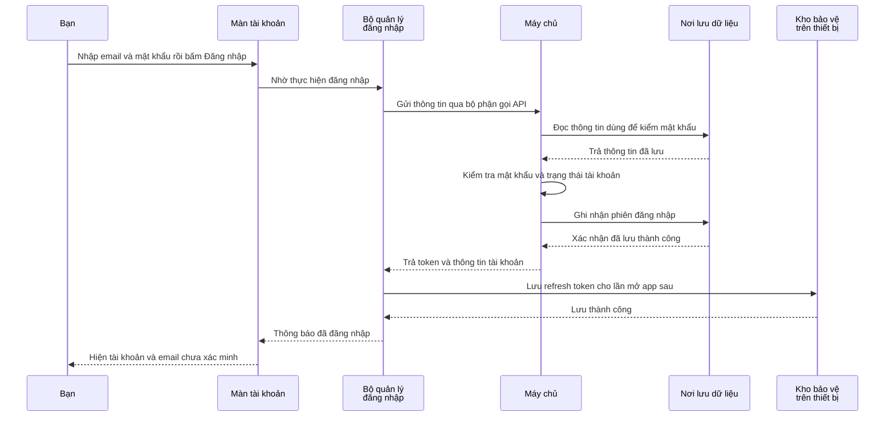

# B01-01 — App đăng nhập và nhớ tài khoản của bạn như thế nào?

DOC-088 · 01/10/2026 · Báo cáo phần email/mật khẩu ở phiên bản code [`50d184a`](https://github.com/anhthaingd/dich-vu-quanh-ban/commit/50d184a). [Checklist](../01-checklist.md).

Bản này giải thích cho người mới học code. Số kiểm thử cuối bài thuộc phiên bản đã ghi nhận, không phải kết quả chạy mới. Phần đổi ngôn ngữ được làm sau đó và có [báo cáo riêng](I18N-01-nen-da-ngon-ngu.md).

## Bạn đã dùng được những gì?

Bạn có thể đăng ký bằng email/mật khẩu, đăng nhập, đóng rồi mở lại app để khôi phục đăng nhập, và đăng xuất. Email vẫn được ghi rõ **chưa xác minh**: nhập email và mật khẩu chưa chứng minh bạn sở hữu hộp thư đó.

Mật khẩu thử nghiệm được duyệt dài 15–128 ký tự. Phần OTP/xác minh đang **Pending theo yêu cầu của bạn**, chưa triển khai cả bản local lẫn gửi thật. Các phần quên mật khẩu, thay email/số điện thoại, khôi phục và xóa tài khoản cũng chưa hoàn tất.

## Vì sao app nhớ đăng nhập mà không cần lưu mật khẩu?

Sau khi kiểm tra mật khẩu đúng, máy chủ cấp các chuỗi bí mật gọi là **token**. Bạn có thể hình dung chúng như giấy chứng nhận đăng nhập. Chúng không phải mã OTP và không được chia sẻ cho người khác.

| Tên trong code | Dùng làm gì? | Hiện lưu ở đâu? |
|---|---|---|
| `access_token` | Gửi kèm yêu cầu để máy chủ biết đang làm việc với tài khoản nào. Có hạn 15 phút, và vẫn phải qua kiểm tra phiên còn hiệu lực | Bộ nhớ tạm của app |
| `refresh_token` | Xin lại thông tin đăng nhập khi cần, để không phải nhập mật khẩu liên tục | Bộ nhớ app và nơi lưu được bảo vệ trên Android/iOS, gọi là SecureStore |
| `session` — phiên đăng nhập | Bản ghi máy chủ dùng để biết lần đăng nhập này còn hiệu lực hay đã đăng xuất | Nơi lưu dữ liệu của máy chủ |

**Bộ nhớ tạm** mất khi ứng dụng bị đóng hoàn toàn. **SecureStore** giúp giữ chuỗi cần thiết cho lần mở sau. Phiên có hạn tối đa 30 ngày; đổi token không đẩy mốc này xa thêm. Bản xem thử trên web chỉ giữ token trong bộ nhớ tạm, khác app Android/iOS.

## Khi bấm Đăng nhập, chuyện gì xảy ra?



Sơ đồ là trường hợp thành công. Bước kiểm mật khẩu nằm trong chương trình máy chủ, không phải màn hình tự quyết định. Máy chủ phải lưu phiên thành công trước khi trả kết quả; app phải lưu được token trước khi báo đăng nhập thành công.

## Mở code theo thứ tự này

| Bước | File và đoạn cần tìm | Bạn sẽ đọc được điều gì? |
|---|---|---|
| 1 | [AccountScreen.tsx](../../../apps/mobile/src/features/auth/screens/AccountScreen.tsx), `submit` | Lấy email/mật khẩu bạn vừa nhập và chọn gọi đăng ký hoặc đăng nhập. Đây là nơi xử lý thao tác bấm |
| 2 | [auth-session.ts](../../../apps/mobile/src/features/auth/state/auth-session.ts), `login`, `run` | Nhận thông tin từ màn hình, đánh dấu đang xử lý để tránh làm hai thao tác tài khoản chồng nhau, rồi nhờ phần gọi API gửi đi |
| 3 | [auth-api.ts](../../../apps/mobile/src/features/auth/api/auth-api.ts) → [request.ts](../../../apps/mobile/src/lib/http/request.ts) | File thứ nhất biết đường gửi yêu cầu đăng nhập và dữ liệu cần gửi. File thứ hai thực hiện gửi qua mạng và báo lỗi khi không nhận được kết quả |
| 4 | [auth.controller.ts](../../../services/api/src/modules/auth/auth.controller.ts) và [auth.input.ts](../../../services/api/src/modules/auth/auth.input.ts) | Máy chủ nhận yêu cầu, kiểm tra dữ liệu nhập và giới hạn số yêu cầu. Không chấp nhận việc app tự gửi thêm quyền cho tài khoản |
| 5 | [auth.service.ts](../../../services/api/src/modules/auth/auth.service.ts), `login`; [password.ts](../../../services/api/src/modules/auth/password.ts), `verifyPassword` | Tìm tài khoản, kiểm mật khẩu và kiểm tài khoản có đang được phép sử dụng hay không |
| 6 | Cùng `auth.service.ts`, `issue`, `transaction` | Tạo token và ghi phiên đăng nhập. `transaction` gom các bước ghi dữ liệu thành một nhóm: thành công thì chốt, lỗi thì hủy thay đổi trong nhóm |
| 7 | Quay về [auth-session.ts](../../../apps/mobile/src/features/auth/state/auth-session.ts), `accept`; [token-storage.ts](../../../apps/mobile/src/features/auth/state/token-storage.ts) | Nhận kết quả, lưu refresh token vào thiết bị. Lưu xong mới đổi thông tin đang ghi nhớ thành đã đăng nhập |
| 8 | Quay về `AccountScreen.tsx` | Màn hình nhận thông tin mới và hiện tài khoản thay cho mẫu nhập đăng nhập |

[App.tsx](../../../apps/mobile/src/app/App.tsx) nối các phần này khi app mở. [AuthProvider.tsx](../../../apps/mobile/src/app/providers/AuthProvider.tsx) cho các màn dùng chung bộ quản lý đăng nhập, gọi `restore` để khôi phục khi mở app và `verify` để kiểm lại khi trở về app. [002_accounts.sql](../../../services/api/migrations/002_accounts.sql) tạo các bảng lưu tài khoản và phiên đăng nhập.

## Đọc một đoạn code ngắn

Trong `auth-session.ts`, đoạn sau được rút gọn để giải thích thứ tự; đây không phải toàn bộ hàm:

```ts
await this.storage.write(session.refresh_token);
this.session = session;
this.update({ phase: 'authenticated', user: session.user });
```

`await` nghĩa là **chờ việc này xong rồi mới đi tiếp**. Dòng đầu chờ lưu token. Dòng thứ hai giữ kết quả đăng nhập trong bộ nhớ. Dòng cuối báo cho màn hình rằng đã đăng nhập và tài khoản là ai. Nếu báo thành công trước khi lưu xong, người dùng có thể tưởng app sẽ nhớ tài khoản dù việc lưu thực tế bị lỗi.

## Các trường hợp dễ hiểu nhầm

**Đóng rồi mở app:** app đọc token đã lưu và hỏi lại máy chủ. Nếu còn hợp lệ, máy chủ cấp token mới và app lưu lại. App không chỉ nhìn thấy tên đã lưu rồi tự coi bạn đã đăng nhập.

**Đăng xuất khi mất mạng:** app không báo rằng máy chủ đã đăng xuất khi chưa xác nhận được. Nó giữ thông tin cần thiết để bạn thử lại. Khi máy chủ xác nhận phiên đã hết hiệu lực, app xóa thông tin trên thiết bị.

**Lưu token thất bại:** app không báo đăng nhập thành công. Nó thử yêu cầu máy chủ hủy phiên vừa cấp. Nếu lần hủy đó cũng mất mạng, không thể khẳng định đã hủy; thời hạn phía máy chủ vẫn là giới hạn còn lại.

**Token cũ bị dùng lại:** sau khi đã đổi refresh token, token cũ không còn được dùng. Nếu máy chủ thấy nó xuất hiện lại, chuỗi phiên liên quan bị thu hồi để hạn chế việc tiếp tục dùng token có thể đã bị sao chép. Đó là lý do cần kiểm tra cả phía máy chủ.

Mật khẩu không được lưu dưới dạng đọc lại được: máy chủ lưu kết quả băm, tức kết quả tính toán dùng để kiểm tra mật khẩu lần sau. Token, mật khẩu và email không được ghi vào nhật ký hoạt động của luồng này.

## Bạn có thể tự thử và tự kiểm hiểu

Dùng tài khoản thử: đăng ký → thấy email chưa xác minh → đóng/mở app → đăng xuất → nhập sai mật khẩu → thử lại đúng. Mật khẩu trong ô nhập được xóa sau khi gửi hoặc rời màn theo cách xử lý hiện có.

- Vì sao không chỉ đổi màn hình thành “đã đăng nhập”? Vì máy chủ mới là nơi quyết định tài khoản/phiên có hợp lệ hay không.
- Vì sao cần cả `AccountScreen` và `AuthSession`? Màn hình quản lý ô nhập và cách hiển thị; bộ quản lý đăng nhập giữ quy trình dùng chung, kể cả lúc đóng/mở app.
- Muốn tìm chỗ app nhớ tài khoản cho lần mở sau? Theo `accept` → `token-storage.ts`; rồi đọc `restore` để thấy chiều đọc lại.

## Kết quả kiểm tra và phần tra cứu kỹ thuật

Ở phiên bản được báo cáo, 65 bài kiểm tra phía app và 30 bài phía máy chủ đã đạt; đây là tổng bộ kiểm tra, không phải tất cả đều chỉ kiểm đăng nhập. Luồng đăng ký, mở lại app, đăng xuất và nhập sai/thử lại cũng đã được kiểm trên máy ảo Android/iOS.

**Cách đọc:** `PASS` là đạt; `coverage` là mức code được chạy qua trong kiểm thử, không có nghĩa chắc chắn hết lỗi; `CI` là kiểm tra tự động trên GitHub; `UAT` là bước chủ dự án thử và nghiệm thu. `Local` nghĩa là trên máy phát triển, chưa phải hệ thống phục vụ người dùng thật.

<details>
<summary>Mở chi tiết lưu dữ liệu, giới hạn và bằng chứng kỹ thuật</summary>


| Nơi | Dữ liệu giữ |
|---|---|
| Form | Password trong memory khi đang nhập; không lưu lâu dài |
| Snapshot UI | phase/user/busy/error; không đưa token vào snapshot |
| AuthSession | Access/refresh ở memory; không dùng state hiển thị để cấp quyền |
| SecureStore | Refresh token native; test runner dùng namespace riêng |
| DB identities | Password hash có salt; verified_at vẫn null |
| DB sessions | SHA-256 refresh hash, family, expires_at, revoked_at; không lưu refresh thô |
| Log | Event/route/status/correlation; test canary xác nhận không lộ email/password/token |

Rate limit hiện ở một process local, chưa là limiter phân tán production. Profile trả mảng partner/admin rỗng và cờ verified false cho lát này; không phải toàn bộ authorization đã hoàn thiện. `locale` chỉ `vi`; tại mốc `50d184a`, lỗi UI còn viết trực tiếp trong state. I18N-01/02 đã chuyển sang mã lỗi và dịch tại UI; xem báo cáo mới hơn được liên kết ở đầu file.

## Thay đổi và cách thử

Thêm auth module, migration 002, AuthProvider/AccountScreen/AuthSession, SecureStore, dependency `jose`, route Account và tests. `AUTH_SECRET` riêng trong env ignored bật auth module; `.env.example` chỉ là ví dụ local. API health/catalog vẫn chạy độc lập khi chưa bật auth.

Mở app → Tài khoản → Đăng ký → tên/email test/mật khẩu 15–128 ký tự → thấy “Email chưa xác minh”. Đóng/mở app rồi vào Tài khoản để kiểm restore. Logout → login sai → kiểm lỗi, email còn/password được xóa → thử lại đúng. Không dùng tài khoản thật khi thử test DB.

Trên iOS, đăng ký đang tắt gợi ý tạo mật khẩu vì input view new-password đã gây lỗi trong build iOS 27 được thử; login vẫn giữ AutoFill. Hỗ trợ nút Xong trên bàn phím. Maestro đóng hộp thoại Save Password; fallback tọa độ đã kiểm trên iPhone 18 Pro, cần rà lại khi đổi simulator/runtime. Không coi bản vá này là đã kiểm mọi thiết bị iOS.

## Kiểm thử và bằng chứng

| Lớp | Kết quả cuối của lát code | Nguồn |
|---|---|---|
| Mobile | 65 tests đạt; coverage gate core lines 100%, app lines khoảng 98.73% | `npm run test:coverage -w apps/mobile`; [state tests](../../../apps/mobile/src/features/auth/state/auth-session.test.ts), [screen tests](../../../apps/mobile/src/features/auth/screens/AccountScreen.test.tsx) |
| API/DB | 30 tests đạt; hash/revocation/concurrency/TTL 15 phút/30 ngày, contract và safe logs | `npm run test:coverage -w services/api`; [auth integration](../../../services/api/test/integration/auth.test.ts) |
| Web | 3 tests đạt, gồm auth và catalog với DB thật | `npm run test:e2e`; [auth.spec.mjs](../../../tests/e2e/web/auth.spec.mjs) |
| Native | Android PASS `2026-09-30T15:14:23.889Z`; iOS PASS `2026-09-30T15:12:09.013Z` | `test-results/native/{android,ios}/auth/result.json`; [auth.yaml](../../../tests/e2e/native/auth.yaml) |
| Tooling/build | 3 tooling tests; typecheck/lint/build/native-config đạt | Scripts hiện hành ở root package.json; log local của phiên triển khai |
| CI | 3 jobs đạt tại đúng `50d184a`, kiểm lại ngày 01/10 | [Quality](https://github.com/anhthaingd/dich-vu-quanh-ban/actions/runs/36810424485) |

Native kiểm trên Android API 36 và iPhone 18 Pro/iOS 27 simulator; flow gồm register → cold-start restore → logout → wrong-login/retry → logout. Schema test đã xóa; API 3100 và Metro 8081/8082 được giữ, Metro test 8083/8084 đã dừng sau phiên kiểm. Đây là bằng chứng của phiên triển khai, không phải đảm bảo các process luôn chạy khi đọc báo cáo.

Các con số trên là toàn suite tại commit, không phải 65/30 ca đều riêng auth. Báo cáo được viết từ code/artifact đã có; không chạy lại app trong đợt viết tài liệu. CI artifact có thời hạn giữ; local artifact bị ignore, có thể cần chạy lại theo [lệnh](../02-quy-trinh-va-cau-truc.md).


</details>

Phần OTP/xác minh giữ Pending. Xem [checklist](../01-checklist.md) để biết phần tài khoản nào còn chưa làm; báo cáo này không có nghĩa toàn bộ nhóm B01 đã hoàn thành.
