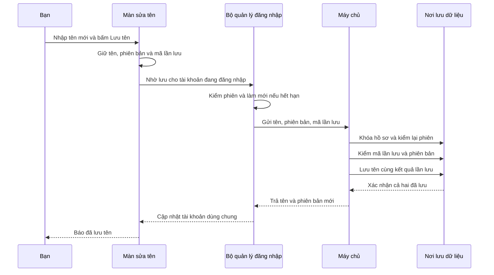

# B01-04 — Bấm Lưu tên thì app và máy chủ làm gì?

06/10/2026 · DELIVERY-01 · Lát sửa tên trên code sau `8a64f94`, chưa commit/push và chưa có CI mới/UAT. Đây là một phần B01-04, không phải toàn bộ hồ sơ/phiên/địa chỉ. [Checklist](../01-checklist.md) · [Phương án đã duyệt](../de-xuat/B01-04-ho-so-ten-hien-thi.md).

## Bạn đã dùng được gì?

Đăng nhập → **Tài khoản → Sửa tên hiển thị**. App đọc tên đang lưu, bạn nhập tên mới và bấm **Lưu tên**. Khi máy chủ xác nhận đã lưu, app báo thành công; quay lại Tài khoản thấy tên mới, avatar dùng tên mới để lấy chữ viết tắt. Đóng rồi mở lại app native vẫn đọc được tên đã lưu trong DB.

Tên được bỏ khoảng trắng ở hai đầu, dài 1–100 ký tự theo giới hạn đang dùng lúc đăng ký. Đổi giao diện Việt/Anh/Nhật không dịch tên của bạn và không xóa tên đang nhập. Chức năng không thay email, mật khẩu, trạng thái xác minh hoặc ngôn ngữ tài khoản. OTP vẫn Pending.

## Vì sao cần hai loại số/mã?

**`version` là số phiên bản hồ sơ.** App đọc phiên bản 3 thì khi lưu gửi `expected_version: 3`, nghĩa là “tôi sửa dựa trên bản số 3”. Máy chủ chỉ nhận nếu hiện vẫn là 3, rồi tăng lên 4. Nếu thiết bị khác đã lưu thành 4, app báo cần tải lại. Nhờ vậy bản cũ không âm thầm ghi đè bản mới.

**`Idempotency-Key` là mã riêng cho một lần bấm lưu.** Nếu máy chủ đã lưu nhưng mạng mất trước khi trả lời, app không biết thành công hay chưa. Khi bấm Thử lại, app gửi đúng mã và nội dung cũ; máy chủ tìm kết quả đã lưu rồi trả lại, không tăng phiên bản lần hai. Mã này khác mã theo dõi request trong log: mỗi lượt gửi có request ID mới, còn lần lưu thử lại giữ nguyên Idempotency-Key.

## Theo một lần lưu thành công

“Khóa hồ sơ” nghĩa là trong lúc một yêu cầu đang sửa, yêu cầu khác cho cùng tài khoản phải chờ. “Giao dịch” là nhóm lệnh DB cùng thành công hoặc cùng hủy: không để tên đổi rồi mã lần lưu lại chưa được ghi.

## Mở code theo thứ tự nào?

| Bước | File và hàm thật | Nhận gì → làm gì → chuyển cho ai? |
|---|---|---|
| 1 | [AccountScreen.tsx](../../../apps/mobile/src/features/auth/screens/AccountScreen.tsx), nút `profile-open`; [AppNavigator.tsx](../../../apps/mobile/src/app/navigation/AppNavigator.tsx) | Bấm sửa tên → chuyển đến route `Profile`. Route không mang token hoặc tên đã dịch. |
| 2 | [ProfileScreen.tsx](../../../apps/mobile/src/features/accounts/screens/ProfileScreen.tsx), `ProfileForm` | Lấy ID tài khoản hiện hành → tạo `ProfileEditor`, gọi `load`. Ô nhập chỉ thay bản nháp, chưa ghi DB. Nút lưu gọi `editor.save()`. |
| 3 | [profile-editor.ts](../../../apps/mobile/src/features/accounts/state/profile-editor.ts), `load`, `setName`, `save` | Đọc tên/version, giữ bản nháp và mã lần lưu. Chỉ đặt `saved: true` sau khi nhận kết quả thành công. Trạng thái giữ mã lỗi để giao diện dịch theo ngôn ngữ đang chọn. |
| 4 | [auth-session.ts](../../../apps/mobile/src/features/auth/state/auth-session.ts), `editProfile` → `profileOperation` | Kiểm đúng tài khoản, chặn thao tác phiên chạy chồng nhau, làm mới token nếu cần. Token giữ riêng trong bộ quản lý, không đưa vào trạng thái màn hình. Phản hồi thuộc tài khoản khác bị từ chối. |
| 5 | [accounts-api.ts](../../../apps/mobile/src/features/accounts/api/accounts-api.ts), `edit`; [request.ts](../../../apps/mobile/src/lib/http/request.ts), `requestJson` | Gửi `PATCH /v1/me`, header Bearer + Idempotency-Key và JSON `{expected_version, display_name}`. Kiểm response có Me hợp lệ, gồm version. Chỉ nhận các mã lỗi 409 được cho phép. |
| 6 | [accounts.controller.ts](../../../services/api/src/modules/accounts/accounts.controller.ts), `edit`; [profile.input.ts](../../../services/api/src/modules/accounts/profile.input.ts), `profileInput` | Máy chủ nhận yêu cầu → kiểm UUID của key, tên và phiên bản; từ chối trường lạ như user_id/email_verified. Sắp xếp các trường theo thứ tự cố định trước khi tính dấu nhận diện nội dung. |
| 7 | [accounts.service.ts](../../../services/api/src/modules/accounts/accounts.service.ts), `edit` | Xác thực, mở giao dịch, khóa user, kiểm lại phiên sau khi chờ khóa. Kiểm key trước version để retry của lần đã thành công vẫn được trả kết quả. Key khác nội dung hoặc version cũ trả 409. |
| 8 | [004_profile_idempotency.sql](../../../services/api/migrations/004_profile_idempotency.sql) và câu SQL trong `edit` | `users` lưu tên và version; `idempotency_keys` lưu actor, operation, key, dấu nhận diện nội dung và kết quả tối thiểu. Cùng commit; lỗi thì rollback cả hai. |
| 9 | Quay về `AuthSession` → `ProfileEditor` → `ProfileForm` | Nhận Me mới → cập nhật dữ liệu tài khoản dùng chung → hiện thông báo thành công. Header/avatar đọc cùng tài khoản nên không cần tự lưu thêm một bản tên. |

[App.tsx](../../../apps/mobile/src/app/App.tsx) nối `createAccountsApi` với `AuthSession` khi khởi động. [AccountsModule](../../../services/api/src/modules/accounts/accounts.module.ts) nối controller/service/DB và dùng lại AuthModule. [AuthService.authenticate](../../../services/api/src/modules/auth/auth.service.ts) kiểm token và phiên DB; register/login/refresh/GET me đều trả version thật. Đây là phần chuẩn bị và hỗ trợ luồng, không phải màn hình tự kết nối DB.

## Gặp lỗi thì chuyện gì xảy ra?

- **Hai thiết bị sửa cùng lúc:** chỉ một lần lưu được nhận. Bản còn lại giữ tên đang nhập, yêu cầu **Tải lại hồ sơ**. Sau tải lại, màn hình hiện “Tên đang lưu” mới nhất; bạn tự quyết định có tiếp tục lưu bản nháp không.
- **Mất mạng hoặc timeout:** chưa báo thành công. Giữ key/nội dung cũ và tạm khóa ô tên cho tới khi thử lại có kết quả rõ, tránh biến retry thành một yêu cầu khác.
- **Bấm lưu liên tục:** màn hình và bộ quản lý phiên chặn gửi chồng; máy chủ vẫn kiểm key/phiên bản độc lập.
- **Phiên hết hạn/bị thu hồi:** làm mới qua đường refresh đã có. Nếu không còn quyền đăng nhập, xóa phiên và thay form bằng lời nhắc đăng nhập; không tự đặt email_verified thành true.
- **Lỗi DB sau cập nhật tên nhưng trước ghi key:** giao dịch hoàn tác tên/version, nên thử lại không gặp trạng thái lưu dở.
- **Rời màn hoặc đóng app:** bản nháp/key chỉ ở bộ nhớ, chưa có hàng đợi lưu ngoại tuyến bền vững. Mở lại màn sẽ đọc DB mới nhất. Tên đã commit ở DB vẫn còn. Không ghi tên hay token vào log.

## Bạn tự thử và tự kiểm hiểu

1. Mở Tài khoản, sửa tên, đổi English rồi 日本語: ô nhập vẫn giữ tên. Bấm lưu, quay lại xem tên và avatar.
2. Mở màn sửa tên trên cả hai máy ảo cùng tài khoản. Lưu tên trên máy thứ nhất rồi lưu tên khác trên máy thứ hai: máy thứ hai phải báo hồ sơ đã thay đổi. Tải lại để thấy tên máy thứ nhất, bản nháp máy thứ hai vẫn còn.
3. Đóng rồi mở lại app: tên lấy từ DB, không lấy từ bản nháp cũ.

Câu hỏi: Vì sao key được kiểm trước version? Vì lần lưu đầu đã tăng version, nhưng lần gửi lại cùng key vẫn phải nhận kết quả cũ. Vì sao không nhận user_id từ form? Vì máy chủ phải lấy tài khoản từ phiên đã xác thực. Ai quyết định hiện “Đã lưu”? `ProfileEditor.save`, sau khi API xác nhận thành công.

## Kiểm thử và giới hạn

Kết quả bên dưới là kiểm trên máy phát triển. Chưa có commit/CI mới, UAT của chủ dự án hoặc kiểm trên điện thoại thật. Lát này không mở quản lý phiên, địa chỉ, ảnh đại diện hay xác minh OTP.

Lệnh, file kiểm thử và bằng chứng

| Phạm vi | Kết quả và cách chạy lại |
|---|---|
| API/PostGIS | 44 test đạt; `npm run test:coverage -w services/api`. [profile.test.ts](../../../services/api/test/integration/profile.test.ts) kiểm cạnh tranh, retry, quyền, dữ liệu sai, thu hồi giữa hai lần kiểm, rollback, schema Session/Me qua bộ auth hiện có. |
| Mobile | 98 test đạt; `npm run test:coverage -w apps/mobile`. Ba file test cạnh API, ProfileEditor và ProfileScreen kiểm key, draft, đổi ngôn ngữ, mất phiên và navigation. |
| Web thật | 5 hành trình hồi quy đạt; hành trình profile đạt sau sửa selector chỉ chọn nút ở màn đang mở. `npm run test:e2e`; [profile.spec.mjs](../../../tests/e2e/web/profile.spec.mjs) cố ý bỏ phản hồi sau khi server đã commit và kiểm DB chỉ tăng một lần. |
| iOS Simulator | Profile PASS: sửa tên, giữ draft VI/EN/JA, quay lại và cold start; `DEVICE_ID=<simulator-UUID> npm run test:native -- ios profile`. |
| Android emulator | Profile PASS: sửa tên, giữ bản nháp VI/EN/JA, quay lại Tài khoản và mở lại app; `DEVICE_ID=emulator-5554 npm run test:native -- android profile`. |
| Chất lượng code | Typecheck/lint/build và 3 test tooling đã đạt; kết quả kiểm cuối ghi tại checklist. Migration 004 đã chạy local, không reset dữ liệu cũ. |

Artifact ở `test-results/api`, `coverage/api`, `coverage/mobile`, `test-results/web`, `test-results/native/{android,ios}/profile`; không track Git. Các log kiểm lệnh ở `/private/tmp/dvqb-profile-*.log` có thể bị dọn. Native dùng schema riêng trong `dvqb_test`, xóa sau kiểm; không dùng tài khoản thật. Màn sửa tên không cần rebuild native vì không thêm thư viện native.

Trong lần kiểm Android đầu, hướng dẫn viết tay của bàn phím Gboard nhận mất thao tác nhập. Bộ chạy test tạm tắt tính năng viết tay cho bài profile và khôi phục giá trị ban đầu khi kết thúc; đã kiểm việc khôi phục. Đây là xử lý môi trường kiểm thử, không thay hành vi nhập tên của app. Hai bản `profile/result.json` cuối đều ghi PASS ngày 06/10/2026.

Thay contract đã duyệt: `Me.version` bắt buộc trong OpenAPI v0.1.4, bao gồm Session.user. Nguồn API/QA, mirror, viewer và ZIP hiện hành được đồng bộ; sổ quản lý ghi phạm vi và tài liệu không áp dụng. Không đổi mô hình users/phiên; chỉ triển khai bảng idempotency đã có trong thiết kế. Không đặt hạn xóa key khi chính sách retention chưa chốt. Tài liệu chuẩn: [API](../../technical-design/02-api-realtime.md), [dữ liệu](../../technical-design/01-data-design.md), [QA](../../technical-design/03-qa-plan.md).

## Phần tiếp theo

B01-04 vẫn **một phần**: còn quản lý các phiên và địa chỉ. I18N-03 cần chốt cách ưu tiên ngôn ngữ tài khoản/thiết bị. OTP giữ Pending. Bàn giao này để chủ dự án xem code và thử; chưa tự push hoặc phát hành.
