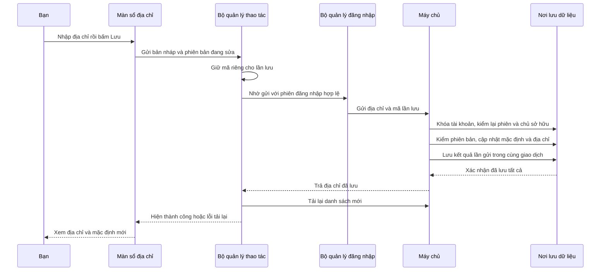

# B01-04 — Quản lý phiên đăng nhập và sổ địa chỉ

06/10/2026 · DELIVERY-01 · Quyết định B01-04A đã duyệt cả gói. Code mới sau `312972b`, chưa commit/push/CI mới, chưa UAT của chủ dự án. [Checklist](../01-checklist.md) · [Báo cáo sửa tên](B01-04-ho-so-ten-hien-thi.md).

## Bạn dùng được gì?

Vào **Tài khoản → Địa chỉ đã lưu** để thêm, sửa, gỡ địa chỉ hoặc chọn địa chỉ mặc định. Dữ liệu được lưu trong PostgreSQL, là nơi lưu dữ liệu thật của app. Đóng rồi mở app vẫn còn địa chỉ. Bạn nhập tên gợi nhớ, địa chỉ và tọa độ bằng tay; chưa có chọn điểm trên bản đồ.

Địa chỉ đầu tiên khi sổ đang rỗng tự là mặc định. Chọn địa chỉ khác làm mặc định sẽ bỏ mặc định cũ. Nếu gỡ địa chỉ mặc định, danh sách còn lại chưa có mặc định; app không chọn thay bạn. “Gỡ” chỉ ẩn khỏi sổ đang dùng, chưa xóa bản ghi lịch sử.

Vào **Tài khoản → Phiên đăng nhập** để xem từng lần đăng nhập, thời điểm tạo/hoạt động và mục nào đang được app này sử dụng. Thu hồi một mục khiến lần đăng nhập đó không còn truy cập được, kể cả khi mã đăng nhập vừa được làm mới. Thu hồi mục hiện tại sẽ đưa app về lời nhắc đăng nhập. Chưa có nút thu hồi tất cả phiên khác cùng lúc; đây vẫn là yêu cầu còn lại của FR-AUTH-008.

Cả hai màn có Việt/Anh/Nhật, tải dữ liệu, danh sách rỗng, lỗi, tải lại và xem thêm khi có nhiều mục. App yêu cầu xác nhận trước gỡ địa chỉ hoặc thu hồi phiên. Bản nháp địa chỉ giữ nguyên khi đổi ngôn ngữ.

## Vì sao gom các phần này cùng đợt?

Phiên và địa chỉ đều thuộc tài khoản đang đăng nhập, cùng cần kiểm chủ sở hữu và xử lý mạng lỗi. Đợt này làm chung phần giao tiếp an toàn, rồi tách logic phiên và địa chỉ thành các file riêng. Theo yêu cầu mới, các đợt sau gom chức năng liên quan có đủ quyết định; không dừng sau từng nút hoặc từng trường. Không cần thêm framework hay dịch vụ trả phí.

## Theo một lần lưu địa chỉ

“Giao dịch” nghĩa là các lệnh lưu cùng thành công hoặc cùng hủy. Nếu lưu địa chỉ mới thất bại, địa chỉ mặc định cũ không bị bỏ mặc định dở dang.

## Đọc code theo đường đi nào?

| Bước | File/hàm thật | Nhận gì, làm gì, chuyển sang đâu? |
|---|---|---|
| 1 | [AccountScreen.tsx](../../../apps/mobile/src/features/auth/screens/AccountScreen.tsx), các nút `addresses-open`/`sessions-open`; [AppNavigator.tsx](../../../apps/mobile/src/app/navigation/AppNavigator.tsx) | Bạn bấm nút → mở màn tương ứng. Không truyền mật khẩu hay token qua điều hướng. |
| 2 | [AddressesScreen.tsx](../../../apps/mobile/src/features/accounts/screens/AddressesScreen.tsx), `save`, `reload`, `draftOf`, `inputOf` | Ô nhập giữ bản nháp riêng. `inputOf` đổi tọa độ chữ thành số và tạo dữ liệu gửi; khi sửa có `expected_version`. Khi xung đột, tải lại phiên bản nhưng giữ nội dung bạn đang nhập. |
| 3 | [SessionsScreen.tsx](../../../apps/mobile/src/features/accounts/screens/SessionsScreen.tsx), `Sessions` | Đọc danh sách lần đăng nhập; chọn mục → hiện xác nhận → nhờ bộ quản lý thu hồi. Thời gian được hiển thị theo ngôn ngữ và múi giờ thiết bị. |
| 4 | [account-collection.ts](../../../apps/mobile/src/features/accounts/state/account-collection.ts), `load`, `read`, `perform` | `load/read` tải danh sách theo từng trang. `perform` giữ nguyên công việc và mã lần gửi khi mạng lỗi, chặn bấm chồng. Lưu thành công rồi tải lại lỗi thì chỉ cần tải lại, không gửi lệnh lưu lần nữa. |
| 5 | [auth-session.ts](../../../apps/mobile/src/features/auth/state/auth-session.ts), `accountOperation` | Kiểm đúng tài khoản, dùng lại đường làm mới phiên khi cần. Các hàm `listAddresses`, `saveAddress`, `archiveAddress`, `listSessions`, `revokeSession` nối tới API. Thu hồi phiên hiện tại xóa phiên lưu an toàn trên máy. Token vẫn nằm riêng trong bộ quản lý này. |
| 6 | [accounts-api.ts](../../../apps/mobile/src/features/accounts/api/accounts-api.ts), `createAccountsApi`; [models.ts](../../../apps/mobile/src/features/accounts/models.ts) | Gửi GET/POST/PUT qua HTTP chung; kiểm cấu trúc dữ liệu máy chủ trả về trước khi dùng. Tọa độ dùng `latitude/longitude` đúng OpenAPI. |
| 7 | [accounts.controller.ts](../../../services/api/src/modules/accounts/accounts.controller.ts); [accounts.input.ts](../../../services/api/src/modules/accounts/accounts.input.ts) | Nhận yêu cầu và kiểm đầu vào. Không nhận user_id từ app; từ chối trường lạ, tọa độ sai, UUID/key sai, phiên bản không hợp lệ. |
| 8 | [addresses.service.ts](../../../services/api/src/modules/accounts/addresses.service.ts), `list`, `save`, `archive` | Chỉ đọc/sửa địa chỉ của tài khoản từ phiên. `save` kiểm phiên bản, chuyển mặc định và lưu địa chỉ; `archive` đánh dấu đã gỡ. |
| 9 | [sessions.service.ts](../../../services/api/src/modules/accounts/sessions.service.ts), `list`, `revoke` | Gom các mã làm mới thuộc cùng lần đăng nhập thành một mục. `revoke` thu hồi cả nhóm đó trong DB, không chỉ mã đang nhìn thấy. |
| 10 | [account-transaction.ts](../../../services/api/src/modules/accounts/account-transaction.ts), `run` | Khóa tài khoản, kiểm lại phiên sau khi chờ, kiểm mã lần gửi, chạy lệnh lưu và lưu kết quả cùng giao dịch. Cùng mã nhưng nội dung khác bị từ chối. |
| 11 | [005_saved_addresses.sql](../../../services/api/migrations/005_saved_addresses.sql) | Tạo bảng địa chỉ có điểm địa lý, phiên bản và dấu mặc định. Ràng buộc DB đảm bảo một tài khoản không có hai địa chỉ mặc định đang hoạt động. Không reset dữ liệu cũ. |

[AccountPage](../../../apps/mobile/src/features/accounts/components/AccountPage.tsx) thay dữ liệu riêng bằng lời nhắc đăng nhập khi mất phiên. [CollectionStatus](../../../apps/mobile/src/features/accounts/components/CollectionStatus.tsx) chỉ hiển thị trạng thái; câu thông báo lấy từ từ điển. Các API được nối trong [AccountsModule](../../../services/api/src/modules/accounts/accounts.module.ts).

## Ba điểm dễ nhầm

**Một lần đăng nhập khác một token.** Token là mã app gửi để chứng minh phiên đăng nhập. Sau khi làm mới, mã thay đổi nhưng lần đăng nhập vẫn giữ cùng `family_id`. Màn phiên hiển thị ID của nhóm này để không mọc thêm một “thiết bị” sau mỗi lần refresh. Chưa nhận diện tên máy/model/IP.

**`version` khác mã lần lưu.** Version ngăn bản cũ ghi đè bản mới. `Idempotency-Key` giúp nhận lại kết quả của lần lưu khi phản hồi bị mất. Đổi địa chỉ mặc định cũng tăng version của địa chỉ mất mặc định, vì dữ liệu của nó đã thay đổi.

**Xem thêm dùng cursor.** Cursor là dấu tiếp tục sau mục cuối trang, có chữ ký để máy chủ phát hiện bị sửa. Dấu này gắn tài khoản và loại danh sách, không dùng cursor địa chỉ để đọc phiên hoặc dữ liệu người khác. [cursor.ts](../../../services/api/src/common/http/cursor.ts) được tách từ phần danh mục để tái dùng, chỉ chứa ID/thời điểm/vùng truy vấn, không chứa tên hoặc địa chỉ.

## Khi lỗi xảy ra

- Mất phản hồi sau lưu: giữ nguyên dữ liệu/key, khóa sửa tạm thời; bấm Thử lại để nhận kết quả cũ. Không báo đã lưu khi chưa được xác nhận.
- Hai máy sửa cùng địa chỉ: lần dùng version cũ nhận lỗi 409. Tải lại lấy version hiện hành, vẫn giữ bản nháp để bạn quyết định lưu tiếp.
- Địa chỉ đã bị gỡ: sửa lại bị từ chối; mở lại danh sách không hiện mục đã gỡ. Gửi lại mã của một lần thêm cũ không khôi phục địa chỉ đã gỡ.
- Thu hồi đúng lúc refresh: cả hai cùng khóa tài khoản theo một thứ tự; token mới thuộc nhóm đã thu hồi cũng không truy cập được.
- Mất phiên: app ẩn màn dữ liệu riêng và mời đăng nhập lại; không tự coi email/điện thoại đã xác minh.
- Rời màn hoặc đóng app: bản nháp và lần gửi đang chờ chỉ ở bộ nhớ. Không có hàng đợi ngoại tuyến bền vững; mở lại đọc DB. Địa chỉ đã lưu vẫn còn.

Log dùng đường dẫn mẫu như `/v1/me/addresses/:id`, không ghi ID địa chỉ, nội dung địa chỉ, tọa độ hay token. Kiểm thử dùng dữ liệu canary để phát hiện rò log.

## Bạn tự thử để hiểu code

1. Thêm Nhà rồi Cơ quan, đặt Cơ quan mặc định. Mở DB hoặc phản hồi API: Nhà đã bỏ mặc định và tăng version.
2. Gỡ Cơ quan: Nhà vẫn còn nhưng chưa mặc định. Bấm Đặt làm mặc định nếu muốn dùng Nhà.
3. Mở cùng địa chỉ trên Android và iOS; lưu máy đầu rồi máy sau. Quan sát lỗi xung đột, tải lại và thử lưu tiếp.
4. Đăng nhập cùng tài khoản trên hai máy. Từ máy đầu thu hồi mục của máy kia; khi máy kia gọi API tiếp theo hoặc về foreground, app phải yêu cầu đăng nhập lại. Không có push đăng xuất tức thời khi app đứng yên.

Câu hỏi: Vì sao không nhận user_id trong form? Vì máy chủ phải lấy chủ sở hữu từ phiên xác thực. Vì sao chỉ tải lại sau lỗi đọc xảy ra sau lưu? Vì thao tác ghi đã được xác nhận; gửi thêm lệnh mới có thể gây tác dụng lặp. Vì sao gỡ địa chỉ giữ bản ghi? Để giữ dấu vết, không âm thầm sửa dữ liệu lịch sử.

## Kiểm thử và phạm vi còn lại

Đã kiểm local ngày 06/10/2026; chưa kiểm điện thoại thật hoặc UAT của chủ dự án. B01-04 vẫn **một phần**: còn thu hồi tất cả phiên khác bằng một thao tác, nối địa chỉ vào tìm/đặt dịch vụ và kiểm snapshot công việc khi miền jobs được triển khai. Không mở OTP, định danh, mật khẩu, ngôn ngữ tài khoản, provider trả phí hoặc production.

Lệnh và bằng chứng để tra cứu

| Kiểm tra | Kết quả |
|---|---|
| API/PostGIS | 50 test đạt, gồm contract OpenAPI, quyền chéo tài khoản, cursor, mặc định, cạnh tranh, rollback, revoke/refresh và log an toàn. `npm run test:coverage -w services/api` |
| Mobile | 106 test đạt; API/state/màn hình, bản nháp/ngôn ngữ/retry/conflict và mất phiên. `npm run test:coverage -w apps/mobile` |
| Web xuyên app/API/DB | 7 hành trình đạt; sau sửa tọa độ đã chạy lại riêng hành trình quản lý tài khoản đạt. `npm run test:e2e` |
| Android | Flow `accounts` PASS: thêm, mặc định đầu tiên, sửa/gỡ, giữ bản nháp qua VI/EN/JA, mở lại app, thu hồi phiên khác/hiện tại. `DEVICE_ID=emulator-5554 npm run test:native -- android accounts` |
| iOS | Cùng flow PASS trên iPhone 18 Pro/iOS 27. `DEVICE_ID=9B485B08-15C4-40BB-9E29-03816068E6AC npm run test:native -- ios accounts` |
| Chất lượng | Typecheck/lint/build và 3 tooling đạt. Prototype: test logic và build đạt sau sửa quy tắc gỡ mặc định. |
| Remote CI phần trước | `312972b` sửa tên đã push; [CI 37402534136](https://github.com/anhthaingd/dich-vu-quanh-ban/actions/runs/37402534136) đạt cả 3 jobs. Không dùng CI này làm bằng chứng cho gói phiên/địa chỉ chưa push. |

Test mới: [API](../../../services/api/test/integration/account-management.test.ts), [state](../../../apps/mobile/src/features/accounts/state/account-collection.test.ts), [màn hình](../../../apps/mobile/src/features/accounts/screens/AccountManagement.test.tsx), [web](../../../tests/e2e/web/account-management.spec.mjs), [native](../../../tests/e2e/native/accounts.yaml). Artifact ở `coverage/`, `test-results/native/{android,ios}/accounts`, `test-results/web`; log `/private/tmp/dvqb-accounts-*.log` có thể bị dọn. Test DB dùng schema riêng trong `dvqb_test`, không dùng tài khoản thật. Đã xem ảnh lưu địa chỉ trên cả hai máy ảo.

Lỗi phát hiện trong quá trình kiểm đã sửa: tên trường tọa độ không khớp Point trong OpenAPI; thao tác đóng bàn phím iOS đổi sang Done; số migration trong kiểm hồi quy tăng từ 4 lên 5. Không đổi contract tọa độ để chạy qua test. Android tạm tắt hướng dẫn viết tay Gboard trong bài tự động và khôi phục cấu hình cũ khi kết thúc.

Spec B01-04A: nguồn API/data/QA v0.1.5, mirror/viewer/ZIP; UX/prototype gỡ mặc định; FR/SRS/UX Drive bổ sung đúng phần, giữ lịch sử. Các file raw trên Drive cập nhật cùng ID và tải lại so bytes; registry ghi phạm vi/N/A và bằng chứng. Không tải báo cáo/checklist lên Drive.

