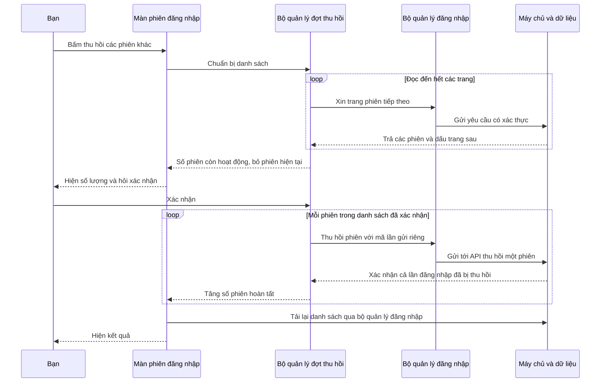

# B01-04/07 — Thu hồi các phiên khác và trở lại màn đang dùng

06/10/2026 · DELIVERY-01 · Phần bổ sung sau `4a98dc0`, chưa commit/push/CI riêng, chưa UAT. [Checklist](../01-checklist.md) · [Gói phiên/địa chỉ trước](B01-04-phien-va-dia-chi.md).

## Bạn dùng được gì?

Trong **Tài khoản → Phiên đăng nhập**, bấm **Thu hồi tất cả phiên khác**. App đọc hết danh sách, kể cả những trang chưa hiển thị, rồi cho bạn xác nhận số phiên sẽ thu hồi. Phiên của app đang thao tác được giữ lại.

Nếu mạng lỗi ở giữa, app báo số phiên đã xác nhận thu hồi. Bấm **Thử lại** để tiếp tục phần chưa xong. Các phiên đã thu hồi không được khôi phục. Nút này dùng API thu hồi từng phiên đã có, nên không hứa tất cả cùng thành công hoặc cùng hủy trong một lần.

Khi phiên hết hiệu lực ở màn **Địa chỉ**, **Phiên đăng nhập** hoặc **Sửa tên**, dữ liệu riêng bị ẩn. Bấm Đăng nhập, đăng nhập thành công sẽ trở lại đúng màn đó và đọc dữ liệu mới. App không tự lưu bản nháp hoặc lặp lại thao tác thu hồi. Nếu đăng nhập bằng tài khoản khác, chỉ đọc dữ liệu của tài khoản mới.

Đây là một đợt bổ sung của quản lý tài khoản, không mở OTP hoặc thay API/data đã chốt. B02 đăng ký partner hiện yêu cầu tài khoản đã xác minh; không bỏ qua điều kiện đó để chuyển sang phần tiếp theo.

## Theo thao tác thu hồi 22 phiên

Giả sử bạn có 22 lần đăng nhập khác, trong khi một trang chỉ trả 20 mục. Chỉ dùng các mục đang nhìn thấy sẽ bỏ sót phiên. App phải đọc các trang tiếp theo trước khi cho xác nhận.

Sơ đồ trên là nhánh thành công. Nếu phản hồi cho phiên thứ hai bị mất sau khi máy chủ đã thu hồi, app chưa thể biết thành công: số xác nhận vẫn là 1/22. Thử lại gửi đúng mã của phiên thứ hai để nhận kết quả cũ, rồi đi tiếp. Không quay lại xử lý phiên thứ nhất và không thêm phiên vừa đăng nhập sau lúc bạn xác nhận.

## Mở code theo thứ tự nào?

| Bước | File và hàm thật | Nhận gì → làm gì → chuyển cho ai |
|---|---|---|
| 1 | [SessionsScreen.tsx](../../../apps/mobile/src/features/accounts/screens/SessionsScreen.tsx), `Sessions`, `runBatch` | Nhận thao tác bấm, hiện số lượng/xác nhận/tiến độ. Nối các nút vào `prepare`, `cancel`, `run`. Sau thành công chỉ tải lại danh sách. |
| 2 | [session-revocation.ts](../../../apps/mobile/src/features/accounts/state/session-revocation.ts), `SessionRevocation.prepare` | Đọc các trang qua `list`. Gom theo ID để không lặp, kiểm có đúng một phiên hiện tại còn hoạt động. Bỏ phiên hiện tại, phiên hết hạn/đã thu hồi, giữ danh sách và tạo mã lần gửi cho từng mục. Chưa thu hồi gì trước xác nhận. |
| 3 | Cùng file, `run` | Bắt đầu từ số mục đã xác nhận. Chờ một phiên xong mới gửi phiên kế. Lỗi thì giữ nguyên vị trí và mã để lần thử lại không tạo tác dụng lặp. Trạng thái chỉ giữ mã lỗi và số liệu, câu chữ nằm ở từ điển VI/EN/JA. |
| 4 | [auth-session.ts](../../../apps/mobile/src/features/auth/state/auth-session.ts), `listSessions`, `revokeSession`, `accountOperation` | Nhận chủ tài khoản và ID phiên, kiểm vẫn đúng người, làm mới mã đăng nhập khi cần, rồi gọi API. Bộ đợt không đọc hoặc giữ token. |
| 5 | [accounts-api.ts](../../../apps/mobile/src/features/accounts/api/accounts-api.ts), `sessions`, `revokeSession` | Gửi GET danh sách hoặc POST thu hồi theo contract hiện có, kiểm cấu trúc trả về. Không có endpoint thu hồi hàng loạt mới. |
| 6 | [sessions.service.ts](../../../services/api/src/modules/accounts/sessions.service.ts), `list`, `revoke`; [account-transaction.ts](../../../services/api/src/modules/accounts/account-transaction.ts), `run` | Máy chủ kiểm chủ sở hữu từ phiên đăng nhập. Thu hồi cả nhóm token thuộc một lần đăng nhập và lưu kết quả thử lại cùng giao dịch DB. Phần này đã có ở đợt trước, không sửa trong đợt bổ sung. |

Đường quay lại sau đăng nhập:

1. [AddressesScreen](../../../apps/mobile/src/features/accounts/screens/AddressesScreen.tsx), [SessionsScreen](../../../apps/mobile/src/features/accounts/screens/SessionsScreen.tsx) hoặc [ProfileScreen](../../../apps/mobile/src/features/accounts/screens/ProfileScreen.tsx) gửi tên màn cần quay lại vào tham số `returnTo` của màn Account. Không mang theo địa chỉ, bản nháp hoặc lệnh lưu.
2. [routes.ts](../../../apps/mobile/src/app/navigation/routes.ts), `accountDestination`, chỉ cho phép ba màn trên. URL, màn quản trị hoặc tên thao tác không được chấp nhận.
3. [AccountScreen.tsx](../../../apps/mobile/src/features/auth/screens/AccountScreen.tsx) đợi đăng nhập/đăng ký thành công, hết trạng thái bận và màn vẫn đang được mở. Sau đó `navigation.replace` mở lại màn đích. Đăng nhập lỗi thì giữ ở form; bấm Quay lại thì không điều hướng trễ từ màn đã rời.
4. Màn đích đọc lại qua API bằng phiên mới. Các phần dữ liệu riêng được gắn với ID chủ tài khoản; chuyển tài khoản tạo phần màn hình mới, không dùng dữ liệu của người trước.

[AccountPage.tsx](../../../apps/mobile/src/features/accounts/components/AccountPage.tsx) cũng phân biệt đang khôi phục phiên, lỗi mạng khi khôi phục và thực sự đã đăng xuất. Lỗi mạng có nút thử khôi phục lại, không coi là đăng nhập thành công hay ép tạo phiên mới.

## Dữ liệu được nhớ ở đâu?

- Danh sách đã xác nhận, mã từng lần gửi, số hoàn tất và màn cần quay lại chỉ ở bộ nhớ của app. Đóng app không có hàng đợi tiếp tục tự động.
- Trạng thái thu hồi đã được máy chủ xác nhận còn trong DB dù đóng app. Mở lại đọc danh sách hiện hành.
- Không có bảng/migration, thư viện hoặc quyền mới. Máy chủ vẫn quyết định phiên nào thuộc tài khoản nào.
- Phiên mới xuất hiện **sau khi app đọc danh sách** không thuộc đợt đã xác nhận. App nói rõ điều này trước khi bạn bấm; có thể kiểm danh sách và chạy một đợt mới.
- Khi đang thu hồi, các nút thay đổi phiên khác trên màn bị khóa để tránh gửi chồng. Nếu bạn rời màn sau khi đã xác nhận, các yêu cầu đang chạy có thể tiếp tục; mở lại đọc kết quả từ máy chủ. Nếu đổi tài khoản, mỗi yêu cầu tiếp theo đều kiểm lại chủ tài khoản.
- Mất phiên khi đang chạy: API từ chối, app ẩn dữ liệu riêng. Đăng nhập lại chỉ trở lại màn, không tiếp tục đợt thu hồi cũ.

## Bạn tự thử

1. Đăng nhập cùng tài khoản trên Android và iOS. Ở Android, mở Phiên đăng nhập, bấm thu hồi các phiên khác rồi thử Hủy: iOS vẫn dùng được.
2. Làm lại và xác nhận. Android còn đăng nhập; iOS phải đăng nhập lại khi gọi API tiếp theo hoặc trở về foreground (mở app từ nền). Không có thông báo đẩy đăng xuất tức thời khi máy kia đứng yên.
3. Trên iOS, mở lại đúng màn bạn đang dùng sau đăng nhập. Nếu trước đó nhập dở địa chỉ, app không tự lưu nội dung đó.
4. Đổi Việt/Anh/Nhật ở màn phiên: nội dung xác nhận/tiến độ đổi ngôn ngữ, số phiên và thao tác đã chọn không thay đổi.

**Tự kiểm hiểu:** Vì sao phải đọc hết các trang? Để không bỏ sót mục chưa hiển thị. Vì sao giữ mã lần gửi? Để kiểm kết quả đã lưu khi mất phản hồi. Vì sao chỉ nhớ tên màn sau đăng nhập? Để trở lại chỗ cần dùng mà không tự thực hiện một thao tác người dùng chưa xác nhận lần nữa.

## Kiểm thử và giới hạn

Đã đạt 124 test mobile (toàn bộ 23 bộ test), 8 hành trình web xuyên app/API/DB, typecheck/lint, 3 test tooling và build mobile cho web/Android/iOS. Bộ mobile đã chạy lại sau chỉnh trạng thái tải/chờ xác nhận; hai hành trình web tài khoản cũng được kiểm lại riêng. Flow `accounts` đạt cả Android và iOS ở lượt cuối; đã xem ảnh màn phiên sau đăng nhập lại trên cả hai máy. iOS kết thúc 15:51 JST, Android 15:52 JST ngày 06/10/2026. Không dùng kết quả native của commit trước làm bằng chứng cho đợt này. Đây là triển khai theo spec hiện có, nên chỉ cập nhật báo cáo/checklist trong repo; không đồng bộ lại spec/Excel/Drive.

Lệnh và bằng chứng kỹ thuật

- [Kiểm bộ đợt](../../../apps/mobile/src/features/accounts/state/session-revocation.test.ts): phân trang, loại phiên hiện tại, trạng thái đã hết hạn/thu hồi, lặp cursor, trùng mục, hủy, bấm hai lần, lỗi giữa chừng, giữ đúng key, không thêm phiên mới khi thử lại.
- [Kiểm quay lại màn](../../../apps/mobile/src/app/navigation/account-return.test.tsx): cả ba màn, đăng nhập lỗi/hủy, chuyển tài khoản, không tự ghi dữ liệu, chặn tên đích ngoài danh sách.
- [Kiểm màn phiên](../../../apps/mobile/src/features/accounts/screens/AccountManagement.test.tsx) và [khôi phục phiên](../../../apps/mobile/src/features/accounts/components/AccountPage.test.tsx).
- [Web với DB thật](../../../tests/e2e/web/account-security.spec.mjs): 22 phiên khác, hơn một trang, mất phản hồi sau commit, thử lại cùng key, access/refresh bị chặn, phiên mới ngoài đợt còn hoạt động, hết phiên khi nhập địa chỉ và quay lại sau login không ghi bản nháp.
- [Native](../../../tests/e2e/native/accounts.yaml): tiếp tục kiểm CRUD địa chỉ, đa ngôn ngữ, mở lại app; thêm thu hồi mọi phiên khác, thu hồi hiện tại và quay lại màn sau login.

Artifact local ở `coverage/`, `test-results/`; không track Git và có thể bị lượt chạy sau ghi đè. Log `/private/tmp/dvqb-session-*.log`. Chạy lại bằng `npm run test:coverage -w apps/mobile`, `npm run test:e2e`, `DEVICE_ID=<máy> npm run test:native -- <android|ios> accounts`. Các runner build chung API: chạy lần lượt, không khởi động nhiều lệnh có bước xóa/build cùng thư mục `dist`.

Trong quá trình kiểm: đã sửa bộ chọn web để chọn form đang hiển thị; tránh chạy đồng thời các lệnh xóa/build API chung; sửa fixture thiếu tham số `api` được TypeScript phát hiện; flow native đóng bàn phím trước đổi ô, đưa nút xác nhận ra khỏi vùng header che, xử lý hộp thoại lưu mật khẩu iOS và cuộn tới mục cần kiểm. Driver XCTest iOS có một lượt không mở được vì cổng bị chiếm, đã đọc xcresult để phân biệt với lỗi ứng dụng.

Commit trước `4a98dc0` đã push và [CI 37424414095](https://github.com/anhthaingd/dich-vu-quanh-ban/actions/runs/37424414095) đạt cả ba jobs. Đây là bằng chứng của gói phiên/địa chỉ trước, không phải CI cho phần bổ sung sau đó.

B01-04 vẫn **một phần**: còn nối địa chỉ vào tìm/đặt dịch vụ và giữ snapshot công việc. B01-07 **một phần**: đã quay lại ba màn tài khoản; deep link ngoài app, ý định chat/thuê và kiểm đối tượng tương ứng chờ các miền đó. OTP/xác minh vẫn Pending; chưa production, tiền thật hay nghiệm thu điện thoại thật.
