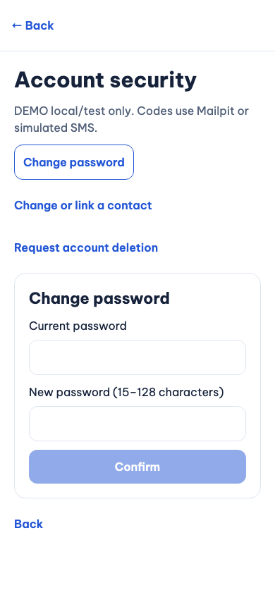
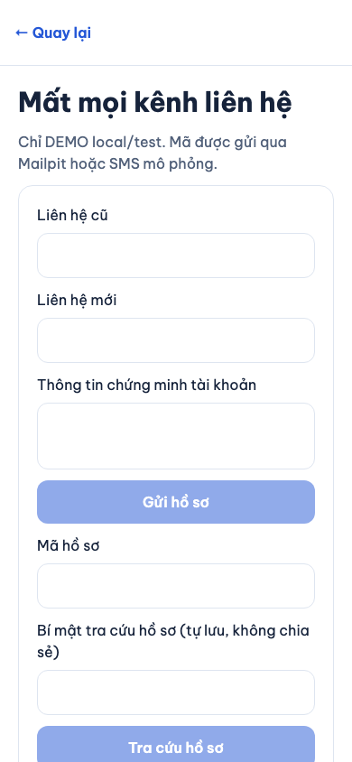
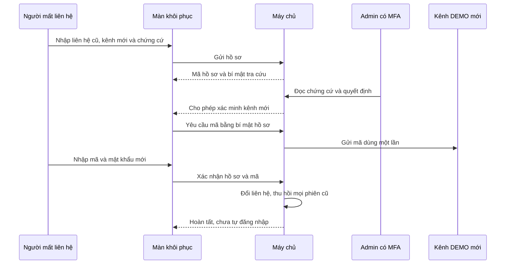
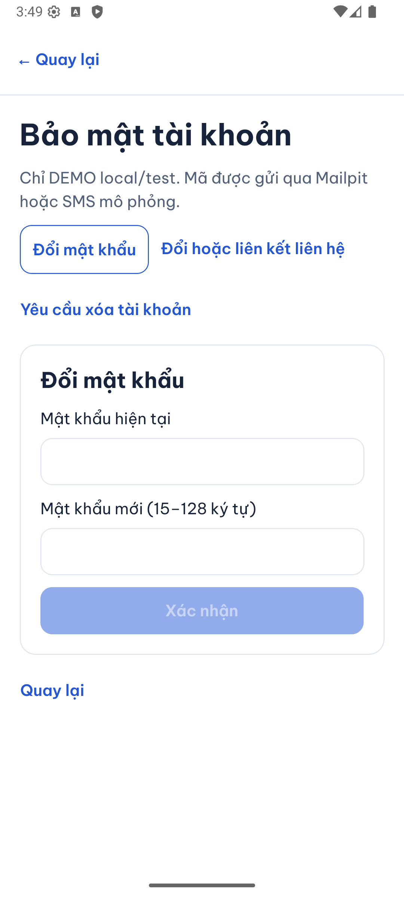
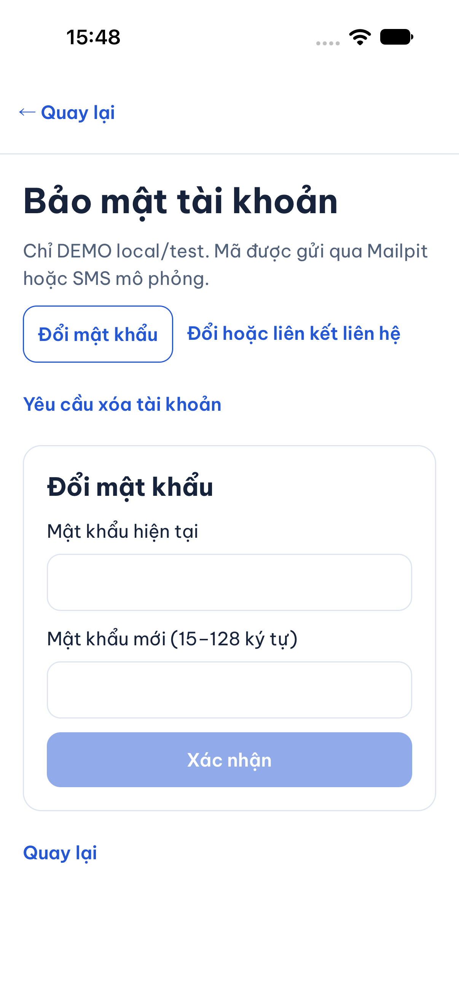
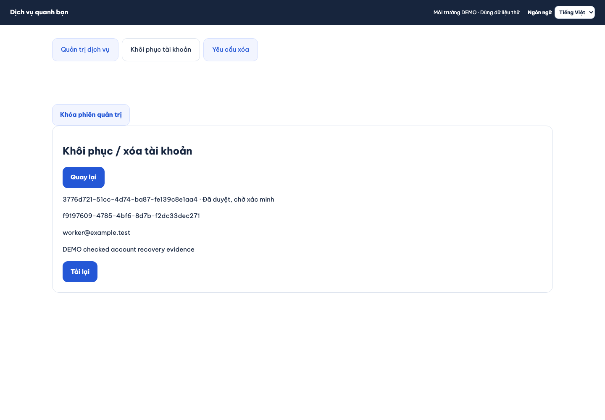

# B01-08 — Bảo mật, khôi phục và yêu cầu xóa tài khoản

21/10/2026 · P2-01 · Code đang sửa trong repo, chưa commit/push. [Quyết định đã chốt](../de-xuat/P2-01-trien-khai-tron-dot.md).

## Bạn đã dùng được những gì?

Trong **Tài khoản → Bảo mật tài khoản**, bạn đổi mật khẩu, xác minh liên hệ mới rồi mới thay liên hệ cũ, hoặc xem nghĩa vụ trước khi gửi yêu cầu xóa. Khi chưa đăng nhập, bạn có thể đăng nhập bằng mã, đặt lại mật khẩu hoặc gửi hồ sơ mất mọi kênh liên hệ.

Mã chỉ gửi tới liên hệ DEMO được cho phép qua Mailpit hoặc SMS mô phỏng. Không tự tạo tài khoản khi nhập một liên hệ chưa tồn tại. Admin được xét hồ sơ; người yêu cầu vẫn phải nhập mã gửi tới kênh mới trước khi khôi phục xong. Admin duyệt hồ sơ không tạo phiên đăng nhập và không mở khóa tài khoản đang bị đình chỉ.

Ảnh dưới là **app web chạy thật bằng Chromium local, viewport điện thoại 390 × 844, ngày 21/10/2026, dữ liệu DEMO**. Đây không phải Android/iOS hoặc thiết bị thật. Các ô bí mật đều trống khi chụp.

## Theo một lần khôi phục từ đầu đến cuối

“Phiên” là quyền đăng nhập được máy chủ cấp cho một lần đăng nhập. “Bí mật tra cứu” là một chuỗi riêng cho hồ sơ khôi phục: cần tự lưu an toàn và không chia sẻ. Nó chỉ cho xem/bổ sung hồ sơ, không tự cấp quyền vào tài khoản.

Nếu admin cần thêm thông tin, người giữ bí mật hồ sơ bổ sung chứng cứ. Nếu hồ sơ bị từ chối, không được xin mã xác minh. Một mã xác minh liên hệ thông thường không thể đem sang đăng nhập hay đặt lại mật khẩu.

## Mở code theo thứ tự nào?

| Bước | File và hàm thật | Nhận gì, làm gì, chuyển đi đâu? |
|---|---|---|
| 1 | [SecurityScreen](../../../apps/mobile/src/features/account-security/screens/SecurityScreen.tsx), `work`; [RecoveryScreen](../../../apps/mobile/src/features/account-security/screens/RecoveryScreen.tsx), `work` | Lấy dữ liệu ô nhập, khóa nút trong lúc gửi và giữ mã trạng thái lỗi để đổi ngôn ngữ được ngay. |
| 2 | [security-api](../../../apps/mobile/src/features/account-security/api/security-api.ts), `createSecurityApi` | Gửi HTTP, đặt bí mật hồ sơ trong header và kiểm hình dạng kết quả. Không đưa token vào route hoặc log. |
| 3 | [auth-session](../../../apps/mobile/src/features/auth/state/auth-session.ts), `featureOperation`, `loginWithCode` | Giữ token ngoài React state, kiểm đúng chủ hiện hành và dùng đường làm mới phiên đã có. |
| 4 | [security.input](../../../services/api/src/modules/account-security/security.input.ts), `challenge`, `confirm`, `recovery`, `deletion` | Chặn trường thừa, mã sai định dạng và mật khẩu ngoài giới hạn. |
| 5 | [SecurityService](../../../services/api/src/modules/account-security/security.service.ts), `request`, `consume`, `confirm`, `recover`, `receipt`, `decide` | Máy chủ kiểm mục đích mã, liên hệ, phiên, hạn, số lần thử, quyền admin và trạng thái hồ sơ trong giao dịch DB. |
| 6 | [LocalMessages](../../../services/api/src/integrations/local-messages.ts), `queue`, `drain` | Ghi hàng đợi mã hóa cùng giao dịch, rồi gửi qua công cụ DEMO local. Lỗi gửi được thử lại bằng hàng đợi bền. |
| 7 | [Migration 019](../../../services/api/migrations/019_p2_accounts.sql) | Bổ sung mục đích mã, hồ sơ khôi phục và yêu cầu xóa. Giữ bảng phiên, lịch sử tài chính và khóa ngoại hiện hành. |

Admin dùng [RecoveryPanel mobile](../../../apps/mobile/src/features/admin/screens/RecoveryPanel.tsx) và [RecoveryPanel web](../../../apps/admin/src/RecoveryPanel.tsx); backend kiểm `accounts.manage` cùng MFA còn mới. Giao diện không tự quyết định quyền.

## Khi bấm xóa, dữ liệu được xử lý thế nào?

Yêu cầu xóa cần phiên bản hồ sơ, lý do và mật khẩu hiện hành. Nếu còn point, người dùng phải tích rõ đồng ý mất point. Admin phải kiểm lại ngay khi duyệt: sở hữu doanh nghiệp, quyền admin, việc chưa kết thúc, hóa đơn chưa quyết toán, báo cáo chưa đóng, khoản giữ, nạp/rút và đề nghị đổi ngân hàng. Bản xem trước không phải giấy phép xóa sau này.

`obligations()` khóa doanh nghiệp rồi hàng thành viên trước khi đọc việc được phân công, để không bỏ sót một phân công đang ghi dở. Số dư point được khóa; nếu đủ điều kiện tịch thu point, máy chủ ghi hai vế bằng nhau vào sổ tiền. Không sửa/xóa các bút toán đã có.

Khi duyệt xong: hồ sơ người dùng chuyển `anonymized`, tên hiển thị và địa chỉ lưu được ẩn danh, định danh đăng nhập bị gỡ, thành viên không phải chủ bị vô hiệu, mọi phiên thường/admin và push bị thu hồi. Chứng từ, nhật ký, công việc và lịch sử vẫn giữ. Chưa xóa vật lý toàn bộ dữ liệu; chưa có quyết định thời hạn lưu hay chứng nhận xóa khỏi mọi bản sao.

## Contract giữ các đường API chuẩn

Các operation đã dự kiến được triển khai bằng đúng đường chuẩn: `resetPassword` tại `/auth/password/reset`, `requestDeletion` tại `/me/deletion-request`, `changeIdentity` và `confirmIdentityChange` tại `/me/identity-change` và `/confirm`, `openRecovery` tại `/auth/recovery-reports`, `decideRecovery` tại `/admin/recovery-reports/{id}/decision`.

Phần token xác minh/fresh-auth còn là placeholder trong contract cũ được cụ thể hóa bằng mã gắn mục đích và mật khẩu hiện hành. Đổi định danh có version, idempotency và nhóm phiên; confirm trả hồ sơ hiện hành. Gửi hồ sơ giữ tên `contact_claim`, `reachable_contact`, `description`; kết quả thêm bí mật tra cứu. Yêu cầu xóa mở rộng input version/lý do bằng mật khẩu và checkbox mất point. Admin không được tự cung cấp `verified_contact` để bỏ qua bước applicant nhập mã.

Hàng đợi admin có bộ lọc chờ xử lý/tất cả và phân trang bằng cursor có chữ ký, gắn đúng admin, loại hồ sơ và bộ lọc. Nút Xem thêm tiếp tục tới hồ sơ cũ; không giới hạn vĩnh viễn ở 100 bản ghi mới nhất.

## Lỗi, thử lại và dữ liệu riêng

- Mã hết hạn sau 5 phút, dùng một lần, tối đa 5 lần sai; giới hạn gửi theo liên hệ, IP và tài khoản. Mã gắn mục đích; đổi liên hệ còn gắn đúng nhóm phiên.
- Liên hệ cũ giữ đến lúc xác minh và commit. Hai người tranh cùng liên hệ chỉ một người thắng; không gộp tài khoản. Mã đăng nhập đã gửi tới liên hệ cũ mất tác dụng sau khi đổi liên hệ.
- Đặt lại mật khẩu/khôi phục thu hồi mọi phiên cũ, quyền MFA cũ và push token; bộ realtime nhận tín hiệu kiểm lại quyền để đóng kết nối không còn hợp lệ.
- Khi gửi hồ sơ khôi phục, app giữ trước một bí mật ngẫu nhiên và gửi trong header. Nếu mất phản hồi, cùng bí mật và nội dung trả về cùng hồ sơ; server chỉ lưu HMAC, không snapshot bí mật.
- Quyết định admin có version và khóa retry. Quyền/MFA được kiểm lại trước khi trả kết quả cũ. Snapshot retry chỉ giữ xác nhận; không giữ mã, token, mật khẩu hoặc chứng cứ. Khi chưa biết quyết định đã ghi hay chưa, UI chỉ cho bấm nút thử lại ghi rõ hành động cũ; các hành động khác bị khóa. Từ chối không thể gửi lại một lệnh Duyệt cũ.
- Chứng cứ khôi phục và liên hệ mới được mã hóa trong DB. API public cần bí mật hồ sơ và chỉ trả trạng thái/lý do; không trả chứng cứ hoặc thông tin tài khoản. Chứng cứ bổ sung được ghi nối thêm vào lịch sử mã hóa bất biến; không ghi đè chứng cứ gốc.

## Bạn có thể tự thử và tự kiểm hiểu

1. Dùng tài khoản DEMO đã xác minh, xin mã đăng nhập; nhập sai rồi nhập đúng. Dùng lại mã đã thành công phải bị từ chối.
2. Xin đổi email, chưa nhập mã: email cũ vẫn dùng được. Xác minh xong, email mới mới được thay.
3. Gửi hồ sơ mất liên hệ và lưu bí mật tra cứu. Admin duyệt rồi thử dùng phiên cũ: quyền đăng nhập cũ chỉ bị thu hồi khi người yêu cầu hoàn tất bước mã mới.
4. Gửi yêu cầu xóa khi chưa có nghĩa vụ. Thêm nghĩa vụ trước lúc admin duyệt: kết quả phải bị chặn và tài khoản chưa bị ẩn danh.

Câu hỏi: Vì sao admin duyệt khôi phục chưa đăng nhập? Xem `decide()` và `confirm()`: hai bước tách biệt. Vì sao chỉ xem nghĩa vụ một lần chưa đủ? Xem lần gọi `obligations()` trong quyết định xóa. Point mất đi có biến mất khỏi sổ tiền không? Xem hai bút toán `account_deletion` đối ứng.

## Đã kiểm gì và còn giới hạn nào?

Đã chạy PostgreSQL local/test, Jest và app web thật. Android/iOS đã kiểm màn bảo mật trong lượt tích hợp ở cuối báo cáo; chưa kiểm toàn bộ thao tác bảo mật trên native, thiết bị thật, CI remote hoặc UAT của chủ dự án. Không gửi email/SMS thương mại và không tác động production.

Bằng chứng kỹ thuật và phạm vi

| Lượt kiểm 21/10/2026 | Kết quả | Phạm vi |
|---|---|---|
| `services/api`: `node --import tsx --test --test-concurrency=1 test/integration/account-security.test.ts test/integration/profile.test.ts test/integration/account-management.test.ts test/integration/auth.test.ts` | 19/19 đạt ở lượt baseline đầu, sau đó 8/8 bài account cập nhật đạt | Purpose/expiry/replay, reset/recovery revocation, family, tranh liên hệ, quyền hồ sơ, nghĩa vụ phát sinh sau yêu cầu, point cân bằng, locale và baseline auth/profile/session/address. Bài assignment race, cursor hàng đợi, chứng cứ bổ sung và receipt retry cũng đã đạt. |
| Jest auth/account API, state locale và lưu locale | 37/37 đạt | Hai tài khoản, khách, phản hồi trễ, lỗi lưu, refresh và kiểm response. |
| Jest SecurityScreen, LanguageSettings, ProfileScreen | 9/9 đạt | Form bảo mật, checkbox, khôi phục cần xác minh; giữ form và đổi tiếng qua server. |
| Playwright `p2-account-security.spec.mjs` | 2/2 đạt ở lượt kiểm cuối | Guest JA → account VI → lưu EN → logout về JA → OTP login lấy EN → màn recovery. Ảnh trong báo cáo được chụp từ lượt này; lượt cuối còn kiểm admin mất phản hồi, khóa quyết định khác và thử lại chính xác hành động cũ. |
| Typecheck API/admin và lint phạm vi account | Đạt | Root tiếp tục kiểm tích hợp toàn repo; trạng thái các miền đang sửa không phải bằng chứng cuối. |

Nguồn bài kiểm: [account-security integration](../../../services/api/test/integration/account-security.test.ts), [SecurityScreen Jest](../../../apps/mobile/src/features/account-security/screens/SecurityScreen.test.tsx), [web E2E](../../../tests/e2e/web/p2-account-security.spec.mjs). Báo cáo này ghi triển khai theo quyết định P2-01 đã chốt; không tự đồng bộ Drive, Excel hoặc `ui-ux`. Chưa commit/push.

## Ảnh native đã kiểm ngày 21/10/2026

Android 16/API36 emulator và iOS27 simulator đã chạy luồng đăng nhập → bảo mật → ví → biểu mẫu ngân hàng qua API/schema test riêng. Đây là kiểm điều hướng/hiển thị và tải SDK native, chưa phải toàn bộ thao tác tài chính hoặc cuộc gọi native. Ảnh chỉ dữ liệu DEMO và biểu mẫu trống; không có mật khẩu/token.

## Ảnh admin khôi phục trên web

Chromium desktop1440×1000, ngày21/10/2026, chỉ tài khoản và chứng cứ DEMO. Đã kiểm mất phản hồi sau duyệt, nút từ chối bị khóa, nút thử lại giữ chính xác quyết định cũ; trạng thái/nghĩa vụ hiển thị bằng ngôn ngữ đã chọn.

