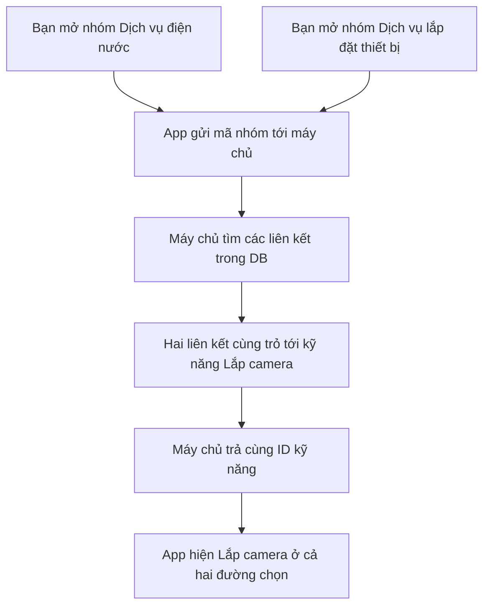

# B02-01 — Rà soát trùng nhóm và kỹ năng

> **Cập nhật sau yêu cầu clear ngày 05/10:** bộ 50 nhóm/140 kỹ năng được phân tích bên dưới đã được xóa khỏi DB local và thay bằng [39 nhóm/128 kỹ năng](B02-01-thay-du-lieu-danh-muc.md). Nội dung bên dưới giữ làm bằng chứng đợt trước; các dòng “chưa sửa DB” và phương án giữ dữ liệu cũ là trạng thái tại thời điểm đó, đã được yêu cầu clear mới thay thế.

05/10/2026 · Rà soát dữ liệu đang chạy, thuộc DELIVERY-01/B02-01/I18N-04. Code đang sửa trên nền `7ded50c`, chưa commit. **Đã phân tích; chưa áp dụng việc phân loại lại vào DB.**

## 1. Vì sao bạn thấy các nhóm giống nhau?

Bạn nhận xét đúng. Ví dụ, mở “Dịch vụ làm đẹp không y tế” thấy “Làm nail”; mở “Móng tay / móng chân” lại thấy các công việc làm móng. Hai cách đặt tên đang dẫn tới cùng một nhu cầu. Đây là vấn đề trong cách tôi biên soạn danh mục, không phải do bạn hiểu sai giao diện.

Đợt mở rộng trước giữ nguyên 10 nhóm chung cũ rồi thêm 40 nhóm chuyên biệt. Giữ ID để bảo toàn dữ liệu là cần thiết, nhưng **không có nghĩa phải tiếp tục công khai mọi nhóm cũ**. Tôi đã giữ cả hai lớp cùng lúc và chưa rà kỹ phần chồng chéo về nghĩa. Các test dịch tên, phân trang và DB đã đạt không chứng minh rằng cách phân loại đã tốt.

Đã kiểm toàn bộ 10 ngành, 50 nhóm và 140 kỹ năng; đối chiếu file dữ liệu với DB phát triển, rồi gọi API của cả 50 nhóm. Có bốn vấn đề khác nhau:

| Vấn đề | Bằng chứng | Hệ quả |
|---|---|---|
| Một kỹ năng nằm ở hai nhóm | `camera_installation` — “Lắp camera” thuộc cả “Dịch vụ điện nước” và “Dịch vụ lắp đặt thiết bị” | Cùng một công việc xuất hiện ở hai đường chọn |
| Nhóm chung bao trùm nhóm cụ thể | Cả 10 ngành đều có một nhóm “Dịch vụ…” cạnh bốn nhóm chuyên biệt | Người dùng không biết chọn nhóm chung hay nhóm cụ thể |
| Khác tên nhưng phạm vi giao nhau | Ghế văn phòng có thể là ghế bọc vải; bàn ghế văn phòng cũng là đồ nội thất | Khác ID vẫn có thể cùng chỉ một công việc |
| Danh sách ngành lặp lại kỹ năng của nhóm con | API ngành Làm đẹp trả cả 14 kỹ năng; màn hình hiện chúng bên dưới năm nhóm | Vào nhóm con thấy lại kỹ năng đã thấy ở màn ngành; không phải DB tạo thêm bản ghi |

Không phát hiện hai kỹ năng khác ID có **tên hoàn toàn giống nhau** sau chuẩn hóa chữ ở VI/EN/JA. Điều này không phủ nhận các lỗi về nghĩa nêu trên. Một liên kết trùng giữa hai nhóm cũng không có nghĩa chỉ có một vấn đề cần sửa.

## 2. Cần thống nhất cách hiểu trước khi sửa dữ liệu

**Ngành** giúp tìm lĩnh vực lớn. **Nhóm** gom các công việc có cùng đối tượng hoặc chuyên môn. **Kỹ năng** nên là công việc mà người cung cấp thực sự có khả năng làm.

Ví dụ: `Điện lạnh / gia dụng → Điều hòa → Vệ sinh điều hòa`. “Điều hòa” là đối tượng; “Vệ sinh” là hành động. Vệ sinh điều hòa ô tô là công việc khác vì đối tượng và chuyên môn khác. Không gộp chỉ vì cùng có chữ “điều hòa”.

Hiện dữ liệu còn trộn ba thứ với kỹ năng:

- **Gói công việc:** dọn toàn bộ nhà, chuyển căn hộ. Một gói có thể cần nhiều kỹ năng.
- **Thông tin nhu cầu:** nhà riêng/căn hộ/phòng trọ, ở văn phòng hay nhà ở. Đây thường là thông tin cần hỏi thêm khi đặt dịch vụ.
- **Cách cung cấp/tính giá:** theo giờ, lượt đón hoặc lượt đưa về. Chúng không nhất thiết là những năng lực nghề nghiệp khác nhau.

Không thể đảm bảo các nhóm khác nhau bằng cách chỉ kiểm tên hoặc đổi mã. Cần xác định mỗi kỹ năng **làm gì, trên đối tượng nào, bao gồm gì và loại trừ gì**. Các gói trọn bộ cần được phân biệt với kỹ năng thành phần; việc đặt form/gói vào sản phẩm là thiết kế tiếp theo, chưa được triển khai trong lượt rà soát này.

### Nguyên tắc đề xuất áp dụng cho bộ danh mục hiện tại

1. Mỗi kỹ năng công khai có một nhóm chính duy nhất trong bộ dữ liệu khởi tạo. Không nhân bản kỹ năng để nó xuất hiện ở nhóm khác.
2. Ẩn 10 nhóm “Dịch vụ…” chung sau khi chuyển các kỹ năng còn phù hợp sang nhóm chuyên biệt. Giữ bản ghi và ID cũ.
3. Kỹ năng quá rộng được ngừng cho chọn mới sau khi đã xác định các công việc cụ thể thay thế. Không âm thầm đổi nghĩa của ID cũ.
4. Không bắt buộc mỗi ngành có bốn nhóm hoặc mỗi nhóm có ba kỹ năng. Số lượng phải đi theo công việc thực tế.
5. Người cung cấp vẫn có thể chọn nhiều kỹ năng thuộc nhiều nhóm. **Một kỹ năng có một nơi phân loại không giới hạn người cung cấp chỉ được làm một nhóm.**
6. Không tự đổi toàn bộ mô hình liên kết nhiều nhóm của DB. Spec hiện hành cho phép một kỹ năng liên kết nhiều nhóm; có thể làm sạch dữ liệu công khai mà vẫn giữ khả năng lưu quan hệ cũ. Ràng buộc cấm nhiều nhóm trên toàn hệ thống là thay đổi spec riêng, không phải điều kiện bắt buộc để sửa bộ dữ liệu này.

## 3. Xử lý 20 kỹ năng nằm trong các nhóm chung

“Chuyển” nghĩa là giữ ID và ý nghĩa, đổi nơi phân loại. “Tách phạm vi” nghĩa là không dùng mục tổng quát để cạnh tranh với mục cụ thể; phải kiểm phần công việc còn thiếu trước khi ngừng cho chọn mới. Bảng dưới là phương án, chưa phải dữ liệu đã sửa.

| Kỹ năng hiện tại | Hướng xử lý | Điểm cần giữ hoặc bổ sung |
|---|---|---|
| Sửa điện dân dụng — `electrical_repair` | Tách phạm vi, đưa công việc cụ thể vào Điện dân dụng | Thay ổ cắm/đèn/aptomat chưa bao phủ dò chập, mất điện, sửa dây. Không coi ba mục này đã thay thế toàn bộ sửa điện |
| Sửa vòi nước / đường ống — `plumbing_repair` | Tách phạm vi trong Cấp nước và thiết bị vệ sinh | Sửa vòi khác lắp vòi mới; sửa đường cấp nước khác thông đường thoát |
| Vệ sinh điều hòa — `aircon_cleaning` | Chuyển vào Điều hòa | Giữ kỹ năng này; khác sửa/lắp/tháo chuyển điều hòa |
| Sửa máy giặt — `washing_machine_repair` | Chuyển vào Máy giặt / máy sấy | Giữ; vệ sinh và lắp máy giặt không thay thế sửa máy |
| Dọn nhà — `house_cleaning` | Ngừng dùng mục chung sau khi làm rõ các loại việc | Phân biệt dọn định kỳ và tổng vệ sinh; “theo giờ” không tự là một kỹ năng |
| Vệ sinh sofa — `sofa_cleaning` | Chuyển vào nhóm đồ bọc/nệm/thảm | Sofa khác ghế rời; tránh đặt tên nhóm có sofa nhưng kỹ năng sofa nằm nơi khác |
| Sửa máy tính — `computer_repair` | Tách phạm vi trước khi ngừng mục chung | Ba mục thay linh kiện laptop không bao phủ máy bàn, nguồn, bo mạch, chẩn đoán lỗi |
| Sửa điện thoại — `phone_repair` | Tách phạm vi trước khi ngừng mục chung | Thay màn hình/pin/cổng sạc chưa bao phủ mọi sửa chữa điện thoại |
| Bảo dưỡng xe — `vehicle_maintenance` | Tách theo đối tượng và việc cụ thể | Không để mục tổng quát cạnh nhóm bảo dưỡng xe máy và ô tô |
| Rửa xe — `vehicle_wash` | Chuyển vào Vệ sinh / chăm sóc xe | Giữ phạm vi; loại xe là thông tin bổ sung hoặc tách riêng khi chuyên môn cần khác nhau |
| Grooming thú cưng — `pet_grooming` | Tách gói khỏi kỹ năng tắm/chải/cắt lông | Grooming có thể chứa cả tắm và chăm sóc lông; không coi đây là nhóm thứ ba độc lập |
| Vệ sinh móng / tai thú cưng — `pet_hygiene` | Tách hai công việc | Cắt móng đã có; vệ sinh tai bên ngoài chưa có mục riêng. Không tự mở sang điều trị thú y |
| Làm nail — `nail_care` | Ngừng mục tổng quát, dùng nhóm Móng | Kiểm chăm sóc/sơn/đắp/tháo móng; bộ hiện tại chưa bao phủ mọi dịch vụ nail |
| Trang điểm — `makeup` | Ngừng mục tổng quát sau khi xác định phạm vi | Trang điểm cô dâu/dự tiệc/chụp ảnh cùng một nhóm; cần phân biệt kỹ năng với lựa chọn dịp |
| Đóng gói chuyển nhà — `moving_packing` | Gom về nhóm Đóng gói | Đồ dễ vỡ/hồ sơ là các loại đồ; kiểm còn thiếu đóng thùng đồ thông thường |
| Bốc xếp — `moving_loading` | Gom về nhóm Bốc xếp | Không giữ cả mục tổng quát và “Bốc xếp đồ gia đình” khi chưa chỉ ra khác biệt năng lực |
| Giặt quần áo — `clothes_laundry` | Hợp nhất cách chọn với Giặt / sấy / gấp quần áo | Giặt, sấy, gấp có thể là gói; không tạo hai lựa chọn tương đương |
| Chăm sóc giày — `shoe_care` | Tách phạm vi trong Giày / túi | Vệ sinh giày thể thao/da chưa bao phủ đánh bóng hoặc sửa giày; không tự tuyên bố thay thế đủ |
| Lắp camera — `camera_installation` | Chỉ cho chọn tại Camera giám sát | Giữ ID; bỏ đường chọn qua Điện nước và nhóm chung Lắp đặt thiết bị |
| Cài mạng Wi-Fi — `wifi_setup` | Gom về Mạng / Wi-Fi; phân biệt cấu hình router và hệ thống mesh | Không giữ mục chung cạnh các mục cụ thể mà không có giới hạn phạm vi |

## 4. Rà từng nhóm chuyên biệt

Các bảng dưới liệt kê đủ **120 kỹ năng còn lại trong 40 nhóm**, không chỉ các ví dụ dễ thấy. “Giữ” nghĩa là chưa thấy trùng qua nhóm khác ở mức tên/phạm vi hiện tại; không đồng nghĩa danh mục đã bao phủ hết ngành nghề.

### Điện nước

| Nhóm hiện tại | Toàn bộ kỹ năng hiện tại | Nhận xét / phương án |
|---|---|---|
| Điện dân dụng — `home_utilities_electrical` | Thay ổ cắm / công tắc (`socket_replacement`); Lắp đèn chiếu sáng (`light_installation`); Thay aptomat (`breaker_replacement`) | Giữ. Loại trừ lắp/cấu hình camera, thao tác bơm nước và sửa bên trong thiết bị gia dụng; bổ sung phạm vi sửa điện còn thiếu sau khi tách mục chung. |
| Cấp nước và thiết bị vệ sinh — `home_utilities_plumbing` | Sửa rò rỉ nước (`water_leak_repair`); Lắp vòi nước (`tap_installation`); Sửa bồn cầu (`toilet_repair`) | Giữ. Sửa bồn cầu là sửa phụ kiện/rò nước, không bao gồm thông tắc; đường thoát bị tắc thuộc nhóm Thoát nước. |
| Thoát nước — `home_utilities_drainage` | Thông tắc chậu rửa (`sink_unblocking`); Thông tắc bồn cầu (`toilet_unblocking`); Thông tắc đường thoát nước (`drain_unblocking`) | Giữ ranh giới thông tắc. Cần xác định đường ống chung khác điểm tắc tại chậu/bồn cầu để không có ba tên cho cùng một lần thông. |
| Máy bơm nước — `home_utilities_water_pumps` | Lắp máy bơm nước (`pump_installation`); Sửa máy bơm nước (`pump_repair`); Thay phao điện bồn nước (`float_switch_replacement`) | Giữ theo thiết bị bơm/cấp nước bồn. Thay phao nằm ở nhóm này, không lặp lại ở Điện dân dụng. |

### Điện lạnh / gia dụng

| Nhóm hiện tại | Toàn bộ kỹ năng hiện tại | Nhận xét / phương án |
|---|---|---|
| Điều hòa — `hvac_appliances_air_conditioning` | Sửa điều hòa (`aircon_repair`); Lắp điều hòa (`aircon_installation`); Tháo chuyển điều hòa (`aircon_relocation`) | Nhận thêm Vệ sinh điều hòa từ nhóm chung. Chỉ thiết bị điều hòa công trình/nhà, không điều hòa xe. Tháo chuyển là gói tháo + lắp, cần ghi rõ khi mô hình hóa kỹ năng. |
| Tủ lạnh / tủ đông — `hvac_appliances_refrigeration` | Sửa tủ lạnh (`fridge_repair`); Sửa tủ đông (`freezer_repair`); Thay gioăng cửa tủ lạnh (`fridge_seal_replacement`) | Cùng nhóm đúng đối tượng, nhưng Sửa tủ lạnh bao gồm cả thay gioăng. Cần tách phạm vi sửa hoặc tách mục sửa chung khỏi kỹ năng thành phần. |
| Máy giặt / máy sấy — `hvac_appliances_laundry_appliances` | Vệ sinh máy giặt (`washer_cleaning`); Sửa máy sấy quần áo (`dryer_repair`); Lắp máy giặt (`washer_installation`) | Nhận Sửa máy giặt từ nhóm chung. Vệ sinh máy không phải giặt quần áo; giữ ranh giới thiết bị với ngành Giặt. |
| Thiết bị bếp / nước nóng — `hvac_appliances_kitchen_appliances` | Sửa bếp từ (`induction_stove_repair`); Sửa lò vi sóng (`microwave_repair`); Sửa bình nóng lạnh (`water_heater_repair`) | Ba đối tượng riêng, chưa thấy lặp qua nhóm. Tên nhóm ghép hai miền; có thể tách bếp và nước nóng khi lượng kỹ năng thực sự cần, không tách để đủ số nhóm. |

### Vệ sinh

| Nhóm hiện tại | Toàn bộ kỹ năng hiện tại | Nhận xét / phương án |
|---|---|---|
| Dọn dẹp nhà ở — `cleaning_home_cleaning` | Dọn nhà theo giờ (`hourly_cleaning`); Tổng vệ sinh nhà ở (`deep_cleaning`); Vệ sinh sau sửa nhà (`post_renovation_cleaning`) | “Theo giờ” là cách cung cấp; tổng vệ sinh và sau sửa nhà là gói/phạm vi. Cần tách dọn thường khỏi làm sạch chuyên sâu, không coi ba tên là ba năng lực độc lập mặc định. |
| Sofa / nệm / thảm — `cleaning_upholstery_cleaning` | Vệ sinh nệm (`mattress_cleaning`); Vệ sinh thảm (`carpet_cleaning`); Vệ sinh ghế bọc vải (`upholstered_chair_cleaning`) | Nhận Vệ sinh sofa. Rà ghế rời cùng Vệ sinh ghế văn phòng; một ghế vải văn phòng không được có hai đường chọn. Nệm không phải ga/chăn/ruột gối. |
| Văn phòng / cửa hàng — `cleaning_office_cleaning` | Dọn vệ sinh văn phòng (`office_cleaning`); Dọn vệ sinh cửa hàng (`shop_cleaning`); Vệ sinh ghế văn phòng (`office_chair_cleaning`) | Ghế văn phòng chuyển về cùng nhóm đồ bọc/ghế. Văn phòng và cửa hàng là loại địa điểm; cần gom theo công việc dọn thường/chuyên sâu thay vì giao với nhóm bề mặt. |
| Bếp / phòng tắm / kính — `cleaning_surface_cleaning` | Vệ sinh bếp (`kitchen_cleaning`); Vệ sinh phòng tắm (`bathroom_cleaning`); Lau kính trong nhà (`window_cleaning`) | Bếp/phòng tắm có thể nằm trong gói dọn nhà/văn phòng. Chỉ giữ riêng nếu định nghĩa việc chuyên sâu rõ; lau kính thông thường và vệ sinh kính chuyên sâu cần phân biệt. |

### Điện thoại / máy tính

| Nhóm hiện tại | Toàn bộ kỹ năng hiện tại | Nhận xét / phương án |
|---|---|---|
| Linh kiện điện thoại — `digital_repair_phone_hardware` | Thay màn hình điện thoại (`phone_screen_replacement`); Thay pin điện thoại (`phone_battery_replacement`); Sửa cổng sạc điện thoại (`phone_port_repair`) | Giữ theo điện thoại. Không gộp với pin/màn hình máy tính bảng chỉ vì tên linh kiện giống; phải xử lý phạm vi Sửa điện thoại tổng quát còn thiếu. |
| Linh kiện laptop — `digital_repair_laptop_hardware` | Thay bàn phím laptop (`laptop_keyboard_replacement`); Thay pin laptop (`laptop_battery_replacement`); Thay màn hình laptop (`laptop_screen_replacement`) | Giữ theo linh kiện laptop. RAM/SSD dù lắp vào laptop vẫn chỉ thuộc nhóm nâng cấp, không thêm bản sao tại đây. |
| Bảo dưỡng máy tính — `digital_repair_computer_maintenance` | Vệ sinh máy tính (`computer_cleaning`); Nâng cấp RAM (`ram_upgrade`); Nâng cấp ổ SSD (`ssd_upgrade`) | Giữ các công việc vệ sinh/nâng cấp; tên nhóm nên phản ánh cả nâng cấp. Không bao gồm thay pin/màn hình/bàn phím; hiện thiếu phạm vi sửa máy bàn/chẩn đoán. |
| Máy tính bảng — `digital_repair_tablet_repair` | Thay màn hình máy tính bảng (`tablet_screen_replacement`); Thay pin máy tính bảng (`tablet_battery_replacement`); Sửa cổng sạc máy tính bảng (`tablet_port_repair`) | Giữ theo máy tính bảng. Màn hình/pin/cổng sạc khác đối tượng điện thoại; không phải trùng kỹ năng chỉ vì cùng hành động. |

### Xe máy / ô tô

| Nhóm hiện tại | Toàn bộ kỹ năng hiện tại | Nhận xét / phương án |
|---|---|---|
| Bảo dưỡng xe máy — `vehicle_care_motorcycle_maintenance` | Thay dầu xe máy (`motorcycle_oil_change`); Bảo dưỡng phanh xe máy (`motorcycle_brake_service`); Bảo dưỡng xích xe máy (`motorcycle_chain_service`) | Giữ các việc bảo dưỡng xe máy; loại trừ lốp/ắc quy đã có nhóm riêng và rửa/chăm sóc ngoại hình. |
| Bảo dưỡng ô tô — `vehicle_care_car_maintenance` | Thay dầu ô tô (`car_oil_change`); Thay lọc gió ô tô (`car_filter_replacement`); Bảo dưỡng phanh ô tô (`car_brake_service`) | Giữ các việc bảo dưỡng ô tô; loại trừ lốp/ắc quy. “Lọc gió” cần rõ lọc động cơ hay lọc cabin; không tự suy một tên là bao phủ cả hai. |
| Lốp / ắc quy — `vehicle_care_tyres_batteries` | Thay lốp xe máy (`motorcycle_tyre_replacement`); Thay lốp ô tô (`car_tyre_replacement`); Thay ắc quy xe (`vehicle_battery_replacement`) | Giữ vị trí duy nhất cho lốp/ắc quy. Thay ắc quy xe đang rộng hơn hai mục thay lốp; cần xác định loại xe/năng lực trước khi tách hoặc dùng thông tin yêu cầu. |
| Vệ sinh / chăm sóc xe — `vehicle_care_vehicle_detailing` | Vệ sinh nội thất ô tô (`car_interior_cleaning`); Đánh bóng ô tô (`car_polishing`); Vệ sinh điều hòa ô tô (`car_aircon_cleaning`) | Nhận Rửa xe. Vệ sinh điều hòa ô tô phải ở ngành xe, không lặp sang điều hòa gia dụng; phân biệt làm sạch điều hòa với vệ sinh nội thất thông thường. |

### Thú cưng

| Nhóm hiện tại | Toàn bộ kỹ năng hiện tại | Nhận xét / phương án |
|---|---|---|
| Tắm / vệ sinh thú cưng — `pet_care_pet_bathing` | Tắm chó (`dog_bathing`); Tắm mèo (`cat_bathing`); Cắt móng thú cưng (`pet_nail_trimming`) | Giữ tắm và vệ sinh cơ thể; bổ sung vệ sinh tai bên ngoài nếu tách mục cũ. Không có cắt/chải lông tại đây; không gồm khám/điều trị. |
| Chăm sóc lông — `pet_care_pet_coat` | Cắt tỉa lông chó (`dog_haircut`); Cắt tỉa lông mèo (`cat_haircut`); Chải / gỡ rối lông (`pet_brushing`) | Giữ cắt/chải/gỡ rối lông. Nếu gói grooming bao gồm tắm thì gói đó là tổ hợp, không tạo thêm kỹ năng trùng ở nhóm chung. |
| Trông giữ thú cưng — `pet_care_pet_boarding` | Trông giữ chó qua đêm (`dog_boarding`); Trông giữ mèo qua đêm (`cat_boarding`); Trông giữ thú cưng ban ngày (`pet_daycare`) | Giữ trông giữ, tách khỏi đưa đón. Chó/mèo và ban ngày/qua đêm là các chiều khác nhau: Pet daycare có thể gồm cả chó lẫn mèo, cần định nghĩa khả năng cung cấp thay vì chỉ so tên. |
| Đưa đón thú cưng — `pet_care_pet_transport` | Đón thú cưng đi spa (`pet_spa_pickup`); Đưa thú cưng về sau spa (`pet_spa_dropoff`); Đưa đón thú cưng đi lưu trú (`pet_boarding_transport`) | Ba mục đang chia theo chiều đi/về và mục đích spa/lưu trú. Đề xuất một năng lực vận chuyển thú cưng; điểm đón/trả, khứ hồi và nơi đến là thông tin chuyến. |

### Làm đẹp không y tế

| Nhóm hiện tại | Toàn bộ kỹ năng hiện tại | Nhận xét / phương án |
|---|---|---|
| Tóc — `beauty_hair_care` | Cắt tóc (`haircut`); Gội / sấy tóc (`hair_washing`); Tạo kiểu tóc (`hair_styling`) | Tên Tóc bao trùm cả nhóm Uốn/duỗi/nhuộm. Đổi phạm vi nhóm thành cắt/gội/tạo kiểu tạm thời; không gồm xử lý tóc hóa chất. |
| Móng tay / móng chân — `beauty_nail_services` | Chăm sóc móng tay (`manicure`); Chăm sóc móng chân (`pedicure`); Sơn móng (`nail_polish`) | Gom Làm nail về đây rồi phân rã mục chung. Chăm sóc móng tay/chân có thể bao gồm sơn: phải định nghĩa phần chăm sóc nền khác sơn, không chỉ thay tên. |
| Trang điểm theo dịp — `beauty_occasion_makeup` | Trang điểm dự tiệc (`party_makeup`); Trang điểm cô dâu (`bridal_makeup`); Trang điểm chụp ảnh (`photo_makeup`) | Gom Trang điểm về đây. Cô dâu/dự tiệc/chụp ảnh có thể khác năng lực nhưng dịp có thể giao nhau; cần mô tả phạm vi hoặc đưa dịp vào form, không tạo nhóm Trang điểm chung song song. |
| Uốn / duỗi / nhuộm tóc — `beauty_hair_treatments` | Nhuộm tóc (`hair_colouring`); Uốn tóc (`hair_perming`); Duỗi tóc (`hair_straightening`) | Giữ phạm vi uốn/duỗi/nhuộm, loại trừ tạo kiểu tạm thời. Các kỹ năng này không được xuất hiện lại trong nhóm Tóc chung. |

### Chuyển nhà / bốc xếp

| Nhóm hiện tại | Toàn bộ kỹ năng hiện tại | Nhận xét / phương án |
|---|---|---|
| Chuyển nhà ở — `moving_home_moving` | Chuyển căn hộ (`apartment_moving`); Chuyển nhà riêng (`house_moving`); Chuyển phòng trọ (`room_moving`) | Căn hộ/nhà riêng/phòng trọ là loại nơi ở; đây là gói chuyển nhà, không phải ba kỹ năng thao tác. Đề xuất chuyển thành thông tin nhu cầu, không bỏ nhu cầu chuyển nhà. |
| Chuyển văn phòng — `moving_office_moving` | Chuyển thiết bị văn phòng (`office_equipment_moving`); Chuyển bàn ghế văn phòng (`office_furniture_moving`); Đóng gói hồ sơ văn phòng (`document_packing`) | Thiết bị/bàn ghế trùng phạm vi vận chuyển đồ; hồ sơ là đóng gói. Phân loại về nhóm thao tác tương ứng, văn phòng là địa điểm. |
| Đóng gói / tháo lắp — `moving_packing_support` | Đóng gói đồ dễ vỡ (`fragile_packing`); Tháo đồ nội thất khi chuyển (`furniture_disassembly`); Lắp lại nội thất sau chuyển (`furniture_reassembly`) | Đang ghép đóng gói với tháo/lắp. Tách theo hai chuyên môn; đóng gói hồ sơ không ở nhóm Văn phòng nữa. |
| Bốc xếp / vận chuyển đồ — `moving_loading_support` | Bốc xếp đồ gia đình (`household_loading`); Vận chuyển đồ nội thất (`furniture_transport`); Vận chuyển đồ gia dụng (`appliance_transport`) | Đang ghép bốc xếp với vận chuyển. Tách thao tác: bốc xếp không tự bao gồm lái xe/xe vận chuyển. Đồ gia dụng có thể giao với thiết bị văn phòng; cần ranh giới đối tượng. |

### Giặt / chăm sóc đồ

| Nhóm hiện tại | Toàn bộ kỹ năng hiện tại | Nhận xét / phương án |
|---|---|---|
| Giặt quần áo / giặt khô — `laundry_garment_laundry` | Giặt / sấy / gấp quần áo (`wash_dry_fold`); Giặt khô quần áo (`dry_cleaning`); Ủi quần áo (`clothes_ironing`) | Gom mục Giặt quần áo. Wash/dry/fold là gói; giặt khô là phương pháp khác. Phân biệt gói và thao tác để không trùng với giặt/ủi riêng. |
| Chăn / ga / gối — `laundry_bedding_laundry` | Giặt chăn (`blanket_laundry`); Giặt ga giường (`bed_linen_laundry`); Giặt ruột gối (`pillow_laundry`) | Giữ chăn, ga, ruột gối. Loại trừ nệm/sofa/thảm; giặt vỏ gối cần định nghĩa có nằm trong đồ giường hay chưa. |
| Rèm / đồ vải gia đình — `laundry_curtain_laundry` | Giặt rèm cửa (`curtain_laundry`); Giặt khăn (`towel_laundry`); Giặt thú nhồi bông (`stuffed_toy_cleaning`) | Tên Đồ vải gia đình bao trùm cả chăn/ga/gối. Đổi tên/phạm vi thành đúng rèm/khăn/thú bông hoặc tách theo nhu cầu thực; không dùng một nhóm ôm lại nhóm khác. |
| Giày / túi — `laundry_shoe_bag_care` | Vệ sinh giày thể thao (`sneaker_cleaning`); Vệ sinh giày da (`leather_shoe_cleaning`); Vệ sinh túi xách (`bag_cleaning`) | Giữ giày/túi ở một nơi. Giày thể thao có thể bằng da: đổi trục phân loại theo vật liệu hoặc loại bỏ giao nhau trong định nghĩa; Chăm sóc giày cũ còn rộng hơn vệ sinh. |

### Lắp đặt thiết bị

| Nhóm hiện tại | Toàn bộ kỹ năng hiện tại | Nhận xét / phương án |
|---|---|---|
| Camera giám sát — `installation_it_camera_systems` | Cấu hình camera (`camera_configuration`); Sửa kết nối camera (`camera_repair`); Di chuyển vị trí camera (`camera_relocation`) | Nhận Lắp camera và bỏ đường chọn qua Điện nước. Lắp/cấu hình/di chuyển có thao tác thành phần giao nhau; xác định lắp mới, cấu hình độc lập, sửa kết nối và di chuyển là nhu cầu khác nhau. |
| Mạng / Wi-Fi — `installation_it_network_installation` | Cài đặt Wi-Fi mesh (`mesh_wifi_setup`); Đi dây mạng nội bộ (`network_cabling`); Cài đặt router (`router_setup`) | Gom Wi-Fi cũ về đây. Mesh có thể gồm router; cần rõ router đơn và hệ thống nhiều điểm, không gắn lại kỹ năng mạng vào sửa máy tính. |
| Tivi / âm thanh — `installation_it_tv_audio_installation` | Treo tivi lên tường (`tv_wall_mounting`); Cài đặt smart tivi (`smart_tv_setup`); Lắp đặt loa gia đình (`speaker_setup`) | Giữ treo tivi/cấu hình smart TV/lắp loa. Lắp mới có thể kèm cấu hình nhưng không tạo bản sao ở nhóm Lắp thiết bị chung. |
| Máy lọc nước — `installation_it_water_filter_installation` | Lắp máy lọc nước (`water_filter_installation`); Thay lõi lọc nước (`water_filter_cartridge`); Bảo dưỡng máy lọc nước (`water_filter_maintenance`) | Giữ thiết bị lọc nước ở một nơi, dù có nối đường nước. Bảo dưỡng có thể bao gồm thay lõi: định nghĩa vệ sinh/kiểm tra khác thay lõi hoặc coi bảo dưỡng là gói, tránh trùng trong cùng nhóm. |

## 5. Những ranh giới dễ nhầm cần xử lý cùng nhau

| Hai phần hiện dễ bị trộn | Ranh giới nên dùng |
|---|---|
| Điện nước ↔ Lắp đặt thiết bị | Sửa hệ thống điện/nước thuộc Điện nước; lắp/cấu hình camera thuộc Camera. Người thợ làm cả hai thì chọn cả hai kỹ năng |
| Điều hòa gia dụng ↔ điều hòa ô tô | Đối tượng và chuyên môn khác nhau; giữ hai kỹ năng riêng, ghi rõ thiết bị |
| Vệ sinh nệm ↔ giặt chăn/ga/gối | Nệm là khối đệm; ga là lớp vải tháo rời; ruột gối là vật riêng. Không đặt chung một tên “giặt đồ giường” |
| Vệ sinh bề mặt máy ↔ sửa/bảo dưỡng máy | Vệ sinh máy giặt/điều hòa có thao tác thiết bị thuộc Điện lạnh; không đưa lại vào nhóm dọn nhà chỉ vì có chữ “vệ sinh” |
| Ghế văn phòng ↔ ghế bọc vải | Vật liệu và địa điểm giao nhau. Dùng một nhóm làm sạch đồ bọc; vật liệu/loại ghế là thông tin cụ thể, không tạo hai đường chọn cho cùng ghế |
| Chuyển bàn ghế văn phòng ↔ vận chuyển nội thất | Cùng loại thao tác vận chuyển. “Văn phòng” là nơi thực hiện, không phải lý do tạo kỹ năng gần như giống ở nhóm khác |
| Dọn toàn nhà ↔ vệ sinh bếp/phòng tắm | Dọn định kỳ có thể bao gồm lau bếp/phòng tắm. Cần phân biệt gói dọn thường với việc chuyên sâu; đổi tên nhóm thôi chưa giải quyết |
| Gội/sấy/tạo kiểu ↔ uốn/duỗi/nhuộm | Phân biệt tạo kiểu tạm thời với xử lý thay đổi tóc lâu hơn. Tên hiện tại “Tóc” quá rộng so với nhóm anh em |

Ngành Chuyển nhà nên phân nhóm theo **Đóng gói → Tháo/lắp → Bốc xếp → Vận chuyển** thay vì vừa chia theo địa điểm, vừa chia theo thao tác. Nhà riêng/căn hộ/phòng trọ/văn phòng là thông tin của nhu cầu. Đây là phương án tổ chức lại, chưa tạo form hay thay dữ liệu trong lượt phân tích.

Ngành Vệ sinh cần phân biệt **dọn định kỳ**, **tổng vệ sinh/chuyên sâu**, **làm sạch đồ bọc/nệm/thảm**. Bếp/phòng tắm/kính và nhà/văn phòng không nên đồng thời làm hai trục chia nhóm ngang cấp mà không có mô tả phạm vi. Chưa chốt số nhóm hoặc số kỹ năng cuối cùng trước khi tách rõ các công việc này.

## 6. Theo code: vì sao cùng kỹ năng xuất hiện hai nơi?

Ví dụ hiện tại là “Lắp camera”. ID là mã nhận diện bản ghi; tên Việt/Anh/Nhật chỉ là cách hiển thị bản ghi ấy.

Đây là luồng đang có, không phải sơ đồ của bản đã sửa. API dùng `EXISTS` để chọn kỹ năng: một lần gọi không nhân đôi một kỹ năng chỉ vì nó có nhiều liên kết. Hai lần gọi cho hai nhóm khác nhau vẫn có thể trả cùng ID, đúng với dữ liệu hiện tại.

| Thứ tự đọc | File/hàm thật | Nhận gì → làm gì → chuyển gì |
|---|---|---|
| 1 | [catalog.json](../../../services/api/seeds/catalog.json), `category_codes` | Định nghĩa một kỹ năng được gắn vào những nhóm nào; camera hiện có hai mã nhóm |
| 2 | [seed.ts](../../../services/api/src/database/seed.ts), `seed()` / `stableId()` | Đọc JSON → tạo ID ổn định → thêm bản ghi và các liên kết còn thiếu vào DB |
| 3 | [CatalogScreen.tsx](../../../apps/mobile/src/features/catalog/screens/CatalogScreen.tsx), `CatalogScreen()` | Nhận ID người dùng vừa chọn → gọi tải nhóm con và kỹ năng |
| 4 | [catalog-api.ts](../../../apps/mobile/src/features/catalog/api/catalog-api.ts), `createCatalogApi()` / `all()` | Gửi `category_id`, ngôn ngữ, lấy hết các trang → trả danh sách cho màn hình |
| 5 | [catalog.controller.ts](../../../services/api/src/modules/catalog/catalog.controller.ts), `skills()` | Nhận yêu cầu → gọi `parseQuery()` kiểm tham số → chuyển tới service |
| 6 | [catalog.service.ts](../../../services/api/src/modules/catalog/catalog.service.ts), `CatalogService.list()` | Tìm nhóm đang bật và các nhóm con → đọc liên kết/kỹ năng đang bật → trả tên theo ngôn ngữ |
| 7 | `CatalogScreen()` | Nhận nhóm và kỹ năng → hiện cả hai. Vì API ngành gồm các kỹ năng hậu duệ, màn ngành cũng hiện các mục của nhóm con |

Điểm quan trọng khi sửa: `seed()` hiện **chỉ thêm liên kết**. Xóa một mã trong `category_codes` rồi chạy seed lại **không xóa liên kết cũ trong DB**. Vì vậy chỉ sửa JSON sẽ cho kết quả khác nhau giữa máy cài mới và máy đang dùng.

Đề xuất giao diện: khi đang chọn ngành thì hiện nhóm; sau khi chọn nhóm cuối mới hiện các kỹ năng tương ứng. Không cần đổi API trả cây con chỉ để sửa cách hiển thị. Với dữ liệu có kỹ năng gắn trực tiếp ở nhóm cha, phải xử lý rõ trước khi ẩn danh sách, tránh làm kỹ năng biến mất ngoài ý muốn.

## 7. Cách sửa an toàn và tiêu chí kiểm lại

Thực hiện một đợt làm sạch danh mục trước khi mở chức năng mới:

1. Lập bảng từ mọi ID cũ sang: giữ nguyên, chuyển nhóm, ngừng cho chọn mới, hoặc cần tách thành các kỹ năng mới. Điền định nghĩa/phạm vi loại trừ cho các mục được giữ. Không chạy lệnh xóa cả bảng.
2. Sửa dữ liệu khởi tạo và thêm bước nâng cấp có phiên bản cho DB đã tồn tại. Bảo toàn ID, tên và lịch sử của mục ngừng dùng; không tự đổi ID “Sửa máy tính” thành một sửa chữa hẹp hơn.
3. So sánh dữ liệu trước khi cập nhật: nếu người dùng đã sửa tên/nhóm/bản dịch, đưa vào danh sách cần xử lý thay vì ghi đè. Dùng giao dịch DB để lỗi giữa chừng không lưu nửa đợt.
4. Ngăn seed chạy lại khôi phục nhóm/mapping đã ngừng dùng. Kết quả danh mục công khai của DB cũ sau nâng cấp phải giống DB mới.
5. Sửa cách hiện ngành/nhóm và dịch đồng nhất VI/EN/JA; không lưu câu đã dịch vào trạng thái nghiệp vụ.
6. Kiểm API, app, Android/iOS rồi cập nhật báo cáo bằng kết quả mới. Khi thay đổi mô hình/luồng chuẩn, đồng bộ spec đúng phạm vi theo AGENTS; không coi báo cáo rà soát này là spec đã thay.

| Kiểm gì | Điều kiện đạt |
|---|---|
| Kỹ năng qua hai nhóm | Giao của tập ID kỹ năng giữa mọi cặp nhóm cuối đang công khai là rỗng trong bộ dữ liệu đã làm sạch |
| Khác mã nhưng cùng việc | Có bảng đối chiếu hành động + đối tượng + giới hạn phạm vi; rà cả VI/EN/JA. So tên tự động chỉ là một lớp kiểm |
| Nhóm chung cũ | Không còn là lựa chọn mới; ID và lịch sử vẫn tồn tại |
| Kỹ năng mất đường chọn | Mỗi kỹ năng còn công khai đều có đúng một nhóm công khai đi tới được từ ngành |
| Nâng cấp | So DB cài mới với DB đã nạp bộ 60/140/141 hiện tại; ID cũ không thay; không mất dữ liệu người dùng |
| Chạy lại | Nâng cấp/seed hai lần không tăng số bản ghi hoặc làm sống lại liên kết cũ |
| Thao tác app | Ngành → nhóm → kỹ năng rõ ràng; Back, đổi tiếng, tải/lỗi/Thử lại vẫn đúng; phản hồi cũ không ghi đè lựa chọn mới |
| Lịch sử | Mục ngừng cho chọn mới vẫn đọc được qua bản ghi lịch sử khi các module liên quan được triển khai; hiện local chưa có bảng partner/job để kiểm tích hợp đó |

## 8. Bằng chứng của lượt rà soát này

- Đối chiếu lúc **2026-10-05 10:48:33 UTC**: file seed và DB phát triển khớp tên VI/EN/JA, trạng thái kỹ năng/nhóm và liên kết. 60 bản ghi danh mục gồm 10 ngành + 50 nhóm; 140 kỹ năng; 141 liên kết; tất cả đang bật.
- 52 yêu cầu HTTP local đã kiểm: một lần lấy toàn bộ categories, 50 lần lấy kỹ năng từng nhóm, một lần lấy kỹ năng ngành Làm đẹp. Tất cả trả HTTP 200. Chỉ camera có cùng ID trong hai nhóm cuối; ngành Làm đẹp trả 14 kỹ năng.
- Kiểm tên kỹ năng chuẩn hóa NFKC, chữ thường, bỏ khoảng trắng đầu/cuối: không có hai ID khác nhau trùng tên nguyên văn trong từng ngôn ngữ VI/EN/JA.
- Đã đọc toàn bộ cây 50 nhóm/140 kỹ năng và rà theo các bảng ở mục 3–5. Đây là đánh giá nội dung của Codex, chưa phải nghiệm thu chuyên gia từng nghề hoặc UAT của chủ dự án.
- Đã kiểm báo cáo chứa đủ 140 mã kỹ năng, liên kết file tồn tại; sơ đồ Mermaid render thành công với đủ bảy nút. Bản render chỉ dùng kiểm tra trong thư mục tạm, không tạo bộ ảnh riêng trong repo.
- DB local hiện có catalog và auth; chưa có bảng partner/job. Không suy ra rằng được phép xóa ID vì chưa có các bảng đó.
- Không sửa DB/seed/API/app trong lượt rà soát; không chạy lại bộ test sản phẩm hoặc thao tác simulator. Kết quả test ghi trong báo cáo I18N-04 thuộc lần trước, không phải bằng chứng đã hết trùng.
- Báo cáo và checklist chỉ lưu trong repo. Không push, triển khai production hoặc đồng bộ Drive trong lượt phân tích này.

## 9. Bài thử để bạn tự thấy vấn đề

1. Mở ngành Làm đẹp: so “Dịch vụ làm đẹp không y tế → Làm nail” với “Móng tay / móng chân”. Bạn đang có hai cách đi tới cùng nhu cầu.
2. Mở file `catalog.json`, tìm `camera_installation`: một kỹ năng nhưng có hai `category_codes`. Đây là trùng đường chọn, không phải hai người thợ hay hai bản dịch.
3. Nghĩ về một ghế văn phòng bọc vải: hiện nó phù hợp hai tên kỹ năng. Đây là trường hợp kiểm trùng tên không phát hiện được.
4. So “Vệ sinh điều hòa” với “Vệ sinh điều hòa ô tô”: giống chữ nhưng không nên gộp vì đối tượng khác. Vì vậy không thể sửa danh mục bằng thuật toán tìm từ giống nhau đơn thuần.

**Trạng thái cuối:** đã xác định nguyên nhân và rà toàn bộ dữ liệu; việc phân loại lại/nâng cấp DB và kiểm native sau sửa vẫn chưa làm. Không đánh dấu B02-01 hoặc chất lượng danh mục I18N-04 hoàn tất từ báo cáo này.
