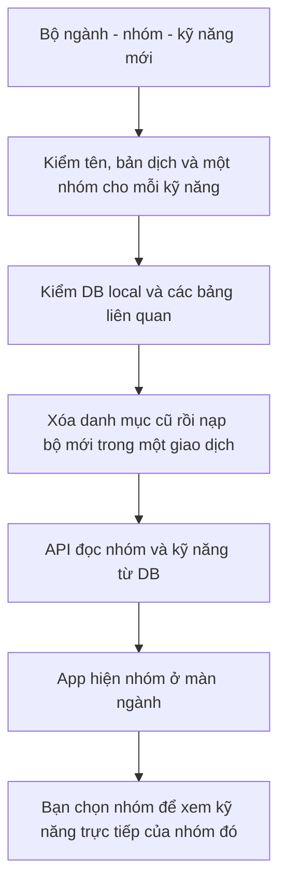

# B02-01 — Thay bộ danh mục và bỏ các lựa chọn trùng

05/10/2026 · DELIVERY-01, nối B02-01/I18N-04 · Theo yêu cầu trực tiếp “clear hết data về phần này và thêm các data mới”. Code đang sửa trên nền `7ded50c`, chưa commit/push; chưa CI/UAT cho thay đổi này.

> **Xác nhận 06/10/2026:** chủ dự án đã xem bộ danh mục mới, xác nhận ổn và yêu cầu push. Kiểm lại trước push: 39 test API, typecheck/lint đạt; bằng chứng mobile/web/native ngày 05/10 giữ theo bảng bên dưới. Đây là xác nhận phạm vi danh mục, không phải UAT toàn app.

## 1. Bạn thấy gì khi mở lại app?

Mở **Điện nước → Điện dân dụng** sẽ thấy năm công việc cụ thể như dò lỗi mạch điện, thay dây điện, thay ổ cắm/công tắc. Nhóm “Dịch vụ điện nước” chung đã được bỏ. Màn ngành hiện các nhóm; kỹ năng của nhóm con không còn lặp lại bên dưới màn ngành.

Đã xóa và nạp lại **riêng danh mục của DB phát triển local**. Bộ cũ có 10 ngành, 50 nhóm, 140 kỹ năng và 141 liên kết; bộ mới có **10 ngành, 39 nhóm, 128 kỹ năng và 128 liên kết**. Mỗi kỹ năng trong bộ mới chỉ nằm trong một nhóm, có tên Việt/Anh/Nhật.

Tài khoản, định danh đăng nhập, phiên đăng nhập và lịch sử migration giữ nguyên: đã so sánh nội dung trước/sau bằng dấu kiểm tra dữ liệu. Không chỉ đếm số dòng. Nếu app đang giữ màn cũ trong bộ nhớ, quay về danh mục hoặc Reload app để tải bộ mới.

## 2. Những chỗ trùng được giải quyết thế nào?

| Trước đây | Bộ mới |
|---|---|
| 10 nhóm “Dịch vụ…” chung đứng cạnh nhóm chuyên biệt | Bỏ cả 10 nhóm chung; phân loại trực tiếp theo công việc/đối tượng |
| Camera nằm ở Điện nước và Lắp đặt thiết bị | Chỉ ở nhóm Camera giám sát; tách lắp phần cứng, cấu hình, sửa kết nối và tháo camera |
| Ghế văn phòng và ghế bọc vải có thể là cùng ghế | Một kỹ năng Vệ sinh ghế rời, tại nhóm Sofa/ghế/nệm/thảm |
| Giày thể thao có thể cũng là giày da | Một kỹ năng Vệ sinh giày; đánh bóng giày da là thao tác riêng |
| Chuyển bàn ghế văn phòng lặp vận chuyển nội thất | Một kỹ năng Vận chuyển đồ nội thất; không tạo bản sao theo địa điểm |
| Gói chuyển nhà/căn hộ/phòng trọ xen với công việc cụ thể | Nhóm Đóng gói, Tháo/lắp, Bốc xếp, Vận chuyển; loại nơi ở không là kỹ năng riêng |
| Đón đi spa, đưa về, đưa đi lưu trú | Một kỹ năng Vận chuyển thú cưng; điểm đón/trả là thông tin chuyến |
| Làm nail và Trang điểm tổng quát đứng cạnh các mục con | Móng được tách theo công việc cụ thể; trang điểm khuôn mặt là một kỹ năng, không nhân bản theo dịp |
| Dọn nhà/văn phòng/cửa hàng giao với bếp/phòng tắm | Phân theo bề mặt cần làm sạch và đồ bọc; không nhân bản theo địa điểm hoặc cách tính giờ |
| Bảo dưỡng máy lọc nước bao gồm cả thay lõi | Tách lắp máy, thay lõi, vệ sinh vỏ/bình; không giữ mục bảo dưỡng bao trùm |

Các nghề khác đối tượng vẫn được giữ riêng, ví dụ thay pin điện thoại và thay pin máy tính bảng; vệ sinh điều hòa gia dụng và vệ sinh điều hòa ô tô. Không gộp chỉ vì tên có vài từ giống nhau.

Mỗi nhóm trong [catalog.json](../../../services/api/seeds/catalog.json) có `scope_vi`: ghi rõ công việc thuộc nhóm và phần loại trừ để lần bổ sung sau không tạo lại chồng chéo. Trường này phục vụ biên soạn/review nguồn dữ liệu, chưa phải một cột DB hay nội dung app hiển thị. Không mở thêm form đặt dịch vụ trong đợt này.

## 3. Toàn bộ cây dữ liệu mới

### Điện nước — 4 nhóm, 15 kỹ năng

| Nhóm | Kỹ năng |
|---|---|
| Điện dân dụng | Thay ổ cắm / công tắc; Lắp đèn chiếu sáng; Thay aptomat; Dò lỗi mạch điện trong nhà; Thay dây điện trong nhà |
| Cấp nước và thiết bị vệ sinh | Sửa rò rỉ nước; Lắp vòi nước; Sửa vòi nước; Sửa bộ xả / van cấp bồn cầu |
| Thông tắc đường thoát | Thông tắc chậu rửa; Thông tắc bồn cầu; Thông tắc đường thoát chung |
| Máy bơm nước | Lắp máy bơm nước; Sửa máy bơm nước; Thay phao điện bồn nước |

### Điện lạnh / gia dụng — 4 nhóm, 15 kỹ năng

| Nhóm | Kỹ năng |
|---|---|
| Điều hòa gia dụng | Vệ sinh điều hòa; Sửa điều hòa; Lắp điều hòa; Tháo điều hòa |
| Tủ lạnh / tủ đông | Sửa hệ làm lạnh tủ lạnh / tủ đông; Sửa điều khiển tủ lạnh / tủ đông; Thay gioăng tủ lạnh / tủ đông |
| Máy giặt / máy sấy | Sửa máy giặt; Vệ sinh máy giặt; Sửa máy sấy quần áo; Lắp máy giặt; Vệ sinh máy sấy quần áo |
| Thiết bị bếp / nước nóng | Sửa bếp từ; Sửa lò vi sóng; Sửa bình nóng lạnh |

### Vệ sinh — 2 nhóm, 8 kỹ năng

| Nhóm | Kỹ năng |
|---|---|
| Làm sạch bề mặt | Làm sạch sàn nhà; Vệ sinh mặt bếp / tủ bếp; Vệ sinh thiết bị phòng tắm; Lau kính trong nhà |
| Sofa / ghế / nệm / thảm | Vệ sinh sofa; Vệ sinh ghế rời; Vệ sinh nệm; Vệ sinh thảm |

### Điện thoại / máy tính — 5 nhóm, 17 kỹ năng

| Nhóm | Kỹ năng |
|---|---|
| Linh kiện điện thoại | Thay màn hình điện thoại; Thay pin điện thoại; Sửa cổng sạc điện thoại |
| Linh kiện laptop | Thay bàn phím laptop; Thay pin laptop; Thay màn hình laptop; Sửa cổng sạc laptop |
| Vệ sinh / nâng cấp máy tính | Vệ sinh máy tính; Nâng cấp RAM; Nâng cấp ổ SSD |
| Linh kiện máy tính bảng | Thay màn hình máy tính bảng; Thay pin máy tính bảng; Sửa cổng sạc máy tính bảng |
| Chẩn đoán / sửa bo mạch | Chẩn đoán lỗi điện thoại; Chẩn đoán lỗi máy tính; Sửa bo mạch điện thoại; Sửa bo mạch máy tính |

### Xe máy / ô tô — 4 nhóm, 15 kỹ năng

| Nhóm | Kỹ năng |
|---|---|
| Bảo dưỡng cơ khí xe máy | Thay dầu xe máy; Bảo dưỡng phanh xe máy; Bảo dưỡng xích xe máy |
| Bảo dưỡng cơ khí ô tô | Thay dầu ô tô; Thay lọc gió động cơ ô tô; Bảo dưỡng phanh ô tô |
| Lốp / ắc quy | Thay lốp xe máy; Thay lốp ô tô; Thay ắc quy xe máy; Thay ắc quy ô tô |
| Vệ sinh / chăm sóc xe | Rửa xe máy; Rửa ngoại thất ô tô; Vệ sinh nội thất ô tô; Đánh bóng ô tô; Vệ sinh điều hòa ô tô |

### Thú cưng — 4 nhóm, 12 kỹ năng

| Nhóm | Kỹ năng |
|---|---|
| Tắm / vệ sinh thú cưng | Tắm chó; Tắm mèo; Cắt móng thú cưng; Vệ sinh tai ngoài thú cưng |
| Chăm sóc lông | Cắt tỉa lông chó; Cắt tỉa lông mèo; Chải / gỡ rối lông |
| Trông giữ thú cưng | Trông giữ chó qua đêm; Trông giữ mèo qua đêm; Trông giữ chó ban ngày; Trông giữ mèo ban ngày |
| Vận chuyển thú cưng | Vận chuyển thú cưng |

### Làm đẹp không y tế — 4 nhóm, 12 kỹ năng

| Nhóm | Kỹ năng |
|---|---|
| Cắt / gội / tạo kiểu tóc | Cắt tóc; Gội / sấy khô tóc; Tạo kiểu tóc tạm thời |
| Chăm sóc / trang trí móng | Chăm sóc nền móng tay; Chăm sóc nền móng chân; Sơn móng; Đắp / nối móng; Tháo sơn / móng đắp |
| Trang điểm | Trang điểm khuôn mặt |
| Uốn / duỗi / nhuộm tóc | Nhuộm tóc; Uốn tóc; Duỗi tóc |

### Chuyển nhà / bốc xếp — 4 nhóm, 9 kỹ năng

| Nhóm | Kỹ năng |
|---|---|
| Đóng gói đồ | Đóng gói đồ dễ vỡ; Đóng gói hồ sơ / sách; Đóng gói đồ dùng không dễ vỡ |
| Tháo / lắp nội thất | Tháo đồ nội thất khi chuyển; Lắp lại nội thất sau chuyển |
| Bốc xếp đồ | Bốc xếp đồ lên / xuống xe |
| Vận chuyển đồ | Vận chuyển đồ nội thất; Vận chuyển thiết bị điện / điện tử; Vận chuyển thùng đồ dùng |

### Giặt / chăm sóc đồ — 4 nhóm, 12 kỹ năng

| Nhóm | Kỹ năng |
|---|---|
| Giặt / ủi quần áo | Giặt nước quần áo; Giặt khô quần áo; Ủi quần áo |
| Giặt chăn / ga / gối | Giặt chăn; Giặt ga giường / vỏ gối; Giặt ruột gối |
| Giặt rèm / khăn / thú bông | Giặt rèm cửa; Giặt khăn; Giặt thú nhồi bông |
| Vệ sinh giày / túi | Vệ sinh giày; Vệ sinh túi xách; Đánh bóng giày da |

### Lắp đặt thiết bị — 4 nhóm, 13 kỹ năng

| Nhóm | Kỹ năng |
|---|---|
| Camera giám sát | Lắp phần cứng camera; Cấu hình camera; Sửa kết nối camera; Tháo camera |
| Mạng / Wi-Fi | Cài đặt Wi-Fi mesh; Đi dây mạng nội bộ; Cài đặt router đơn |
| Tivi / âm thanh | Treo tivi lên tường; Cài đặt smart tivi; Lắp đặt loa gia đình |
| Máy lọc nước | Lắp máy lọc nước; Thay lõi lọc nước; Vệ sinh vỏ / bình máy lọc nước |


## 4. Theo một thao tác từ dữ liệu đến màn hình

`Seed` là thao tác nạp bộ dữ liệu khởi tạo từ file vào DB. Lệnh seed thường chỉ bổ sung phần thiếu, không có nghĩa là xóa dữ liệu cũ. Lần này có lệnh **thay danh mục** riêng và chỉ chạy khi được yêu cầu rõ.



**Giao dịch DB** nghĩa là toàn bộ việc xóa và nạp phải cùng thành công. Nếu nạp lỗi giữa chừng, DB quay lại dữ liệu trước khi xóa; không để danh mục trống một nửa.

| Đọc theo thứ tự | File/hàm thật | Nhận gì → làm gì → chuyển gì |
|---|---|---|
| 1 | [catalog.json](../../../services/api/seeds/catalog.json) | Chứa 10 ngành, 39 nhóm và 128 kỹ năng, tên ba ngôn ngữ, nhóm duy nhất của mỗi kỹ năng |
| 2 | [seed.ts](../../../services/api/src/database/seed.ts), `validateCatalog()` | Nhận nội dung file → kiểm mã/tên/bản dịch, cây hai cấp, nhóm không rỗng, mỗi kỹ năng một nhóm cuối → từ chối trước khi đụng DB nếu sai |
| 3 | [cli.ts](../../../services/api/src/database/cli.ts) | Nhận lệnh `replace-catalog` → chỉ cho development/test và địa chỉ máy local → gọi `seed(pool, { replaceCatalog: true })` |
| 4 | `seed()` / `stableId()` trong `seed.ts` | Kiểm tên DB `dvqb_local`/`dvqb_test`, khóa bảng, kiểm tham chiếu ngoài → xóa liên kết/kỹ năng/nhóm cũ → nạp mới → commit; lỗi thì rollback |
| 5 | [catalog.controller.ts](../../../services/api/src/modules/catalog/catalog.controller.ts), `categories()` / `skills()` | Nhận ID/ngôn ngữ → `parseQuery()` kiểm đầu vào → chuyển tới service |
| 6 | [catalog.service.ts](../../../services/api/src/modules/catalog/catalog.service.ts), `list()` | Đọc dữ liệu đang bật trong DB → chọn tên theo locale → trả danh sách và cursor, tức dấu để đọc trang tiếp |
| 7 | [catalog-api.ts](../../../apps/mobile/src/features/catalog/api/catalog-api.ts), `createCatalogApi()` / `all()` | Gửi yêu cầu, lấy đủ trang → kiểm cấu trúc → trả danh sách cho màn hình |
| 8 | [CatalogScreen.tsx](../../../apps/mobile/src/features/catalog/screens/CatalogScreen.tsx), `CatalogScreen()` | Chỉ hiện kỹ năng có `category_ids` chứa đúng nhóm đang mở; không hiện lại kỹ năng chỉ thuộc nhóm con |

API vẫn hỗ trợ truy vấn toàn cây con. Việc bỏ lặp màn ngành nằm tại cách màn hình chọn các liên kết trực tiếp để hiển thị. Kỹ năng gắn trực tiếp vào một nhóm cha vẫn được hiện đúng nếu DB có dữ liệu đó; không đơn giản ẩn mọi kỹ năng khi có nhóm con.

## 5. Phạm vi xóa và bảo vệ dữ liệu

- Chỉ ba bảng: `skill_categories`, `skills`, `categories`. Không `TRUNCATE ... CASCADE`, không drop database, không xóa auth.
- Trước thay đã lưu bản sao riêng ba bảng danh mục trong thư mục tạm local. Không đưa dữ liệu tài khoản vào bản sao hoặc Git.
- Nếu có bất kỳ bảng ngoài nào tham chiếu danh mục, lệnh từ chối, kể cả khóa ngoại có cơ chế xóa dây chuyền. Hiện DB local chưa có bảng partner/job; test tạo bảng phụ thuộc riêng để kiểm nhánh từ chối.
- Seed thường giữ nguyên cơ chế bảo toàn dữ liệu sửa thủ công. Lệnh thay danh mục là ngoại lệ xóa rõ ràng theo yêu cầu lần này; không tự chạy khi khởi động API hoặc migration.
- Mã còn cùng nghĩa tạo lại cùng ID theo `stableId()`; mục bị bỏ không còn trong DB local. Không tuyên bố giữ lịch sử danh mục cũ sau yêu cầu clear. Đây không phải quy trình chuyển dữ liệu production có lịch sử giao dịch.
- Mô hình DB/API nhiều-nhiều vẫn giữ nguyên; bộ seed hiện tại có một nhóm chính cho mỗi kỹ năng và được validator kiểm. Không đổi hợp đồng quyền, tài khoản, thanh toán hoặc triển khai production.

## 6. Lỗi và thử lại

| Trường hợp | Hành vi |
|---|---|
| File nạp có tên trùng/thiếu bản dịch/kỹ năng hai nhóm | Từ chối trước khi bắt đầu xóa |
| Lệnh thay nhắm môi trường không được phép hoặc DB khác | Từ chối |
| Có bảng ngoài tham chiếu danh mục | Từ chối, không xóa dây chuyền dữ liệu liên quan |
| Nạp dữ liệu gặp lỗi sau khi đã xóa trong giao dịch | Rollback khôi phục nguyên trạng trước xóa; đã kiểm bằng DB thật |
| Chạy seed thường sau khi thay | Không thêm lại bộ cũ vì nguồn seed đã thay; không tăng số bản ghi |
| API mất mạng/lỗi | App hiện lỗi và Thử lại; không chèn danh sách giả |
| Đổi ngôn ngữ hoặc quay lại khi request chưa xong | Giữ cơ chế hủy request cũ và tải lại theo lựa chọn hiện tại |

## 7. Kiểm thử và bằng chứng

| Phần | Kết quả đợt này |
|---|---|
| DB local sau thay + seed lại | 49 categories = 10 ngành + 39 nhóm; 128 skills; 128 liên kết; không kỹ năng trùng nhóm hoặc mồ côi |
| Dữ liệu không liên quan | Nội dung `users`, `identities`, `sessions`, `schema_migrations` trước/sau khớp; kiểm 11:07:24 UTC ngày 05/10 |
| Đọc trực tiếp API local | 120 request: categories + từng nhóm trong cả VI/EN/JA; đủ 128 kỹ năng mỗi ngôn ngữ, đúng tên từ nguồn seed và một nhóm mỗi kỹ năng |
| API | 39 test đạt; có kiểm replacement, rollback, từ chối tham chiếu ngoài, giữ auth, không tái tạo bộ cũ, tất cả nhóm không giao ID; coverage gate đạt |
| Mobile | 86 test đạt; có kiểm màn ngành không lặp kỹ năng nhóm con; coverage gate đạt |
| Web xuyên API/DB | 5 hành trình đạt: danh mục, retry/rỗng, lỗi máy chủ, tài khoản, i18n/shell |
| Android catalog | PASS 11:09:34 UTC; danh mục, Back, resume, lỗi/retry, rỗng/phục hồi |
| iOS catalog | PASS 11:09:41 UTC; cùng các nhánh trên |
| Native i18n | Android PASS 11:15:59 UTC, iOS PASS 11:11:14 UTC; đổi tiếng, giữ form, lỗi theo ngôn ngữ, đọc kỹ năng, retry và khởi động lại giữ locale |
| Typecheck / lint / build | Đạt; bốn test logging chạy lại sau bổ sung sự kiện `db.catalog.replaced` đều đạt |
| Tooling | Ba test kiểm công cụ đạt |

Đã xem ảnh kỹ năng ở cả Android và iOS: tiêu đề Điện dân dụng và năm kỹ năng mới hiển thị đúng, không thấy tràn ngang trong ảnh được kiểm. Không coi một màn đã xem là bằng chứng kiểm giao diện toàn bộ 128 kỹ năng.

Mốc so sánh bảo toàn auth là **ngay sau thay dữ liệu lúc 11:07:24 UTC**. Khi công cụ native mở lại app phát triển sau test, API ghi nhận hai lần `POST /v1/auth/refresh` thành công lúc 11:09:43 và 11:11:15 UTC, tạo phiên kế tiếp theo cơ chế refresh hiện có. Vì vậy bảng sessions cuối buổi không còn giống từng byte với đầu buổi; đây là hoạt động phiên sau reset, không phải lệnh clear xóa auth. Users/identities vẫn khớp bản đầu; không khôi phục snapshot phiên cũ đè lên các phiên mới.

Các file bằng chứng local: `test-results/api/junit.xml`, `coverage/api/`, `coverage/mobile/`, `test-results/web/`, `test-results/native/android/result.json`, `test-results/native/ios/result.json` và các thư mục `i18n/` tương ứng. Artifact test không commit. Lượt web đầu bị sandbox chặn Chromium trước khi vào app; đã chạy lại với quyền mở trình duyệt local và đạt cả năm test.

Một lượt i18n Android dừng ở bước tìm ô mật khẩu: ảnh/log cho thấy app đã quay về danh mục sau `hideKeyboard`. Kịch bản đã đổi sang Enter để kết thúc nhập email và gửi form qua `onSubmitEditing`, tránh dùng Back để đóng bàn phím. Chạy lại đạt; không sửa logic tài khoản để né lỗi test. Nhánh iOS dùng Enter như trước và đã đạt.

Sơ đồ Mermaid đã render thành công; các link file và cây dữ liệu trong báo cáo đã đối chiếu nguồn seed. Bản render chỉ ở thư mục tạm, không tạo file ảnh riêng trong repo.

Chưa có CI cho code mới, UAT của chủ dự án, kiểm thiết bị thật hoặc nghiệm thu chuyên gia từng nghề. Không khẳng định 128 kỹ năng là mọi dịch vụ có thể có trên thị trường. Các số 50 nhóm/140 kỹ năng trong báo cáo và snapshot kỹ thuật I18N-04 trước là bộ đã thay, không dùng để đánh giá DB hiện tại.

## 8. Lệnh tra cứu và bài thử

```sh
# Nạp bổ sung thông thường, không xóa
npm run db:seed

# Xóa và thay riêng danh mục local — chỉ dùng khi thực sự muốn thay dữ liệu
npm run db:replace-catalog -w services/api

npm run test:coverage -w services/api
npm run test:coverage -w apps/mobile
npm run test:e2e
```

1. Mở Điện nước: vì sao không còn thấy Lắp camera? Tìm `camera_mounting` trong file seed để xem nhóm của nó.
2. Mở Vệ sinh: tìm Vệ sinh ghế rời. Ghế văn phòng và ghế nhà ở dùng cùng một mục; loại ghế/chất liệu sẽ là thông tin cần làm rõ khi đặt dịch vụ.
3. Đổi English/日本語 trong một nhóm: ID không thay, chỉ tên hiển thị đổi. Tên ở đâu ra? Đi theo hàng 5–8 của bảng đọc code.
4. Đọc `seed()` và so lệnh thường với `replaceCatalog: true`: vì sao chạy seed thường không có quyền tự xóa dữ liệu đã tồn tại?

Đợt này thay dữ liệu phát triển và sửa hiển thị theo cấu trúc ngành → nhóm → kỹ năng; không đổi schema/API nghiệp vụ. Báo cáo/checklist lưu trong repo theo DELIVERY-01; không đồng bộ toàn bộ hồ sơ/Drive chỉ vì thay data local.
