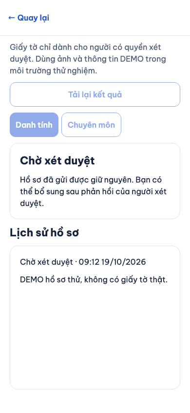
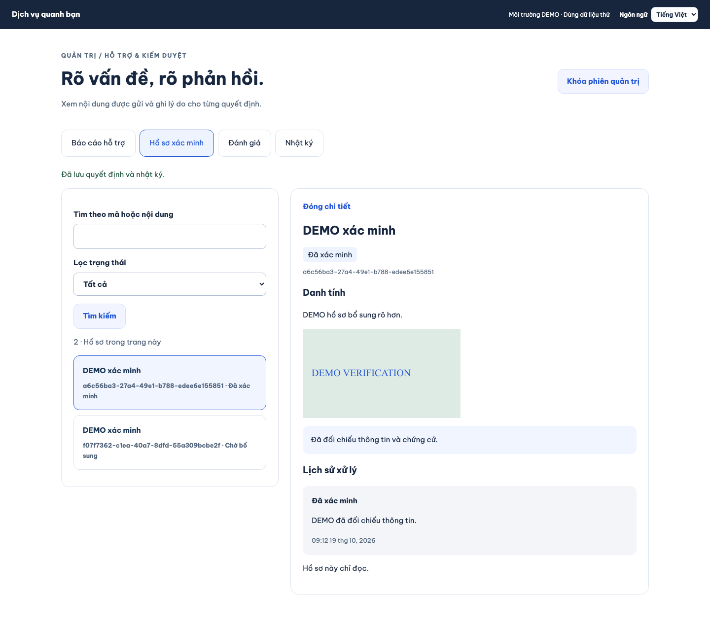
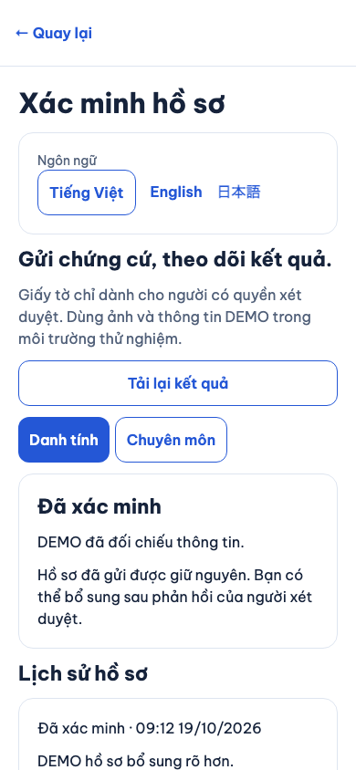
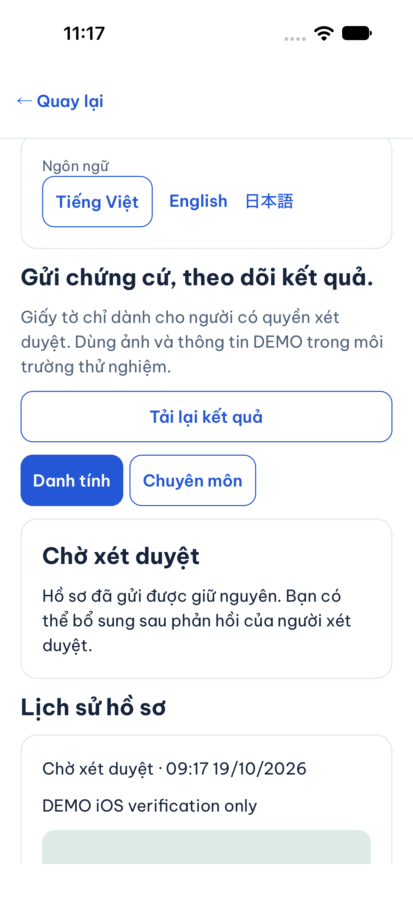
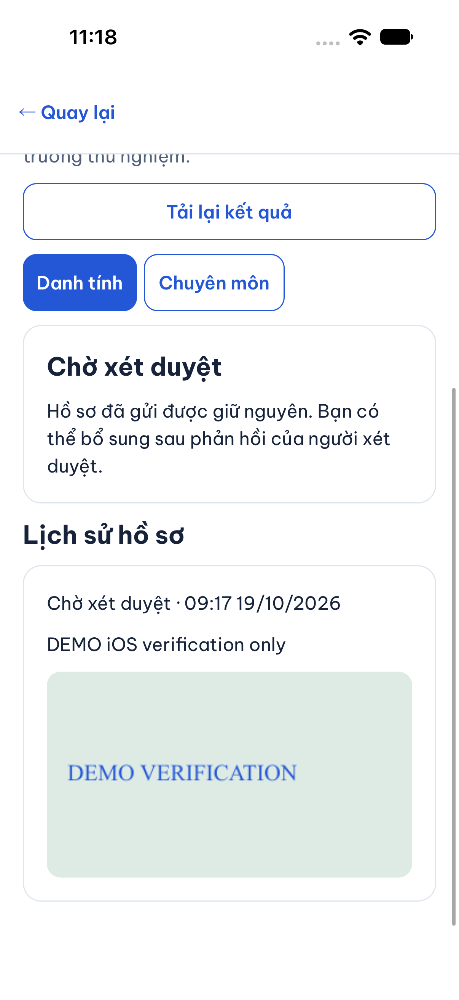
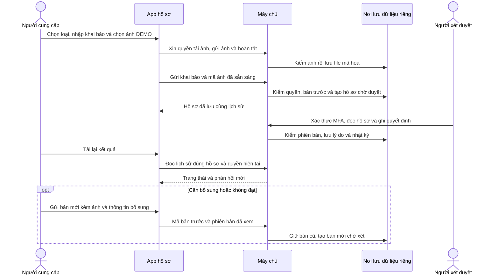

# B02-04 — Nộp hồ sơ và theo dõi xét xác minh

19/10/2026 · P1-03, lát xác minh của B02-05/P1-2 · Code đang sửa trên nền `7545890`. [Phạm vi đã duyệt](../de-xuat/P1-03-admin-ho-tro-va-kiem-duyet.md) · [Phần admin](B09-02-admin-ho-tro-va-kiem-duyet.md).

## Bạn dùng được gì?

Trong **Tài khoản → Hồ sơ cung cấp dịch vụ → chọn hồ sơ → Xác minh hồ sơ**, người có quyền sửa hồ sơ chọn loại giấy tờ, nhập thông tin khai báo, chọn ảnh DEMO và gửi xét duyệt. Hồ sơ nháp cũng vào được bước này. Loại danh tính và chuyên môn dùng cho mọi partner; loại doanh nghiệp chỉ hiện cho doanh nghiệp.

App hiển thị **Chờ xét duyệt**, **Cần bổ sung**, **Không đạt** hoặc **Đã xác minh**. Nếu cần bổ sung/không đạt, bạn gửi một bản mới; bản cũ và phản hồi vẫn còn trong lịch sử. Đang chờ hoặc đã duyệt không gửi đè. Admin duyệt danh tính thì huy hiệu chung của hồ sơ đổi thành đã xác minh; duyệt chuyên môn/doanh nghiệp không tự đổi huy hiệu đó.

Ảnh Chromium 390px và desktop, ngày 19/10/2026, app/API/PostgreSQL test thật, dữ liệu DEMO; không phải điện thoại vật lý.

iOS 27 simulator (iPhone 18 Pro), 19/10/2026: đã đi từ tài khoản/hồ sơ nháp vào xác minh, nhập khai báo, chọn ảnh DEMO từ Photos, upload và gửi thành công qua API/DB test. Màn hiển thị Chờ xét duyệt và lịch sử có ảnh. Đây là simulator, chưa phải thiết bị thật; nhánh bổ sung/duyệt được kiểm trọn trên web.

## Theo một lần gửi đến kết quả

API là đường app gửi yêu cầu đến máy chủ. “Ảnh ready” nghĩa là máy chủ đã nhận đủ dữ liệu và kiểm kiểu/kích thước ảnh, không chỉ nhận tên file. “Giao dịch DB” giữ thay đổi đồng bộ: nếu một bước lưu lỗi thì hủy các thay đổi trong lần gửi đó.

## Mở code theo thứ tự

| Bước | File / hàm | Dữ liệu đi đâu và vì sao? |
|---|---|---|
| 1 | [PartnerEditorScreen.tsx](../../../apps/mobile/src/features/partners/screens/PartnerEditorScreen.tsx) | Nút `partner-verification` chuyển sang màn xác minh với ID hồ sơ. |
| 2 | [VerificationScreen.tsx](../../../apps/mobile/src/features/verification/screens/VerificationScreen.tsx), `VerificationDesk`, `pick`, `send` | Đọc lịch sử, giữ nội dung/ảnh nháp, lấy ID và phiên bản bản trước để gửi. Không hiện thành công trước khi API trả hồ sơ hợp lệ. |
| 3 | [auth-session.ts](../../../apps/mobile/src/features/auth/state/auth-session.ts), `submitVerification`, `uploadVerification` | Ràng buộc thao tác vào đúng tài khoản đang đăng nhập; chuyển đến API client của chức năng. |
| 4 | [verification-api.ts](../../../apps/mobile/src/features/verification/api/verification-api.ts) | Xin upload grant, gửi bytes, hoàn tất ảnh rồi gửi khai báo. Cùng thao tác thử lại giữ cùng mã. Kiểm cấu trúc phản hồi. |
| 5 | [verification.service.ts](../../../services/api/src/modules/verification/verification.service.ts), `verificationInput`, `access`, `submit`, `list` | Kiểm quyền `profile.manage`, loại hồ sơ, ảnh của người gửi và bản trước mới nhất. Mỗi bản lưu riêng, khai báo được mã hóa. |
| 6 | [moderation.service.ts](../../../services/api/src/modules/moderation/moderation.service.ts), `decide` | Admin có MFA và quyền xét duyệt mới ghi được; duyệt phải xác nhận đã đối chiếu chứng cứ. |
| 7 | [015_admin_moderation.sql](../../../services/api/migrations/015_admin_moderation.sql) | Tạo bảng hồ sơ, liên kết ảnh và lịch sử; chỉ một bản pending cho mỗi partner/loại. |

## Dữ liệu, quyền và lỗi

Khai báo và ảnh xác minh được mã hóa bằng khóa riêng của môi trường thử. App chỉ giữ bản nháp trong bộ nhớ. Ảnh chưa gắn vào hồ sơ thuộc người tải lên; sau khi gắn, người đọc phải còn quyền `profile.manage` của hồ sơ đó. Admin cần `moderation.manage` và phiên MFA hiện hành. Truy vấn công khai không trả giấy tờ hoặc khai báo.

Tối đa 10 ảnh, mỗi ảnh 10 MiB, loại JPEG/PNG/WebP. Máy chủ kiểm nội dung thực của ảnh, chuyển PNG và bỏ metadata. Môi trường này dùng ổ đĩa local, chưa dịch vụ lưu trữ cloud hoặc quét mã độc chuyên dụng.

Mất phản hồi: app giữ yêu cầu để thử lại. Hai lần gửi cùng mã không tạo hai hồ sơ. Quyền bị thu hồi: dữ liệu riêng và bản nháp bị xóa khỏi màn. Bản trước thay đổi: yêu cầu tải lại; không tự ghi đè. Lịch sử đọc đủ các trang; con trỏ phân trang gắn tài khoản và partner nên không dùng chéo.

## Tự thử và tự hiểu

1. Dùng người cung cấp DEMO, mở nút xác minh trong hồ sơ nháp; nhập khai báo có chữ DEMO và tải ảnh thử.
2. Gửi, kiểm trạng thái Chờ xét duyệt và bản ghi lịch sử. Nút gửi không còn hiện để gửi đè.
3. Admin chọn Cần bổ sung kèm lý do. App tải lại rồi gửi bản mới. Kiểm bản cũ vẫn còn.
4. Admin xác nhận đã đối chiếu rồi duyệt; app tải lại thấy Đã xác minh. Thử tài khoản ngoài hồ sơ: không được đọc ảnh/khai báo.

Vì sao gửi lại tạo bản mới? Để giữ đúng tài liệu admin đã xét trước đó. Vì sao không dùng ảnh của người khác? Quyền upload và quyền hồ sơ được máy chủ kiểm riêng. Vì sao duyệt chuyên môn không tự đổi huy hiệu danh tính? Hai loại xác minh có ý nghĩa khác nhau; xem nhánh `kind==='identity'`.

## Kiểm thử và phần còn mở

Bốn bài mobile/client và bài tích hợp xác minh đã đạt ở lượt tập trung: dữ liệu phản hồi, upload, thử lại, bổ sung và mất quyền. Hành trình web người gửi–admin đã đạt (1 bài), dùng ảnh từ fixture và DB test thật, nằm trong [admin-moderation.spec.mjs](../../../tests/e2e/web/admin-moderation.spec.mjs). Kết quả SDD cuối lưu trong `test-results/sdd/SDD-PROJECT/`; chưa có CI mới hoặc UAT.

Không nhận giấy tờ thật ở pilot. PDF, cloud storage, recovery MFA, quy trình vận hành production, điện thoại vật lý và kiểm toàn bộ Android chưa nằm trong bằng chứng hiện có. Các trạng thái nghiệp vụ ngoài P1-03 và toàn bộ B02/P1-2 chưa được đánh dấu hoàn tất. Không tự đồng bộ Drive/Excel/ui-ux.
