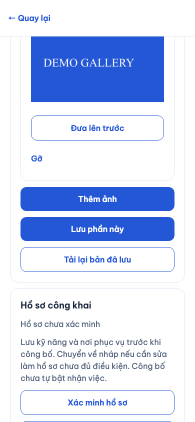
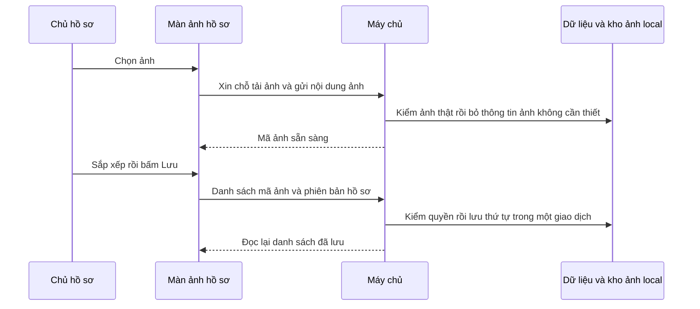
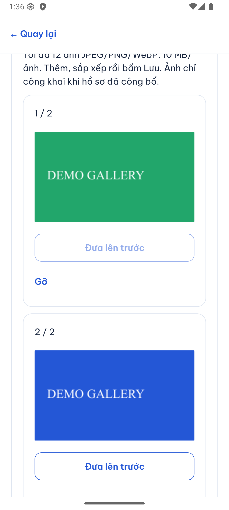
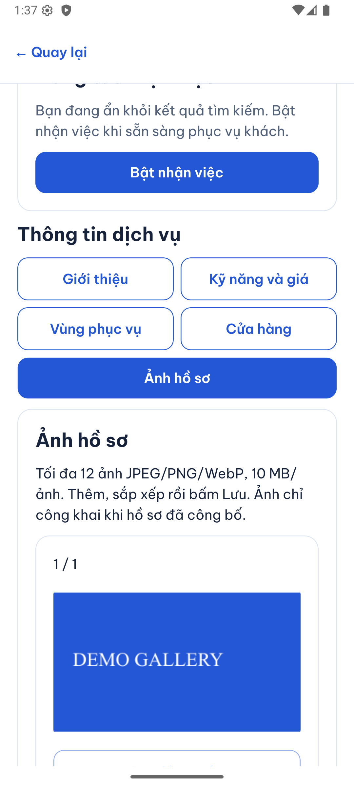
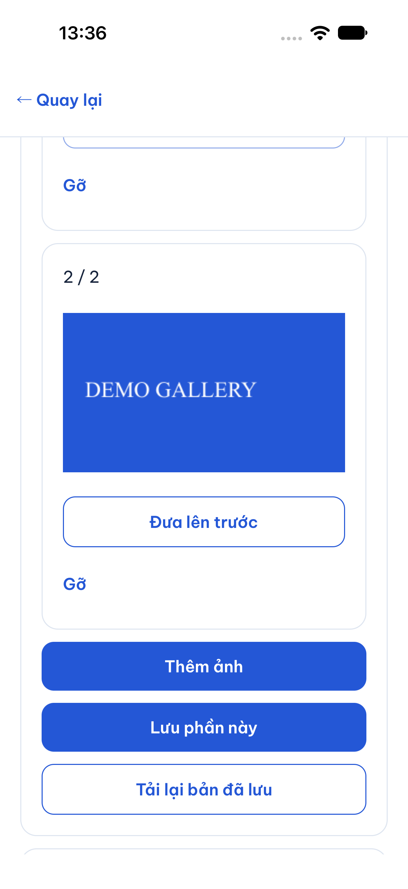
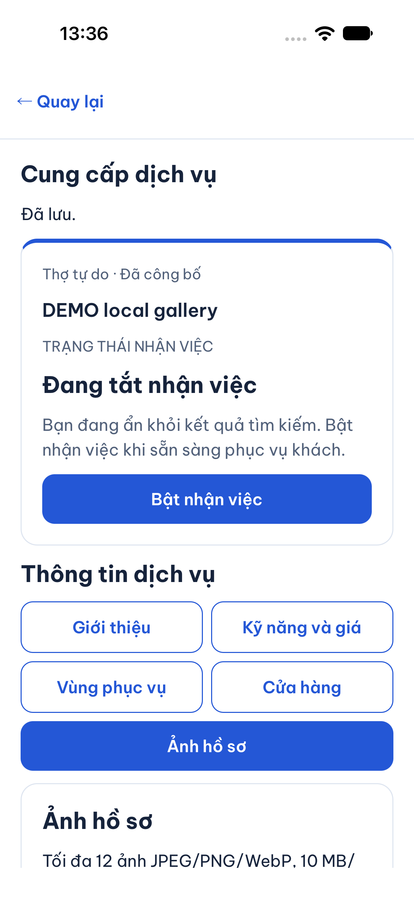

# B02-05 — Ảnh hồ sơ và tạm ngừng nhận việc

23/10/2026 · LOCAL-01 · Dữ liệu DEMO/local. Quyết định bổ sung được chủ dự án duyệt trong [kế hoạch](../de-xuat/LOCAL-01-hoan-thien-luong-local.md).

## Người dùng thấy gì?

Trong **Cung cấp dịch vụ → chọn hồ sơ → Ảnh hồ sơ**, chủ hồ sơ hoặc nhân viên có quyền sửa hồ sơ có thể chọn ảnh, đưa ảnh lên trước, gỡ ảnh rồi bấm **Lưu phần này**. Tối đa 12 ảnh JPEG/PNG/WebP, mỗi ảnh tối đa 10 MB. Hồ sơ công khai có phần ảnh riêng; ảnh chưa gắn vào hồ sơ vẫn thuộc người tải lên.

Nút **Tắt nhận việc** dùng thao tác ngừng hồ sơ có lưu lý do và nhật ký. Hồ sơ vẫn đã công bố, ví và lịch sử vẫn còn; khách không thể tạo việc mới. Có thể **Bật nhận việc** lại khi hồ sơ còn đủ điều kiện.

## Một ảnh đi từ điện thoại đến hồ sơ thế nào?

API là cửa nhận yêu cầu của máy chủ. Phiên bản giúp phát hiện hai người đang sửa cùng một hồ sơ: người đến sau phải tải lại, không ghi đè âm thầm. Khóa thử lại là mã của một lần bấm; app giữ mã và nội dung này khi mất phản hồi.

## Đọc code theo thứ tự

| Bước | File và hàm | Nhận gì → làm gì → trả gì |
|---|---|---|
| 1 | [GalleryEditor.tsx](../../../apps/mobile/src/features/partners/components/GalleryEditor.tsx), `pick`, `complete` | Nhận ảnh từ thư viện; kiểm loại/kích thước; giữ danh sách thứ tự tạm trước khi lưu. |
| 2 | [auth-session.ts](../../../apps/mobile/src/features/auth/state/auth-session.ts), `uploadGallery`, `saveGallery`, `gallery` | Kiểm đúng tài khoản và gửi yêu cầu với phiên hiện hành. |
| 3 | [gallery-api.ts](../../../apps/mobile/src/features/partners/api/gallery-api.ts), `upload`, `save` | Tải ảnh qua grant, kiểm ready khi thử lại; gửi phiên bản và danh sách mã ảnh. |
| 4 | [assets.service.ts](../../../services/api/src/modules/assets/assets.service.ts), `grant`, `complete`, `authorized`, `publicAsset` | Kiểm nội dung ảnh thật, không nhận MIME giả; chỉ cấp ảnh công khai khi hồ sơ đang công bố và không bị khóa. Mỗi lần mở URL kiểm lại quyền. |
| 5 | [partners.service.ts](../../../services/api/src/modules/partners/partners.service.ts), `gallery`, `edit`, `deactivate` | Khóa hồ sơ khi sửa; kiểm owner/profile.manage, ảnh ready và quyền sử dụng; lưu thứ tự hoặc tắt nhận việc và audit cùng giao dịch. |
| 6 | [PublicGallery.tsx](../../../apps/mobile/src/features/partners/components/PublicGallery.tsx) | Đọc danh sách riêng qua gallery API rồi hiển thị ảnh được phép. |

## Dữ liệu và lỗi

`partner_gallery` lưu hồ sơ, mã ảnh và vị trí 0–11. Ảnh bị gỡ không còn đường xem công khai; file chưa được xóa vật lý theo một chính sách lưu trữ mới. URL đã cấp cũng kiểm lại quan hệ và trạng thái, nên gỡ ảnh/ngừng công bố chặn lần tải sau. Ảnh đã tải về máy người xem không thể thu hồi từ xa.

Lưu thất bại do mạng giữ nguyên lần bấm để thử lại. Xung đột phiên bản hoặc mất quyền yêu cầu đọc lại dữ liệu. Tắt nhận việc dùng `POST /partners/{id}/deactivation` có `expected_version`, `reason`, `Idempotency-Key`; bật lại dùng availability hiện hành. Thao tác ngừng không xóa profile, ví, việc hoặc chat.

Gallery dùng `GET/PUT /partners/{id}/gallery`; GET trả `{partner_id, version, asset_ids}`, PUT nhận `{expected_version, asset_ids}` và trả management hiện hành. App đọc lại gallery sau lưu. Giữ nguyên response của hai API hồ sơ cũ để không phá contract đã có. Các route gallery và purpose mới được ghi rõ là bổ sung đã duyệt, chưa đồng bộ OpenAPI/Drive/ui-ux theo quy tắc dự án.

## Đã kiểm và tự thử

Lượt hồi quy toàn bộ đầu tiên có 175/176 bài API đạt; bài kiểm khởi tạo DB vẫn kỳ vọng 23 migration. Đã cập nhật thành 24 và kiểm hai bảng gallery/mã dự phòng tồn tại, giữ nguyên kiểm chạy migration/seed lại và bảo toàn dữ liệu. Kết quả SDD cuối lấy từ evidence cùng fingerprint.

API kiểm giới hạn, ảnh sai người/sai purpose, quyền ủy quyền, sửa đồng thời, retry, URL công khai sau gỡ/ngừng công bố và bảo toàn ví khi ngừng. Mobile kiểm thứ tự/gỡ và retry upload đúng payload. Web chạy ảnh thật DEMO, lưu mất phản hồi, gỡ và bật/tắt; ảnh ở trên lấy từ lượt chạy này.

Android emulator API 36 và iOS 27 simulator đã PASS ngày 23/10/2026: xem ảnh DEMO có sẵn, sắp xếp, gỡ/lưu và tắt nhận việc. Native chưa thao tác bộ chọn ảnh của hệ điều hành trong lượt này; upload đã kiểm qua web với ảnh thật và qua API/mobile test. Simulator không thay thiết bị thật hoặc UAT. Chưa commit/push đợt này.

1. Thêm hai ảnh, đưa ảnh thứ hai lên trước, lưu và mở hồ sơ công khai. Vì sao phải bấm Lưu sau sắp xếp? Danh sách trước đó chỉ nằm trong màn hình.
2. Gỡ ảnh rồi tải lại URL công khai cũ. Hàm nào từ chối? `publicAsset` kiểm quan hệ gallery hiện hành.
3. Tắt rồi bật nhận việc. Ví có bị tạo lại không? Không: `deactivate` chỉ sửa trạng thái và phiên bản, kèm audit.

Tra cứu kiểm thử

- [API](../../../services/api/test/integration/local-gallery.test.ts), [mobile](../../../apps/mobile/src/features/partners/components/GalleryEditor.test.tsx), [web](../../../tests/e2e/web/local-gallery-mfa.spec.mjs).
- [Migration](../../../services/api/migrations/024_local_gallery_mfa.sql).
- Native: `test-results/native/{android,ios}/local-approved/result.json`.
- Toàn bộ: `npm run sdd:run -- --change SDD-PROJECT`, sau đó `npm run sdd:check -- --change SDD-PROJECT --phase verify`. Evidence phải khớp fingerprint hiện tại.

