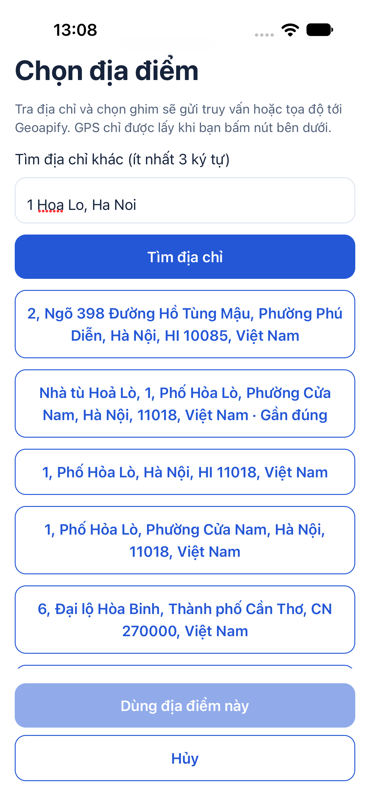
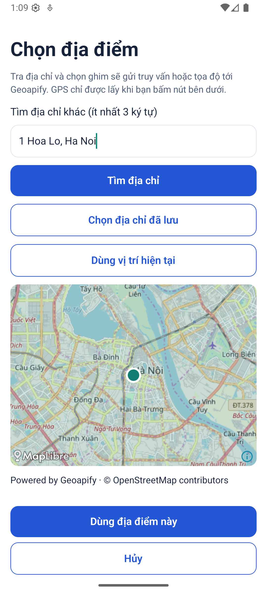
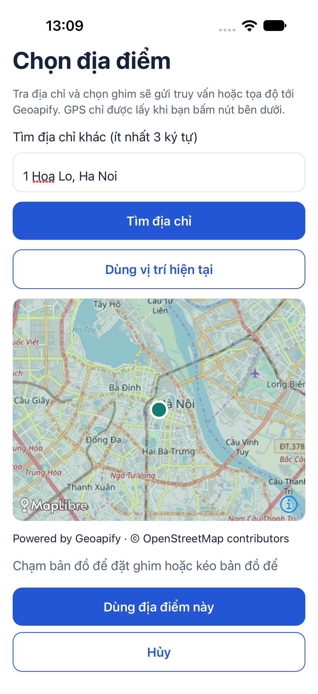
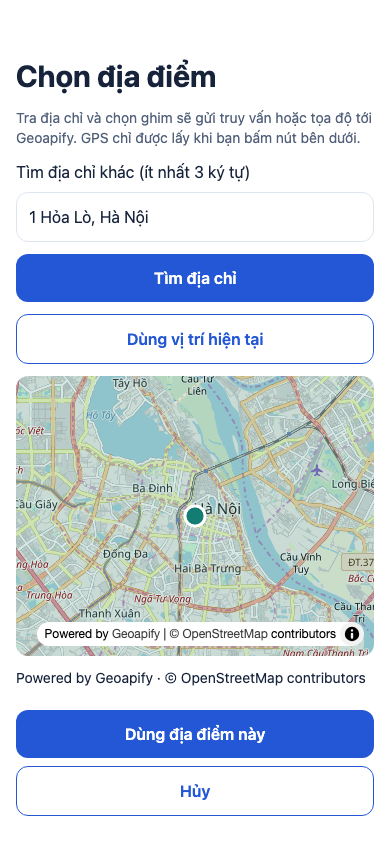
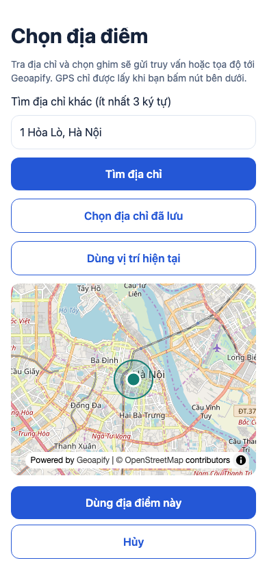
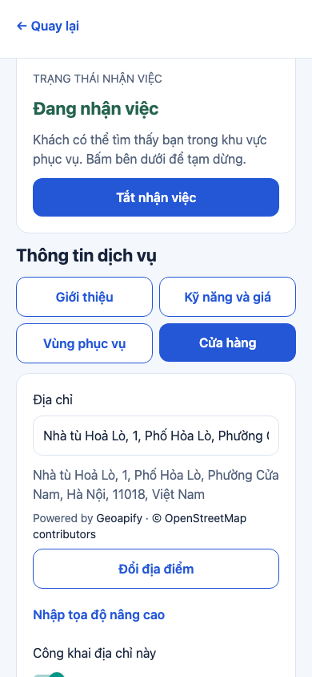
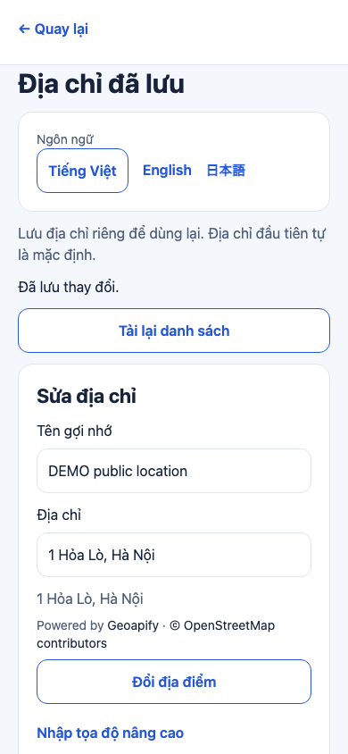
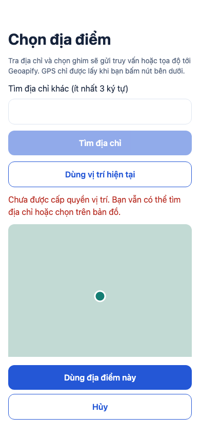
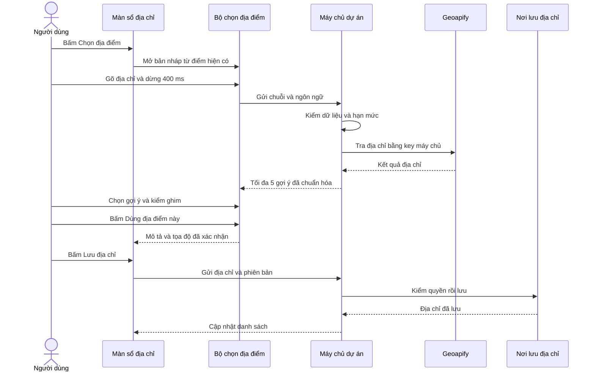

# B03-01 — Chọn địa điểm bằng địa chỉ và bản đồ

MAP-01 · kiểm ngày 07/10/2026 · thuộc bộ DELIVERY-01. Đã push MAP-01 tại `4dc7600` ngày 07/10/2026; [CI](https://github.com/anhthaingd/dich-vu-quanh-ban/actions/runs/37577265358) đã đạt cả 3 job. Các kết quả local dưới đây giữ ngày kiểm gốc. [Mục lục](../README.md) · [Kế hoạch](../de-xuat/MAP-01-ban-do-mien-phi.md).

## 1. Bạn đã dùng được những gì?

Ở màn tìm dịch vụ, sổ địa chỉ, cửa hàng và vùng phục vụ, bạn có thể bấm **Chọn địa điểm**, nhập địa chỉ rồi chọn một gợi ý. Bản đồ hiện ghim để bạn kiểm tra. Bạn cũng có thể chạm hoặc kéo bản đồ để chọn điểm khác, sửa mô tả tầng/phòng, rồi bấm **Dùng địa điểm này**. Không cần tự tìm kinh độ/vĩ độ.

Nút **Dùng vị trí hiện tại** chỉ xin quyền và lấy GPS khi bạn bấm. Nếu không cấp quyền hoặc máy chưa lấy được vị trí, bạn vẫn nhập địa chỉ/chọn ghim được. Địa chỉ đã lưu của chính tài khoản có thể dùng lại. Nút **Hủy** giữ nguyên form ban đầu. Phần nhập tọa độ cũ nằm trong **Nhập tọa độ nâng cao**.

Điểm mới chỉ chuyển vào form khi xác nhận. Với sổ địa chỉ/cửa hàng/vùng, bạn còn phải bấm nút lưu của màn đó để lưu vào máy chủ. Với tìm dịch vụ, bạn bấm tìm để máy chủ lọc người cung cấp quanh điểm mới. Điểm cửa hàng đã công khai có nút mở bản đồ trong hồ sơ; tâm vùng không trở thành vị trí công khai của thợ.

Đã chạy bản đồ thật trên web, Android emulator và iOS simulator, với hai key do chủ dự án điền. Chưa bật billing, chưa phát hành production, chưa UAT của chủ dự án hay kiểm điện thoại thật. Bản đồ toàn bộ kết quả tìm kiếm, gom ghim, polygon, chỉ đường/ETA và theo dõi thợ chưa thuộc đợt.

### Ảnh app chạy thật

Ảnh ngày 07/10/2026, địa điểm công khai và tài khoản DEMO/test. Android/iOS dưới đây là máy ảo, không phải điện thoại thật. Ảnh thể hiện thao tác ghi ở chú thích, không thay thế test hoặc chứng minh toàn bộ luồng trên mọi nền tảng.

| Gợi ý địa chỉ thật trên iOS simulator | Ghim trên Android emulator |
|---|---|
|  |  |

Trong thử nhập không dấu `1 Hoa Lo, Ha Noi`, gợi ý đầu có thể sai. Người kiểm đã chọn dòng Hỏa Lò phù hợp; app không tự lấy dòng đầu.

| Bản đồ thật trên iOS simulator | Bản đồ thật trên web |
|---|---|
|  |  |

| Chọn tâm vùng, vòng tròn 1 km trên web | Địa chỉ cửa hàng sau xác nhận vào bản nháp |
|---|---|
|  |  |

Hai ảnh này dùng Geoapify thật; chưa bấm lưu thay hồ sơ DEMO đang có. Việc lưu và kiểm quyền/version được kiểm tự động riêng.

| Địa chỉ test đã lưu và mở lại qua API/DB thật | Từ chối GPS trên web test |
|---|---|
|  |  |

Hai ảnh web test dùng gợi ý và bản đồ nền giả lập để không tiêu quota trong kiểm thử. Không dùng chúng làm bằng chứng dữ liệu Geoapify thật. [Ảnh iOS không lấy được GPS](anh/B03-01/ios-gps-unavailable.png) là trường hợp simulator chưa có vị trí, khác với từ chối quyền.

## 2. Những khái niệm cần biết

**Gợi ý địa chỉ (autocomplete)** là các kết quả hiện sau khi dừng gõ. **Geocode** là tìm địa chỉ đầy đủ bằng nút tìm. **Tra ngược (reverse)** là đưa tọa độ ghim cho dịch vụ để lấy mô tả địa chỉ gần đó. Địa chỉ tra được có thể gần đúng, nên ghim vẫn cần người dùng kiểm tra.

**MapLibre** vẽ bản đồ và nhận thao tác chạm/kéo. **Geoapify** cung cấp bản đồ nền và kết quả tra địa chỉ. **State** là dữ liệu app giữ tạm khi bạn đang chọn, chẳng hạn truy vấn, ghim và lỗi. **API** là cách app gửi yêu cầu đến chương trình xử lý ở máy chủ. Cơ sở dữ liệu PostgreSQL/PostGIS vẫn quyết định kết quả tìm người cung cấp và quyền lưu; MapLibre không gọi thẳng cơ sở dữ liệu.

## 3. Theo một thao tác từ đầu đến cuối

Ví dụ bạn thêm địa chỉ ở Hỏa Lò. Khi mở bộ chọn, app tạo bản nháp riêng. Sau khi bạn gõ ít nhất 3 ký tự và dừng 400 mili giây, app gửi chuỗi tìm đến API dự án. Máy chủ kiểm đầu vào và hạn mức rồi hỏi Geoapify. Kết quả được chuyển về một dạng chung, tối đa 5 gợi ý.

Bạn chọn một gợi ý, kiểm ghim rồi sửa mô tả cổng/tầng nếu cần. Bấm xác nhận mới đưa địa chỉ và tọa độ về màn sổ địa chỉ. Nút lưu của màn sổ địa chỉ gọi API hiện có; máy chủ kiểm tài khoản và phiên bản trước khi lưu. Đây là hai lần xác nhận khác nhau: chọn một vị trí, rồi lưu mục địa chỉ.

Sơ đồ mô tả nhánh thành công. Nếu Hủy, không có bước trả dữ liệu mới về form. Nếu kéo ghim, app chờ 450 mili giây rồi tra ngược; mô tả có thể lấy từ Geoapify nhưng tọa độ giữ đúng điểm bạn chọn, không tự nhảy sang tòa nhà gần nhất. Nếu tra ngược rỗng/lỗi, bạn tự nhập mô tả cho ghim đó.

## 4. Mở code theo thứ tự nào?

| Bước | File và hàm thật | Nhận gì, làm gì, chuyển cho ai và vì sao? |
|---|---|---|
| 1 | [AddressesScreen](../../../apps/mobile/src/features/accounts/screens/AddressesScreen.tsx), `AddressesScreen`, `save` | Đọc địa chỉ đang sửa. `LocationField.onChange` nhận điểm đã xác nhận và cập nhật form. `save` vẫn dùng API tài khoản để giữ quyền/version/retry cũ. |
| 2 | [LocationField](../../../apps/mobile/src/features/location/components/LocationField.tsx), `LocationField`, `LocationPicker` | Mở modal, tức lớp chọn nằm trên màn đang sửa. Nhận tọa độ/mô tả/bán kính; quản lý Hủy/Xác nhận, hẹn giờ tìm, GPS và danh sách địa chỉ của tài khoản. |
| 3 | [LocationDraft](../../../apps/mobile/src/features/location/state/location-draft.ts), `query`, `search`, `choose`, `pin`, `describe` | Nhớ bản nháp và lượt thao tác mới nhất. `query` bỏ điểm cũ; `describe` giữ điểm. Mỗi thao tác tăng số lượt để câu trả lời chậm không thay lựa chọn mới. |
| 4 | [locations-api](../../../apps/mobile/src/features/location/api/locations-api.ts), `createLocationsApi` | Đổi thao tác thành POST JSON và kiểm hình dạng phản hồi. Dữ liệu provider lỗi không được coi là tọa độ hợp lệ. |
| 5 | [LocationsController](../../../services/api/src/modules/locations/locations.controller.ts), `lookup`; [locationInput](../../../services/api/src/modules/locations/locations.input.ts) | Kiểm action/body, bearer nếu có và hạn mức. Không nhận URL tùy ý hoặc ID tài khoản do client tự khai. Đầu ra là gợi ý hoặc lỗi chuẩn. |
| 6 | [LocationLimit](../../../services/api/src/modules/locations/locations.limit.ts), `take` | Đếm lượt theo IP/tài khoản và toàn tiến trình trước khi hỏi nhà cung cấp, giúp giảm gọi liên tục trong pilot. |
| 7 | [GeoapifyProvider](../../../services/api/src/integrations/maps/geoapify.ts), `lookup` | Gọi hostname cố định, timeout 6 giây, chuẩn hóa địa chỉ/điểm/độ gần đúng. Key máy chủ không được trả về app. |
| 8 | [LocationMap.native](../../../apps/mobile/src/features/location/components/LocationMap.native.tsx), [LocationMap.web](../../../apps/mobile/src/features/location/components/LocationMap.web.tsx), `LocationMap`; [map-model](../../../apps/mobile/src/features/location/components/map-model.ts), `mapFeatures` | Vẽ ghim/vòng tròn bằng đúng thứ tự kinh độ trước, vĩ độ sau của thư viện. Tâm camera ban đầu không phải lựa chọn mặc định của người dùng. |
| 9 | [SearchScreen](../../../apps/mobile/src/features/search/screens/SearchScreen.tsx), [PartnerEditorScreen](../../../apps/mobile/src/features/partners/screens/PartnerEditorScreen.tsx), [PublicLocation](../../../apps/mobile/src/features/location/components/PublicLocation.tsx) | Tái sử dụng cùng bộ chọn cho tìm/cửa hàng/tâm vùng. Tìm đổi điểm thì bỏ kết quả/cursor cũ. Hồ sơ chỉ vẽ địa chỉ từ DTO public, tức dữ liệu backend cho phép công khai. |

[AppModule](../../../services/api/src/app.module.ts) đăng ký module lúc máy chủ khởi động; nó không tự gọi Geoapify mỗi lần app mở.

## 5. Dữ liệu được nhớ ở đâu và nếu có lỗi thì sao?

Trong bộ chọn, `{text, point, source}` chỉ là bản nháp. `source` ghi người dùng chọn từ tìm kiếm/ghim/GPS/địa chỉ lưu, không thêm vào DB. API lưu cũ tiếp tục nhận `{text, point}`; không có migration hay lịch sử GPS mới. ID gợi ý cũng chỉ dùng tạm.

Khi bạn sửa truy vấn, app bỏ ghim cũ để tránh lưu một tọa độ không còn khớp câu tìm. Khi bạn sửa mô tả tầng/phòng, app giữ ghim và chặn phản hồi tra ngược cũ ghi đè lời bạn vừa nhập. Rời modal hoặc đổi tài khoản hủy thao tác đang chờ; kết quả GPS về muộn cũng bị bỏ qua. Chỉ bấm lưu ở màn cha mới thực hiện ghi DB.

| Tình huống | Người dùng thấy và cách tiếp tục |
|---|---|
| GPS từ chối, timeout hoặc vị trí cũ hơn 60 giây | Báo chưa cấp quyền/chưa lấy được vị trí. Chọn bằng địa chỉ hoặc bản đồ; không lấy ngầm dưới nền. |
| Địa chỉ gần đúng hoặc không có kết quả | Kiểm ghim, thêm tên thành phố, bấm tìm cả chuỗi hoặc chọn trực tiếp bản đồ. |
| Bản đồ nền lỗi nhưng tra địa chỉ còn chạy | Báo lỗi bản đồ và có thử lại; vẫn chọn được kết quả. Không giả vờ đã tải map. |
| Tra ngược lỗi/rỗng | Giữ điểm vừa chọn, cho nhập mô tả; không báo đó là địa chỉ đã xác minh. |
| Hết hạn mức 429 | App chờ khoảng `Retry-After` trước khi gọi lại. Không tự retry liên tục. |
| Mất mạng khi lưu hoặc xung đột phiên bản | Dùng luồng lỗi/thử lại của màn lưu cũ; backend kiểm quyền và không cho ghi đè phiên bản mới hơn. Xác nhận trong modal không đồng nghĩa đã lưu thành công. |

Máy chủ không log chuỗi địa chỉ, tọa độ hoặc key. App giải thích truy vấn/ghim sẽ gửi tới Geoapify; nhãn Nhà, số điện thoại và token dự án không đi theo yêu cầu provider. Key tile ở `EXPO_PUBLIC_*` là công khai trong app; key geocode nằm ở server. Hai `.env` được Git bỏ qua.

Geoapify cho phép lưu kết quả geocode/tra ngược theo thông tin chính thức; phần ghi nguồn Geoapify/OpenStreetMap được giữ cạnh bản đồ và địa chỉ hiển thị. Đã kiểm ngày 07/10/2026: [Geocoding](https://www.geoapify.com/geocoding-api/), [FAQ Reverse Geocoding](https://www.geoapify.com/reverse-geocoding-api/), [giới hạn và attribution](https://www.geoapify.com/pricing/).

## 6. Bạn có thể tự thử và tự kiểm hiểu

1. Mở **Tìm dịch vụ → Chọn địa điểm**, nhập `1 Hỏa Lò, Hà Nội`, chọn đúng gợi ý rồi xác nhận. Kéo ghim và kiểm mô tả trước khi tìm.
2. Mở lại bộ chọn, gõ một địa chỉ khác rồi bấm **Hủy**. Điểm trên form ban đầu phải còn nguyên.
3. Trong sổ địa chỉ, thêm mục DEMO ở địa điểm công khai, chọn điểm rồi bấm **Lưu địa chỉ**. Đóng/mở lại và kiểm mô tả, tọa độ nâng cao.
4. Trong quản lý người cung cấp, mở vùng phục vụ và đổi bán kính để xem vòng tròn. Chỉ bấm lưu nếu muốn thay hồ sơ DEMO.
5. Bấm GPS và từ chối quyền để kiểm vẫn tìm tay được. Trên máy ảo, có quyền nhưng chưa đặt vị trí mô phỏng vẫn có thể báo chưa lấy được vị trí.

- Vì sao chọn gợi ý chưa tự lưu địa chỉ? Vì modal chỉ trả bản nháp; xem `LocationField` và `AddressesScreen.save`.
- Vì sao sửa câu tìm bỏ ghim, còn sửa tầng/phòng giữ ghim? Hai thao tác có ý nghĩa khác nhau; xem `LocationDraft.query` và `describe`.
- Tâm vùng phục vụ có phải vị trí hiện tại của thợ không? Không. Xem đầu vào public profile và `PublicLocation`.

## 7. Đã kiểm tra gì và còn giới hạn nào?

Hai key đã nhận HTTP 200 từ Geoapify. Bộ **30 địa chỉ công khai** gồm số nhà, ngõ, không dấu, tên đường trùng, chung cư và vùng ven có [kết quả từng mẫu](bang-chung/B03-01-geoapify-30-dia-chi.json). Rà thủ công theo tên và khu vực: autocomplete có **24/30** mẫu chứa kết quả phù hợp trong 5 dòng; tìm cả chuỗi có **29/30**. Đây là kiểm khu vực sơ bộ, không có bộ tọa độ chuẩn độc lập và không chứng minh đúng cửa nhà. Các ngõ và tên đường trùng vẫn cần chỉnh ghim. Không suy ra chất lượng toàn Việt Nam từ 30 mẫu này.

Đã kiểm bộ code, API nối DB và web; đã build Android/iOS, xem gợi ý/ghim trên map thật ở cả hai máy ảo. Luồng hồi quy native Android sổ địa chỉ và iOS partner đạt. Chưa kiểm trọn cả bốn nơi với bản đồ thật trên từng nền tảng, GPS thực tế/độ chính xác thấp, chữ lớn, thiết bị thật hoặc UAT. Giới hạn này còn trong checklist nghiệm thu, không đánh dấu hoàn tất toàn B03.

Lệnh, test và bằng chứng kỹ thuật

Tất cả kết quả ngày 07/10/2026, local. Log trong `.local/map-01/` bị Git bỏ qua; dùng lệnh để chạy lại. Ảnh và bộ 30 mẫu nằm trong Git. Coverage là mức code được thực thi khi test, không bảo đảm không còn lỗi.

| Kiểm | Kết quả | Bằng chứng/lệnh |
|---|---|---|
| Kiểu dữ liệu và lint | PASS sau sửa mock Response của test | `npm run typecheck`, `npm run lint`; `typecheck-final.log`, `lint-final.log` |
| API toàn bộ | 66 test PASS trước thêm test OpenAPI riêng; coverage đạt cổng | `npm run test:coverage -w services/api`; `api-coverage-final.log` |
| API địa điểm sau rà contract | 6 test PASS gồm OpenAPI, bearer sai, lỗi/quota/riêng tư | `cd services/api && node --import tsx --test test/unit/locations.test.ts test/integration/locations.test.ts`; `locations-final.log` |
| Mobile | 148 test, 30 suites PASS; core lines 100%, app lines 85.42%, app branches 77.38% | `npm run test:coverage -w apps/mobile`; `mobile-coverage-final.log` |
| Rà UI cuối | 10 test thuộc 2 suites PASS sau sửa xóa mô tả tìm cũ khi đổi tọa độ và thứ tự hủy truy vấn khi đổi locale | `npm test -w apps/mobile -- --runTestsByPath src/features/location/components/LocationField.test.tsx src/features/partners/screens/Partners.test.tsx`; `ui-final.log`; typecheck/lint chạy lại PASS |
| Web toàn bộ và MAP chạy lại | 10 test PASS; bài MAP chạy lại PASS sau thêm attribution/viền vùng và chụp ảnh | `npm run test:e2e`; `web-all.log`; `MAP_REPORT_SCREENSHOTS=1 npx playwright test --config tests/e2e/web/playwright.config.mjs locations.spec.mjs`; `web-map-final.log` |
| Native config và bundle | Config PASS; xuất bundle Android/iOS/web PASS | `npm run test:native-config`, `npm run build -w apps/mobile`; `native-config.log`, `mobile-build.log` |
| Android build/runtime | APK debug arm64 build PASS; Geoapify map thật hiện | `apps/mobile/android/gradlew app:assembleDebug -PreactNativeArchitectures=arm64-v8a`; `android-build.log`, ảnh Android |
| iOS build/runtime | Xcode simulator build PASS, scheme `Dchvquanhbn`; map thật hiện | `ios-build.log`, ảnh iOS; development build cần rebuild sau thêm SDK |
| Native hồi quy | Android `accounts` PASS; iOS `partners` PASS | `node scripts/test/native.mjs android accounts`, `node scripts/test/native.mjs ios partners`; `android-accounts.log`, `ios-partners.log`. Luồng này kiểm tọa độ nâng cao/quyền/lưu và phiên, không thay live picker UAT. |
| Sơ đồ | Mermaid được render và xem trước bàn giao | Khối Mermaid trong báo cáo; bản render tạm không lưu trong Git |
| CI và UAT MAP-01 | Push `4dc7600`, CI 37577265358 đạt cả 3 job; chưa UAT | Cập nhật 07/10/2026; không thay kiểm thiết bị thật |

API mới: `POST /v1/locations/autocomplete`, `/geocode`, `/reverse`; body JSON, locale vi/en/ja, query 3–300 ký tự, tối đa 5 kết quả. OpenAPI v0.1.7 tại [contract](../../technical-design/openapi.json); [QA-076–079](../../technical-design/qa-cases.json).

SDK mới khóa phiên bản MapLibre React Native 11.5.0, MapLibre GL JS 5.22.0, expo-location 57.0.20. Không thêm service hoặc framework. Cấu hình chỉ dùng foreground GPS. API lọc tìm chữ trong Việt Nam; ghim/GPS vẫn kiểm khoảng tọa độ hợp lệ.

Pilot giới hạn một tiến trình: 4 lookup/giây, 30/IP hoặc tài khoản/phút, 1000 lookup/24h. Bộ đếm reset khi restart, không dùng được làm quota phân tán. Tile tải trực tiếp không nằm trong bộ đếm này; chưa đối chiếu tổng credit dashboard hoặc kiểm giới hạn key native. Hạn mức Free của nhà cung cấp không được coi là khóa chi phí cứng. Không bật billing.

Đã đồng bộ phần spec ảnh hưởng: PRD/SRS/UX/FR trên Drive cùng ID, API/data/QA/luồng và các bản HTML/mirror/ZIP hiện hành. Bản OpenAPI và hai ZIP tải lại từ Drive khớp byte local; các Docs đọc lại giữ nguyên nội dung cũ trước phần nối thêm. Sổ quản lý ghi MAP-01, phần không áp dụng và bằng chứng. Báo cáo/checklist/ảnh chỉ lưu repo; không tải lên Drive.

## 8. Phần chưa làm và bước sau

Chủ dự án thử bốn nơi trên thiết bị dùng hằng ngày, nhất là GPS, địa chỉ ngõ và tên không dấu. Tiếp tục giữ Free và chưa billing; nếu chất lượng không đáp ứng thì đưa kết quả cụ thể để chọn hướng khác, không tự đổi provider.

P0-2 nhận vị trí đã xác nhận theo contract công việc sau này. MAP-01 không mở OTP thật, routing, tracking, bản đồ toàn bộ người cung cấp, polygon hoặc ranking khác. Xem [checklist](../01-checklist.md) để phân biệt phần code đã kiểm với nghiệm thu còn mở.

### Kiểm trước push ngày 07/10/2026

Đã chạy lại typecheck, lint, 3 tooling test, 148 mobile test và 67 API test: PASS, coverage gates đạt. Log local `.local/map-01/push-{typecheck,lint,tooling,coverage}.log`. Hai key thật không xuất hiện trong các file đưa vào commit; `.env` và DEMO local được ignore. Chủ dự án yêu cầu tiếp bản đồ kết quả, xem [MAP-02](../de-xuat/MAP-02-ban-do-ket-qua-tim-kiem.md); quy tắc ghim sau đó đã chốt chỉ dùng địa điểm công khai.

Cập nhật tiếp 07/10: chủ dự án yêu cầu và chốt MAP-02 chỉ ghim điểm công khai; xem [báo cáo B03-02](B03-02-ban-do-ket-qua-tim-kiem.md). Giới hạn “chưa bản đồ kết quả” ở trên là phạm vi riêng MAP-01, đã được mở trong MAP-02.
