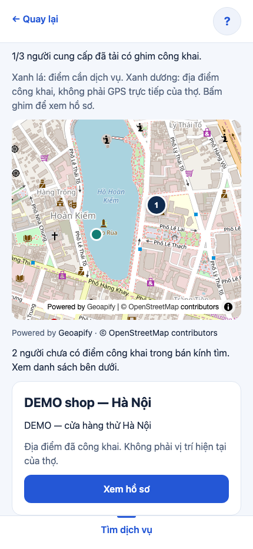
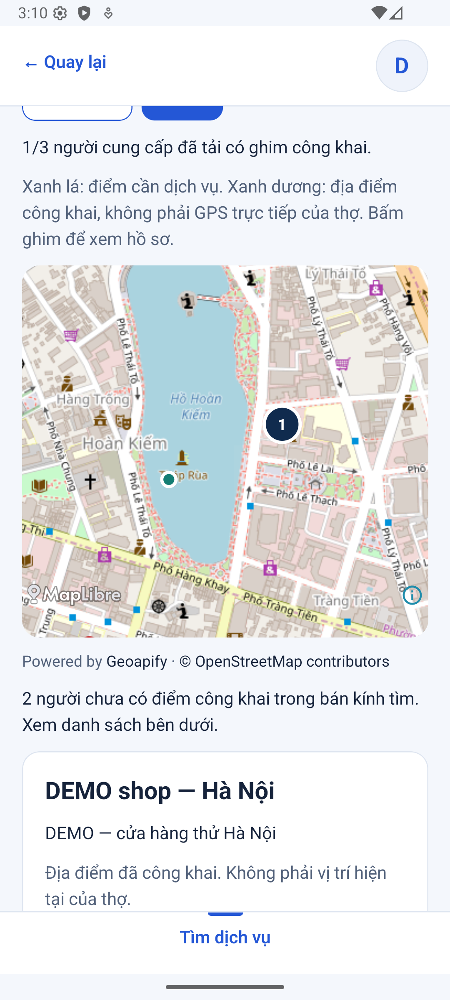
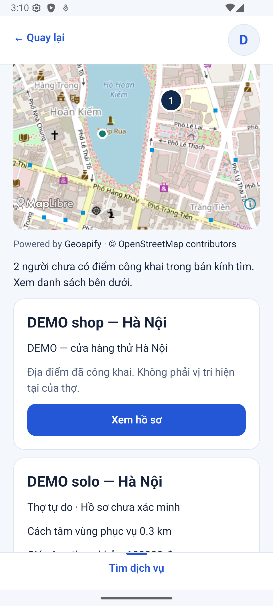
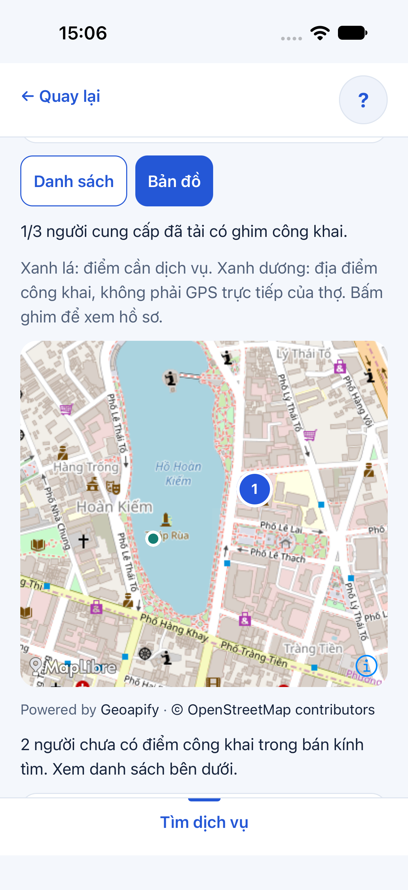
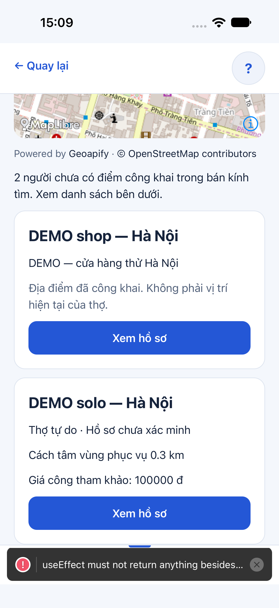
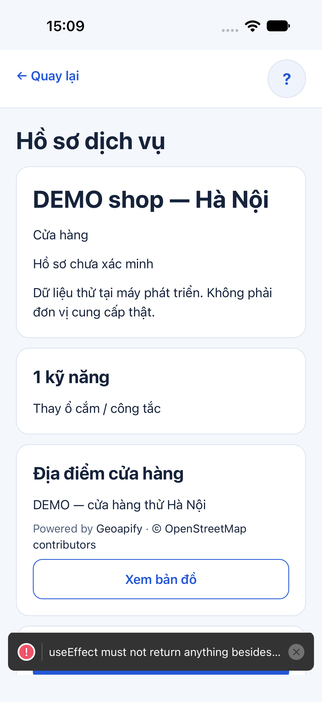
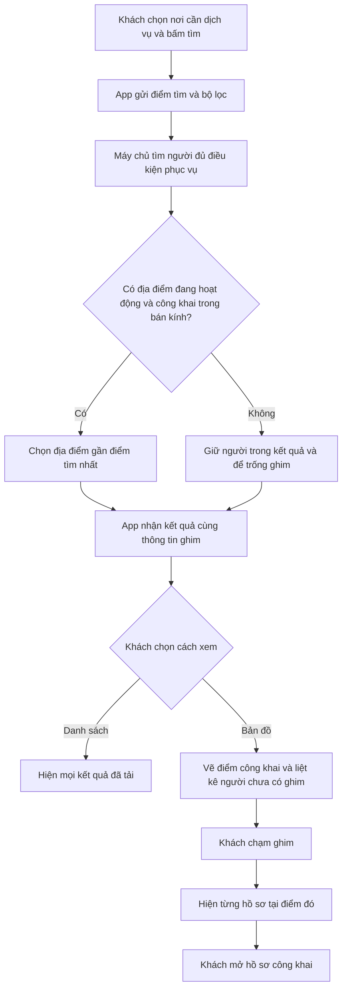

# B03-02 — Xem người cung cấp trên bản đồ tìm kiếm

MAP-02 · kiểm ngày 07/10/2026 · thuộc DELIVERY-01, chỉ lưu repo. Đây là mã báo cáo con; không có nghĩa nhiệm vụ tạo yêu cầu thuê B03-02 trong checklist đã hoàn tất. [Mục lục](../README.md) · [Kế hoạch](../de-xuat/MAP-02-ban-do-ket-qua-tim-kiem.md).

## Bạn thấy gì trên app?

Sau khi chọn nơi cần dịch vụ và bấm tìm, bạn có thể chuyển giữa **Danh sách** và **Bản đồ**. Ghim xanh dương là địa điểm người cung cấp đã công khai; chấm xanh lá là điểm bạn đang tìm dịch vụ. Bấm ghim để xem tên, địa chỉ và mở hồ sơ.

Chủ dự án đã chốt: **chỉ ghim địa điểm công khai; người chưa có điểm công khai vẫn hiện trong danh sách**. Vì vậy bản đồ không cố đặt mọi thợ lên một tọa độ. Với bộ DEMO hiện tại, có ba kết quả nhưng chỉ cửa hàng có điểm công khai: app ghi “1/3”, còn thợ tự do và doanh nghiệp ở danh sách bên dưới. Địa điểm khai báo không phải GPS trực tiếp của thợ.

Nếu nhiều người cùng tọa độ, ghim ghi số người, chẳng hạn `2×`. Chạm ghim sẽ thấy từng hồ sơ để chọn. Nút **Xem thêm** tiếp tục tải cả kết quả và ghim; bản đồ chỉ phản ánh các kết quả đã tải.

## Ảnh app chạy thật

Ảnh ngày 07/10/2026 dùng dữ liệu DEMO, API/PostGIS cục bộ và bản đồ nền Geoapify thật. Web là Chromium; Android là emulator API 36; iOS là iPhone 18 Pro simulator iOS 27. Không phải ảnh thiết bị thật hoặc nghiệm thu UAT.

| Web: bản đồ và ghim được chọn | Web: thẻ địa điểm và danh sách |
|---|---|
|  |  |

| Android: bản đồ | Android: ghim đã chọn | Android: mở hồ sơ |
|---|---|---|
|  |  |  |

| iOS: bản đồ | iOS: ghim đã chọn | iOS: mở hồ sơ |
|---|---|---|
|  |  |  |

## Một lần tìm đi qua những đâu?

Máy chủ quyết định điểm nào được công khai trước khi gửi dữ liệu. App không tải hồ sơ quản lý rồi tự giấu tọa độ riêng. Cách này tránh để dữ liệu riêng đã tới máy khách dù giao diện không vẽ nó.

## Đọc code theo thứ tự này

Các đường dẫn dưới đây tính từ repo. “API” là giao diện để app trao đổi với máy chủ; “state” là dữ liệu app đang nhớ trong phiên mở màn hình; “cursor” là dấu tiếp tục tải trang kết quả tiếp theo.

| Bước | File và hàm thật | Nhận gì, làm gì, chuyển gì? |
|---|---|---|
| 1. Bấm tìm | [SearchScreen.tsx](../../../apps/mobile/src/features/search/screens/SearchScreen.tsx), `submit` | Nhận điểm, bán kính, kỹ năng/ngành và bộ lọc; kiểm đầu vào rồi gọi `search.search`. Bộ chọn địa điểm dùng lại MAP-01. |
| 2. Nhớ lần tìm | [partner-search.ts](../../../apps/mobile/src/features/search/state/partner-search.ts), `search`, `load`, `more`, `reset` | Chụp lại điều kiện đã gửi vào `criteria`; nhận trang kết quả và cursor. Bản đồ dùng điều kiện đã gửi, tránh lấy bán kính đang sửa dở. Đổi tọa độ xóa kết quả và hủy phản hồi cũ. |
| 3. Gọi máy chủ | [partners-api.ts](../../../apps/mobile/src/features/partners/api/partners-api.ts), `isCard` và `search` | Gửi GET `/v1/partners`; kiểm mỗi kết quả có `map_location` là địa chỉ hợp lệ hoặc `null`. Dữ liệu sai bị từ chối thay vì vẽ ghim nhầm. |
| 4. Chọn dữ liệu public | [search.service.ts](../../../services/api/src/modules/search/search.service.ts), `SearchService.list` | Giữ điều kiện published/accepting/moderation, kỹ năng, bán kính và thứ tự hiện hành. Truy vấn phụ chọn một `partner_locations` active/public gần nhất trong bán kính. Không có thì trả `null`, không loại người khỏi danh sách. |
| 5. Gom ghim | [results-map-model.ts](../../../apps/mobile/src/features/search/components/results-map-model.ts), `resultPins`, `resultBounds` | Nhận trang kết quả, bỏ điểm rỗng/sai, gom các tọa độ trùng tuyệt đối và bỏ ID trùng. Tính vùng nhìn chứa điểm khách và các ghim. |
| 6. Chọn ghim | [SearchResultsMap.tsx](../../../apps/mobile/src/features/search/components/SearchResultsMap.tsx), `SearchResultsMap` | Nhớ ghim đang chọn, hiển thị số người có ghim/đã tải, thẻ hồ sơ và trạng thái lỗi. Một ghim có thể chứa nhiều người. |
| 7. Vẽ và mở hồ sơ | [ResultsMap.native.tsx](../../../apps/mobile/src/features/search/components/ResultsMap.native.tsx), [ResultsMap.web.tsx](../../../apps/mobile/src/features/search/components/ResultsMap.web.tsx), `ResultsMap` | MapLibre nhận điểm và tải nền Geoapify; chạm ghim gọi `onSelect`. Nút hồ sơ gọi `navigation.navigate('PartnerProfile', {id})`, dùng màn public profile hiện hành. |

## Dữ liệu, quyền và trạng thái

Ví dụ một phần phản hồi: `map_location: {text: 'DEMO — cửa hàng thử Hà Nội', point: {latitude: 21.0285, longitude: 105.8542}}`. Không có điểm hợp lệ thì `map_location: null`.

Một người có nhiều điểm công khai sẽ dùng điểm gần nơi tìm nhất trong bán kính. Nếu bằng khoảng cách, máy chủ chọn theo ngày tạo rồi ID để kết quả ổn định. Điểm riêng, điểm ngừng hoạt động và tâm vùng phục vụ không được dùng làm ghim. Không đổi quyền khai báo public/private và không tạo bảng hay migration mới.

`distance_m` và `distance_kind` vẫn dùng để xếp hạng theo cửa hàng hoặc tâm vùng. Chúng không nhất thiết là khoảng cách tới ghim được chọn. Thẻ ghim vì vậy chỉ ghi địa chỉ công khai, không gắn khoảng cách tâm vùng vào ghim. Các điều kiện lọc người đủ phục vụ và cursor được giữ nguyên.

Lựa chọn Danh sách/Bản đồ, ghim đang chọn và lỗi bản đồ chỉ nằm trong state app. App không lưu lịch sử vị trí thợ, không tự xin GPS thợ, không gọi dịch vụ tra địa chỉ riêng cho mỗi kết quả. Key tra cứu ở server và key nền bản đồ công khai ở app theo MAP-01; `.env` không vào Git.

## Có lỗi thì xử lý ra sao?

Nếu tải kết quả lỗi, nút thử lại dùng điều kiện lần tìm trước. Khi đổi điểm hoặc gửi lần tìm mới, kết quả cũ được xóa và phản hồi chậm không được ghi đè. Tải thêm thất bại giữ trang đã tải để thử lại.

Nếu nền bản đồ lỗi hoặc thiếu cấu hình, app báo thử lại hoặc chuyển về Danh sách. Thử lại dựng bản đồ mới nhưng giữ kết quả. Khi ghim đã chọn không còn trong kết quả, thẻ của ghim đó biến mất. Nguồn Geoapify/OpenStreetMap vẫn được ghi dưới bản đồ.

## Bạn có thể tự thử

1. Mở Tìm người cung cấp, chọn một địa điểm tại Hà Nội rồi bấm tìm. Chuyển Bản đồ và so sánh số ghim với danh sách.
2. Bấm ghim xanh dương, đọc nhãn “không phải vị trí hiện tại của thợ”, rồi mở hồ sơ. Quay lại và chọn Danh sách để thấy cả người chưa có điểm công khai.
3. Đổi điểm tìm. Kết quả và ghim cũ phải biến mất cho đến khi tìm lại.

Câu hỏi học code: Vì sao trả `null` mà không bỏ luôn hồ sơ? Vì quyền công khai địa điểm khác với điều kiện đủ phục vụ. Vì sao không lấy tâm vùng làm ghim? Chủ dự án chưa cho công khai tâm vùng. Vì sao hai người cùng tọa độ vẫn mở được riêng? `resultPins` giữ mảng `partners` trong mỗi ghim.

## Đã kiểm và giới hạn

Kiểm thử tự động đã kiểm dữ liệu riêng/công khai, điểm gần nhất, ngoài bán kính, chuyển trạng thái public và lưu trữ điểm. Kiểm UI đã kiểm ghim trùng mở từng hồ sơ, giữ người không có điểm trong danh sách, đổi tọa độ xóa cũ, lỗi bản đồ và thử lại. Web dùng API/DB test thật, chỉ nền tile được giả lập trong E2E; lượt ảnh DEMO kiểm nền Geoapify thật riêng.

Web, iOS simulator và Android emulator đã đi từ tìm → ghim → thẻ → hồ sơ. Android được kiểm lại thành công lúc 15:54 JST sau khi WebView của emulator tự cập nhật và đóng app ở lượt trước; lượt cuối còn đi qua nhập địa chỉ và chọn gợi ý Geoapify thật. Chưa nghiệm thu trên điện thoại thật hoặc UAT của chủ dự án. Gom ghim hiện chỉ xử lý tọa độ trùng tuyệt đối, chưa có gom cụm theo mức zoom.

Lệnh, test và bằng chứng kỹ thuật

| Kiểm tra | Kết quả ngày 07/10/2026 | Bằng chứng |
|---|---|---|
| Typecheck, lint | PASS | `.local/map-02/typecheck-final.log`, `lint-final.log` |
| Mobile unit/UI + coverage | 152 test, 32 suite PASS; core lines 100%, branches 92.56%; app lines 82.81%, branches 76.76%; đạt gate repo | `.local/map-02/mobile-coverage-final.log` |
| API unit/integration + PostGIS coverage | 68 test PASS; core lines 100%, branches 92.17%; app lines 90.98%, branches 88.20% | `.local/map-02/coverage.log`; [partners.test.ts](../../../services/api/test/integration/partners.test.ts) |
| Web E2E MAP-02 | 1 hành trình PASS | [search-map.spec.mjs](../../../tests/e2e/web/search-map.spec.mjs), `.local/map-02/web.log` |
| Web live + Geoapify | PASS ghim, thẻ, hồ sơ | `.local/map-02/live-web.log`, ảnh trên |
| iOS simulator / Android emulator | Ghi đúng phạm vi ở đoạn trên; không thay thiết bị thật | Ảnh và thao tác Mobile MCP; Maestro Android không khởi động được driver, không tính PASS Maestro |
| MAP-01 đã push | `4dc7600`, cả ba job CI PASS | [CI MAP-01](https://github.com/anhthaingd/dich-vu-quanh-ban/actions/runs/37577265358) |
| MAP-02 Git/CI | Chưa push tại thời điểm viết báo cáo; cập nhật sau khi xác nhận remote | Không dùng CI MAP-01 để kết luận MAP-02 |

Các log `.local` được bỏ qua bởi Git. Chạy lại bằng `npm run typecheck`, `npm run lint`, `npm run test:coverage` và `npx playwright test --config tests/e2e/web/playwright.config.mjs search-map.spec.mjs`. E2E tạo dữ liệu cô lập; không sửa hồ sơ DEMO sẵn có.

Contract OpenAPI v0.1.8, QA-080/081 và RTM đã cập nhật cùng nguồn/mirror/HTML/ZIP hiện hành. PRD/SRS/UX và FR trên Drive được bổ sung cùng ID, đọc lại giữ nội dung cũ. Sổ Excel v1.46 ghi MAP-02, bằng chứng và phần không áp dụng; đọc lại bytes Drive khớp local. Báo cáo/ảnh/checklist chỉ Git.

Ngoại lệ DOC-017: automatic approval review từ chối ghi `architecture-v0.1.md` trên Drive vì tên có thể là bản lịch sử. Bản này được giữ nguyên cả local và Drive; MAP-02 có ở nguồn kiến trúc, HTML DOC-016 và ZIP DOC-018 hiện hành. Không báo đã cập nhật DOC-017.

## Phần tiếp theo

Chức năng kết quả bản đồ được làm trước P0-2 theo yêu cầu. Chưa mở tracking/GPS thợ, routing/ETA, polygon, ranking khác, OTP thật, billing hoặc production. P0-2 tiếp tục là gửi/nhận việc và liên hệ; không tự coi MAP-02 là phê duyệt các phần đó.
