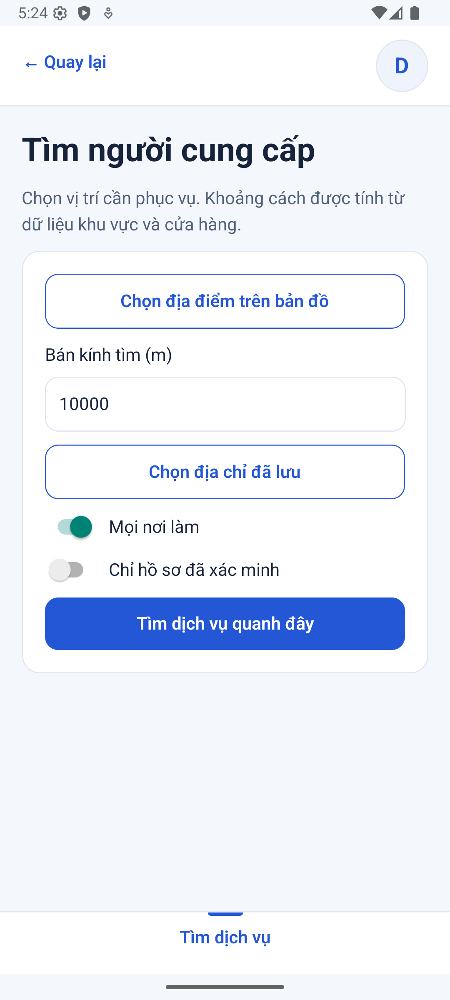
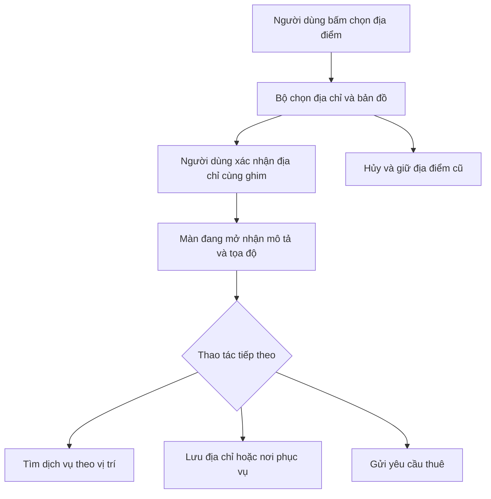

# B03-03 — Chọn địa điểm, bỏ nhập tọa độ thủ công

**Cập nhật push 07/10/2026:** code đã lên `main` tại `293b073`; [CI 37604427549](https://github.com/anhthaingd/dich-vu-quanh-ban/actions/runs/37604427549) đạt cả 3 job: app/build, API/PostGIS, web E2E. Các ghi chú “chưa commit/push/CI” bên dưới là mốc kiểm local trước khi push; kết quả CI này xác nhận đúng commit `293b073`. Chưa UAT hoặc phát hành production.

07/10/2026 · MAP-03 · Code đang sửa trong repo, chưa commit/push. [Mục lục](../README.md) · [Gói tiếp theo P0-2](B03-04-yeu-cau-nhan-viec-va-chat.md).

## Bạn thấy gì thay đổi?

Ở màn tìm dịch vụ, sổ địa chỉ, cửa hàng và vùng phục vụ, không còn nút mở phần nâng cao hoặc ô vĩ độ/kinh độ. Bạn bấm chọn địa điểm, tìm địa chỉ hoặc chọn ghim rồi xác nhận. GPS vẫn chỉ chạy khi bấm nút. Form thuê mới cũng dùng cùng bộ chọn.

App vẫn cần tọa độ để tìm người gần bạn và lưu địa điểm. Điểm thay đổi là bạn không phải tự nhập các con số đó. Dòng tọa độ chỉ để xem và dữ liệu gửi tới máy chủ vẫn có thể tồn tại.

Ảnh ngày 07/10/2026, dữ liệu DEMO/test, app native chạy thật trên máy mô phỏng; không phải điện thoại vật lý:

| Android emulator | iOS simulator |
|---|---|
|  |  |

## Một lần chọn đi qua những đâu?

Bộ chọn trả một địa điểm đã xác nhận, gồm mô tả và `point` — cặp vĩ độ/kinh độ. Màn gọi không còn nhận từng con số gõ tay. Nếu hủy bộ chọn, dữ liệu trước khi mở vẫn giữ nguyên.

## Đọc code theo thứ tự

| File / hàm | Nhận gì → làm gì → trả gì? |
|---|---|
| [LocationField.tsx](../../../apps/mobile/src/features/location/components/LocationField.tsx), `LocationField` | Nhận địa điểm hiện tại, mở bộ chọn và gọi `onChange` khi xác nhận; phần nhập nâng cao đã bỏ. |
| [LocationField.tsx](../../../apps/mobile/src/features/location/components/LocationField.tsx), `LocationPicker` | Nhận tìm kiếm/ghim/GPS, cho kiểm tra mô tả rồi trả địa điểm đã chọn. |
| [SearchScreen.tsx](../../../apps/mobile/src/features/search/screens/SearchScreen.tsx) | Dùng điểm đã chọn để tìm. Không tạo tọa độ thay thế khi chưa chọn. |
| [AddressesScreen.tsx](../../../apps/mobile/src/features/accounts/screens/AddressesScreen.tsx) | Nhận mô tả/điểm để lưu địa chỉ của tài khoản. Quyền và cơ chế thử lại giữ nguyên. |
| [PartnerEditorScreen.tsx](../../../apps/mobile/src/features/partners/screens/PartnerEditorScreen.tsx) | Dùng bộ chọn cho cửa hàng và tâm vùng; bán kính vẫn là ô nhập riêng. |
| [JobCreateScreen.tsx](../../../apps/mobile/src/features/jobs/screens/JobCreateScreen.tsx) | Dùng địa điểm đã chọn làm nơi thực hiện dịch vụ, máy chủ kiểm lại vùng. |

`Coordinates` trong [PartnerFields.tsx](../../../apps/mobile/src/features/partners/components/PartnerFields.tsx) đã gỡ. Các bản dịch hướng dẫn “nhập tọa độ nâng cao” được thay bằng hướng dẫn chọn địa chỉ/bản đồ.

## Lỗi và dữ liệu

Không đổi dữ liệu địa điểm đang lưu hoặc API bản đồ. Lỗi tải bản đồ vẫn cho tìm địa chỉ/thử lại. Không tự lấy gợi ý đầu tiên. Đóng bộ chọn không làm mất địa điểm cũ. Thay đổi này không công khai tâm vùng hoặc địa điểm riêng.

## Đã kiểm và giới hạn

Bốn bài web dùng app thật + API + PostgreSQL test đã đạt: sổ địa chỉ, bộ chọn địa điểm, nguồn cung và bản đồ tìm kiếm. Chúng dùng dữ liệu tra địa chỉ cố định trong test, chọn qua bộ chọn thật và kiểm tọa độ đã lưu ở DB. Đây không phải lượt kiểm chất lượng Geoapify mới. Ảnh native xác nhận màn tìm kiếm không còn phần nhập tọa độ; không coi ảnh là kiểm lại mọi nhánh GPS/bản đồ của MAP-01.

Bộ mobile trước khi nối P0-2: 153 bài/33 nhóm đạt; sau khi nối P0-2: 155 bài/34 nhóm đạt. Typecheck/lint đạt. Chưa có CI từ xa hoặc UAT cho đợt này.

Tra cứu bài kiểm thử và lệnh

- [LocationField.test.tsx](../../../apps/mobile/src/features/location/components/LocationField.test.tsx): mở/xác nhận, không có điều khiển nâng cao.
- [location-helper.mjs](../../../tests/e2e/web/location-helper.mjs): dữ liệu tra địa chỉ chỉ trong test.
- [locations.spec.mjs](../../../tests/e2e/web/locations.spec.mjs), [account-management.spec.mjs](../../../tests/e2e/web/account-management.spec.mjs), [partners.spec.mjs](../../../tests/e2e/web/partners.spec.mjs), [search-map.spec.mjs](../../../tests/e2e/web/search-map.spec.mjs).
- Lệnh: `npx playwright test --config tests/e2e/web/playwright.config.mjs locations.spec.mjs account-management.spec.mjs partners.spec.mjs search-map.spec.mjs`.
- Log lần kiểm gỡ tọa độ: `.local/map-03/web.log` (4 bài đạt, 53,6 giây); log không quản lý Git. Kịch bản đã sửa vẫn có thể chạy lại.
- Spec đã chốt MAP-03 được ghi cùng đợt P0-2 trong API v0.1.9 và sổ quản lý v1.47; các báo cáo cũ giữ bằng chứng lịch sử.

## Tự thử để hiểu code

1. Mở tìm dịch vụ, chọn một địa chỉ rồi hủy lần chọn tiếp theo: địa chỉ cũ phải còn.
2. Lưu một địa chỉ từ ghim rồi mở lại: vẫn đúng mô tả và vị trí dù không gõ vĩ độ/kinh độ.
3. Câu hỏi: “Bỏ ô tọa độ có phải bỏ tọa độ khỏi dữ liệu không?” Không; xem `LocationField.onChange` và trường `point` gửi qua API.
