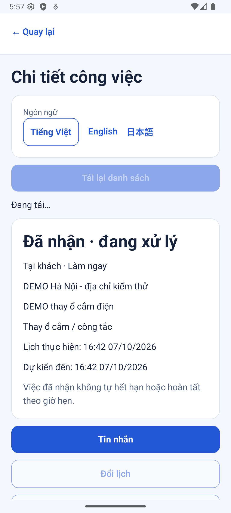
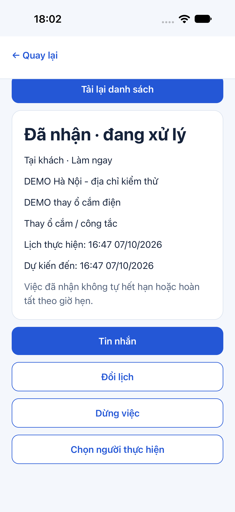
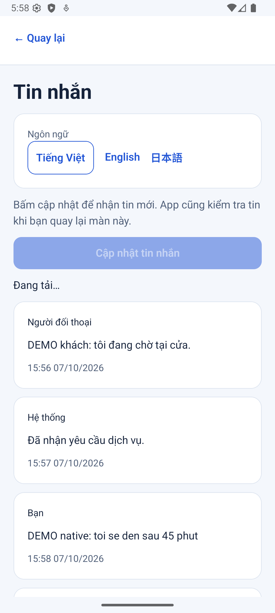
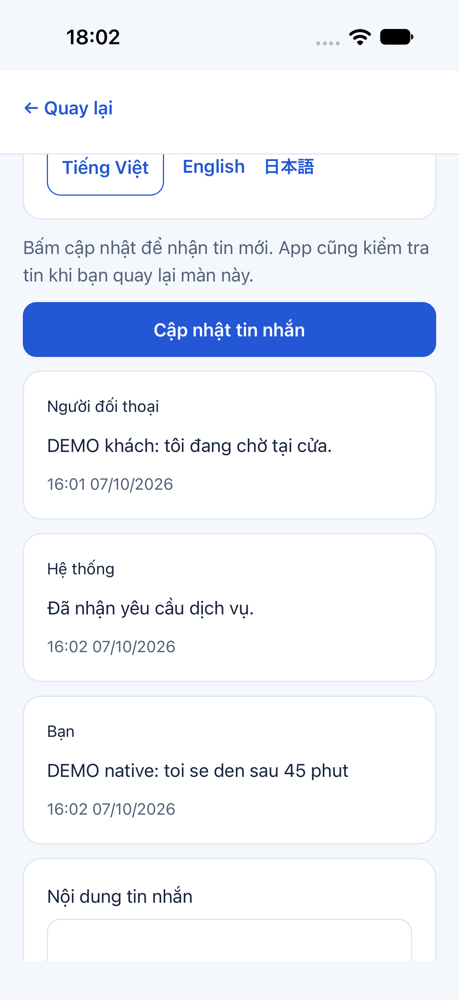
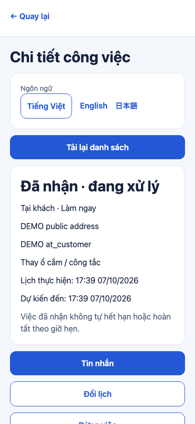
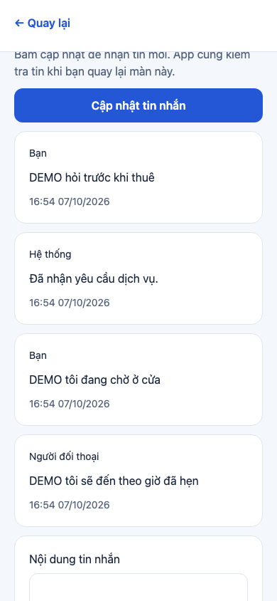
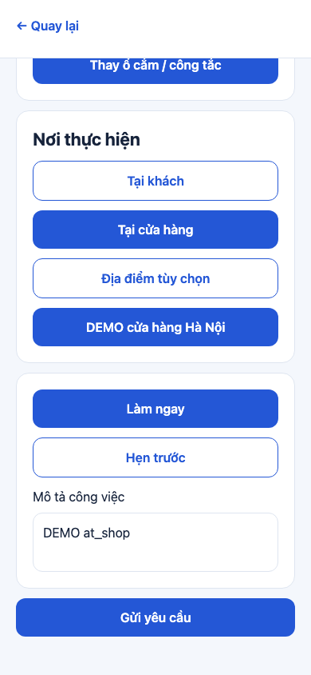
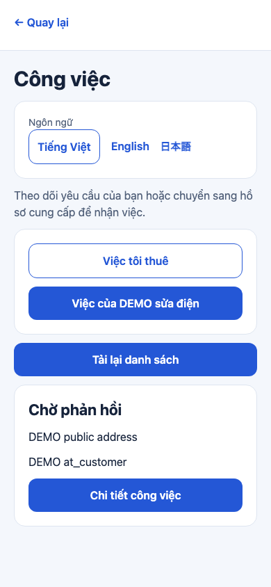
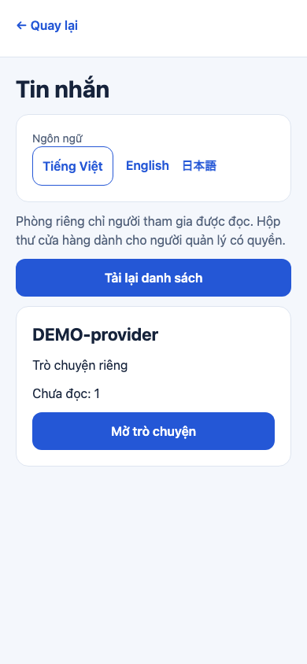
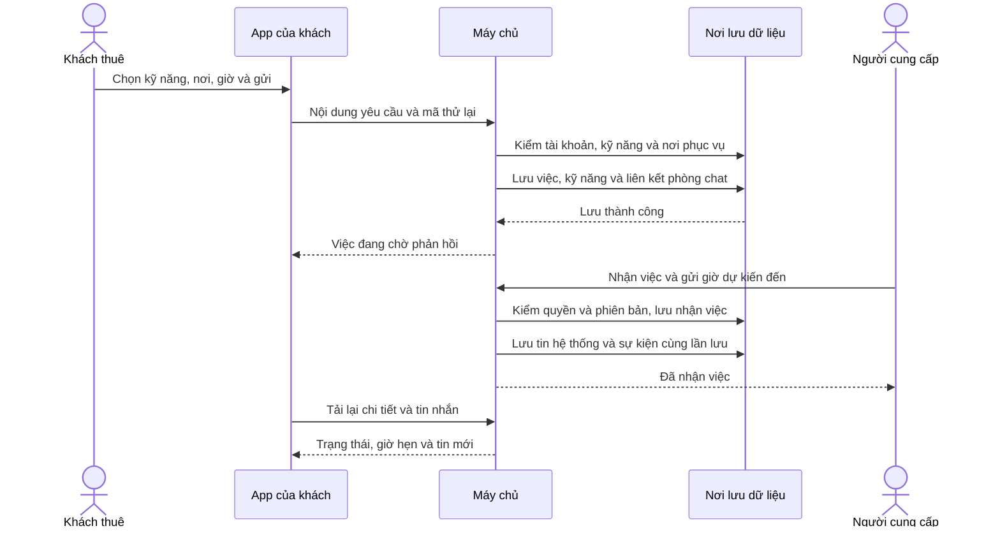

# B03-04 — Gửi yêu cầu, nhận việc và trò chuyện

**Cập nhật push 07/10/2026:** code đã lên `main` tại `293b073`; [CI 37604427549](https://github.com/anhthaingd/dich-vu-quanh-ban/actions/runs/37604427549) đạt cả 3 job: app/build, API/PostGIS, web E2E. Các ghi chú “chưa commit/push/CI” bên dưới là mốc kiểm local trước khi push; kết quả CI này xác nhận đúng commit `293b073`. Chưa UAT hoặc phát hành production.

07/10/2026 · P0-2 · Checklist B03-02/03/04, phần phân công B04-02, HTTP chat B05-01. Code local chưa commit/push. [Mục lục](../README.md) · [Bỏ nhập tọa độ](B03-03-bo-nhap-toa-do.md).

## Bạn đã dùng được gì?

Khách đăng nhập, mở hồ sơ người cung cấp rồi bấm **Gửi yêu cầu dịch vụ**. Khách chọn một hoặc nhiều kỹ năng, nơi phục vụ và làm ngay/hẹn trước. Có ba nơi: tại khách, tại cửa hàng công khai, hoặc địa điểm khác. Người cung cấp vào **Tài khoản → Công việc**, chọn hồ sơ của mình rồi nhận hoặc từ chối.

Khi nhận việc làm ngay, người cung cấp nhập số phút dự kiến đến. App đổi số phút thành thời điểm cụ thể, máy chủ lưu lại và khách thấy giờ dự kiến. Không có nút “Bắt đầu”. Hai bên có thể đổi lịch hoặc dừng theo quyền. Nếu đã thống nhất chi phí, việc vẫn mở để xử lý hóa đơn ở P0-3; đợt này chưa lập hoặc quyết toán hóa đơn.

Bấm **Mở trò chuyện** trên hồ sơ để hỏi trước thuê, hoặc **Tin nhắn** trong chi tiết việc. Tin được lưu ở máy chủ và hiện khi bấm cập nhật hoặc quay lại màn/app. Đây là chat qua API HTTP, chưa phải tin realtime tự đẩy qua WebSocket.

Phạm vi dùng tài khoản DEMO local/test đã được chủ dự án duyệt. Điều kiện điện thoại xác minh vẫn kiểm phía máy chủ; OTP thật giữ Pending. Các trường Job và dữ liệu địa điểm công khai được bổ sung theo ba phản hồi duyệt của chủ dự án ngày 07/10.

## Ảnh app đã kiểm

Chụp ngày 07/10/2026 bằng dữ liệu DEMO/test; Android emulator và iOS simulator, không phải thiết bị vật lý. Màn web dùng cùng ứng dụng Expo và API/DB test thật.

| Màn | Android emulator | iOS simulator |
|---|---|---|
| Nhận việc và ETA |  |  |
| Chat hai bên |  |  |

| Web: chi tiết việc | Web: chat |
|---|---|
|  |  |

| Web: form thuê tại cửa hàng | Web: danh sách việc | Web: danh sách phòng |
|---|---|---|
|  |  |  |

## Theo một yêu cầu từ lúc bấm gửi

`API` là đường app trao đổi với máy chủ. `Transaction` là một nhóm lệnh lưu dữ liệu: hoặc cả nhóm thành công, hoặc toàn bộ được hoàn tác. Nhờ vậy không có việc đã tạo nhưng thiếu kỹ năng hoặc phòng liên hệ.

Đây là nhánh thành công. Trước khi lưu, máy chủ kiểm người thuê không phải chính partner hoặc thành viên đang hoạt động của partner. Nơi khách chọn phải nằm trong vùng phục vụ. Với cửa hàng, máy chủ lấy địa chỉ thật từ ID công khai; không tin mô tả cửa hàng do app tự gửi.

`version` là số lần thay đổi việc. App gửi số đang nhìn thấy; nếu người khác đã đổi trước, máy chủ trả xung đột thay vì ghi đè. `Idempotency-Key` là mã cho một lần thao tác: mất phản hồi thì thử lại cùng mã và nội dung để lấy đúng kết quả, không tạo việc/tin thứ hai.

## Mở code theo thứ tự nào?

| Bước | File và hàm thật | Nhận gì → làm gì → trả gì? |
|---|---|---|
| 1 | [PartnerProfileScreen.tsx](../../../apps/mobile/src/features/partners/screens/PartnerProfileScreen.tsx), `Profile` | Hiện nút thuê/chat dựa trên dữ liệu công khai; mở form hoặc tạo/mở lại phòng. Khi quay lại, đợi phiên tài khoản sẵn sàng trước tải hồ sơ. |
| 2 | [JobCreateScreen.tsx](../../../apps/mobile/src/features/jobs/screens/JobCreateScreen.tsx), `Form`, `send` | Nhận lựa chọn kỹ năng, mode, địa điểm, thời gian và ghi chú. Gửi ID/schema_version thay vì tên đã dịch. |
| 3 | [appointment.ts](../../../apps/mobile/src/features/jobs/state/appointment.ts), `appointment` | Đọc ngày/giờ Việt Nam, kiểm ngày thực sự tồn tại rồi đổi thành thời gian UTC để truyền đi. |
| 4 | [mutation.ts](../../../apps/mobile/src/features/jobs/state/mutation.ts), `Mutation.run` | Giữ mã và hàm gửi cũ khi chưa biết kết quả; lỗi chắc chắn cho sửa/gửi lại mới. Bản nháp này ở bộ nhớ của màn, không phải hàng đợi bền vững qua khởi động lại app. |
| 5 | [auth-session.ts](../../../apps/mobile/src/features/auth/state/auth-session.ts), `createJob`, `changeJob`, `accountOperation` | Gắn đúng tài khoản, xử lý phiên/token, ngăn dùng kết quả của tài khoản trước. Token không đưa vào state giao diện. |
| 6 | [jobs-api.ts](../../../apps/mobile/src/features/jobs/api/jobs-api.ts), `createJobsApi` | Gọi HTTP và kiểm hình dạng phản hồi trước đưa Job cho màn. |
| 7 | [jobs.controller.ts](../../../services/api/src/modules/jobs/jobs.controller.ts), [jobs.input.ts](../../../services/api/src/modules/jobs/jobs.input.ts) | Nhận HTTP, chỉ nhận các trường đã cho phép; kiểm ID, ngày, phiên bản, mode và danh sách kỹ năng. |
| 8 | [jobs.service.ts](../../../services/api/src/modules/jobs/jobs.service.ts), `create`, `eligible`, `change` | Quyết định có được thuê/nhận/đổi/dừng không, ghi Job và kỹ năng trong transaction. Khi nhận làm ngay lưu ETA; khi đổi lịch thêm lịch sử. |
| 9 | [jobs.access.ts](../../../services/api/src/modules/jobs/jobs.access.ts), `jobAccess`, `allowedActions` | Đọc quyền đang có và người đang được giao. Quyền máy chủ quyết định các nút được trả cho app. |
| 10 | [JobsScreen.tsx](../../../apps/mobile/src/features/jobs/screens/JobsScreen.tsx), [JobDetailScreen.tsx](../../../apps/mobile/src/features/jobs/screens/JobDetailScreen.tsx) | Tải danh sách theo khách/partner và chi tiết; hiển thị trạng thái, kỹ năng, nơi, ghi chú, lịch/ETA và form hành động. |
| 11 | [chat.service.ts](../../../services/api/src/modules/chat/chat.service.ts), `open`, `send`, `messages`, `read` | Mở lại đúng phòng, lưu tin theo thứ tự, lấy các tin sau mốc đã biết và giữ mốc đọc chỉ tăng. |
| 12 | [chat.store.ts](../../../services/api/src/modules/chat/chat.store.ts), `conversationAccess`, `partnerConversation`, `directConversation` | Phòng solo theo cặp người. Phòng doanh nghiệp tách khỏi phòng riêng khách–nhân viên; quản lý không được đọc phòng riêng. |
| 13 | [ConversationsScreen.tsx](../../../apps/mobile/src/features/chat/screens/ConversationsScreen.tsx), [ConversationScreen.tsx](../../../apps/mobile/src/features/chat/screens/ConversationScreen.tsx), `Room` | Liệt kê phòng theo quyền, tải đủ các trang tin mới, ghép không trùng, gửi và đánh dấu đọc. Quay lại màn/app tự kiểm tin mới. |

[App.tsx](../../../apps/mobile/src/app/App.tsx), [AppNavigator.tsx](../../../apps/mobile/src/app/navigation/AppNavigator.tsx) và các module Nest là phần nối những thành phần trên lúc ứng dụng khởi động. Chúng không trực tiếp quyết định nghiệp vụ mỗi lần bấm.

## Dữ liệu, quyền và trạng thái

[Migration 007](../../../services/api/migrations/007_jobs_chat.sql) thêm jobs, job_skills, assignments, schedule_history, conversations, job_conversations, messages, conversation_reads và outbox_events. `outbox_events` là các sự kiện đã ghi bền vững cùng thay đổi chính; chưa có nghĩa chúng đã được đẩy tới thiết bị qua WebSocket/push.

- `requested`: khách rút được; người có `jobs.accept` nhận/từ chối được. Nhận phải có điện thoại xác minh. Solo tự gán người nhận làm người thực hiện; cửa hàng/doanh nghiệp chọn người qua phân công.
- `accepted`: người có quyền đổi lịch/dừng; `jobs.assign` chọn một thành viên đang hoạt động. Một việc chỉ có một phân công hiệu lực.
- Không có chi phí đã thỏa thuận thì dừng chuyển `stopped`; có chi phí giữ `accepted` và lưu lý do/cờ để nối hóa đơn. `completed` chưa được tạo bởi gói này.
- Đổi người kết thúc phân công cũ. Người cũ mất quyền xem việc, vẫn giữ phòng chat riêng của mình; quản lý không được đọc lịch sử riêng đó. Tin gắn Job cần quyền Job hiện hành.
- Job lưu bản chụp địa chỉ và dữ liệu kỹ năng lúc gửi. Thay địa chỉ đã lưu không sửa ngược việc cũ. Tên kỹ năng trên app tra theo hồ sơ hiện hành; nếu hồ sơ không còn công khai, tạm hiện ID kỹ năng, không làm mất quyền đọc việc.
- Ngày/giờ nhập và hiển thị theo Việt Nam. `eta` là dự kiến ban đầu khi nhận làm ngay; `scheduled_at` là lịch hiện hành, có thể đổi sau đó.

## Nếu lỗi thì sao?

Mất phản hồi khi tạo việc/gửi tin: app khóa nội dung lần gửi đang chờ và cho **Thử lại** cùng mã. Tin còn có `client_message_id` riêng để chống gửi trùng kể cả mã HTTP đổi. Máy chủ chỉ trả thành công sau commit; lỗi lưu sự kiện hoàn tác cả tin và số thứ tự.

Xung đột phiên bản: giữ dữ liệu form, bấm tải lại để thấy trạng thái mới rồi xem lại trước gửi. Không đủ quyền hoặc phiên bị thu hồi: máy chủ kiểm lại cả khi xin kết quả cũ theo mã thử lại. Rời màn/đổi tài khoản: kết quả tải cũ không được đưa sang người mới. Lỗi tải hồ sơ lúc quay lại từ chat đã được phát hiện bằng web E2E và sửa bằng chờ phiên sẵn sàng.

Chat HTTP không tự cập nhật liên tục khi ngồi yên trên màn: dùng **Cập nhật tin nhắn**. Bản nháp/mã retry hiện chỉ ở bộ nhớ; sau đóng app nên kiểm danh sách/lịch sử trước gửi một yêu cầu mới. Chưa có hàng đợi gửi offline bền vững. Bộ danh mục hiện hành chưa có form kỹ năng phức tạp; giao diện chỉ dựng các trường đơn giản, chưa nghiệm thu form lồng nhau/file.

## Tự thử và tự kiểm hiểu

1. Dùng tài khoản khách DEMO tìm hồ sơ, hỏi một câu trước thuê, rồi gửi yêu cầu làm ngay.
2. Dùng tài khoản cung cấp DEMO vào Công việc, chọn hồ sơ, nhận với ETA 45 phút. Khách tải lại phải thấy đã nhận và giờ dự kiến.
3. Gửi tin từ hai bên; bấm cập nhật để thấy tin mới. Thử đổi lịch rồi dừng với lựa chọn không có chi phí.

Vì sao bấm nhận hai lần không tạo hai tin hệ thống? Xem `AccountTransaction` và mã sự kiện. Vì sao quản lý không xem được chat riêng khách–nhân viên? Xem `conversationAccess`. Vì sao mất mạng không nên sửa nội dung rồi thử lại mã cũ? Vì cùng mã chỉ đại diện cho cùng một thao tác.

## Bằng chứng và giới hạn

Web đã chạy hai tài khoản qua cả ba mode, làm ngay/hẹn trước, chat trước thuê, nhận ETA, đổi lịch/dừng, gửi/nhận tin và hai tình huống mất phản hồi. Android emulator đã kiểm danh sách theo partner, nhận ETA, chat đọc/gửi và đổi locale. iOS simulator đã kiểm danh sách, nhận ETA, đọc/gửi chat; lượt kiểm đổi locale mới của iOS chưa đạt do thao tác tự động không đổi được locale, không gộp vào kết quả PASS.

Lệnh, số bài và phạm vi kiểm sâu

| Kiểm | Kết quả local 07/10/2026 | Bằng chứng có thể chạy lại |
|---|---|---|
| TypeScript và lint | Đạt | `npm run typecheck`, `npm run lint` |
| Mobile | 155 bài / 34 nhóm đạt | `npm test`, gồm retry và ngày Việt Nam |
| API unit | 18 bài đạt | `npm test` |
| API tích hợp DB thật | 56 bài đạt; 6 bài jobs/chat chạy lại sau bổ sung phone guard và tin phân công đều đạt | `npm run test:integration`; [jobs-chat.test.ts](../../../services/api/test/integration/jobs-chat.test.ts) |
| Web P0-2 | 1 hành trình hai tài khoản đạt, lượt cuối 20,6 giây | [jobs-chat.spec.mjs](../../../tests/e2e/web/jobs-chat.spec.mjs) |
| Android | Maestro PASS 1 phút 47 giây | `DEVICE_ID=emulator-5554 node scripts/test/native.mjs android jobs` |
| iOS | Maestro PASS 48 giây | `DEVICE_ID=<simulator-uuid> node scripts/test/native.mjs ios jobs` |
| Migration local | 007 đã áp dụng | `npm run db:migrate` |

Các test API kiểm: tự thuê/điện thoại/vùng/schema/cửa hàng riêng, contract phản hồi, replay và version race, lịch sử đổi lịch, stop có/không phí, phân công lại, thu hồi quyền, room ACL, sequence/cursor, mốc đọc không lùi, chống trùng và rollback khi outbox lỗi. [Kịch bản native](../../../tests/e2e/native/jobs.yaml) tạo dữ liệu ở schema test riêng rồi xóa sau kiểm; không sửa tài khoản thật.

Log tại `.local/p0-2/` và `test-results/` không nằm trong Git. Ảnh đính kèm báo cáo giữ bằng chứng quan sát; scripts/tests giữ cách tái hiện. Code đang sửa, chưa có commit/remote CI/UAT của đợt này. Không tuyên bố coverage toàn bộ hoặc production sẵn sàng.

## Phần sau

P0-3 tiếp tục hóa đơn/hoàn tất với tiền test theo thứ tự đã chốt. OTP thật, WebSocket/provider, push/nhắc lịch, upload/gọi, quản trị nhân viên đầy đủ, tài chính và UAT vẫn theo các điều kiện riêng. Chưa mở billing, production hoặc tiền thật. Việc bổ sung contract đã được cập nhật nguồn kỹ thuật/UX/PRD/SRS/FR, bản xuất và Drive cùng ID; sổ v1.47 ghi phạm vi và các tài liệu không áp dụng. Báo cáo này chỉ lưu trong repo.
