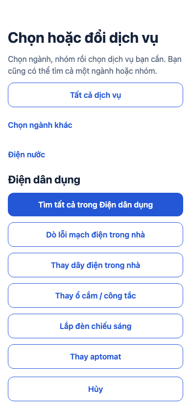
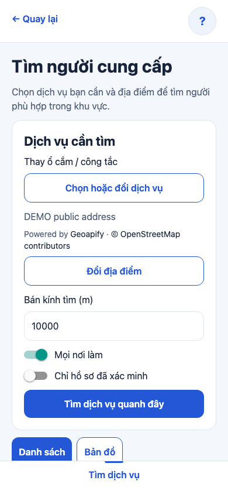
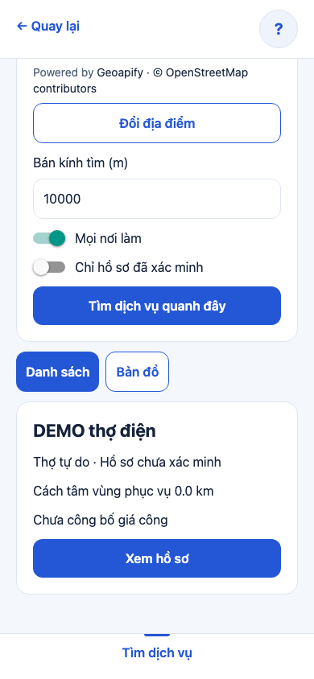
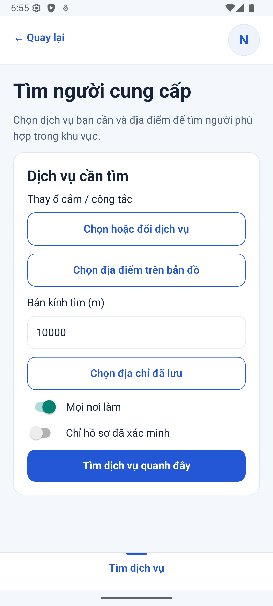
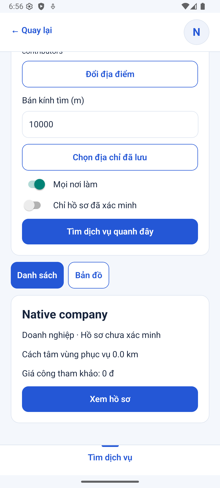
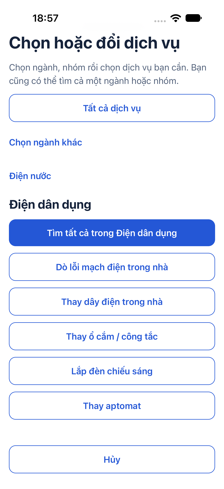
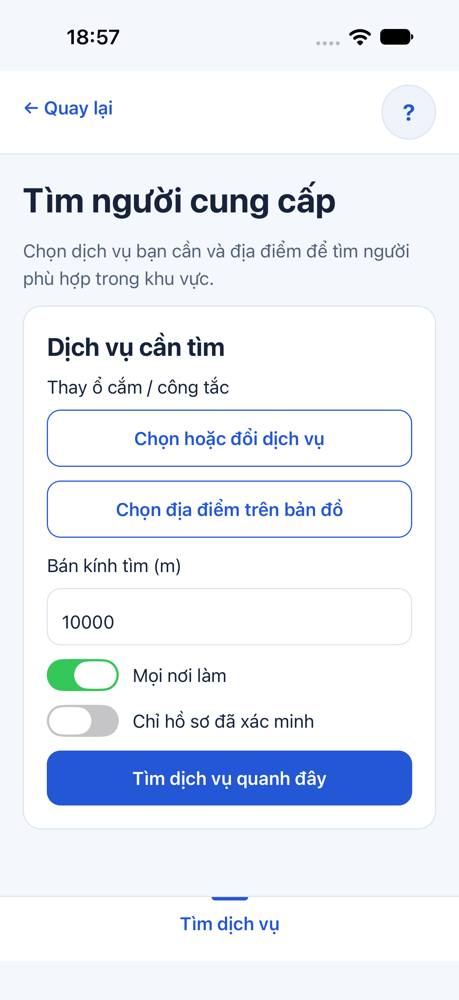
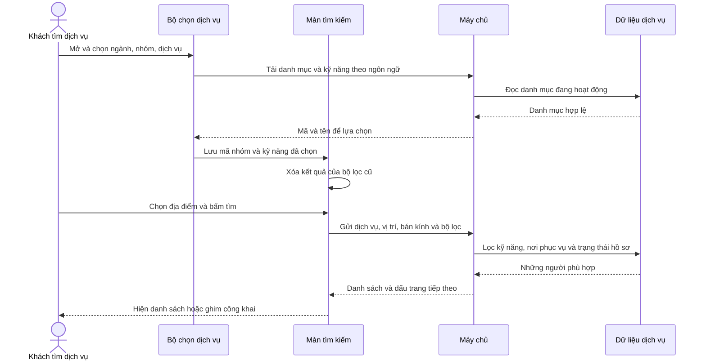

# B03-05 — Chọn đúng dịch vụ trước khi tìm người phù hợp

**Cập nhật push 07/10/2026:** code đã lên `main` tại `293b073`; [CI 37604427549](https://github.com/anhthaingd/dich-vu-quanh-ban/actions/runs/37604427549) đạt cả 3 job: app/build, API/PostGIS, web E2E. Các ghi chú “chưa commit/push/CI” bên dưới là mốc kiểm local trước khi push; kết quả CI này xác nhận đúng commit `293b073`. Chưa UAT hoặc phát hành production.

B03 / sửa thiếu sót P0-1 · 07/10/2026 · Theo phản hồi của chủ dự án. Đây là sửa code để khớp spec đã chốt, không thay API hoặc nghiệp vụ; không đồng bộ lại Excel/Drive.

## Bạn dùng được gì?

Vào **Tìm dịch vụ → Chọn hoặc đổi dịch vụ**, chọn **ngành → nhóm → dịch vụ**, chẳng hạn **Điện nước → Điện dân dụng → Thay ổ cắm / công tắc**. Sau đó chọn địa điểm và bấm tìm. Người chỉ cung cấp sửa nước sẽ không xuất hiện trong kết quả thay ổ cắm, dù cùng khu vực.

Bạn có thể tìm tất cả dịch vụ trong một ngành/nhóm, hoặc chọn **Tất cả dịch vụ** để bỏ bộ lọc. Màn tìm luôn hiện lựa chọn hiện tại. Khi đổi dịch vụ, vị trí hoặc bộ lọc, kết quả cũ được xóa; bấm tìm để lấy kết quả mới. Bấm **Hủy** trong bộ chọn giữ nguyên lựa chọn trước đó. Mở tìm kiếm từ một kỹ năng trong danh mục vẫn giữ sẵn kỹ năng đó.

**Nguyên nhân thiếu sót:** [spec UX, mục Địa chỉ và tìm kiếm](../../../ui-ux/specs/ux-scope-current.md) đã quy định lọc ngành/kỹ năng. Backend cũng đã lọc theo `category_id`/`skill_id`. Tuy nhiên màn tìm trước đây chỉ nhận hai ID qua đường đi từ danh mục, không có điều khiển chọn/đổi chúng. Vì thế nút tìm ở trang chủ đi vào màn tìm mọi dịch vụ. Báo cáo P0-1 trước đây mô tả phần đã làm nhưng chưa nêu rõ thiếu sót giao diện này; báo cáo này bổ sung và sửa nó.

## Ảnh app và cách thử

Ảnh web app chạy cùng API/DB test riêng, khung 390 px, ngày 07/10/2026. Hai hồ sơ DEMO ở cùng vị trí và có hai kỹ năng khác nhau. Địa điểm trong bài kiểm dùng fixture tra địa chỉ; bài này kiểm lọc dịch vụ, không kiểm lại nhà cung cấp bản đồ thật.

| Chọn dịch vụ | Lựa chọn trước khi tìm | Kết quả chỉ có thợ phù hợp |
|---|---|---|
|  |  |  |

Ảnh native ngày 07/10/2026: Android emulator kiểm chọn kỹ năng → địa điểm → tìm → mở hồ sơ với API/DB test; iOS simulator kiểm chọn ngành/nhóm/kỹ năng, hủy giữ lựa chọn và bỏ lọc. Chưa kiểm luồng tìm kết quả bằng bộ chọn mới trên iOS trong lượt này.

| Android — dịch vụ đã chọn | Android — kết quả | iOS — chọn kỹ năng | iOS — đã chọn |
|---|---|---|---|
|  |  |  |  |

## Một thao tác đi qua app thế nào?

“ID” là mã ổn định của ngành/nhóm/kỹ năng trong dữ liệu. App gửi mã này thay vì tên hiển thị, vì cùng một dịch vụ có thể có tên tiếng Việt, Anh hoặc Nhật.

Sơ đồ là đường thành công. Bộ chọn lỗi tải danh mục thì hiện **Thử lại**, không tự đổi thành tìm tất cả. Khi đóng bộ chọn hoặc đổi ngôn ngữ, phản hồi cũ không được ghi đè dữ liệu mới. Tên được đọc theo ngôn ngữ hiện tại, còn mã dịch vụ giữ nguyên.

## Đọc code theo thứ tự

| Bước | File và hàm thật | Nhận gì, làm gì, chuyển gì? |
|---|---|---|
| 1 | [CatalogScreen.tsx](../../../apps/mobile/src/features/catalog/screens/CatalogScreen.tsx), `CatalogScreen` | Nút tìm chung chuyển mã nhóm nếu có; bấm kỹ năng chuyển thêm mã kỹ năng sang màn tìm. |
| 2 | [ServiceFilter.tsx](../../../apps/mobile/src/features/search/components/ServiceFilter.tsx), `ServiceFilter`, `choose` | Nhận lựa chọn hiện tại. Tải ngành/nhóm theo cấu trúc danh mục hai cấp hiện hành và kỹ năng của nhóm đang xem. Chỉ gọi `onChange` khi chọn một dịch vụ/nhóm hoặc bỏ bộ lọc; duyệt nhóm và hủy chưa đổi tiêu chí tìm. |
| 3 | [catalog-api.ts](../../../apps/mobile/src/features/catalog/api/catalog-api.ts), `createCatalogApi`, `all` | Nhận mã ngành/nhóm và ngôn ngữ; đọc đủ các trang danh mục từ API, kiểm dữ liệu phản hồi. Không gắn cứng tên dịch vụ trong UI. |
| 4 | [SearchScreen.tsx](../../../apps/mobile/src/features/search/screens/SearchScreen.tsx), `SearchScreen`, `submit` | Nhớ mã dịch vụ trong `service`, nhận điểm từ bộ chọn địa điểm; kiểm bán kính rồi gửi `skill_id`, `category_id` và các bộ lọc. Khi tiêu chí đổi, gọi `search.reset`. |
| 5 | [partner-search.ts](../../../apps/mobile/src/features/search/state/partner-search.ts), `PartnerSearch.reset`, `search`, `load` | Hủy yêu cầu cũ, xóa danh sách và dấu phân trang cũ. Gọi API với đúng tiêu chí; bỏ phản hồi của lượt tìm đã bị thay thế. “Cursor” là dấu để máy chủ biết trang kế tiếp của chính bộ lọc này. |
| 6 | [search.service.ts](../../../services/api/src/modules/search/search.service.ts), `SearchService.list` | Lọc đúng kỹ năng/nhóm và chế độ phục vụ trên cùng kỹ năng. Chỉ hồ sơ đã công bố, đang nhận việc, hợp lệ và nằm trong phạm vi phục vụ mới được trả lại. Quyền/trạng thái tiếp tục do backend quyết định. |

## Dữ liệu và lỗi

Bộ lọc chỉ lưu tạm trong màn, không sửa hồ sơ hay dữ liệu DB. Ngành/nhóm lấy từ API danh mục; kỹ năng chỉ tải cho mục đang xem. Giao diện giữ mã khi đổi ngôn ngữ. Danh mục hiện có hai cấp **ngành → nhóm**, sau đó là kỹ năng; chưa triển khai cây danh mục sâu tùy ý.

Không yêu cầu đăng nhập để chọn dịch vụ và tìm người. Các cổng đăng nhập/liên hệ/thuê hiện có giữ nguyên. Lỗi mạng khi tìm có nút thử lại cùng tiêu chí; đổi tiêu chí xóa cả lỗi và kết quả cũ. Hủy yêu cầu đang chạy giúp tránh việc kết quả dịch vụ cũ xuất hiện dưới tên dịch vụ mới.

## Tự thử và học code

1. Mở tìm từ trang chủ. Chọn một kỹ năng, chọn địa điểm rồi tìm. Nếu chưa có người cung cấp đúng kỹ năng tại đó, kết quả rỗng là hợp lệ.
2. Đổi sang kỹ năng khác: danh sách cũ phải biến mất trước khi bấm tìm lại. Địa điểm vẫn giữ.
3. Mở bộ chọn, duyệt sang nhóm khác rồi **Hủy**: tên dịch vụ đang chọn không đổi. Chọn **Tất cả dịch vụ** thì bỏ cả mã nhóm lẫn kỹ năng.

- Vì sao không gửi chữ “Thay ổ cắm” để lọc? Vì mã ổn định khi tên/ngôn ngữ thay đổi; xem `submit`.
- Vì sao thay ngành không được giữ kỹ năng cũ? Kỹ năng có thể thuộc ngành khác; `choose` gửi lựa chọn mới đầy đủ, không trộn bộ lọc cũ.
- Người chỉ làm sửa nước nhưng đứng gần hơn có xuất hiện khi tìm thay ổ cắm không? Không; `matched_skills` lọc trước khi tính/sắp khoảng cách.

## Kiểm thử và phạm vi

- Mobile: 176 bài kiểm trong 37 bộ đạt; bao gồm chọn ngành/nhóm/kỹ năng, hủy/bỏ lọc, lỗi tải và phản hồi ngôn ngữ cũ. Bổ sung kiểm API/màn công việc và chat trước push: ba cách phục vụ, phiên bản xung đột, giữ khóa thử lại, quyền bị thu hồi, ghép trang tin và đọc watermark.
- Coverage app đạt ngưỡng CI: dòng 86,08%, nhánh 79,29%; phần HTTP/logging cốt lõi đạt 100% dòng, 94,17% nhánh. Đây là số toàn bộ app, không phải riêng bộ chọn.
- API: 74 bài unit/integration đạt; coverage phần app 92,12% dòng / 87,37% nhánh. Bộ lọc phía máy chủ đã có từ P0-1 và không bị sửa trong đợt này.
- Typecheck, lint, tooling và build mọi nền tảng đạt local.
- Web: 13 ca hồi quy đạt tổng hợp. Lượt toàn bộ có 12 ca đạt, một ca i18n lỗi môi trường do chạy build dọn thư mục API cùng lúc; đã chạy riêng lại sau build và đạt. Ca mới dùng hai người cùng khu vực khác nghề, kiểm tham số gửi và kết quả thực.
- Android emulator: luồng partners đạt 4 phút 29 giây, có thêm chọn dịch vụ trước khi tìm và mở hồ sơ. iOS simulator: luồng search-service đạt 27 giây, gồm chọn, hủy giữ lựa chọn và bỏ lọc. Các luồng mới không đồng nghĩa kiểm lại toàn bộ app native.
- Chưa có UAT của chủ dự án hoặc kiểm trên điện thoại thật. OTP/WebSocket vẫn Pending; P0-3 hóa đơn/tiền test chưa triển khai.

Lệnh và bằng chứng kỹ thuật

- `npm run test:coverage -w apps/mobile`
- `npm run test:coverage -w services/api`
- `npm run typecheck`, `npm run lint`, `npm run test:tooling`, `npm run build`
- `npx playwright test --config tests/e2e/web/playwright.config.mjs`
- Bài kiểm: [ServiceFilter.test.tsx](../../../apps/mobile/src/features/search/components/ServiceFilter.test.tsx), [search-service.spec.mjs](../../../tests/e2e/web/search-service.spec.mjs), [Work.test.tsx](../../../apps/mobile/src/features/jobs/screens/Work.test.tsx), [work-api.test.ts](../../../apps/mobile/src/features/jobs/api/work-api.test.ts).
- Log local trong `.local/search-fix/`, coverage và kết quả native/web trong `coverage/` và `test-results/`; các thư mục này không lưu Git. Có thể chạy lại bằng các lệnh trên.
- Ảnh chụp và báo cáo lưu repo. Mermaid được render trước bàn giao; bản render kiểm tra chỉ nằm trong `.local/search-fix/`.

