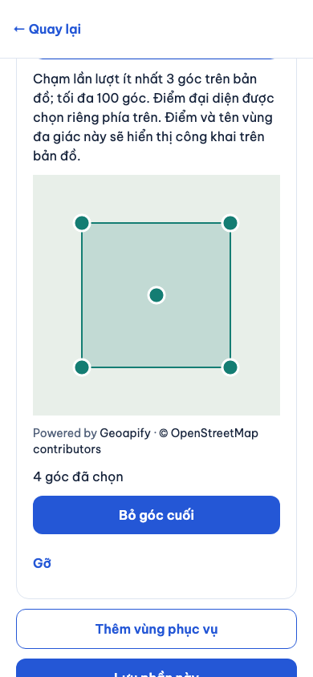
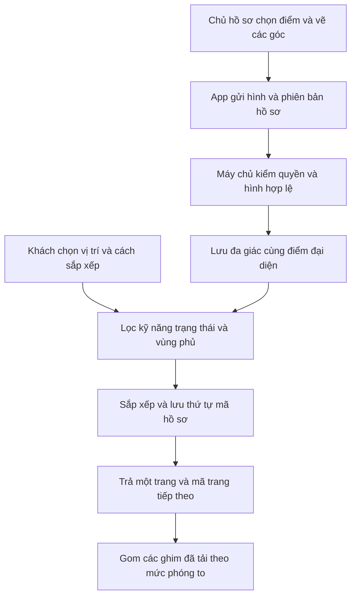

# B03-06 — Vùng đa giác, gom cụm bản đồ và xếp hạng

20/10/2026 · P1-06 · Code trên nền `f7eb929`, chưa commit/push đợt này. [Quyết định đã duyệt](../de-xuat/P1-06-hoan-thien-cung-dot.md).

## Bạn dùng được gì?

Trong hồ sơ → Vùng phục vụ, chủ hồ sơ chọn điểm đại diện rồi bấm **Vẽ vùng đa giác**. Chạm 3–100 góc theo thứ tự, có thể bỏ góc cuối hoặc trở về vùng tròn. Máy chủ kiểm hình hợp lệ trước khi lưu. Điểm đại diện không tự suy từ tâm hình; với đa giác mới, tên vùng và điểm đại diện có thể xuất hiện công khai trên bản đồ kết quả.

Màn tìm có ba lựa chọn: gần nhất, sao cao nhất và đề xuất. Đề xuất ưu tiên hồ sơ đã xác minh, rồi số sao, số đánh giá, khoảng cách. Bản đồ gom các điểm gần nhau theo mức phóng to; bấm cụm vẫn chọn được từng hồ sơ đã tải.

Expo web thật, Chromium khung điện thoại, 20/10/2026. API/PostGIS thật trong DB test. Nền bản đồ và tìm địa chỉ được fixture thay bằng dữ liệu DEMO để test ổn định; thao tác vẽ, lưu, tìm và quyền dùng code sản phẩm. Không phải bằng chứng Geoapify live hoặc native mới.

## Luồng từ vẽ đến tìm

## Mở code theo thứ tự

| File và hàm | Vai trò cụ thể |
|---|---|
| [PolygonEditor.tsx](../../../apps/mobile/src/features/partners/components/PolygonEditor.tsx) | Lưu tạm các góc do người dùng chạm, hỗ trợ hoàn tác; kéo bản đồ không thêm góc. |
| [map-model.ts](../../../apps/mobile/src/features/location/components/map-model.ts), `mapFeatures` | Biến góc thành vùng tô và ghim để MapLibre vẽ trên web/native. |
| [partners.input.ts](../../../services/api/src/modules/partners/partners.input.ts), `polygonInput` | Kiểm tọa độ, số góc, vòng đóng, góc trùng, hình MultiPolygon một vùng không có lỗ. |
| [partners.service.ts](../../../services/api/src/modules/partners/partners.service.ts), `edit` | Kiểm hình bằng PostGIS rồi thay vùng trong giao dịch; lỗi làm toàn bộ lần sửa quay lại. |
| [search.service.ts](../../../services/api/src/modules/search/search.service.ts), `list` | Lọc trước xếp hạng, lưu thứ tự mã vào `search_snapshots`; mỗi trang vẫn kiểm trạng thái/địa lý và trả dữ liệu công khai hiện hành. |
| [results-map-model.ts](../../../apps/mobile/src/features/search/components/results-map-model.ts), `clusterPins` | Gom điểm theo ô 52 pixel trong phép chiếu bản đồ, tách khi phóng to; không tự tải toàn bộ kết quả. |

## Dữ liệu, phân trang và lỗi

PostGIS là phần PostgreSQL xử lý địa lý. Vùng tròn dùng `center/radius_m`; đa giác dùng `boundary`, giữ `center` làm điểm đại diện và bán kính lưu là null. Địa điểm nhận việc được kiểm bằng vùng phủ, không dùng bán kính nháp của đa giác. Hồ sơ cũ có đa giác nhưng chưa có điểm đại diện không được tự gán tâm khi migration.

Snapshot chỉ lưu thứ tự mã hồ sơ, sống 15 phút. Khi sao/xác minh đổi, trang sau giữ thứ tự của lần tìm đầu; hồ sơ ngừng hoạt động vẫn bị loại ngay. Tìm lại tạo thứ tự mới. Cursor ký gắn bộ lọc/cách sắp xếp; hết hạn hoặc sửa cursor thì tìm lại. Cách hiện tại truy vấn lại tập ứng viên trên mỗi trang, cần đo tải thực trước production.

Hình tự cắt, không đủ góc hoặc tọa độ sai bị từ chối. App giữ bản nháp để sửa; xung đột phiên bản phải tải lại. Mất nền bản đồ vẫn giữ danh sách kết quả và thông báo lỗi.

## Tự thử, bằng chứng và giới hạn

Vẽ vùng bao quanh vị trí tìm, lưu và công bố; tìm bên trong rồi bên ngoài. Vì sao điểm đại diện nằm gần vẫn chưa đủ để nhận việc? Địa chỉ phải nằm trong đa giác. Vì sao đổi sao giữa hai trang không đưa hồ sơ xuất hiện lần hai? Trang dựa vào thứ tự mã đã lưu.

- Integration `partners.test.ts`: đa giác hợp lệ/tự cắt, lọc vùng, điểm đã chọn, snapshot/ranking/quyền hiển thị và hết hạn.
- Jest: gom/tách cụm theo zoom, không mất hoặc nhân đôi hồ sơ.
- Playwright `partners.spec.mjs` và `search-map.spec.mjs`: vẽ/lưu/tìm thật, chọn hồ sơ trong cụm và giữ riêng địa chỉ không công khai.
- SDD `SDD-PROJECT` giữ toàn bộ tiêu chí cũ. Chưa có lượt native/thiết bị thật, tải production hoặc UAT cho phần mới. Chưa CI mới, chưa push, chưa đồng bộ Drive/ui-ux.
